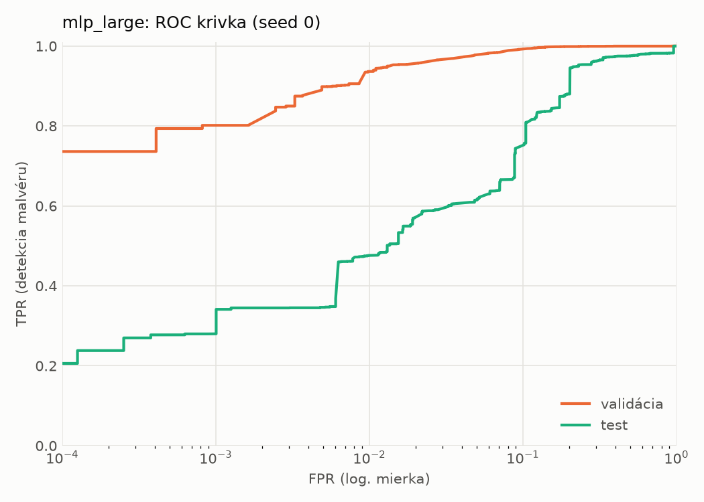
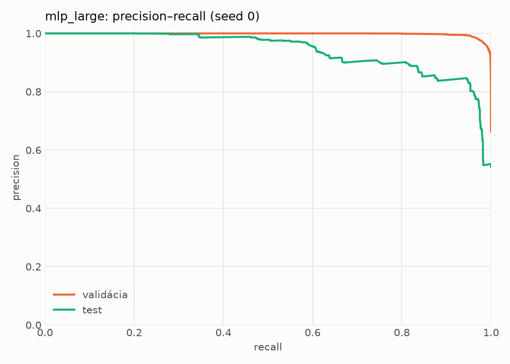
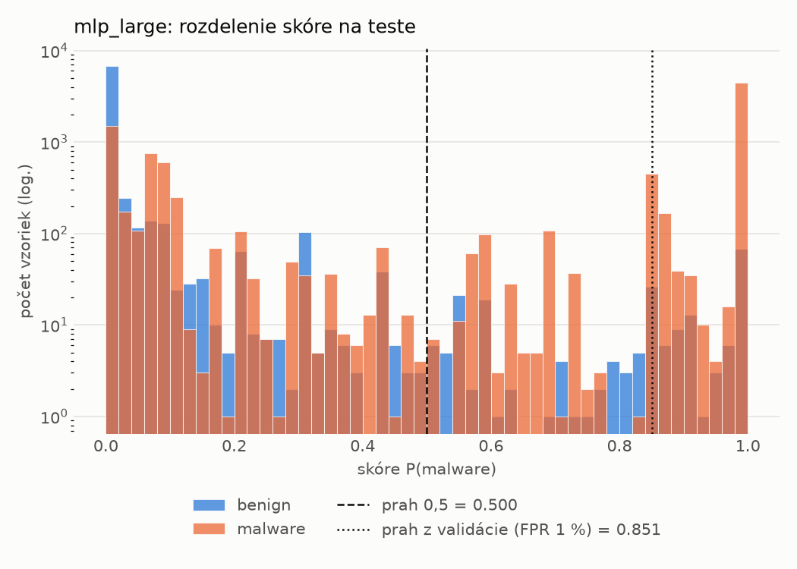
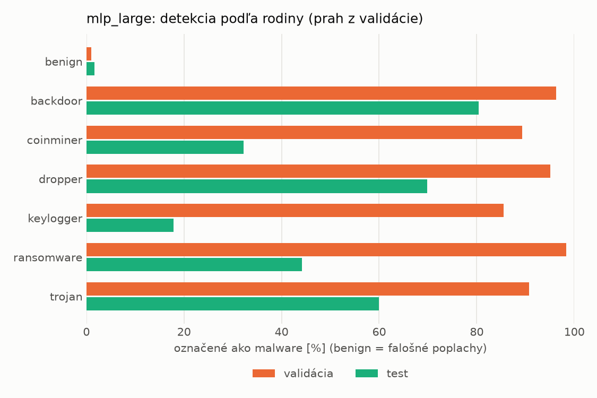
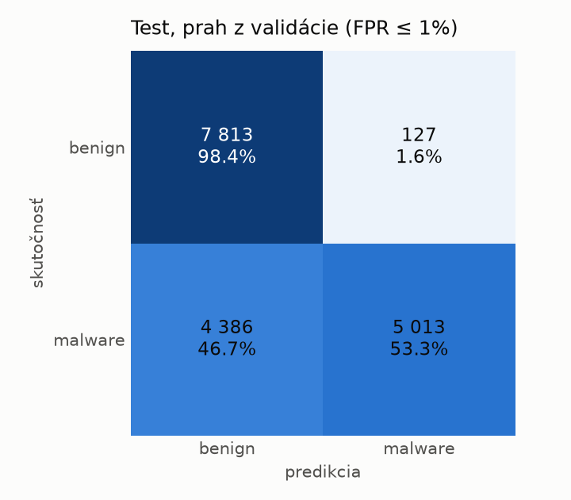
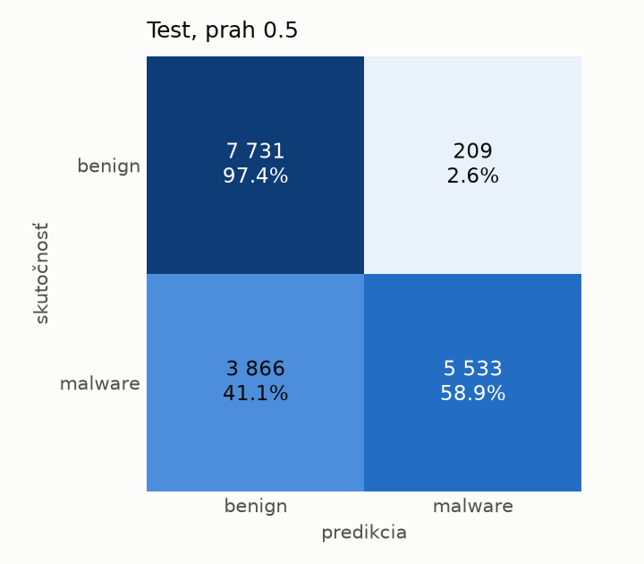
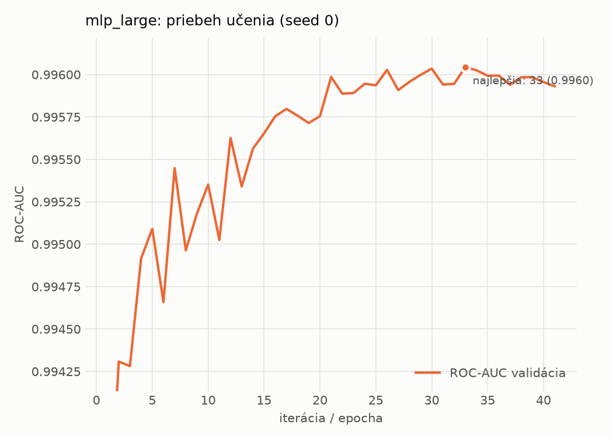

# dynamic/mlp_large – beh `20261104-081843`

> Automaticky generované (`src/training/run_tabular.py`). Konfigurácia: `config.yaml`, protokol: `protocol.yaml`.

- **Model:** `mlp` – veľká neurónová sieť (3–5 skrytých vrstiev, 512–2048 neurónov), kandidát na učiteľa
- **Ladenie:** bez ladenia – hyperparametre prevzaté z `runs_final/dynamic/mlp_large/20261102-005920`
- **Finálne modely:** seedy [0, 1, 2]; hodnoty sú priemer ± smerodajná odchýlka cez seedy
- **Najlepšie hyperparametre:** `{"max_epochs": 100, "patience": 8, "hidden_layers": 3, "hidden_width": 512, "width_decay": 0.5, "dropout": 0.3735687797102123, "lr": 0.00020669709962675654, "weight_decay": 1.4747439017290252e-05, "batch_size": 256}`

## Detekčná kvalita (bez prahu)
| metrika | train (podvzorka) | validácia | test |
|---|---|---|---|
| ROC-AUC | 0.9974 ± 0.0000 | 0.9961 ± 0.0000 | 0.9190 ± 0.0056 |
| PR-AUC | 0.9986 ± 0.0000 | 0.9980 ± 0.0000 | 0.9371 ± 0.0031 |
| TPR pri FPR 1 % | 0.9423 ± 0.0005 | 0.9383 ± 0.0038 | 0.4824 ± 0.0065 |
| TPR pri FPR 0,1 % | 0.8958 ± 0.0009 | 0.8010 ± 0.0022 | 0.3051 ± 0.0331 |
| log loss | 0.0634 ± 0.0000 | 0.0806 ± 0.0010 | 0.9123 ± 0.0345 |
| Brier skóre | 0.0203 ± 0.0000 | 0.0232 ± 0.0001 | 0.2029 ± 0.0064 |

Rozdiel ROC-AUC train − validácia: **0.0014** (veľký rozdiel = preučenie).

## Pri prahu z validácie (FPR ≤ 1% na validácii)
| metrika | train (podvzorka) | validácia | test |
|---|---|---|---|
| accuracy | 0.9530 ± 0.0025 | 0.9558 ± 0.0025 | 0.7404 ± 0.0086 |
| balanced accuracy | 0.9624 ± 0.0017 | 0.9642 ± 0.0019 | 0.7594 ± 0.0079 |
| precision | 0.9956 ± 0.0004 | 0.9947 ± 0.0000 | 0.9763 ± 0.0013 |
| recall (TPR) | 0.9327 ± 0.0042 | 0.9383 ± 0.0038 | 0.5341 ± 0.0168 |
| FPR | 0.0079 ± 0.0008 | 0.0098 ± 0.0000 | 0.0154 ± 0.0012 |
| F1 | 0.9631 ± 0.0021 | 0.9657 ± 0.0020 | 0.6904 ± 0.0138 |
| MCC | 0.9022 ± 0.0047 | 0.9067 ± 0.0049 | 0.5659 ± 0.0119 |

## Pri pevnom prahu 0.5
| metrika | train (podvzorka) | validácia | test |
|---|---|---|---|
| accuracy | 0.9682 ± 0.0003 | 0.9646 ± 0.0002 | 0.7648 ± 0.0065 |
| balanced accuracy | 0.9722 ± 0.0001 | 0.9681 ± 0.0002 | 0.7812 ± 0.0060 |
| precision | 0.9919 ± 0.0004 | 0.9889 ± 0.0003 | 0.9665 ± 0.0026 |
| recall (TPR) | 0.9596 ± 0.0008 | 0.9574 ± 0.0004 | 0.5864 ± 0.0128 |
| FPR | 0.0151 ± 0.0008 | 0.0212 ± 0.0006 | 0.0241 ± 0.0021 |
| F1 | 0.9755 ± 0.0002 | 0.9729 ± 0.0001 | 0.7299 ± 0.0098 |
| MCC | 0.9315 ± 0.0004 | 0.9230 ± 0.0003 | 0.5964 ± 0.0093 |

## Výpočtové nároky (seed 0, testovacia množina)
| meranie | hodnota |
|---|---|
| tréning finálneho modelu | 24.0 s (priemer cez seedy) |
| ladenie spolu | 0 s |
| počet parametrov / uzlov | 1 190 657 |
| veľkosť modelu na disku | 4.83 MB |
| transformácia vstupu – latencia (1 vlákno) | 0.034 ms |
| transformácia vstupu – priepustnosť | 48 296 vzoriek/s |
| CPU latencia modelu (batch 1, 1 vlákno) | 0.199 ms (p95 0.216) |
| CPU priepustnosť (24 vlákien) | 76 112 vzoriek/s |
| GPU latencia (batch 1) | 0.418 ms (p95 1.367) |
| GPU priepustnosť | 110 167 vzoriek/s |
| GPU špičková pamäť | 1360 MB |

## Grafy
| | |
|---|---|
|  |  |
|  |  |
|  |  |
|  |  |

## Súbory
`metrics.json` (všetky metriky po seedoch vrátane rodín), `timing.json`, `hpo_trials.csv`,
`predictions/<časť>_seed<N>.parquet` (sha256, family, label, score), `model/seed_<N>/`, `log.txt`.
