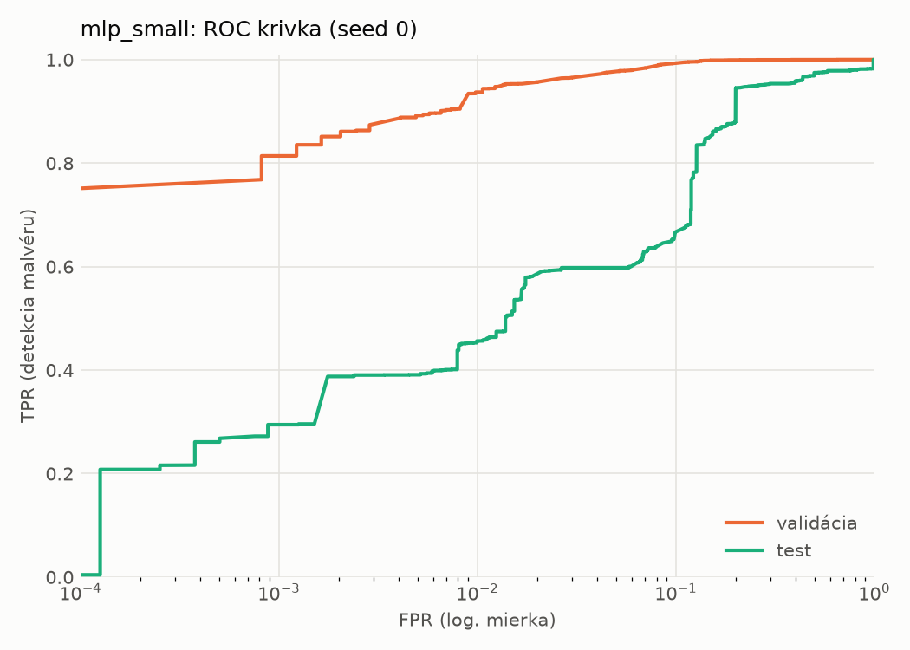
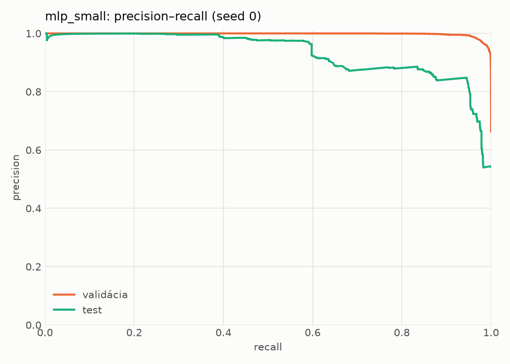
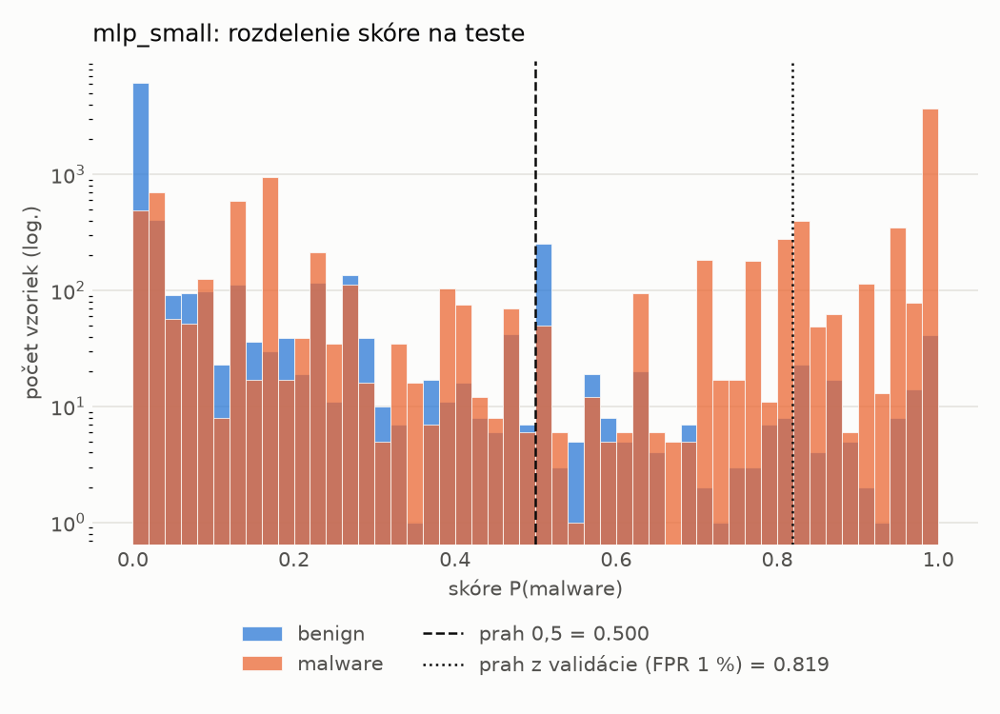
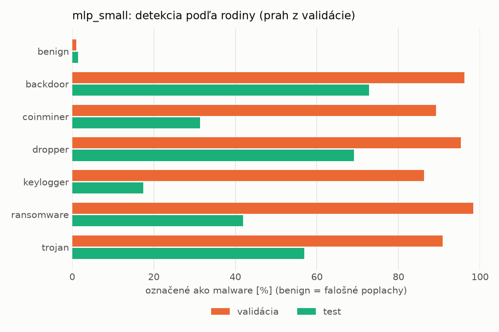
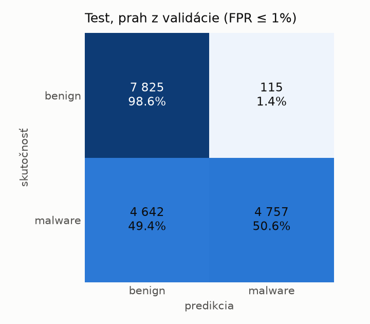
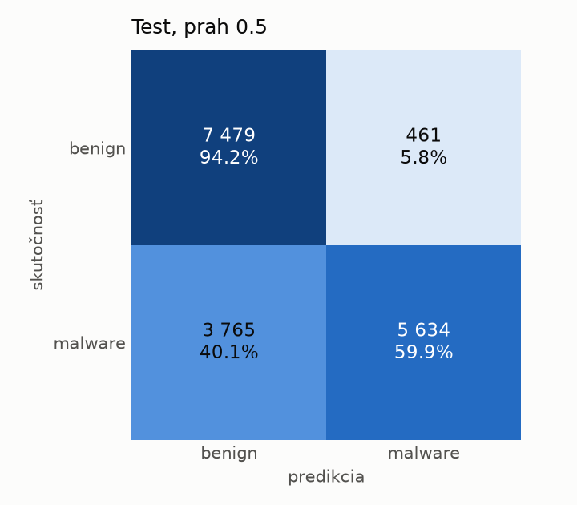
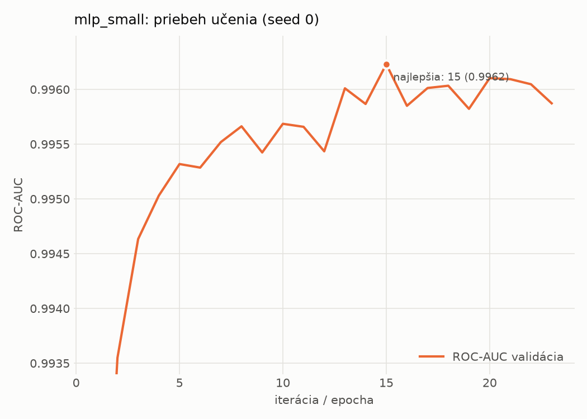

# dynamic/mlp_small – beh `20261104-081822`

> Automaticky generované (`src/training/run_tabular.py`). Konfigurácia: `config.yaml`, protokol: `protocol.yaml`.

- **Model:** `mlp` – malá neurónová sieť (1–2 skryté vrstvy), kandidát na ľahkého študenta
- **Ladenie:** bez ladenia – hyperparametre prevzaté z `runs_final/dynamic/mlp_small/20261102-005611`
- **Finálne modely:** seedy [0, 1, 2]; hodnoty sú priemer ± smerodajná odchýlka cez seedy
- **Najlepšie hyperparametre:** `{"width_decay": 0.5, "max_epochs": 100, "patience": 8, "hidden_layers": 2, "hidden_width": 256, "dropout": 0.194338644844741, "lr": 0.0002516607127550297, "weight_decay": 0.0020651425578959264, "batch_size": 1024}`

## Detekčná kvalita (bez prahu)
| metrika | train (podvzorka) | validácia | test |
|---|---|---|---|
| ROC-AUC | 0.9974 ± 0.0002 | 0.9963 ± 0.0001 | 0.9056 ± 0.0100 |
| PR-AUC | 0.9986 ± 0.0001 | 0.9981 ± 0.0000 | 0.9281 ± 0.0063 |
| TPR pri FPR 1 % | 0.9432 ± 0.0004 | 0.9351 ± 0.0017 | 0.4569 ± 0.0011 |
| TPR pri FPR 0,1 % | 0.8922 ± 0.0014 | 0.8142 ± 0.0149 | 0.2873 ± 0.0069 |
| log loss | 0.0646 ± 0.0024 | 0.0773 ± 0.0008 | 0.7848 ± 0.0842 |
| Brier skóre | 0.0204 ± 0.0006 | 0.0231 ± 0.0003 | 0.1860 ± 0.0048 |

Rozdiel ROC-AUC train − validácia: **0.0011** (veľký rozdiel = preučenie).

## Pri prahu z validácie (FPR ≤ 1% na validácii)
| metrika | train (podvzorka) | validácia | test |
|---|---|---|---|
| accuracy | 0.9524 ± 0.0016 | 0.9536 ± 0.0011 | 0.7251 ± 0.0009 |
| balanced accuracy | 0.9621 ± 0.0010 | 0.9626 ± 0.0008 | 0.7453 ± 0.0008 |
| precision | 0.9959 ± 0.0007 | 0.9947 ± 0.0000 | 0.9755 ± 0.0018 |
| recall (TPR) | 0.9316 ± 0.0031 | 0.9351 ± 0.0017 | 0.5057 ± 0.0024 |
| FPR | 0.0074 ± 0.0012 | 0.0098 ± 0.0000 | 0.0150 ± 0.0012 |
| F1 | 0.9626 ± 0.0013 | 0.9640 ± 0.0009 | 0.6661 ± 0.0018 |
| MCC | 0.9012 ± 0.0029 | 0.9025 ± 0.0022 | 0.5438 ± 0.0010 |

## Pri pevnom prahu 0.5
| metrika | train (podvzorka) | validácia | test |
|---|---|---|---|
| accuracy | 0.9696 ± 0.0012 | 0.9658 ± 0.0013 | 0.7654 ± 0.0092 |
| balanced accuracy | 0.9728 ± 0.0003 | 0.9685 ± 0.0003 | 0.7807 ± 0.0096 |
| precision | 0.9908 ± 0.0024 | 0.9879 ± 0.0015 | 0.9491 ± 0.0214 |
| recall (TPR) | 0.9628 ± 0.0042 | 0.9603 ± 0.0035 | 0.5996 ± 0.0082 |
| FPR | 0.0173 ± 0.0046 | 0.0232 ± 0.0030 | 0.0383 ± 0.0171 |
| F1 | 0.9766 ± 0.0010 | 0.9739 ± 0.0011 | 0.7349 ± 0.0093 |
| MCC | 0.9342 ± 0.0022 | 0.9253 ± 0.0025 | 0.5894 ± 0.0224 |

## Výpočtové nároky (seed 0, testovacia množina)
| meranie | hodnota |
|---|---|
| tréning finálneho modelu | 4.5 s (priemer cez seedy) |
| ladenie spolu | 0 s |
| počet parametrov / uzlov | 546 049 |
| veľkosť modelu na disku | 2.24 MB |
| transformácia vstupu – latencia (1 vlákno) | 0.034 ms |
| transformácia vstupu – priepustnosť | 44 736 vzoriek/s |
| CPU latencia modelu (batch 1, 1 vlákno) | 0.134 ms (p95 0.157) |
| CPU priepustnosť (24 vlákien) | 87 912 vzoriek/s |
| GPU latencia (batch 1) | 0.626 ms (p95 0.725) |
| GPU priepustnosť | 128 558 vzoriek/s |
| GPU špičková pamäť | 758 MB |

## Grafy
| | |
|---|---|
|  |  |
|  |  |
|  |  |
|  |  |

## Súbory
`metrics.json` (všetky metriky po seedoch vrátane rodín), `timing.json`, `hpo_trials.csv`,
`predictions/<časť>_seed<N>.parquet` (sha256, family, label, score), `model/seed_<N>/`, `log.txt`.
