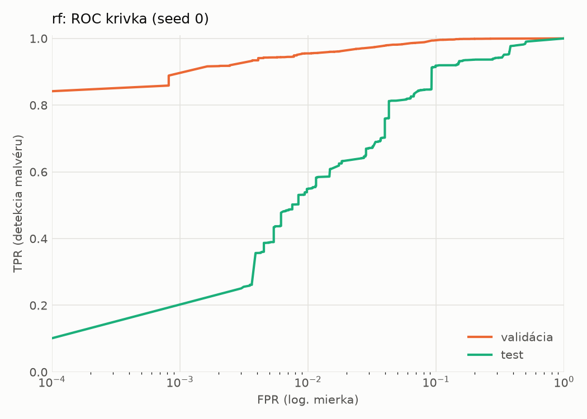
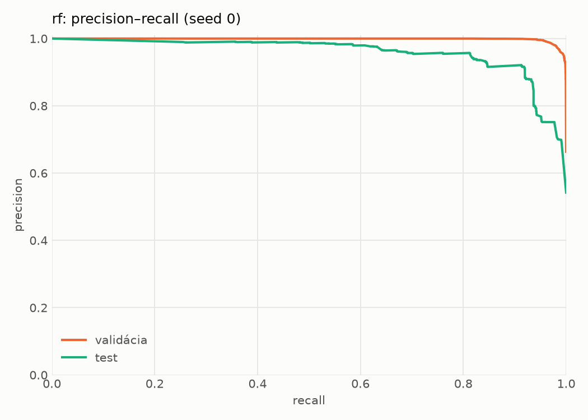
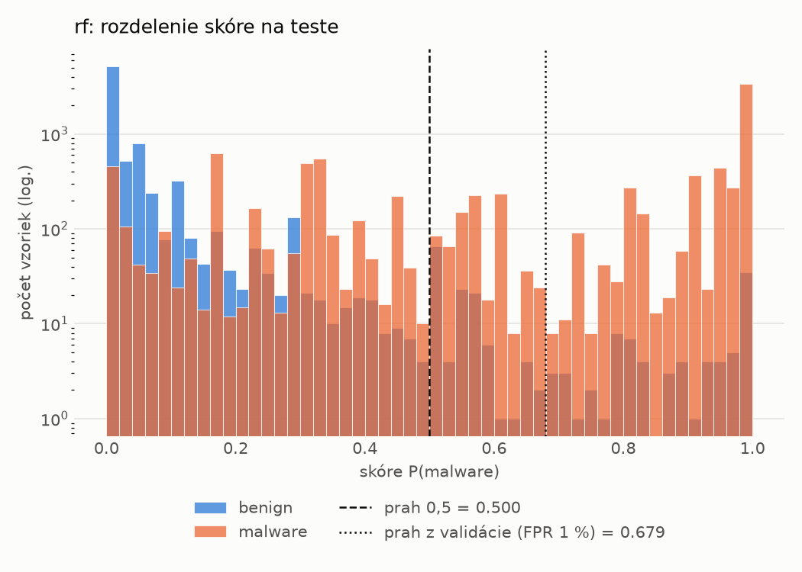
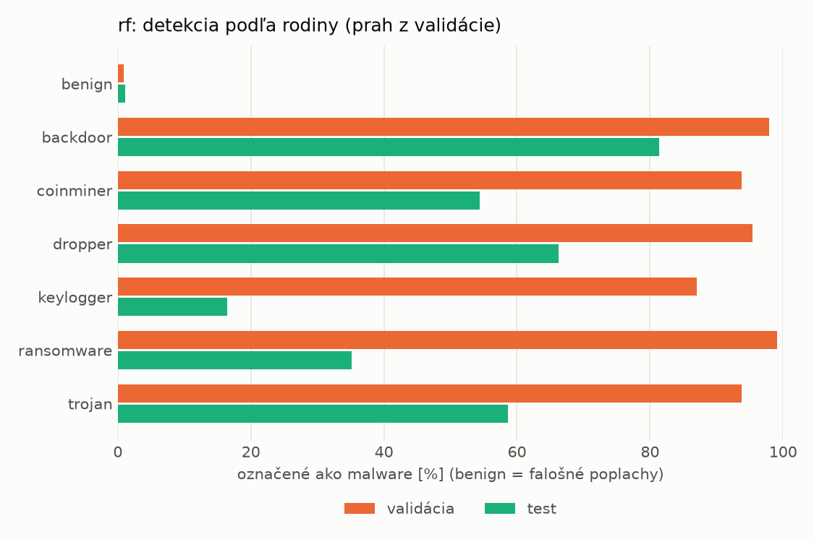
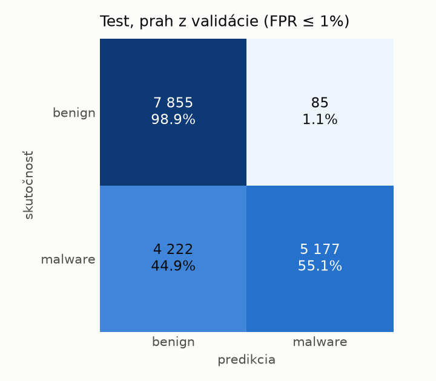
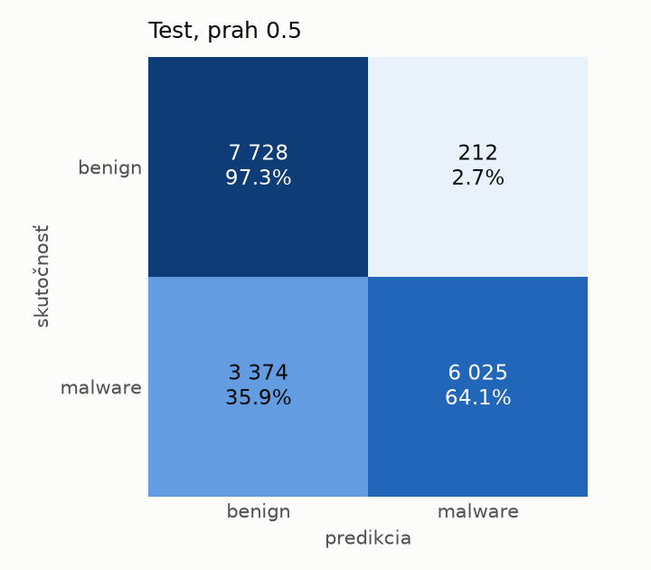

# dynamic/rf – beh `20261104-081447`

> Automaticky generované (`src/training/run_tabular.py`). Konfigurácia: `config.yaml`, protokol: `protocol.yaml`.

- **Model:** `random_forest` – Random Forest (pôvodné hodnoty príznakov)
- **Ladenie:** bez ladenia – hyperparametre prevzaté z `runs_final/dynamic/rf/20261102-003041`
- **Finálne modely:** seedy [0, 1, 2]; hodnoty sú priemer ± smerodajná odchýlka cez seedy
- **Najlepšie hyperparametre:** `{"n_estimators": 450, "max_depth": null, "min_samples_leaf": 1, "max_features": 0.05}`

## Detekčná kvalita (bez prahu)
| metrika | train (podvzorka) | validácia | test |
|---|---|---|---|
| ROC-AUC | 0.9986 ± 0.0000 | 0.9970 ± 0.0000 | 0.9495 ± 0.0010 |
| PR-AUC | 0.9992 ± 0.0000 | 0.9984 ± 0.0000 | 0.9574 ± 0.0004 |
| TPR pri FPR 1 % | 0.9647 ± 0.0000 | 0.9549 ± 0.0002 | 0.5441 ± 0.0056 |
| TPR pri FPR 0,1 % | 0.9364 ± 0.0001 | 0.8801 ± 0.0151 | 0.0000 ± 0.0000 |
| log loss | 0.0491 ± 0.0000 | 0.0699 ± 0.0008 | 0.5429 ± 0.0114 |
| Brier skóre | 0.0158 ± 0.0000 | 0.0202 ± 0.0000 | 0.1387 ± 0.0017 |

Rozdiel ROC-AUC train − validácia: **0.0017** (veľký rozdiel = preučenie).

## Pri prahu z validácie (FPR ≤ 1% na validácii)
| metrika | train (podvzorka) | validácia | test |
|---|---|---|---|
| accuracy | 0.9699 ± 0.0002 | 0.9669 ± 0.0001 | 0.7512 ± 0.0007 |
| balanced accuracy | 0.9761 ± 0.0001 | 0.9728 ± 0.0001 | 0.7697 ± 0.0006 |
| precision | 0.9978 ± 0.0000 | 0.9951 ± 0.0001 | 0.9841 ± 0.0002 |
| recall (TPR) | 0.9563 ± 0.0002 | 0.9549 ± 0.0002 | 0.5499 ± 0.0014 |
| FPR | 0.0041 ± 0.0000 | 0.0093 ± 0.0002 | 0.0105 ± 0.0002 |
| F1 | 0.9766 ± 0.0001 | 0.9746 ± 0.0001 | 0.7056 ± 0.0011 |
| MCC | 0.9360 ± 0.0003 | 0.9290 ± 0.0003 | 0.5848 ± 0.0009 |

## Pri pevnom prahu 0.5
| metrika | train (podvzorka) | validácia | test |
|---|---|---|---|
| accuracy | 0.9748 ± 0.0001 | 0.9686 ± 0.0002 | 0.7903 ± 0.0044 |
| balanced accuracy | 0.9794 ± 0.0000 | 0.9722 ± 0.0002 | 0.8046 ± 0.0040 |
| precision | 0.9969 ± 0.0000 | 0.9911 ± 0.0002 | 0.9669 ± 0.0011 |
| recall (TPR) | 0.9647 ± 0.0001 | 0.9614 ± 0.0000 | 0.6349 ± 0.0092 |
| FPR | 0.0058 ± 0.0000 | 0.0171 ± 0.0005 | 0.0258 ± 0.0013 |
| F1 | 0.9805 ± 0.0000 | 0.9760 ± 0.0001 | 0.7665 ± 0.0064 |
| MCC | 0.9458 ± 0.0001 | 0.9316 ± 0.0004 | 0.6339 ± 0.0060 |

## Výpočtové nároky (seed 0, testovacia množina)
| meranie | hodnota |
|---|---|
| tréning finálneho modelu | 36.6 s (priemer cez seedy) |
| ladenie spolu | 0 s |
| počet parametrov / uzlov | 997 918 |
| veľkosť modelu na disku | 80.28 MB |
| CPU latencia modelu (batch 1, 1 vlákno) | 12.993 ms (p95 13.457) |
| CPU priepustnosť (24 vlákien) | 91 845 vzoriek/s |

## Grafy
| | |
|---|---|
|  |  |
|  |  |
|  |  |
|  |  |

## Súbory
`metrics.json` (všetky metriky po seedoch vrátane rodín), `timing.json`, `hpo_trials.csv`,
`predictions/<časť>_seed<N>.parquet` (sha256, family, label, score), `model/seed_<N>/`, `log.txt`.
