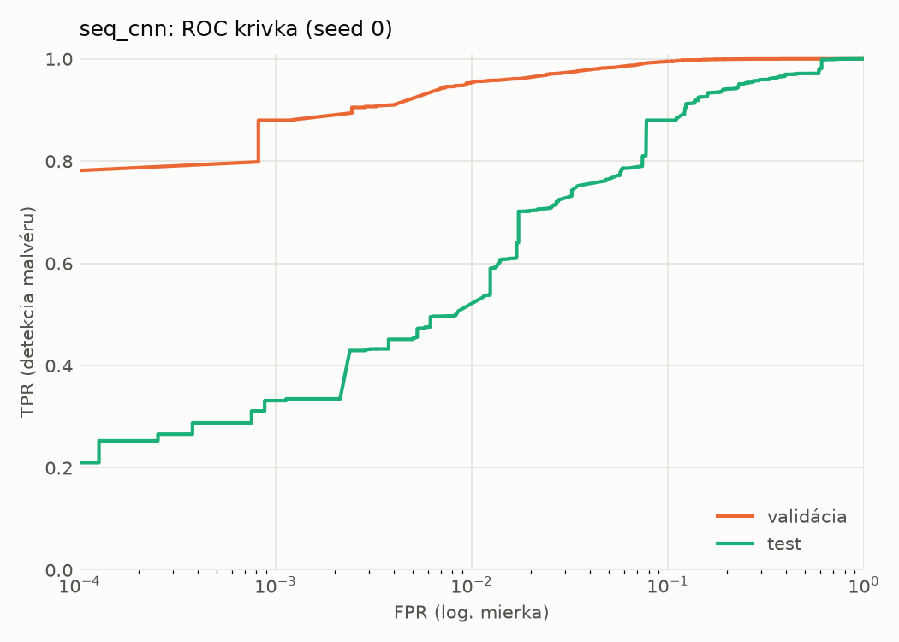
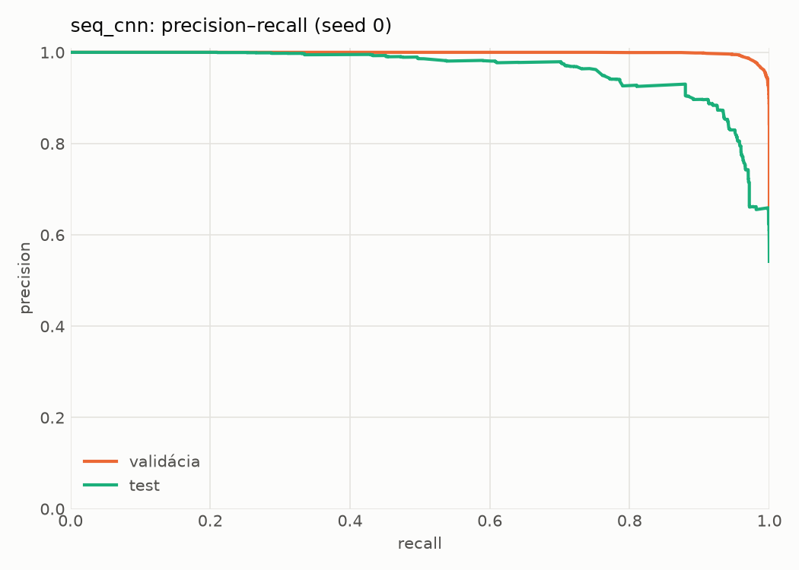
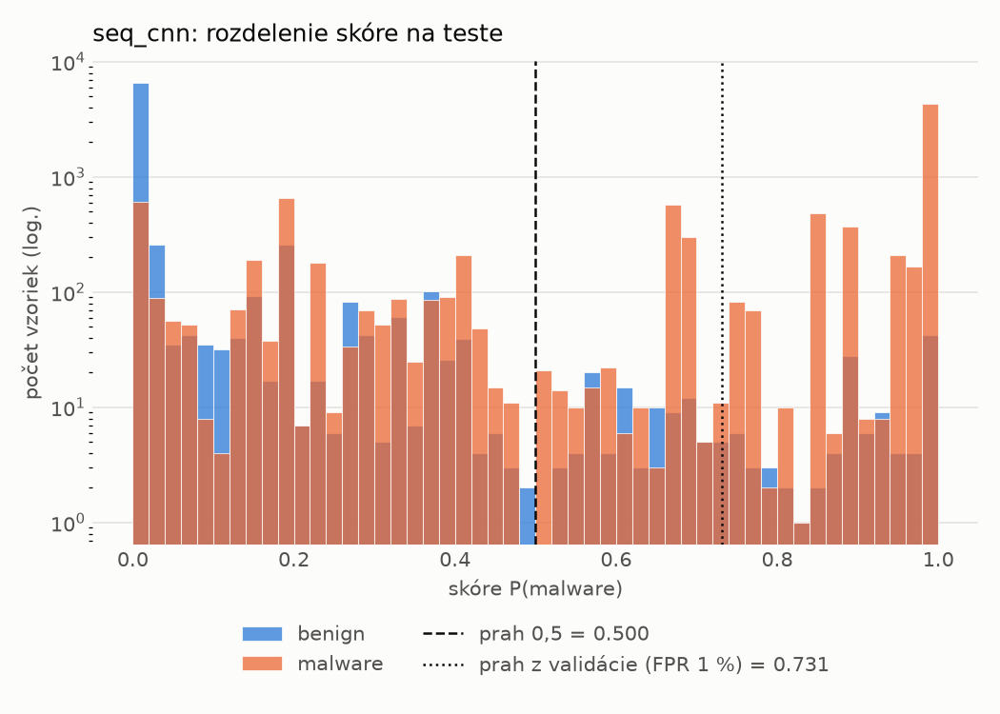
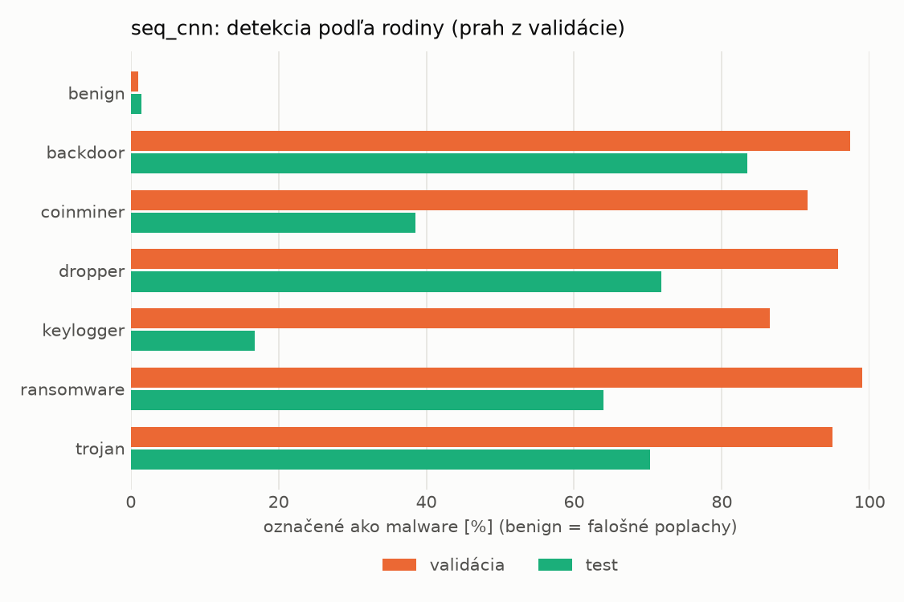
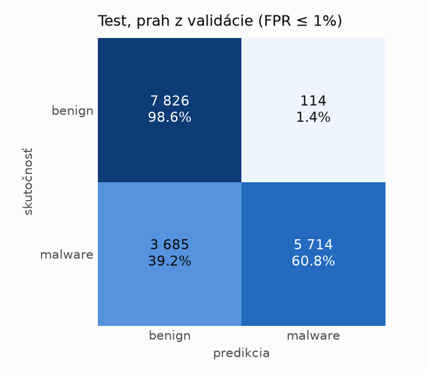
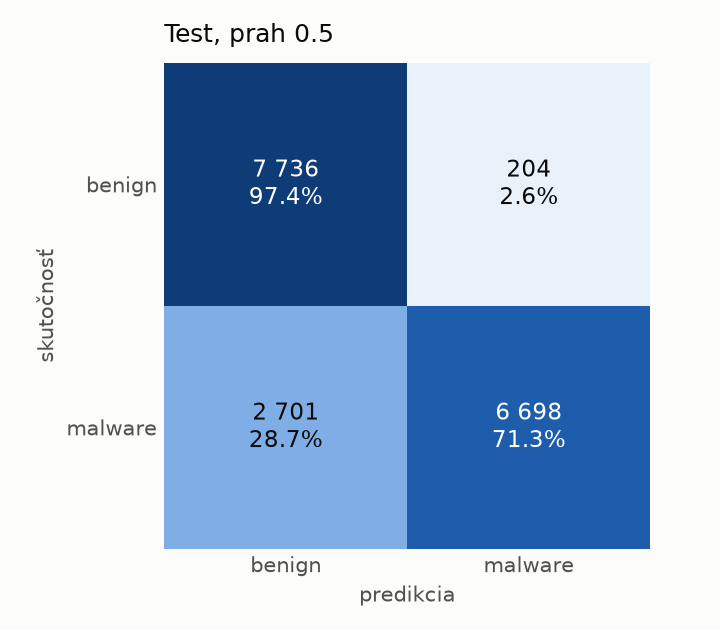
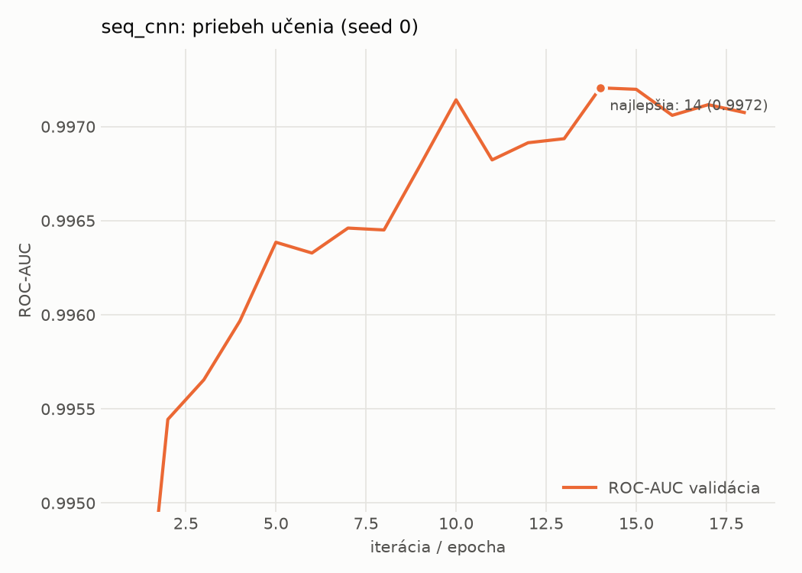

# dynamic_seq/seq_cnn – beh `20261104-165202`

> Automaticky generované (`src/training/run_tabular.py`). Konfigurácia: `config.yaml`, protokol: `protocol.yaml`.

- **Model:** `seq_cnn` – embedding API + paralelné 1D konvolúcie + maximum cez postupnosť
- **Ladenie:** bez ladenia – hyperparametre prevzaté z `runs_final/dynamic/seq_cnn/20261102-010741`
- **Finálne modely:** seedy [0, 1, 2]; hodnoty sú priemer ± smerodajná odchýlka cez seedy
- **Najlepšie hyperparametre:** `{"max_epochs": 30, "patience": 4, "emb_dim": 64, "channels": 128, "kernels": "2-4-8", "hidden": 64, "dropout": 0.19665662644598886, "lr": 0.0005755683530429188, "weight_decay": 0.0005400591881097476, "batch_size": 128}`

## Detekčná kvalita (bez prahu)
| metrika | train (podvzorka) | validácia | test |
|---|---|---|---|
| ROC-AUC | 0.9980 ± 0.0001 | 0.9972 ± 0.0001 | 0.9504 ± 0.0006 |
| PR-AUC | 0.9989 ± 0.0000 | 0.9985 ± 0.0000 | 0.9606 ± 0.0010 |
| TPR pri FPR 1 % | 0.9541 ± 0.0034 | 0.9515 ± 0.0020 | 0.5163 ± 0.0141 |
| TPR pri FPR 0,1 % | 0.9051 ± 0.0004 | 0.8290 ± 0.0541 | 0.3200 ± 0.0139 |
| log loss | 0.0577 ± 0.0009 | 0.0688 ± 0.0005 | 0.5301 ± 0.0173 |
| Brier skóre | 0.0181 ± 0.0002 | 0.0205 ± 0.0003 | 0.1257 ± 0.0014 |

Rozdiel ROC-AUC train − validácia: **0.0009** (veľký rozdiel = preučenie).

## Pri prahu z validácie (FPR ≤ 1% na validácii)
| metrika | train (podvzorka) | validácia | test |
|---|---|---|---|
| accuracy | 0.9631 ± 0.0016 | 0.9645 ± 0.0013 | 0.7916 ± 0.0330 |
| balanced accuracy | 0.9698 ± 0.0014 | 0.9709 ± 0.0010 | 0.8066 ± 0.0303 |
| precision | 0.9952 ± 0.0006 | 0.9948 ± 0.0000 | 0.9804 ± 0.0001 |
| recall (TPR) | 0.9484 ± 0.0019 | 0.9515 ± 0.0020 | 0.6282 ± 0.0622 |
| FPR | 0.0088 ± 0.0010 | 0.0098 ± 0.0000 | 0.0149 ± 0.0015 |
| F1 | 0.9713 ± 0.0013 | 0.9727 ± 0.0010 | 0.7645 ± 0.0455 |
| MCC | 0.9218 ± 0.0033 | 0.9241 ± 0.0026 | 0.6423 ± 0.0490 |

## Pri pevnom prahu 0.5
| metrika | train (podvzorka) | validácia | test |
|---|---|---|---|
| accuracy | 0.9712 ± 0.0002 | 0.9683 ± 0.0003 | 0.8404 ± 0.0080 |
| balanced accuracy | 0.9747 ± 0.0004 | 0.9719 ± 0.0001 | 0.8510 ± 0.0075 |
| precision | 0.9925 ± 0.0009 | 0.9910 ± 0.0004 | 0.9737 ± 0.0029 |
| recall (TPR) | 0.9635 ± 0.0009 | 0.9609 ± 0.0007 | 0.7251 ± 0.0136 |
| FPR | 0.0140 ± 0.0016 | 0.0172 ± 0.0007 | 0.0231 ± 0.0024 |
| F1 | 0.9778 ± 0.0002 | 0.9757 ± 0.0002 | 0.8312 ± 0.0096 |
| MCC | 0.9376 ± 0.0004 | 0.9310 ± 0.0005 | 0.7128 ± 0.0133 |

## Výpočtové nároky (seed 0, testovacia množina)
| meranie | hodnota |
|---|---|
| tréning finálneho modelu | 405.0 s (priemer cez seedy) |
| ladenie spolu | 0 s |
| počet parametrov / uzlov | 209 857 |
| veľkosť modelu na disku | 0.84 MB |
| CPU latencia modelu (batch 1, 1 vlákno) | 2.892 ms (p95 3.558) |
| CPU priepustnosť (24 vlákien) | 1 224 vzoriek/s |
| GPU latencia (batch 1) | 0.762 ms (p95 1.827) |
| GPU priepustnosť | 9 408 vzoriek/s |
| GPU špičková pamäť | 834 MB |

## Grafy
| | |
|---|---|
|  |  |
|  |  |
|  |  |
|  |  |

## Súbory
`metrics.json` (všetky metriky po seedoch vrátane rodín), `timing.json`, `hpo_trials.csv`,
`predictions/<časť>_seed<N>.parquet` (sha256, family, label, score), `model/seed_<N>/`, `log.txt`.
