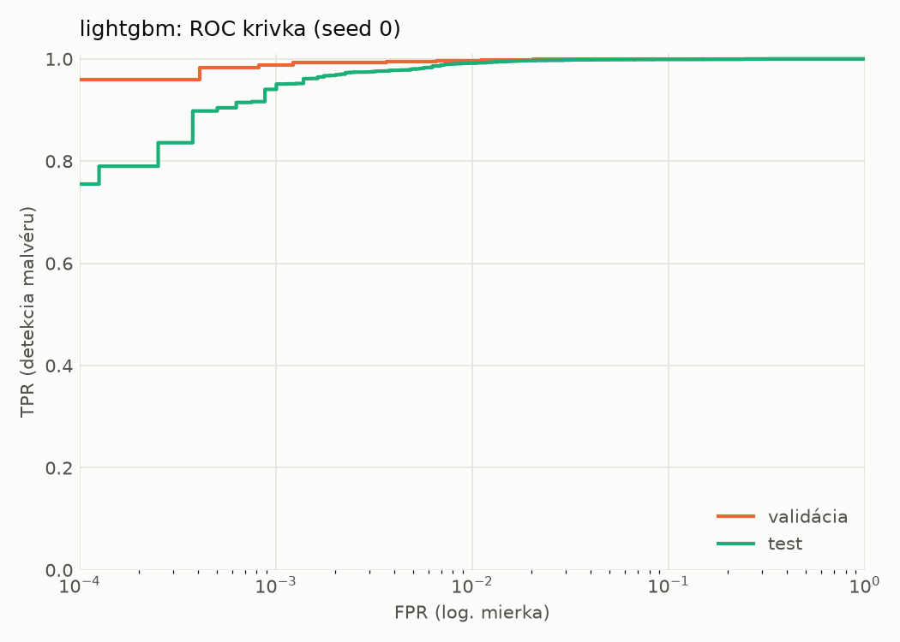
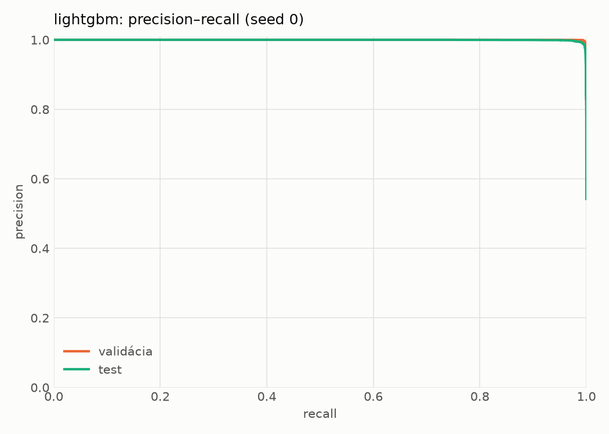
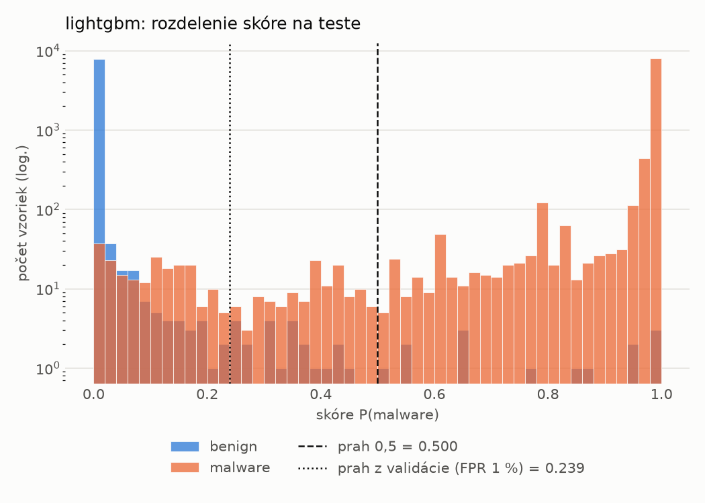
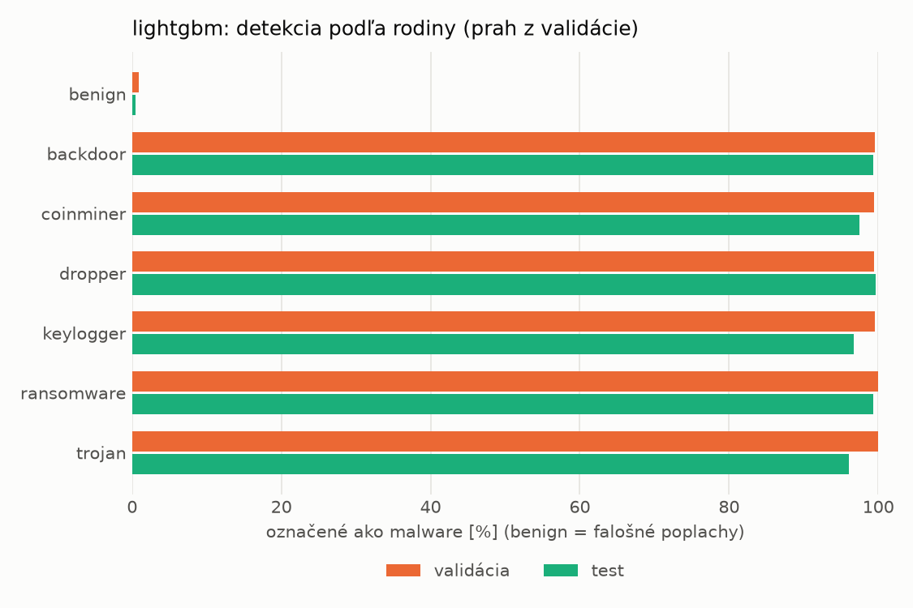
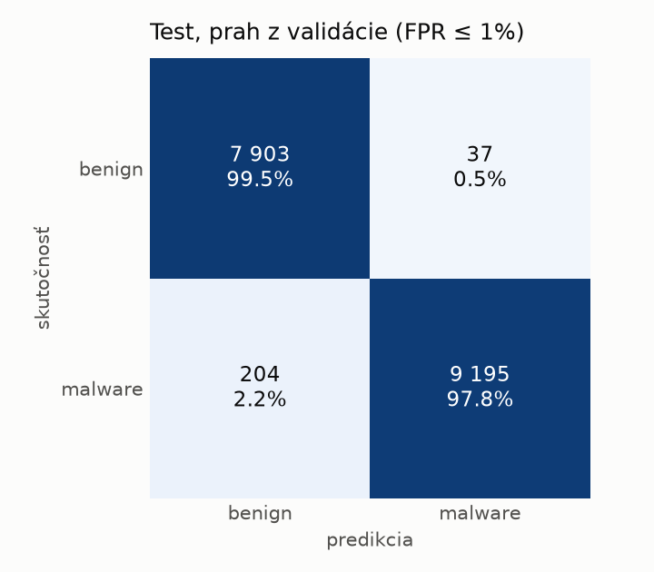
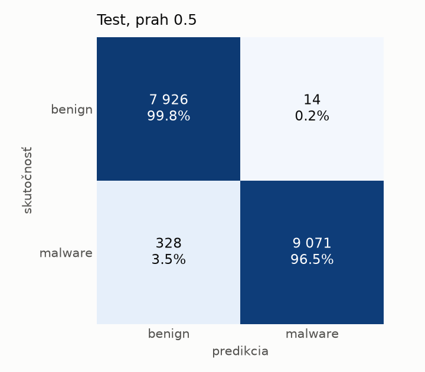
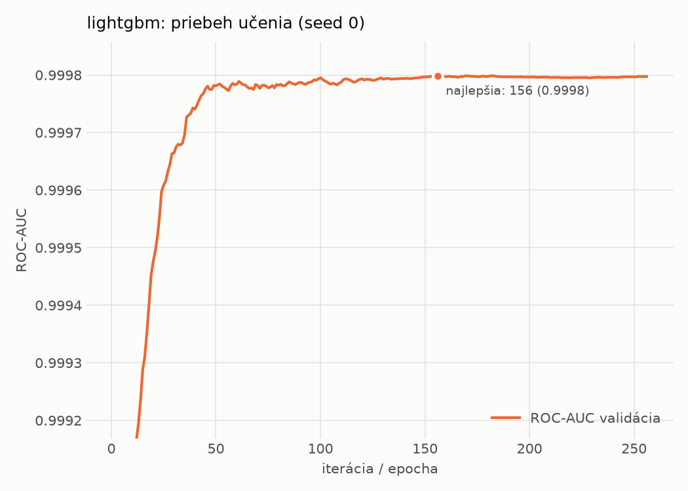

# hybrid/lightgbm – beh `20261104-172135`

> Automaticky generované (`src/training/run_tabular.py`). Konfigurácia: `config.yaml`, protokol: `protocol.yaml`.

- **Model:** `lightgbm` – LightGBM, gradient boosting stromov s early stopping na validácii (pôvodné hodnoty príznakov)
- **Ladenie:** bez ladenia – hyperparametre prevzaté z `runs_final/hybrid/lightgbm/20261102-052826`
- **Finálne modely:** seedy [0, 1, 2]; hodnoty sú priemer ± smerodajná odchýlka cez seedy
- **Najlepšie hyperparametre:** `{"num_boost_round": 5000, "early_stopping_rounds": 100, "learning_rate": 0.13394334706750485, "num_leaves": 127, "min_child_samples": 82, "feature_fraction": 0.3144091460070617, "bagging_fraction": 0.9849549260809971, "lambda_l1": 0.31044435499483225, "lambda_l2": 8.148018307012941e-07}`

## Detekčná kvalita (bez prahu)
| metrika | train (podvzorka) | validácia | test |
|---|---|---|---|
| ROC-AUC | 1.0000 ± 0.0000 | 0.9998 ± 0.0000 | 0.9992 ± 0.0002 |
| PR-AUC | 1.0000 ± 0.0000 | 0.9999 ± 0.0000 | 0.9994 ± 0.0001 |
| TPR pri FPR 1 % | 1.0000 ± 0.0000 | 0.9969 ± 0.0002 | 0.9829 ± 0.0126 |
| TPR pri FPR 0,1 % | 1.0000 ± 0.0000 | 0.9890 ± 0.0009 | 0.9271 ± 0.0119 |
| log loss | 0.0004 ± 0.0002 | 0.0145 ± 0.0007 | 0.0673 ± 0.0149 |
| Brier skóre | 0.0000 ± 0.0000 | 0.0038 ± 0.0002 | 0.0186 ± 0.0047 |

Rozdiel ROC-AUC train − validácia: **0.0002** (veľký rozdiel = preučenie).

## Pri prahu z validácie (FPR ≤ 1% na validácii)
| metrika | train (podvzorka) | validácia | test |
|---|---|---|---|
| accuracy | 1.0000 ± 0.0000 | 0.9948 ± 0.0001 | 0.9828 ± 0.0065 |
| balanced accuracy | 1.0000 ± 0.0000 | 0.9937 ± 0.0002 | 0.9838 ± 0.0060 |
| precision | 1.0000 ± 0.0000 | 0.9952 ± 0.0002 | 0.9963 ± 0.0007 |
| recall (TPR) | 1.0000 ± 0.0000 | 0.9969 ± 0.0002 | 0.9718 ± 0.0115 |
| FPR | 0.0000 ± 0.0000 | 0.0094 ± 0.0004 | 0.0043 ± 0.0008 |
| F1 | 1.0000 ± 0.0000 | 0.9961 ± 0.0001 | 0.9839 ± 0.0061 |
| MCC | 1.0000 ± 0.0000 | 0.9883 ± 0.0003 | 0.9657 ± 0.0126 |

## Pri pevnom prahu 0.5
| metrika | train (podvzorka) | validácia | test |
|---|---|---|---|
| accuracy | 1.0000 ± 0.0000 | 0.9953 ± 0.0005 | 0.9772 ± 0.0059 |
| balanced accuracy | 1.0000 ± 0.0000 | 0.9952 ± 0.0007 | 0.9788 ± 0.0054 |
| precision | 1.0000 ± 0.0000 | 0.9974 ± 0.0007 | 0.9984 ± 0.0001 |
| recall (TPR) | 1.0000 ± 0.0000 | 0.9956 ± 0.0001 | 0.9595 ± 0.0109 |
| FPR | 0.0000 ± 0.0000 | 0.0052 ± 0.0014 | 0.0018 ± 0.0001 |
| F1 | 1.0000 ± 0.0000 | 0.9965 ± 0.0004 | 0.9785 ± 0.0057 |
| MCC | 1.0000 ± 0.0000 | 0.9895 ± 0.0011 | 0.9551 ± 0.0113 |

## Výpočtové nároky (seed 0, testovacia množina)
| meranie | hodnota |
|---|---|
| tréning finálneho modelu | 16.5 s (priemer cez seedy) |
| ladenie spolu | 0 s |
| počet parametrov / uzlov | 31 746 |
| veľkosť modelu na disku | 1.77 MB |
| CPU latencia modelu (batch 1, 1 vlákno) | 0.045 ms (p95 0.054) |
| CPU priepustnosť (24 vlákien) | 274 584 vzoriek/s |

## Grafy
| | |
|---|---|
|  |  |
|  |  |
|  |  |
|  |  |

## Súbory
`metrics.json` (všetky metriky po seedoch vrátane rodín), `timing.json`, `hpo_trials.csv`,
`predictions/<časť>_seed<N>.parquet` (sha256, family, label, score), `model/seed_<N>/`, `log.txt`.
