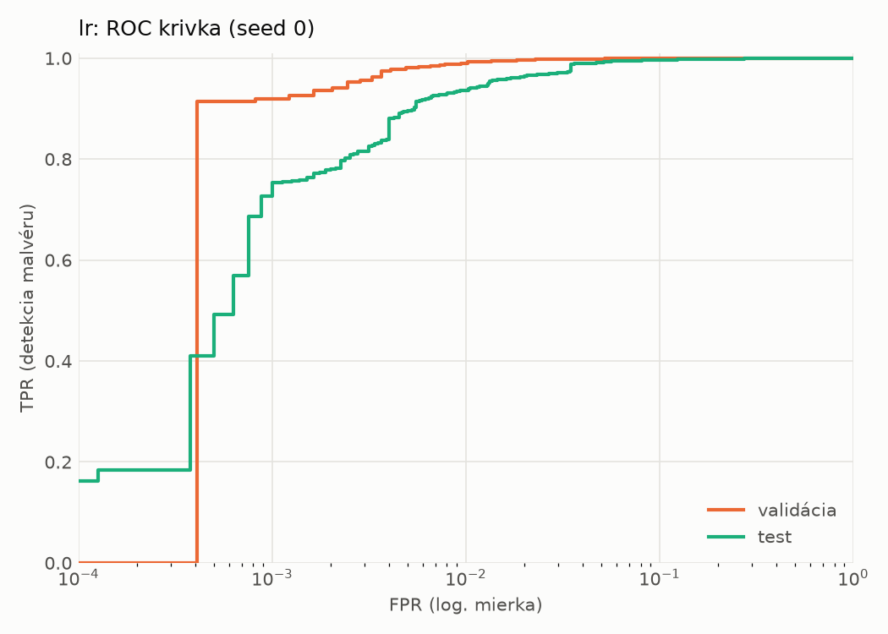
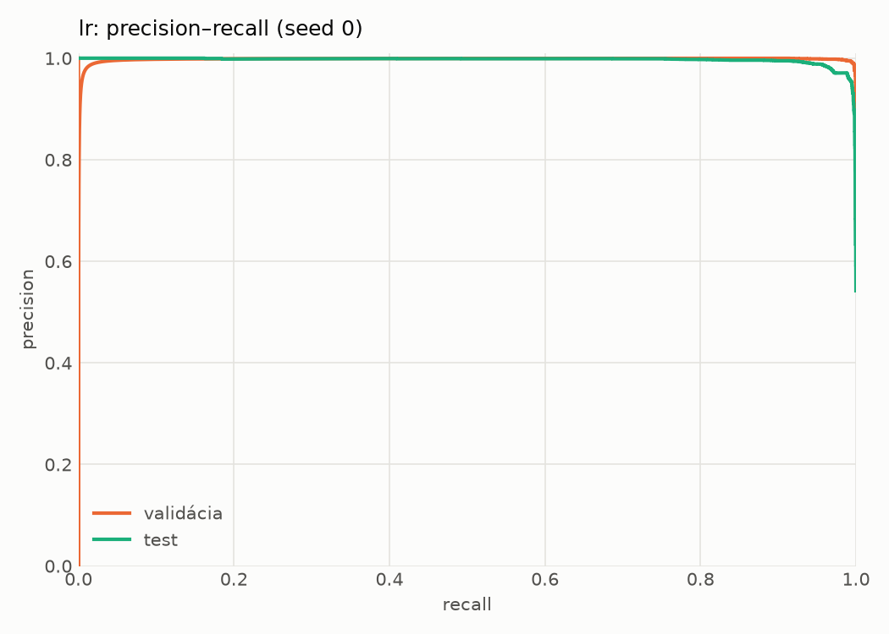
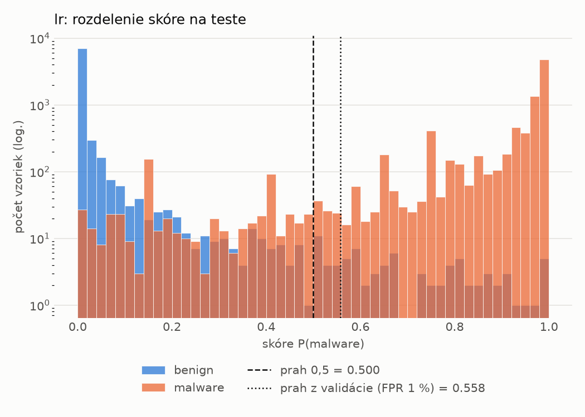
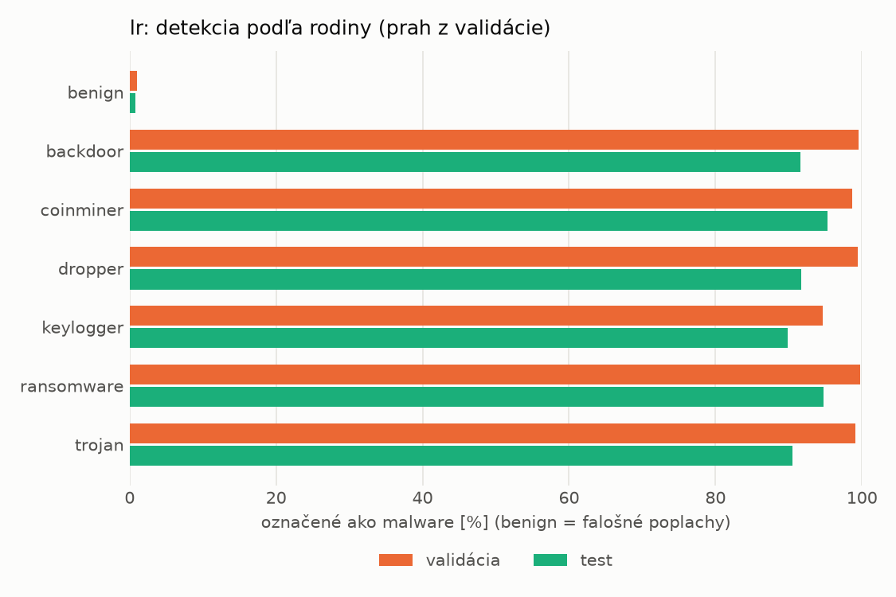
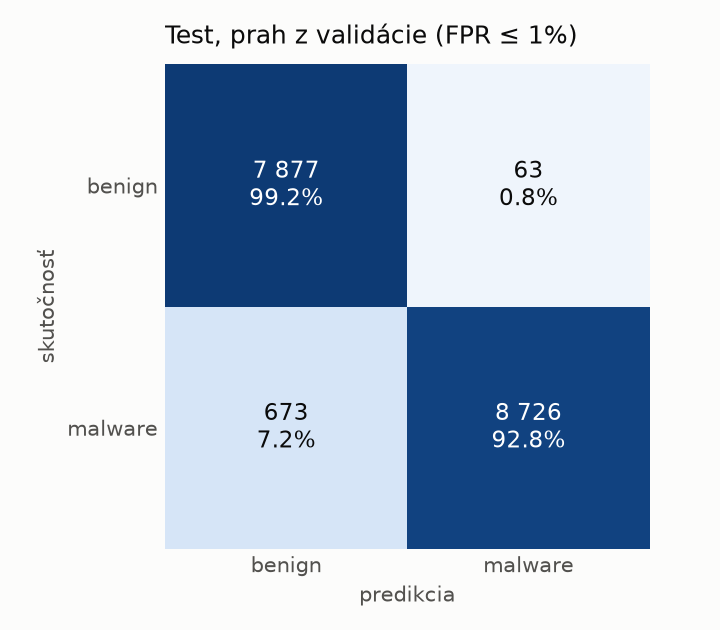
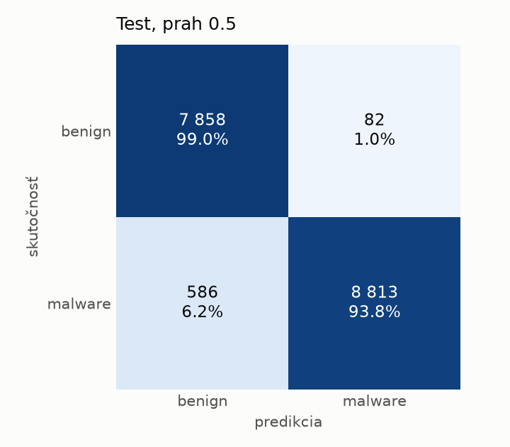

# hybrid/lr – beh `20261104-171412`

> Automaticky generované (`src/training/run_tabular.py`). Konfigurácia: `config.yaml`, protokol: `protocol.yaml`.

- **Model:** `logreg` – logistická regresia s L2 regularizáciou (vstup signed log1p + štandardizácia)
- **Ladenie:** bez ladenia – hyperparametre prevzaté z `runs_final/hybrid/lr/20261102-044357`
- **Finálne modely:** seedy [0, 1, 2]; hodnoty sú priemer ± smerodajná odchýlka cez seedy
- **Najlepšie hyperparametre:** `{"max_iter": 2000, "C": 0.0028355883180749405}`

## Detekčná kvalita (bez prahu)
| metrika | train (podvzorka) | validácia | test |
|---|---|---|---|
| ROC-AUC | 0.9997 ± 0.0000 | 0.9989 ± 0.0000 | 0.9963 ± 0.0000 |
| PR-AUC | 0.9998 ± 0.0000 | 0.9980 ± 0.0000 | 0.9967 ± 0.0000 |
| TPR pri FPR 1 % | 0.9970 ± 0.0000 | 0.9896 ± 0.0000 | 0.9365 ± 0.0000 |
| TPR pri FPR 0,1 % | 0.9424 ± 0.0000 | 0.9194 ± 0.0000 | 0.7265 ± 0.0000 |
| log loss | 0.0243 ± 0.0000 | 0.0324 ± 0.0000 | 0.1091 ± 0.0000 |
| Brier skóre | 0.0053 ± 0.0000 | 0.0073 ± 0.0000 | 0.0305 ± 0.0000 |

Rozdiel ROC-AUC train − validácia: **0.0008** (veľký rozdiel = preučenie).

## Pri prahu z validácie (FPR ≤ 1% na validácii)
| metrika | train (podvzorka) | validácia | test |
|---|---|---|---|
| accuracy | 0.9925 ± 0.0000 | 0.9898 ± 0.0000 | 0.9576 ± 0.0000 |
| balanced accuracy | 0.9927 ± 0.0000 | 0.9899 ± 0.0000 | 0.9602 ± 0.0000 |
| precision | 0.9965 ± 0.0000 | 0.9950 ± 0.0000 | 0.9928 ± 0.0000 |
| recall (TPR) | 0.9921 ± 0.0000 | 0.9896 ± 0.0000 | 0.9284 ± 0.0000 |
| FPR | 0.0067 ± 0.0000 | 0.0098 ± 0.0000 | 0.0079 ± 0.0000 |
| F1 | 0.9943 ± 0.0000 | 0.9923 ± 0.0000 | 0.9595 ± 0.0000 |
| MCC | 0.9834 ± 0.0000 | 0.9773 ± 0.0000 | 0.9173 ± 0.0000 |

## Pri pevnom prahu 0.5
| metrika | train (podvzorka) | validácia | test |
|---|---|---|---|
| accuracy | 0.9940 ± 0.0000 | 0.9917 ± 0.0000 | 0.9615 ± 0.0000 |
| balanced accuracy | 0.9935 ± 0.0000 | 0.9909 ± 0.0000 | 0.9637 ± 0.0000 |
| precision | 0.9957 ± 0.0000 | 0.9942 ± 0.0000 | 0.9908 ± 0.0000 |
| recall (TPR) | 0.9951 ± 0.0000 | 0.9934 ± 0.0000 | 0.9377 ± 0.0000 |
| FPR | 0.0082 ± 0.0000 | 0.0115 ± 0.0000 | 0.0103 ± 0.0000 |
| F1 | 0.9954 ± 0.0000 | 0.9938 ± 0.0000 | 0.9635 ± 0.0000 |
| MCC | 0.9867 ± 0.0000 | 0.9815 ± 0.0000 | 0.9243 ± 0.0000 |

## Výpočtové nároky (seed 0, testovacia množina)
| meranie | hodnota |
|---|---|
| tréning finálneho modelu | 5.1 s (priemer cez seedy) |
| ladenie spolu | 0 s |
| počet parametrov / uzlov | 4 320 |
| veľkosť modelu na disku | 0.13 MB |
| transformácia vstupu – latencia (1 vlákno) | 0.034 ms |
| transformácia vstupu – priepustnosť | 23 797 vzoriek/s |
| CPU latencia modelu (batch 1, 1 vlákno) | 0.007 ms (p95 0.008) |
| CPU priepustnosť (24 vlákien) | 160 759 vzoriek/s |

## Grafy
| | |
|---|---|
|  |  |
|  |  |
|  |  |
|  |  |

## Súbory
`metrics.json` (všetky metriky po seedoch vrátane rodín), `timing.json`, `hpo_trials.csv`,
`predictions/<časť>_seed<N>.parquet` (sha256, family, label, score), `model/seed_<N>/`, `log.txt`.
