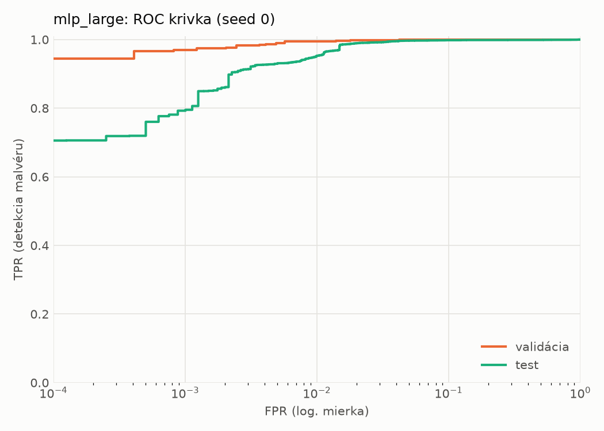
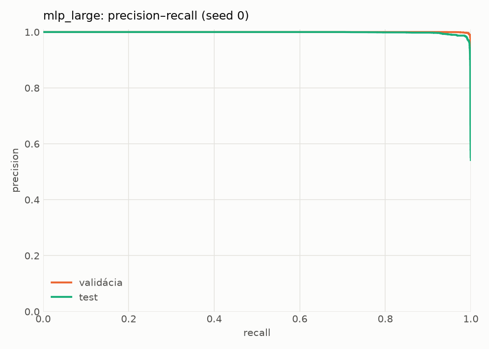
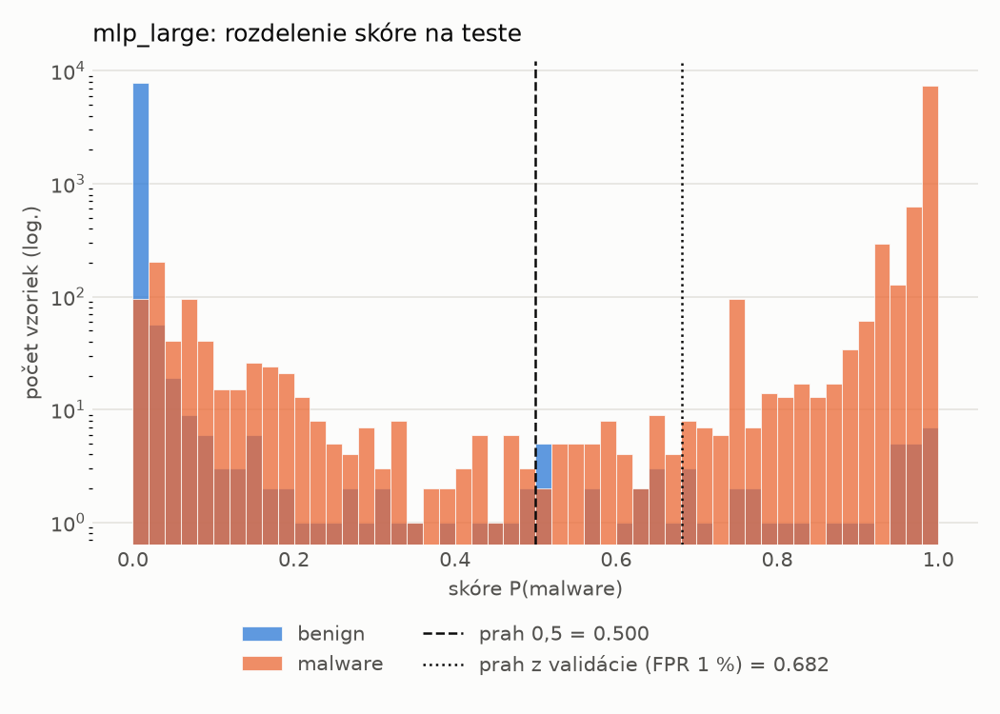
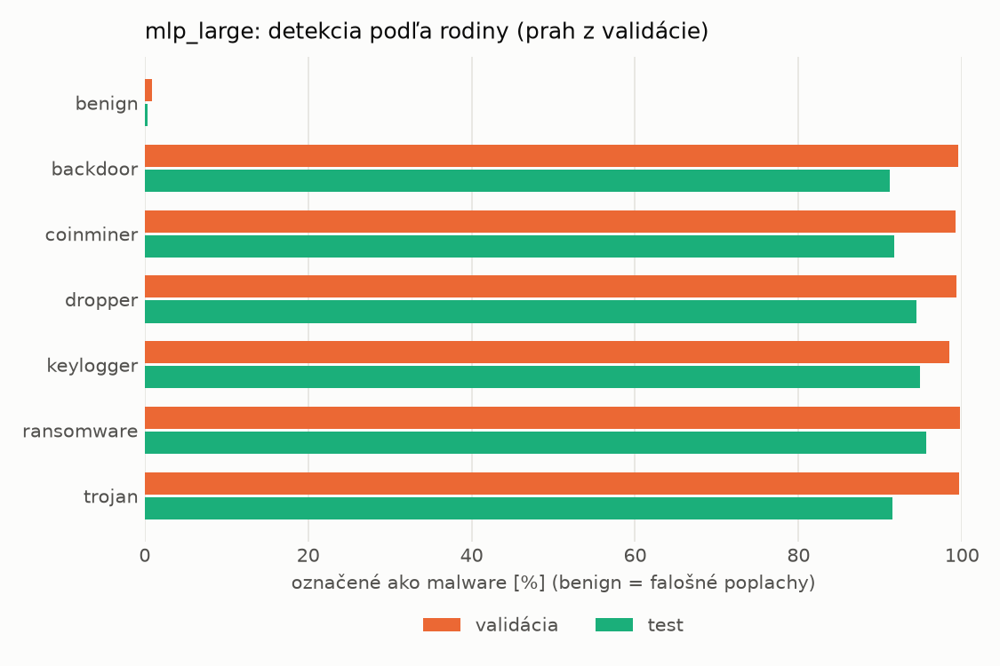
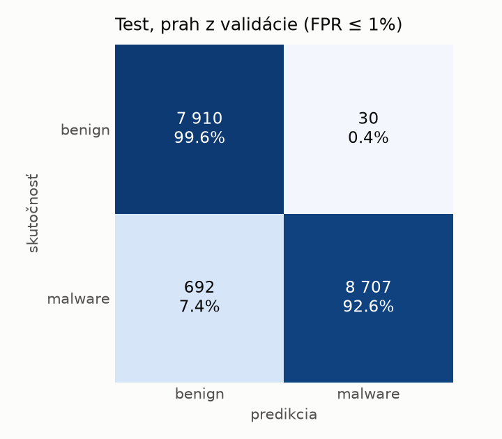
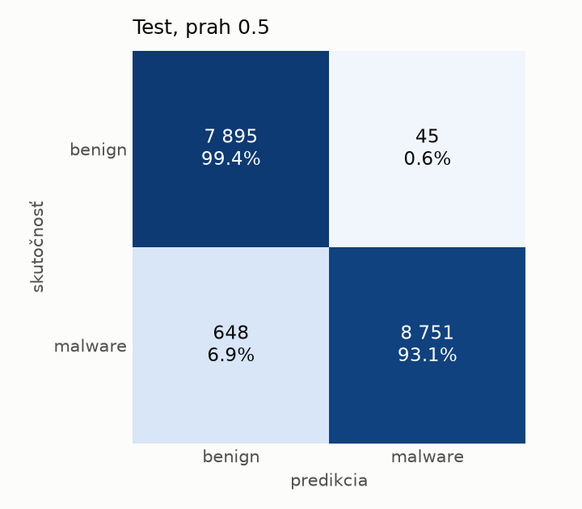
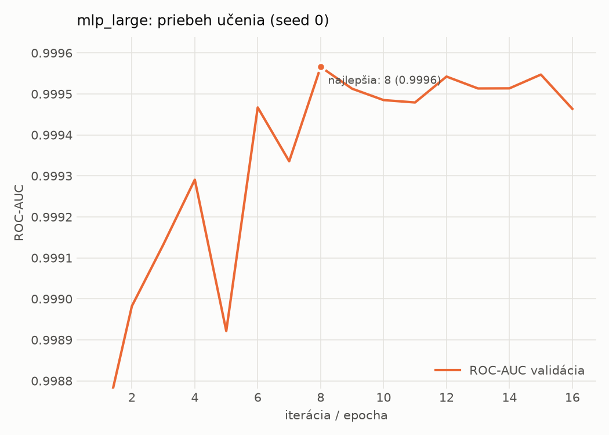

# hybrid/mlp_large – beh `20261104-172301`

> Automaticky generované (`src/training/run_tabular.py`). Konfigurácia: `config.yaml`, protokol: `protocol.yaml`.

- **Model:** `mlp` – veľká neurónová sieť (3–5 skrytých vrstiev, 512–2048 neurónov), kandidát na učiteľa
- **Ladenie:** bez ladenia – hyperparametre prevzaté z `runs_final/hybrid/mlp_large/20261102-064138`
- **Finálne modely:** seedy [0, 1, 2]; hodnoty sú priemer ± smerodajná odchýlka cez seedy
- **Najlepšie hyperparametre:** `{"max_epochs": 100, "patience": 8, "hidden_layers": 4, "hidden_width": 512, "width_decay": 0.5, "dropout": 0.1951820260605614, "lr": 0.000176468680848935, "weight_decay": 1.209699321025492e-05, "batch_size": 512}`

## Detekčná kvalita (bez prahu)
| metrika | train (podvzorka) | validácia | test |
|---|---|---|---|
| ROC-AUC | 0.9999 ± 0.0001 | 0.9996 ± 0.0000 | 0.9977 ± 0.0004 |
| PR-AUC | 1.0000 ± 0.0000 | 0.9998 ± 0.0000 | 0.9983 ± 0.0002 |
| TPR pri FPR 1 % | 0.9991 ± 0.0002 | 0.9952 ± 0.0008 | 0.9574 ± 0.0048 |
| TPR pri FPR 0,1 % | 0.9891 ± 0.0030 | 0.9571 ± 0.0109 | 0.8240 ± 0.0339 |
| log loss | 0.0189 ± 0.0034 | 0.0296 ± 0.0018 | 0.1208 ± 0.0095 |
| Brier skóre | 0.0027 ± 0.0004 | 0.0056 ± 0.0005 | 0.0330 ± 0.0023 |

Rozdiel ROC-AUC train − validácia: **0.0003** (veľký rozdiel = preučenie).

## Pri prahu z validácie (FPR ≤ 1% na validácii)
| metrika | train (podvzorka) | validácia | test |
|---|---|---|---|
| accuracy | 0.9968 ± 0.0004 | 0.9938 ± 0.0005 | 0.9609 ± 0.0044 |
| balanced accuracy | 0.9961 ± 0.0005 | 0.9931 ± 0.0004 | 0.9634 ± 0.0040 |
| precision | 0.9968 ± 0.0006 | 0.9954 ± 0.0002 | 0.9943 ± 0.0020 |
| recall (TPR) | 0.9984 ± 0.0004 | 0.9952 ± 0.0008 | 0.9331 ± 0.0094 |
| FPR | 0.0061 ± 0.0012 | 0.0090 ± 0.0004 | 0.0063 ± 0.0022 |
| F1 | 0.9976 ± 0.0003 | 0.9953 ± 0.0004 | 0.9627 ± 0.0044 |
| MCC | 0.9930 ± 0.0008 | 0.9860 ± 0.0012 | 0.9237 ± 0.0082 |

## Pri pevnom prahu 0.5
| metrika | train (podvzorka) | validácia | test |
|---|---|---|---|
| accuracy | 0.9969 ± 0.0006 | 0.9934 ± 0.0013 | 0.9600 ± 0.0029 |
| balanced accuracy | 0.9962 ± 0.0005 | 0.9928 ± 0.0015 | 0.9627 ± 0.0026 |
| precision | 0.9970 ± 0.0002 | 0.9954 ± 0.0012 | 0.9951 ± 0.0003 |
| recall (TPR) | 0.9983 ± 0.0007 | 0.9947 ± 0.0011 | 0.9308 ± 0.0055 |
| FPR | 0.0058 ± 0.0003 | 0.0090 ± 0.0023 | 0.0055 ± 0.0004 |
| F1 | 0.9976 ± 0.0004 | 0.9950 ± 0.0010 | 0.9619 ± 0.0028 |
| MCC | 0.9930 ± 0.0013 | 0.9853 ± 0.0029 | 0.9222 ± 0.0053 |

## Výpočtové nároky (seed 0, testovacia množina)
| meranie | hodnota |
|---|---|
| tréning finálneho modelu | 5.6 s (priemer cez seedy) |
| ladenie spolu | 0 s |
| počet parametrov / uzlov | 2 386 305 |
| veľkosť modelu na disku | 9.67 MB |
| transformácia vstupu – latencia (1 vlákno) | 0.062 ms |
| transformácia vstupu – priepustnosť | 21 922 vzoriek/s |
| CPU latencia modelu (batch 1, 1 vlákno) | 0.294 ms (p95 0.336) |
| CPU priepustnosť (24 vlákien) | 37 847 vzoriek/s |
| GPU latencia (batch 1) | 0.526 ms (p95 1.054) |
| GPU priepustnosť | 35 721 vzoriek/s |
| GPU špičková pamäť | 2877 MB |

## Grafy
| | |
|---|---|
|  |  |
|  |  |
|  |  |
|  |  |

## Súbory
`metrics.json` (všetky metriky po seedoch vrátane rodín), `timing.json`, `hpo_trials.csv`,
`predictions/<časť>_seed<N>.parquet` (sha256, family, label, score), `model/seed_<N>/`, `log.txt`.
