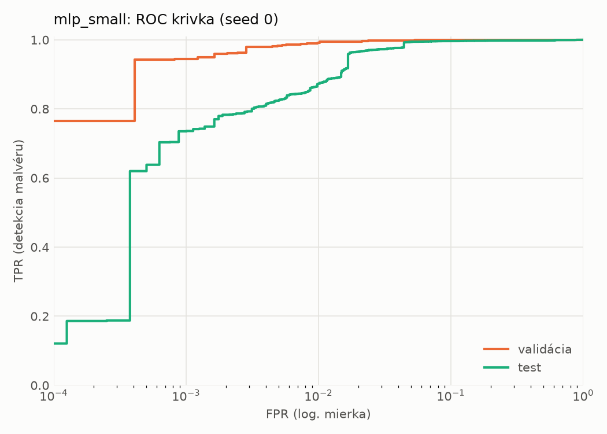
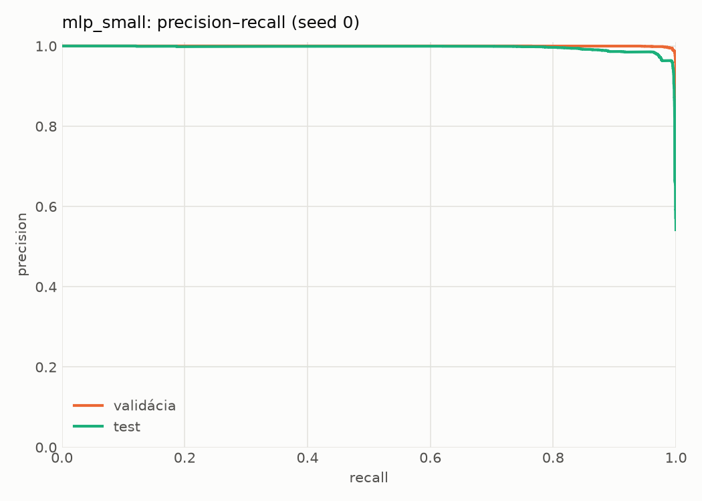
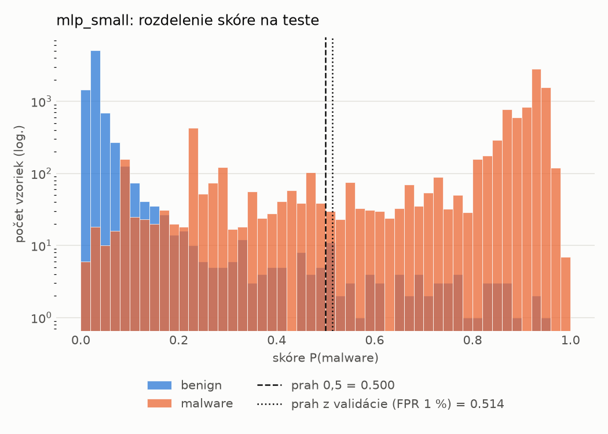
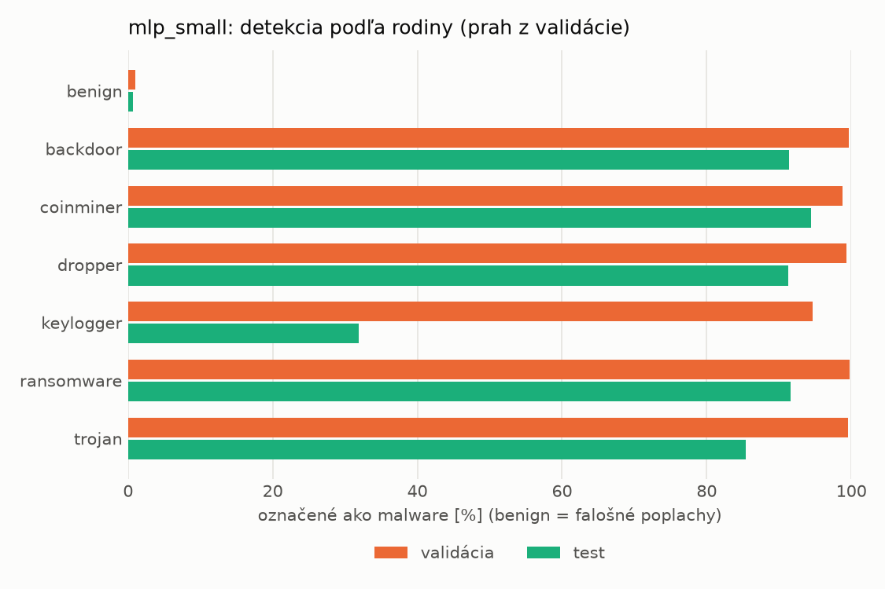
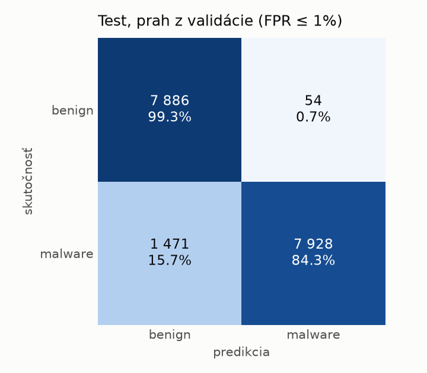
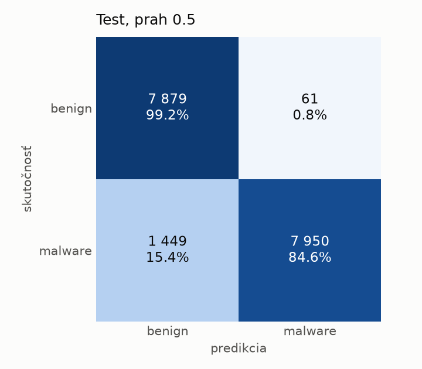
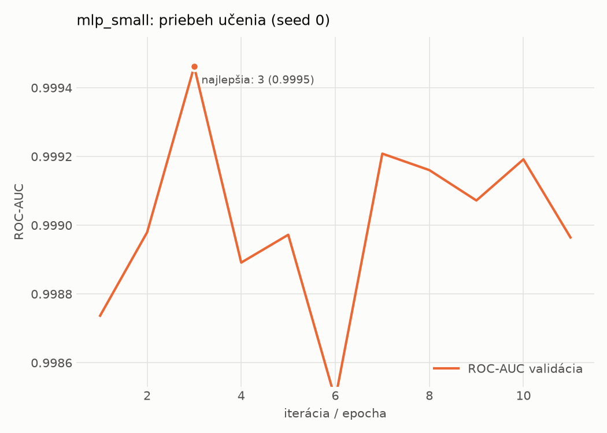

# hybrid/mlp_small – beh `20261104-172229`

> Automaticky generované (`src/training/run_tabular.py`). Konfigurácia: `config.yaml`, protokol: `protocol.yaml`.

- **Model:** `mlp` – malá neurónová sieť (1–2 skryté vrstvy), kandidát na ľahkého študenta
- **Ladenie:** bez ladenia – hyperparametre prevzaté z `runs_final/hybrid/mlp_small/20261102-063854`
- **Finálne modely:** seedy [0, 1, 2]; hodnoty sú priemer ± smerodajná odchýlka cez seedy
- **Najlepšie hyperparametre:** `{"width_decay": 0.5, "max_epochs": 100, "patience": 8, "hidden_layers": 2, "hidden_width": 32, "dropout": 0.16874195706419903, "lr": 0.0006143857735366936, "weight_decay": 0.007079811471617702, "batch_size": 512}`

## Detekčná kvalita (bez prahu)
| metrika | train (podvzorka) | validácia | test |
|---|---|---|---|
| ROC-AUC | 0.9998 ± 0.0001 | 0.9993 ± 0.0002 | 0.9956 ± 0.0007 |
| PR-AUC | 0.9999 ± 0.0001 | 0.9987 ± 0.0009 | 0.9962 ± 0.0006 |
| TPR pri FPR 1 % | 0.9976 ± 0.0018 | 0.9935 ± 0.0029 | 0.8895 ± 0.0167 |
| TPR pri FPR 0,1 % | 0.9849 ± 0.0066 | 0.9507 ± 0.0100 | 0.7414 ± 0.0057 |
| log loss | 0.0376 ± 0.0294 | 0.0446 ± 0.0264 | 0.1884 ± 0.0353 |
| Brier skóre | 0.0052 ± 0.0030 | 0.0073 ± 0.0025 | 0.0548 ± 0.0076 |

Rozdiel ROC-AUC train − validácia: **0.0005** (veľký rozdiel = preučenie).

## Pri prahu z validácie (FPR ≤ 1% na validácii)
| metrika | train (podvzorka) | validácia | test |
|---|---|---|---|
| accuracy | 0.9946 ± 0.0023 | 0.9925 ± 0.0020 | 0.9234 ± 0.0104 |
| balanced accuracy | 0.9943 ± 0.0019 | 0.9920 ± 0.0016 | 0.9288 ± 0.0095 |
| precision | 0.9966 ± 0.0004 | 0.9952 ± 0.0002 | 0.9928 ± 0.0005 |
| recall (TPR) | 0.9951 ± 0.0031 | 0.9935 ± 0.0029 | 0.8651 ± 0.0197 |
| FPR | 0.0065 ± 0.0007 | 0.0094 ± 0.0004 | 0.0075 ± 0.0007 |
| F1 | 0.9959 ± 0.0017 | 0.9944 ± 0.0015 | 0.9245 ± 0.0111 |
| MCC | 0.9879 ± 0.0050 | 0.9833 ± 0.0044 | 0.8560 ± 0.0179 |

## Pri pevnom prahu 0.5
| metrika | train (podvzorka) | validácia | test |
|---|---|---|---|
| accuracy | 0.9952 ± 0.0014 | 0.9930 ± 0.0010 | 0.9232 ± 0.0095 |
| balanced accuracy | 0.9947 ± 0.0013 | 0.9923 ± 0.0008 | 0.9286 ± 0.0088 |
| precision | 0.9965 ± 0.0005 | 0.9951 ± 0.0004 | 0.9929 ± 0.0005 |
| recall (TPR) | 0.9961 ± 0.0019 | 0.9943 ± 0.0015 | 0.8645 ± 0.0173 |
| FPR | 0.0067 ± 0.0010 | 0.0097 ± 0.0009 | 0.0073 ± 0.0003 |
| F1 | 0.9963 ± 0.0011 | 0.9947 ± 0.0007 | 0.9242 ± 0.0101 |
| MCC | 0.9893 ± 0.0032 | 0.9843 ± 0.0021 | 0.8556 ± 0.0166 |

## Výpočtové nároky (seed 0, testovacia množina)
| meranie | hodnota |
|---|---|
| tréning finálneho modelu | 4.4 s (priemer cez seedy) |
| ladenie spolu | 0 s |
| počet parametrov / uzlov | 138 881 |
| veľkosť modelu na disku | 0.67 MB |
| transformácia vstupu – latencia (1 vlákno) | 0.062 ms |
| transformácia vstupu – priepustnosť | 22 779 vzoriek/s |
| CPU latencia modelu (batch 1, 1 vlákno) | 0.102 ms (p95 0.117) |
| CPU priepustnosť (24 vlákien) | 45 967 vzoriek/s |
| GPU latencia (batch 1) | 0.362 ms (p95 0.679) |
| GPU priepustnosť | 29 056 vzoriek/s |
| GPU špičková pamäť | 1574 MB |

## Grafy
| | |
|---|---|
|  |  |
|  |  |
|  |  |
|  |  |

## Súbory
`metrics.json` (všetky metriky po seedoch vrátane rodín), `timing.json`, `hpo_trials.csv`,
`predictions/<časť>_seed<N>.parquet` (sha256, family, label, score), `model/seed_<N>/`, `log.txt`.
