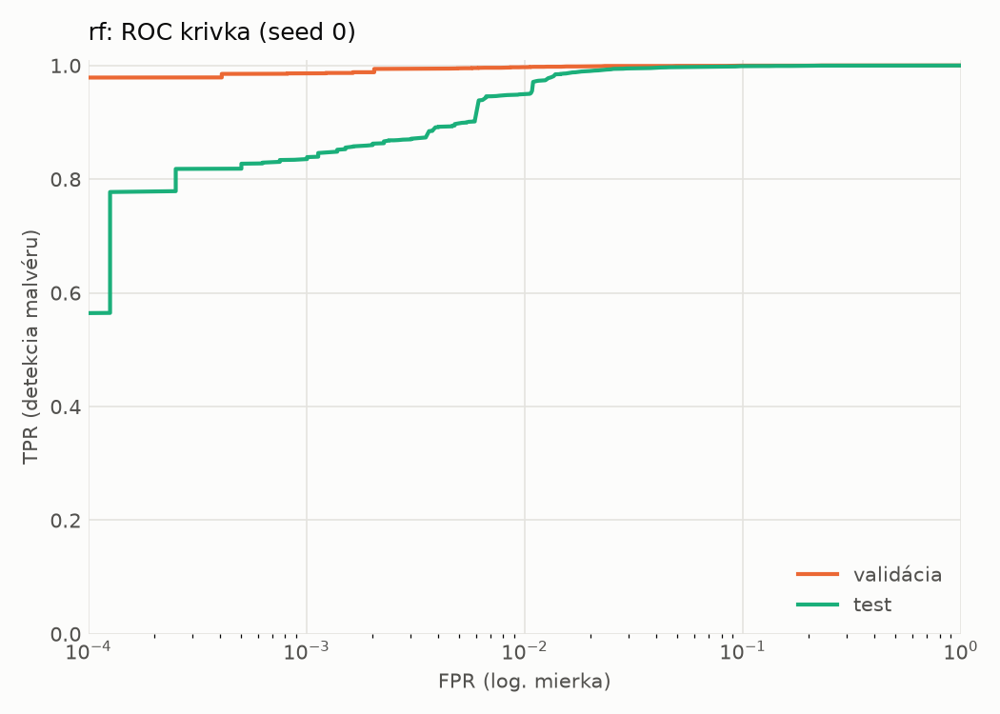
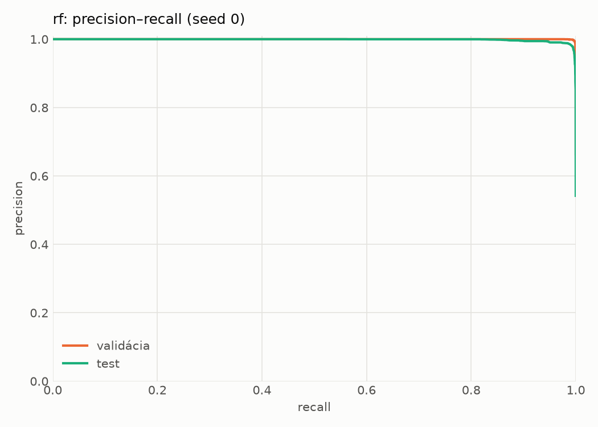
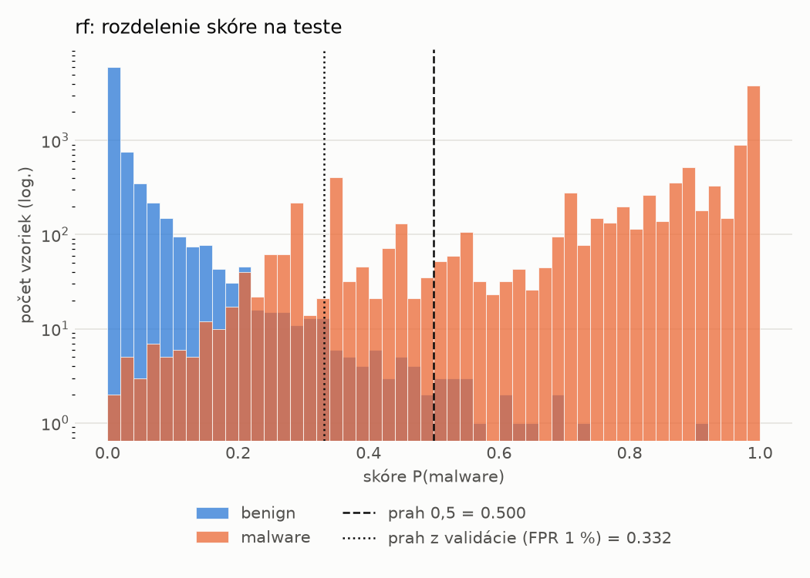
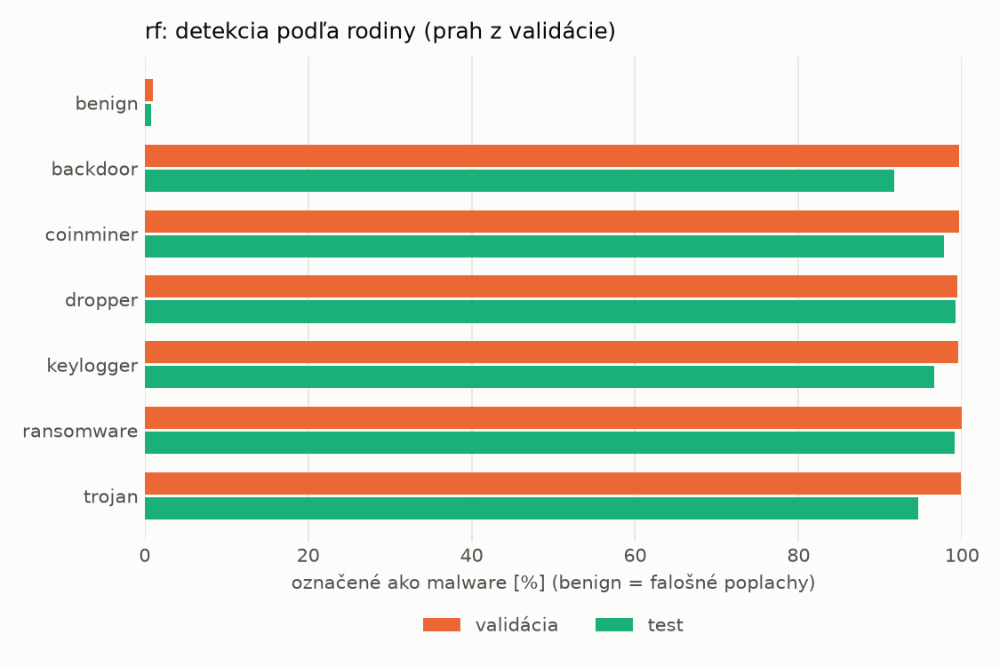
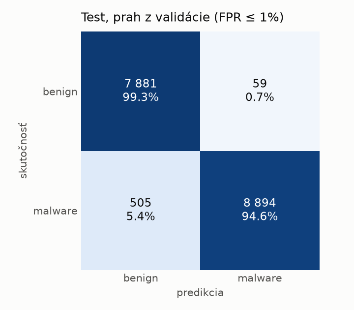
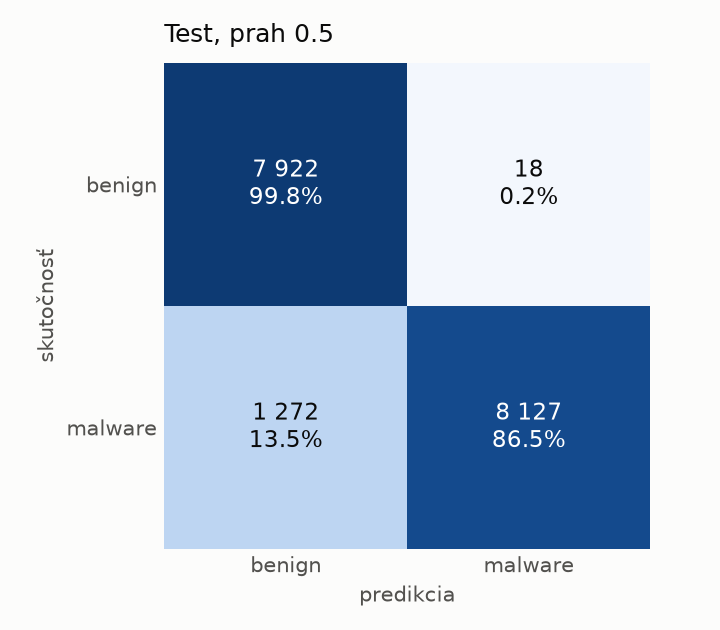

# hybrid/rf – beh `20261104-171444`

> Automaticky generované (`src/training/run_tabular.py`). Konfigurácia: `config.yaml`, protokol: `protocol.yaml`.

- **Model:** `random_forest` – Random Forest (pôvodné hodnoty príznakov)
- **Ladenie:** bez ladenia – hyperparametre prevzaté z `runs_final/hybrid/rf/20261102-044751`
- **Finálne modely:** seedy [0, 1, 2]; hodnoty sú priemer ± smerodajná odchýlka cez seedy
- **Najlepšie hyperparametre:** `{"n_estimators": 250, "max_depth": null, "min_samples_leaf": 1, "max_features": 0.05}`

## Detekčná kvalita (bez prahu)
| metrika | train (podvzorka) | validácia | test |
|---|---|---|---|
| ROC-AUC | 1.0000 ± 0.0000 | 0.9998 ± 0.0000 | 0.9984 ± 0.0000 |
| PR-AUC | 1.0000 ± 0.0000 | 0.9999 ± 0.0000 | 0.9986 ± 0.0000 |
| TPR pri FPR 1 % | 1.0000 ± 0.0000 | 0.9972 ± 0.0001 | 0.9521 ± 0.0026 |
| TPR pri FPR 0,1 % | 1.0000 ± 0.0000 | 0.9862 ± 0.0002 | 0.8303 ± 0.0035 |
| log loss | 0.0060 ± 0.0000 | 0.0193 ± 0.0001 | 0.1426 ± 0.0024 |
| Brier skóre | 0.0008 ± 0.0000 | 0.0045 ± 0.0001 | 0.0444 ± 0.0011 |

Rozdiel ROC-AUC train − validácia: **0.0002** (veľký rozdiel = preučenie).

## Pri prahu z validácie (FPR ≤ 1% na validácii)
| metrika | train (podvzorka) | validácia | test |
|---|---|---|---|
| accuracy | 1.0000 ± 0.0000 | 0.9949 ± 0.0002 | 0.9674 ± 0.0009 |
| balanced accuracy | 1.0000 ± 0.0000 | 0.9939 ± 0.0002 | 0.9693 ± 0.0009 |
| precision | 1.0000 ± 0.0000 | 0.9952 ± 0.0002 | 0.9931 ± 0.0003 |
| recall (TPR) | 1.0000 ± 0.0000 | 0.9972 ± 0.0001 | 0.9464 ± 0.0017 |
| FPR | 0.0000 ± 0.0000 | 0.0094 ± 0.0004 | 0.0078 ± 0.0003 |
| F1 | 1.0000 ± 0.0000 | 0.9962 ± 0.0001 | 0.9692 ± 0.0009 |
| MCC | 1.0000 ± 0.0000 | 0.9887 ± 0.0004 | 0.9358 ± 0.0018 |

## Pri pevnom prahu 0.5
| metrika | train (podvzorka) | validácia | test |
|---|---|---|---|
| accuracy | 1.0000 ± 0.0001 | 0.9949 ± 0.0003 | 0.9239 ± 0.0023 |
| balanced accuracy | 1.0000 ± 0.0000 | 0.9951 ± 0.0003 | 0.9297 ± 0.0022 |
| precision | 1.0000 ± 0.0000 | 0.9979 ± 0.0002 | 0.9977 ± 0.0002 |
| recall (TPR) | 0.9999 ± 0.0001 | 0.9943 ± 0.0003 | 0.8617 ± 0.0041 |
| FPR | 0.0000 ± 0.0000 | 0.0041 ± 0.0004 | 0.0024 ± 0.0002 |
| F1 | 1.0000 ± 0.0000 | 0.9961 ± 0.0002 | 0.9247 ± 0.0025 |
| MCC | 0.9999 ± 0.0001 | 0.9885 ± 0.0007 | 0.8580 ± 0.0041 |

## Výpočtové nároky (seed 0, testovacia množina)
| meranie | hodnota |
|---|---|
| tréning finálneho modelu | 134.5 s (priemer cez seedy) |
| ladenie spolu | 0 s |
| počet parametrov / uzlov | 271 792 |
| veľkosť modelu na disku | 22.11 MB |
| CPU latencia modelu (batch 1, 1 vlákno) | 7.199 ms (p95 7.562) |
| CPU priepustnosť (24 vlákien) | 99 582 vzoriek/s |

## Grafy
| | |
|---|---|
|  |  |
|  |  |
|  |  |
|  |  |

## Súbory
`metrics.json` (všetky metriky po seedoch vrátane rodín), `timing.json`, `hpo_trials.csv`,
`predictions/<časť>_seed<N>.parquet` (sha256, family, label, score), `model/seed_<N>/`, `log.txt`.
