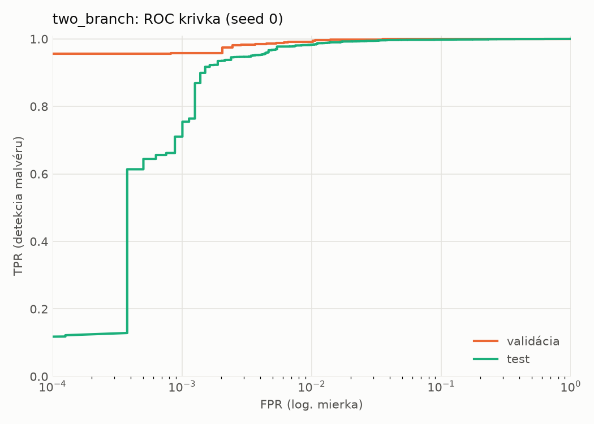
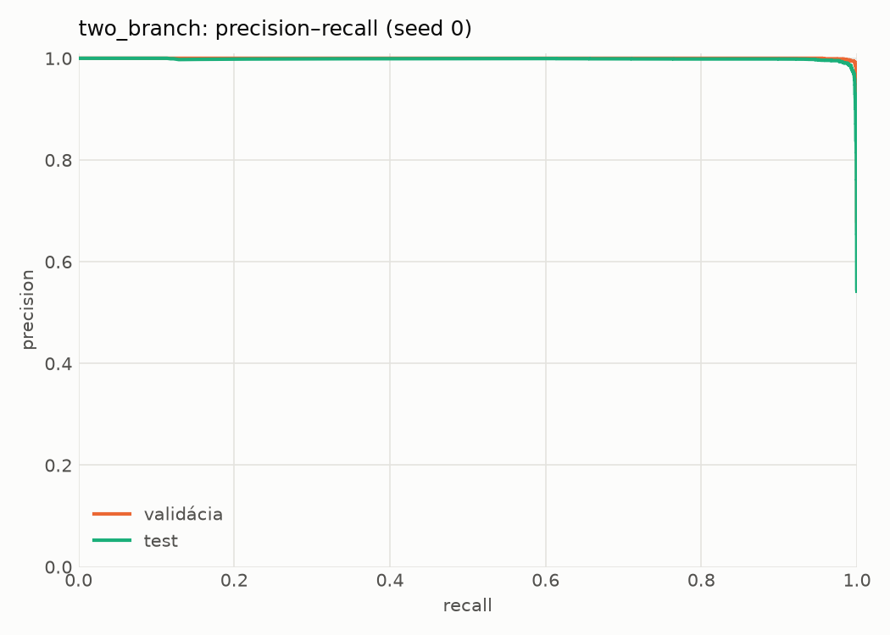
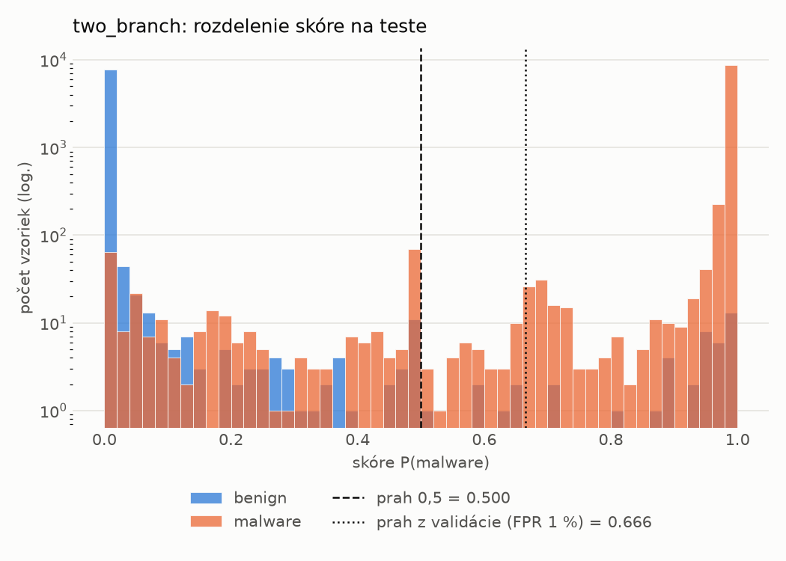
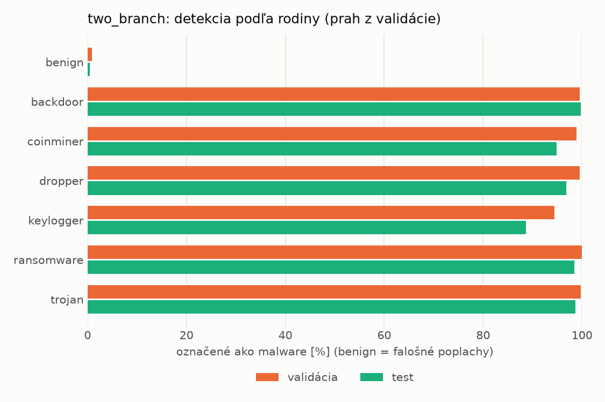
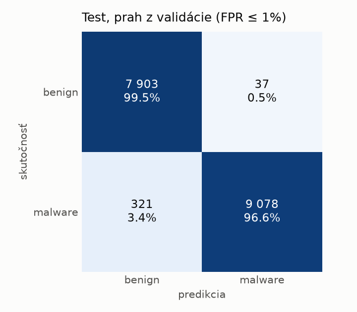
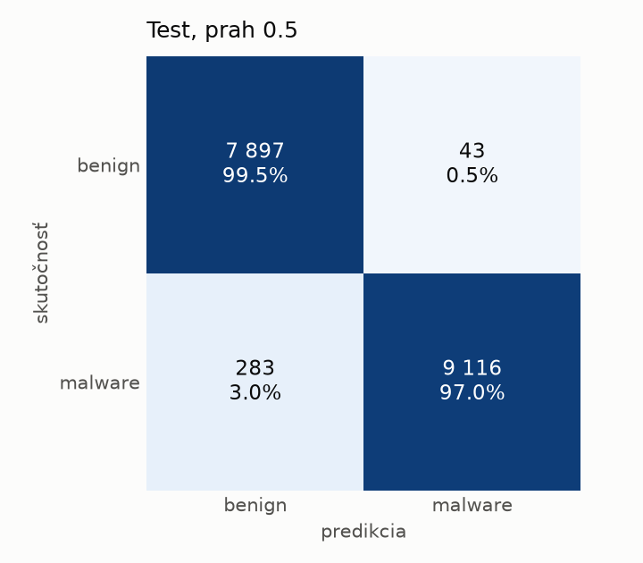
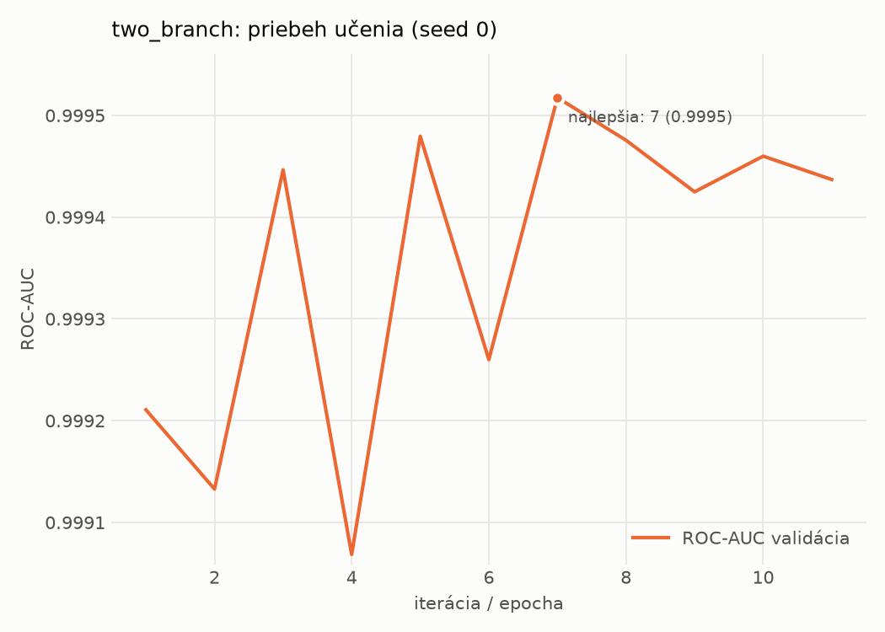

# hybrid_seq/two_branch – beh `20261104-172337`

> Automaticky generované (`src/training/run_tabular.py`). Konfigurácia: `config.yaml`, protokol: `protocol.yaml`.

- **Model:** `two_branch` – statická MLP vetva + sekvenčná CNN vetva nad API volaniami, spojené v spoločnej hlave
- **Ladenie:** bez ladenia – hyperparametre prevzaté z `runs_final/hybrid/two_branch/20261102-170657`
- **Finálne modely:** seedy [0, 1, 2]; hodnoty sú priemer ± smerodajná odchýlka cez seedy
- **Najlepšie hyperparametre:** `{"n_static": 2381, "width_decay": 0.5, "max_epochs": 30, "patience": 4, "static_layers": 3, "static_width": 256, "emb_dim": 64, "channels": 256, "kernels": "2-4-8", "hidden": 512, "dropout": 0.32477392485404594, "lr": 0.0006728393356648638, "weight_decay": 0.0003230215070317658, "batch_size": 256}`

## Detekčná kvalita (bez prahu)
| metrika | train (podvzorka) | validácia | test |
|---|---|---|---|
| ROC-AUC | 0.9998 ± 0.0001 | 0.9995 ± 0.0001 | 0.9981 ± 0.0002 |
| PR-AUC | 0.9999 ± 0.0000 | 0.9998 ± 0.0000 | 0.9983 ± 0.0002 |
| TPR pri FPR 1 % | 0.9981 ± 0.0011 | 0.9942 ± 0.0024 | 0.9797 ± 0.0026 |
| TPR pri FPR 0,1 % | 0.9827 ± 0.0110 | 0.9330 ± 0.0212 | 0.7832 ± 0.0880 |
| log loss | 0.0140 ± 0.0046 | 0.0247 ± 0.0008 | 0.0695 ± 0.0100 |
| Brier skóre | 0.0036 ± 0.0010 | 0.0059 ± 0.0002 | 0.0168 ± 0.0028 |

Rozdiel ROC-AUC train − validácia: **0.0003** (veľký rozdiel = preučenie).

## Pri prahu z validácie (FPR ≤ 1% na validácii)
| metrika | train (podvzorka) | validácia | test |
|---|---|---|---|
| accuracy | 0.9953 ± 0.0002 | 0.9930 ± 0.0014 | 0.9776 ± 0.0079 |
| balanced accuracy | 0.9949 ± 0.0009 | 0.9925 ± 0.0009 | 0.9788 ± 0.0071 |
| precision | 0.9968 ± 0.0016 | 0.9953 ± 0.0003 | 0.9936 ± 0.0030 |
| recall (TPR) | 0.9960 ± 0.0013 | 0.9942 ± 0.0024 | 0.9650 ± 0.0165 |
| FPR | 0.0062 ± 0.0031 | 0.0093 ± 0.0006 | 0.0074 ± 0.0036 |
| F1 | 0.9964 ± 0.0002 | 0.9947 ± 0.0010 | 0.9790 ± 0.0076 |
| MCC | 0.9895 ± 0.0005 | 0.9844 ± 0.0031 | 0.9557 ± 0.0152 |

## Pri pevnom prahu 0.5
| metrika | train (podvzorka) | validácia | test |
|---|---|---|---|
| accuracy | 0.9957 ± 0.0010 | 0.9932 ± 0.0005 | 0.9783 ± 0.0026 |
| balanced accuracy | 0.9951 ± 0.0008 | 0.9925 ± 0.0009 | 0.9795 ± 0.0025 |
| precision | 0.9966 ± 0.0004 | 0.9951 ± 0.0014 | 0.9948 ± 0.0007 |
| recall (TPR) | 0.9968 ± 0.0015 | 0.9946 ± 0.0012 | 0.9650 ± 0.0043 |
| FPR | 0.0065 ± 0.0007 | 0.0097 ± 0.0027 | 0.0060 ± 0.0007 |
| F1 | 0.9967 ± 0.0008 | 0.9948 ± 0.0004 | 0.9797 ± 0.0025 |
| MCC | 0.9904 ± 0.0022 | 0.9847 ± 0.0012 | 0.9569 ± 0.0051 |

## Výpočtové nároky (seed 0, testovacia množina)
| meranie | hodnota |
|---|---|
| tréning finálneho modelu | 345.8 s (priemer cez seedy) |
| ladenie spolu | 0 s |
| počet parametrov / uzlov | 1 757 442 |
| veľkosť modelu na disku | 7.10 MB |
| CPU latencia modelu (batch 1, 1 vlákno) | 5.187 ms (p95 5.476) |
| CPU priepustnosť (24 vlákien) | 645 vzoriek/s |
| GPU latencia (batch 1) | 1.242 ms (p95 3.064) |
| GPU priepustnosť | 4 370 vzoriek/s |
| GPU špičková pamäť | 3985 MB |

## Grafy
| | |
|---|---|
|  |  |
|  |  |
|  |  |
|  |  |

## Súbory
`metrics.json` (všetky metriky po seedoch vrátane rodín), `timing.json`, `hpo_trials.csv`,
`predictions/<časť>_seed<N>.parquet` (sha256, family, label, score), `model/seed_<N>/`, `log.txt`.
