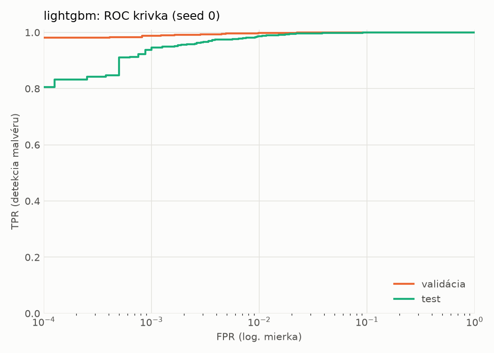
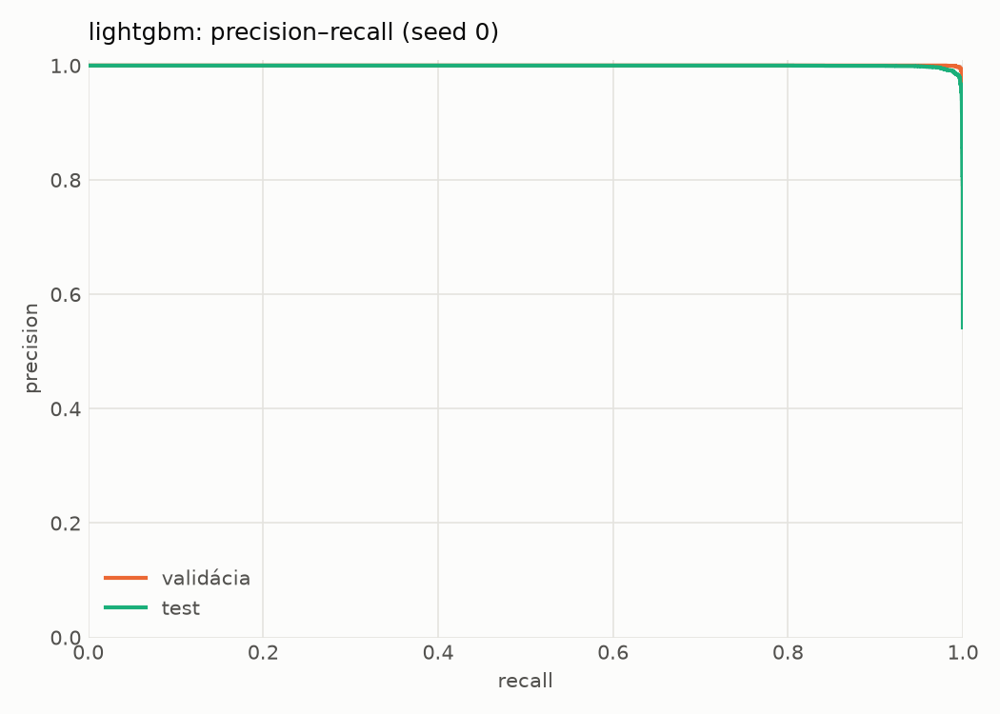
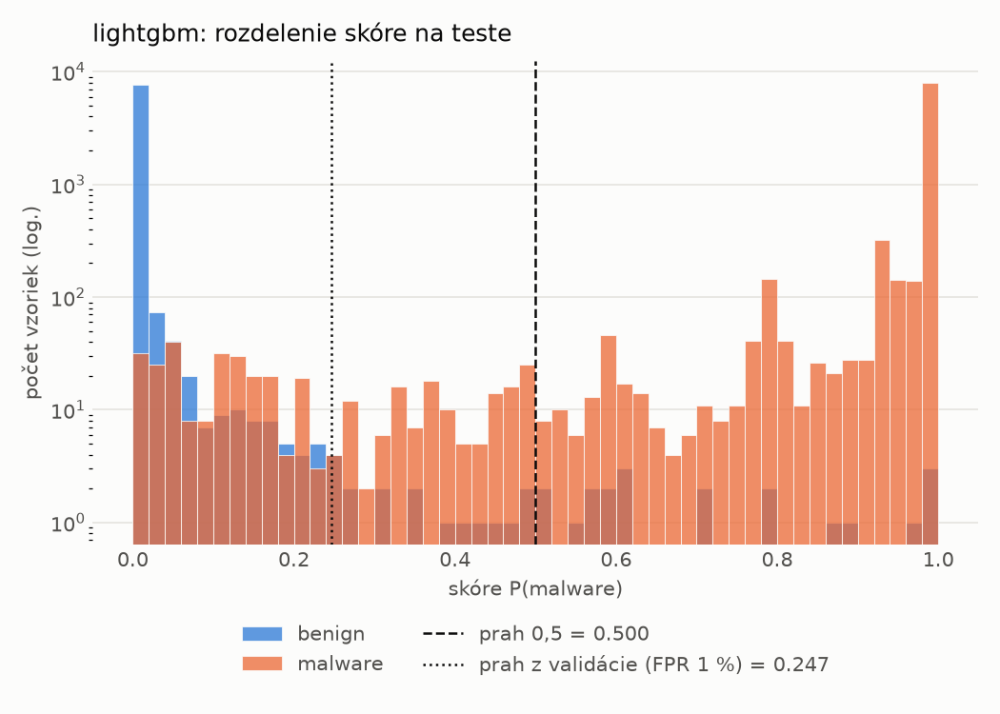
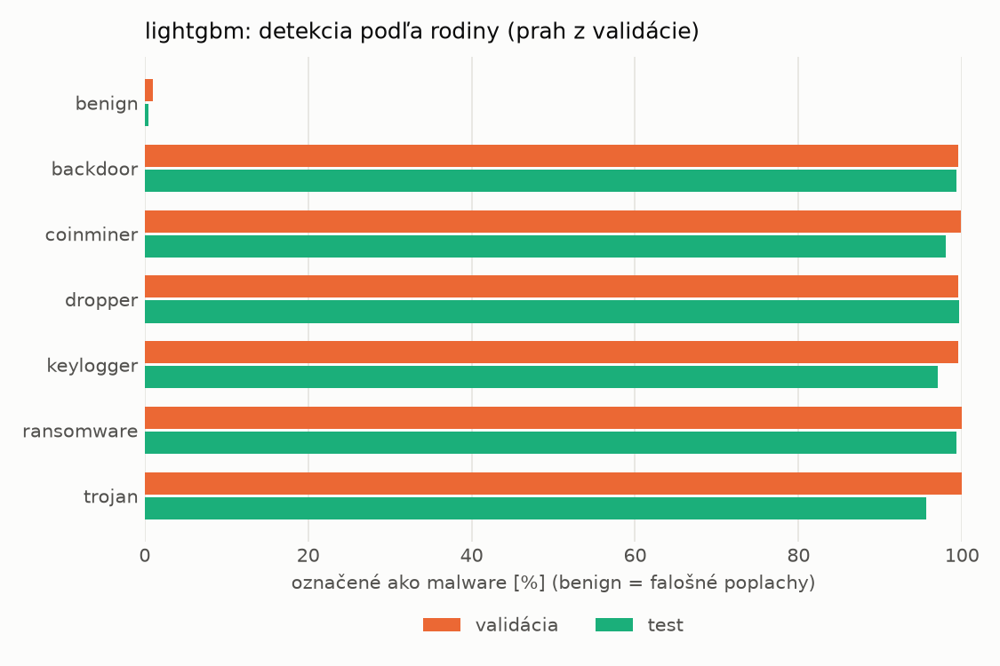
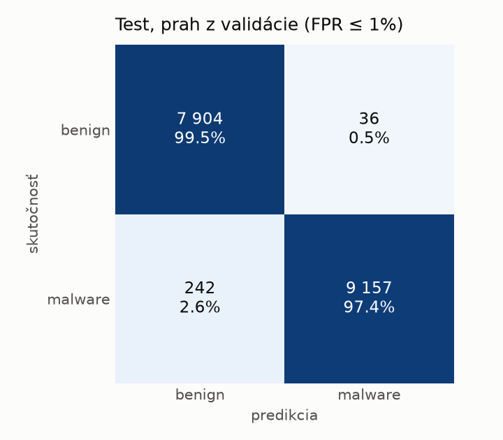
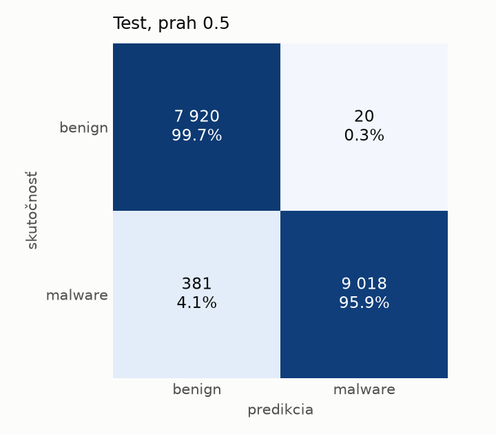
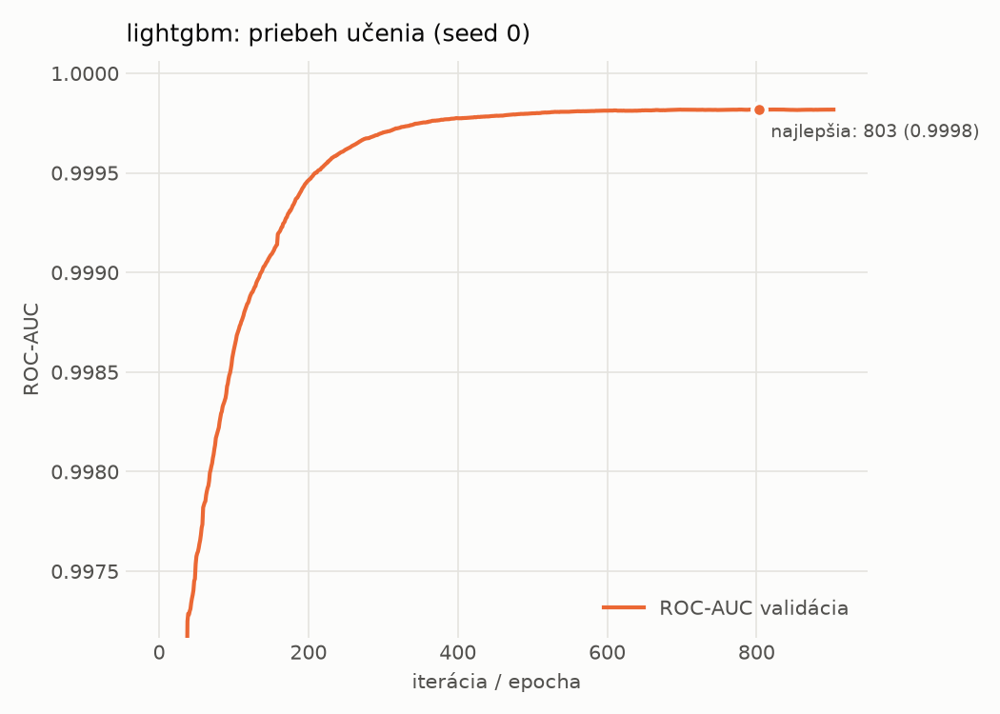

# static/lightgbm – beh `20261104-080300`

> Automaticky generované (`src/training/run_tabular.py`). Konfigurácia: `config.yaml`, protokol: `protocol.yaml`.

- **Model:** `lightgbm` – LightGBM, gradient boosting stromov s early stopping na validácii (pôvodné hodnoty príznakov)
- **Ladenie:** bez ladenia – hyperparametre prevzaté z `runs_final/static/lightgbm/20261101-215345`
- **Finálne modely:** seedy [0, 1, 2]; hodnoty sú priemer ± smerodajná odchýlka cez seedy
- **Najlepšie hyperparametre:** `{"num_boost_round": 5000, "early_stopping_rounds": 100, "learning_rate": 0.017398074711291726, "num_leaves": 461, "min_child_samples": 101, "feature_fraction": 0.9576492590949324, "bagging_fraction": 0.9474136752138245, "lambda_l1": 0.002404915432737351, "lambda_l2": 1.9809253750493907}`

## Detekčná kvalita (bez prahu)
| metrika | train (podvzorka) | validácia | test |
|---|---|---|---|
| ROC-AUC | 1.0000 ± 0.0000 | 0.9998 ± 0.0000 | 0.9993 ± 0.0001 |
| PR-AUC | 1.0000 ± 0.0000 | 0.9999 ± 0.0000 | 0.9994 ± 0.0000 |
| TPR pri FPR 1 % | 1.0000 ± 0.0000 | 0.9976 ± 0.0001 | 0.9876 ± 0.0013 |
| TPR pri FPR 0,1 % | 1.0000 ± 0.0000 | 0.9884 ± 0.0008 | 0.9443 ± 0.0063 |
| log loss | 0.0005 ± 0.0003 | 0.0137 ± 0.0001 | 0.0604 ± 0.0013 |
| Brier skóre | 0.0000 ± 0.0000 | 0.0037 ± 0.0001 | 0.0169 ± 0.0004 |

Rozdiel ROC-AUC train − validácia: **0.0002** (veľký rozdiel = preučenie).

## Pri prahu z validácie (FPR ≤ 1% na validácii)
| metrika | train (podvzorka) | validácia | test |
|---|---|---|---|
| accuracy | 1.0000 ± 0.0000 | 0.9952 ± 0.0002 | 0.9844 ± 0.0005 |
| balanced accuracy | 1.0000 ± 0.0000 | 0.9940 ± 0.0003 | 0.9853 ± 0.0005 |
| precision | 1.0000 ± 0.0000 | 0.9952 ± 0.0002 | 0.9961 ± 0.0003 |
| recall (TPR) | 1.0000 ± 0.0000 | 0.9976 ± 0.0001 | 0.9751 ± 0.0012 |
| FPR | 0.0000 ± 0.0000 | 0.0096 ± 0.0005 | 0.0046 ± 0.0003 |
| F1 | 1.0000 ± 0.0000 | 0.9964 ± 0.0002 | 0.9855 ± 0.0005 |
| MCC | 1.0000 ± 0.0000 | 0.9892 ± 0.0005 | 0.9689 ± 0.0010 |

## Pri pevnom prahu 0.5
| metrika | train (podvzorka) | validácia | test |
|---|---|---|---|
| accuracy | 1.0000 ± 0.0000 | 0.9955 ± 0.0002 | 0.9779 ± 0.0009 |
| balanced accuracy | 1.0000 ± 0.0000 | 0.9954 ± 0.0001 | 0.9795 ± 0.0009 |
| precision | 1.0000 ± 0.0000 | 0.9974 ± 0.0001 | 0.9981 ± 0.0003 |
| recall (TPR) | 1.0000 ± 0.0000 | 0.9958 ± 0.0003 | 0.9611 ± 0.0015 |
| FPR | 0.0000 ± 0.0000 | 0.0051 ± 0.0002 | 0.0022 ± 0.0003 |
| F1 | 1.0000 ± 0.0000 | 0.9966 ± 0.0001 | 0.9793 ± 0.0009 |
| MCC | 1.0000 ± 0.0000 | 0.9899 ± 0.0004 | 0.9565 ± 0.0018 |

## Výpočtové nároky (seed 0, testovacia množina)
| meranie | hodnota |
|---|---|
| tréning finálneho modelu | 185.4 s (priemer cez seedy) |
| ladenie spolu | 0 s |
| počet parametrov / uzlov | 228 229 |
| veľkosť modelu na disku | 13.23 MB |
| CPU latencia modelu (batch 1, 1 vlákno) | 0.144 ms (p95 0.187) |
| CPU priepustnosť (24 vlákien) | 104 093 vzoriek/s |

## Grafy
| | |
|---|---|
|  |  |
|  |  |
|  |  |
|  |  |

## Súbory
`metrics.json` (všetky metriky po seedoch vrátane rodín), `timing.json`, `hpo_trials.csv`,
`predictions/<časť>_seed<N>.parquet` (sha256, family, label, score), `model/seed_<N>/`, `log.txt`.
