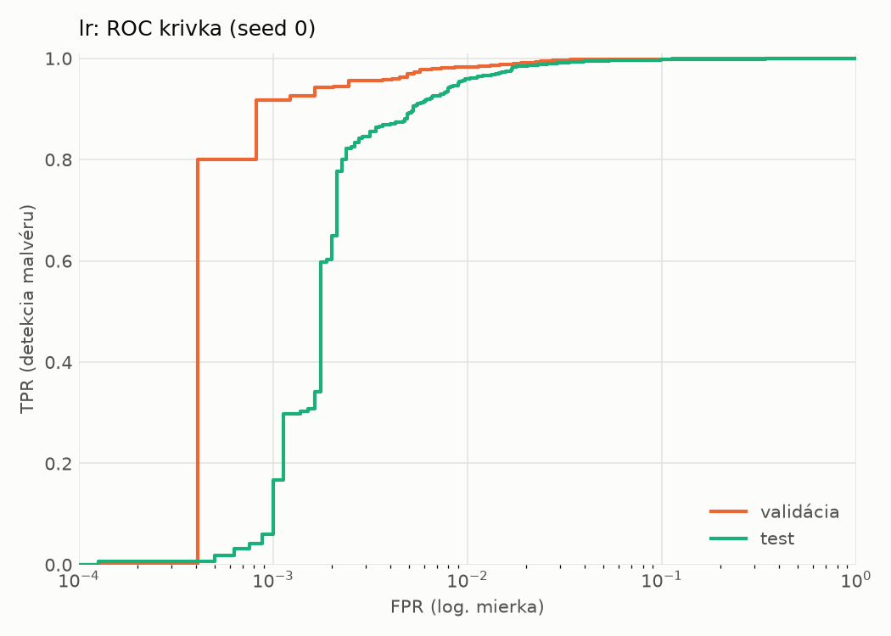
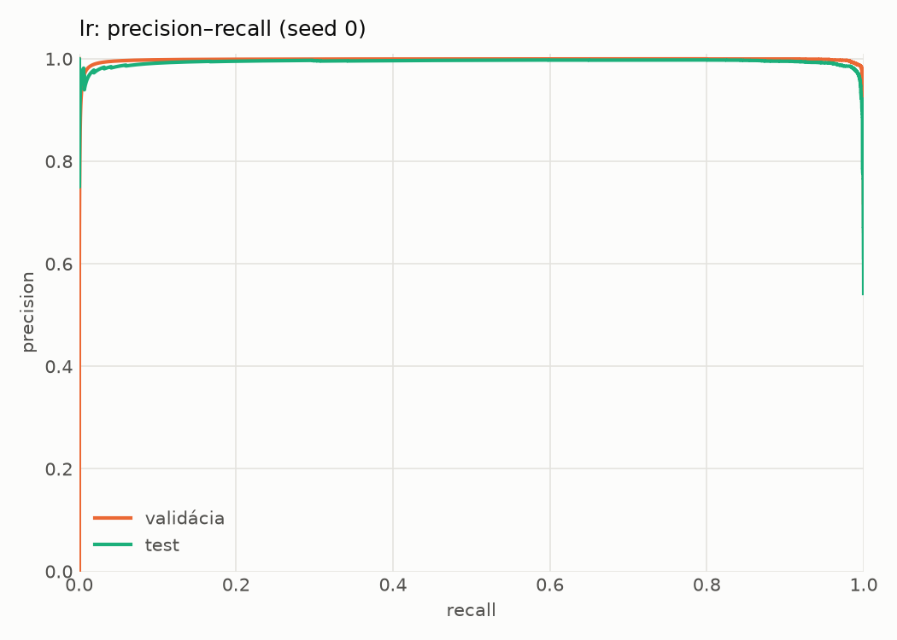
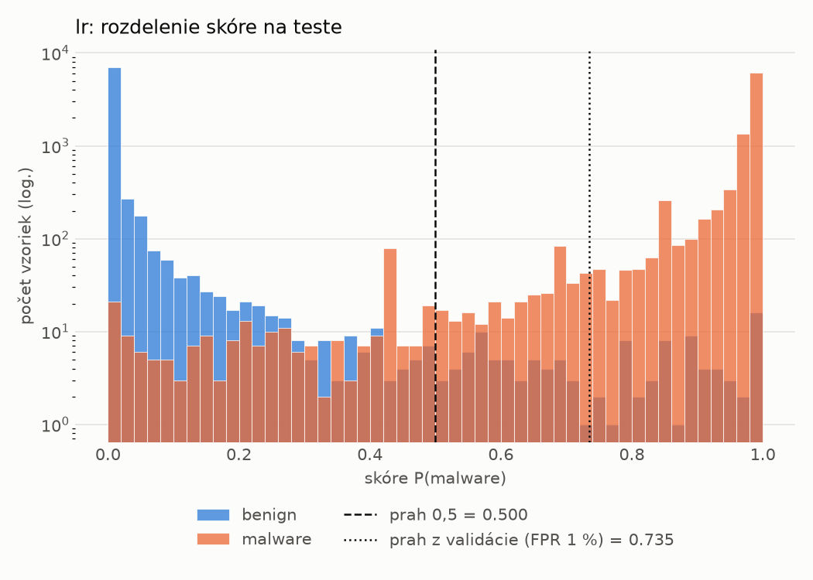
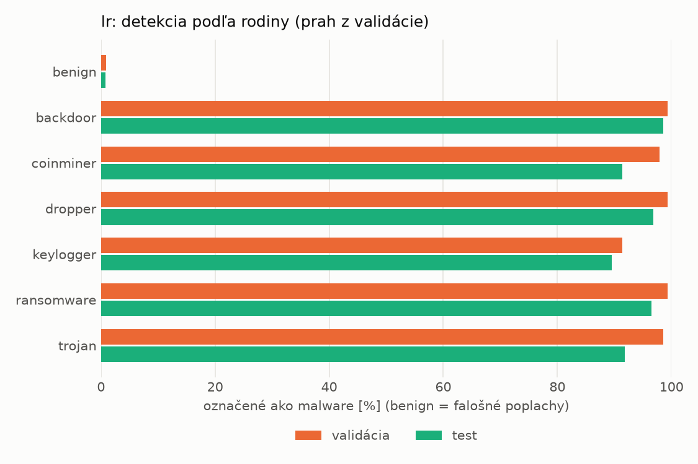
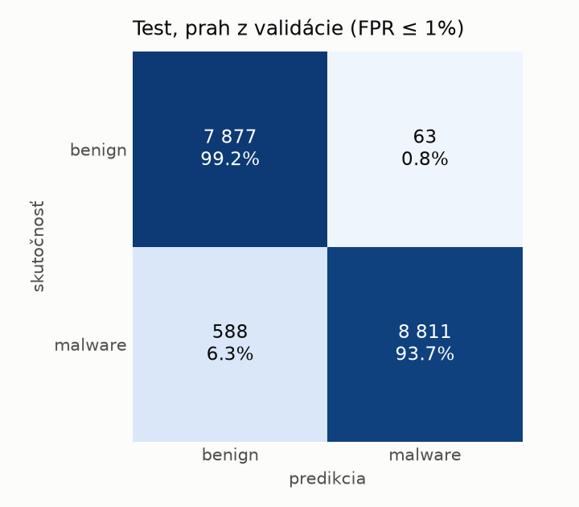
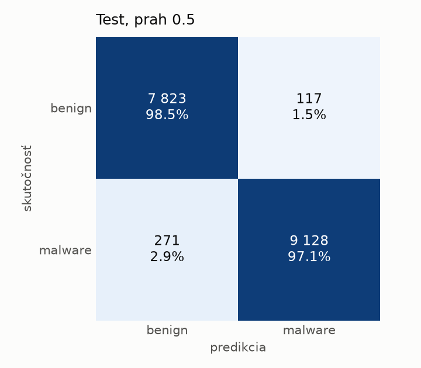

# static/lr – beh `20261104-080123`

> Automaticky generované (`src/training/run_tabular.py`). Konfigurácia: `config.yaml`, protokol: `protocol.yaml`.

- **Model:** `logreg` – logistická regresia s L2 regularizáciou (vstup signed log1p + štandardizácia)
- **Ladenie:** bez ladenia – hyperparametre prevzaté z `runs_final/static/lr/20261101-213555`
- **Finálne modely:** seedy [0, 1, 2]; hodnoty sú priemer ± smerodajná odchýlka cez seedy
- **Najlepšie hyperparametre:** `{"max_iter": 2000, "C": 0.00515917154582608}`

## Detekčná kvalita (bez prahu)
| metrika | train (podvzorka) | validácia | test |
|---|---|---|---|
| ROC-AUC | 0.9996 ± 0.0000 | 0.9986 ± 0.0000 | 0.9963 ± 0.0000 |
| PR-AUC | 0.9998 ± 0.0000 | 0.9980 ± 0.0000 | 0.9936 ± 0.0000 |
| TPR pri FPR 1 % | 0.9926 ± 0.0000 | 0.9830 ± 0.0000 | 0.9590 ± 0.0000 |
| TPR pri FPR 0,1 % | 0.9445 ± 0.0000 | 0.9173 ± 0.0000 | 0.0597 ± 0.0000 |
| log loss | 0.0290 ± 0.0000 | 0.0399 ± 0.0000 | 0.0713 ± 0.0000 |
| Brier skóre | 0.0066 ± 0.0000 | 0.0093 ± 0.0000 | 0.0170 ± 0.0000 |

Rozdiel ROC-AUC train − validácia: **0.0010** (veľký rozdiel = preučenie).

## Pri prahu z validácie (FPR ≤ 1% na validácii)
| metrika | train (podvzorka) | validácia | test |
|---|---|---|---|
| accuracy | 0.9885 ± 0.0000 | 0.9855 ± 0.0000 | 0.9625 ± 0.0000 |
| balanced accuracy | 0.9901 ± 0.0000 | 0.9868 ± 0.0000 | 0.9648 ± 0.0000 |
| precision | 0.9974 ± 0.0000 | 0.9952 ± 0.0000 | 0.9929 ± 0.0000 |
| recall (TPR) | 0.9851 ± 0.0000 | 0.9830 ± 0.0000 | 0.9374 ± 0.0000 |
| FPR | 0.0050 ± 0.0000 | 0.0094 ± 0.0000 | 0.0079 ± 0.0000 |
| F1 | 0.9912 ± 0.0000 | 0.9890 ± 0.0000 | 0.9644 ± 0.0000 |
| MCC | 0.9747 ± 0.0000 | 0.9679 ± 0.0000 | 0.9265 ± 0.0000 |

## Pri pevnom prahu 0.5
| metrika | train (podvzorka) | validácia | test |
|---|---|---|---|
| accuracy | 0.9916 ± 0.0000 | 0.9873 ± 0.0000 | 0.9776 ± 0.0000 |
| balanced accuracy | 0.9912 ± 0.0000 | 0.9859 ± 0.0000 | 0.9782 ± 0.0000 |
| precision | 0.9947 ± 0.0000 | 0.9906 ± 0.0000 | 0.9873 ± 0.0000 |
| recall (TPR) | 0.9926 ± 0.0000 | 0.9902 ± 0.0000 | 0.9712 ± 0.0000 |
| FPR | 0.0102 ± 0.0000 | 0.0184 ± 0.0000 | 0.0147 ± 0.0000 |
| F1 | 0.9936 ± 0.0000 | 0.9904 ± 0.0000 | 0.9792 ± 0.0000 |
| MCC | 0.9814 ± 0.0000 | 0.9716 ± 0.0000 | 0.9551 ± 0.0000 |

## Výpočtové nároky (seed 0, testovacia množina)
| meranie | hodnota |
|---|---|
| tréning finálneho modelu | 2.3 s (priemer cez seedy) |
| ladenie spolu | 0 s |
| počet parametrov / uzlov | 2 320 |
| veľkosť modelu na disku | 0.07 MB |
| transformácia vstupu – latencia (1 vlákno) | 0.021 ms |
| transformácia vstupu – priepustnosť | 43 186 vzoriek/s |
| CPU latencia modelu (batch 1, 1 vlákno) | 0.006 ms (p95 0.006) |
| CPU priepustnosť (24 vlákien) | 293 492 vzoriek/s |

## Grafy
| | |
|---|---|
|  |  |
|  |  |
|  |  |
|  |  |

## Súbory
`metrics.json` (všetky metriky po seedoch vrátane rodín), `timing.json`, `hpo_trials.csv`,
`predictions/<časť>_seed<N>.parquet` (sha256, family, label, score), `model/seed_<N>/`, `log.txt`.
