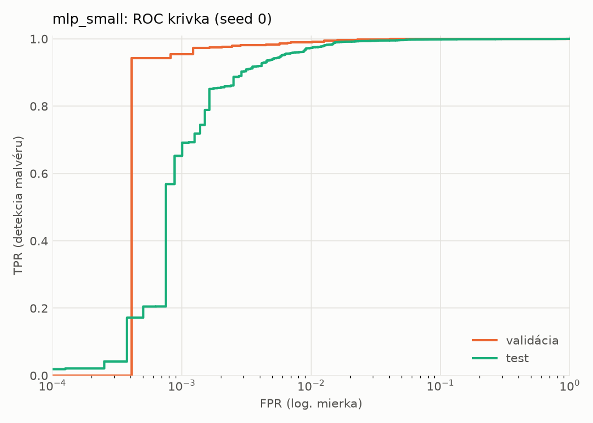
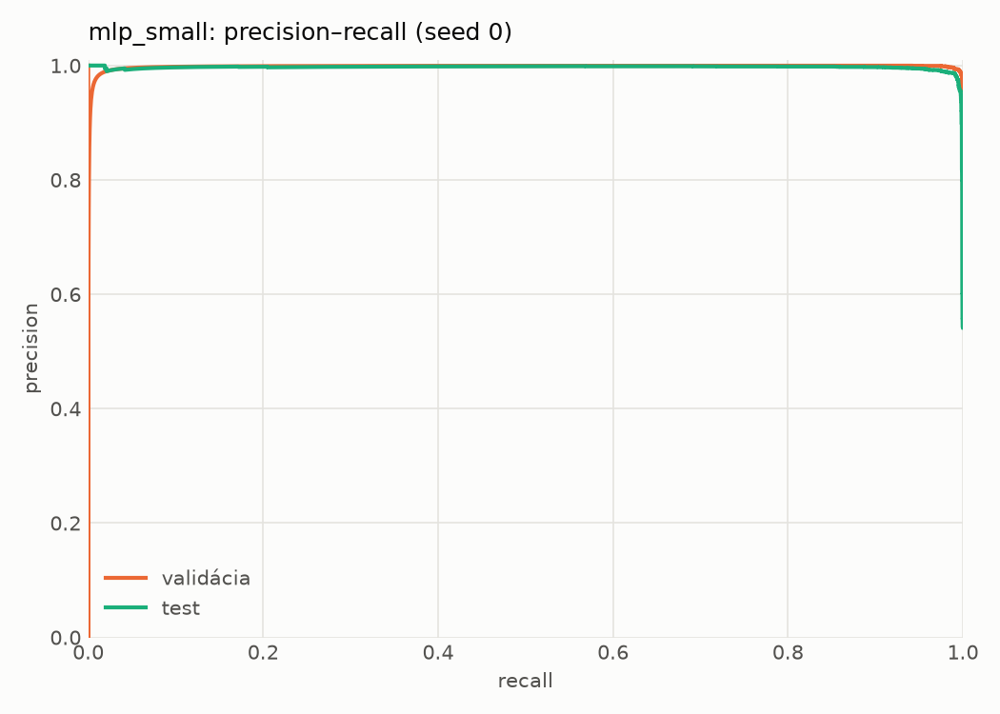
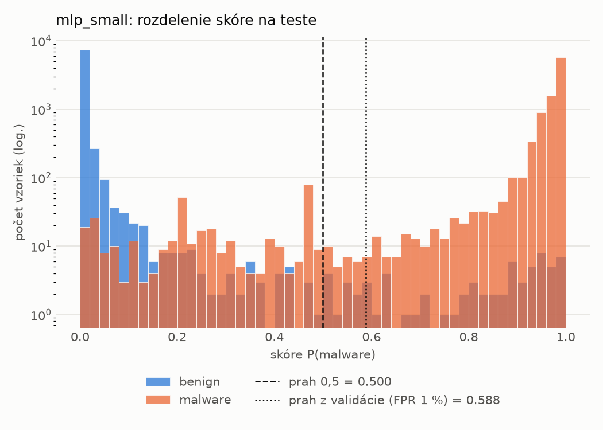
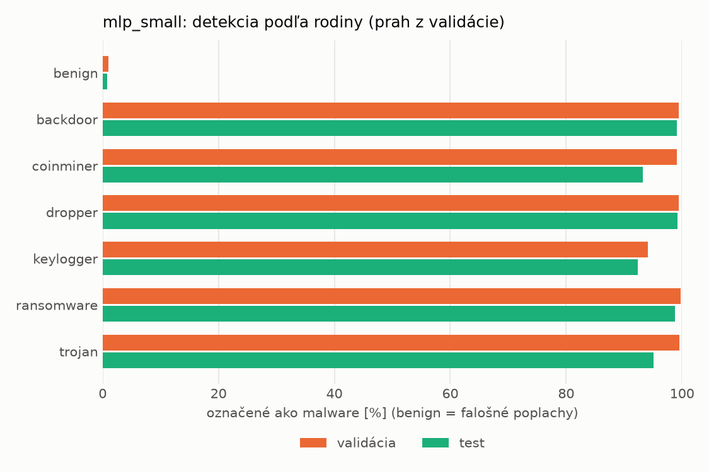
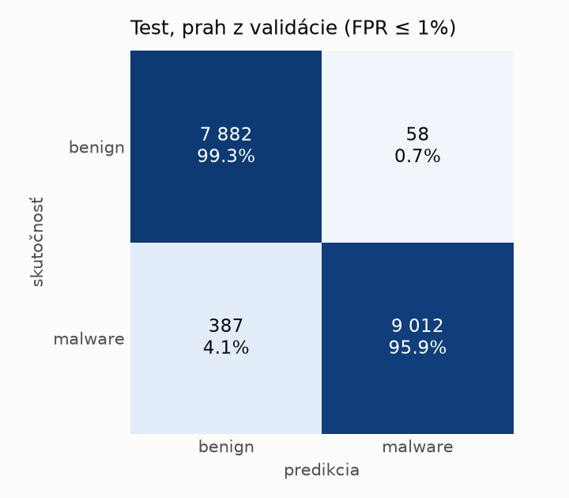
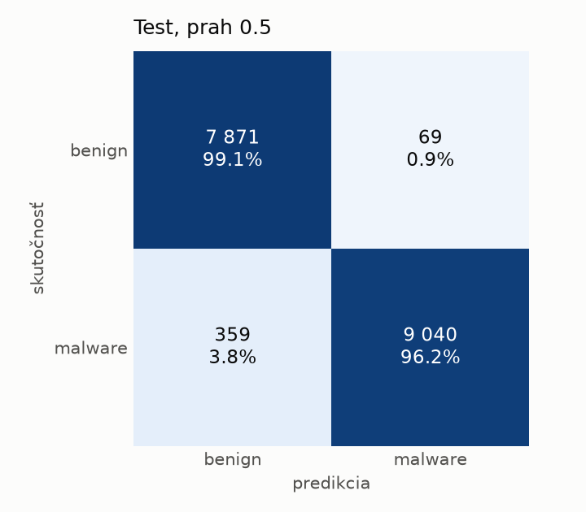
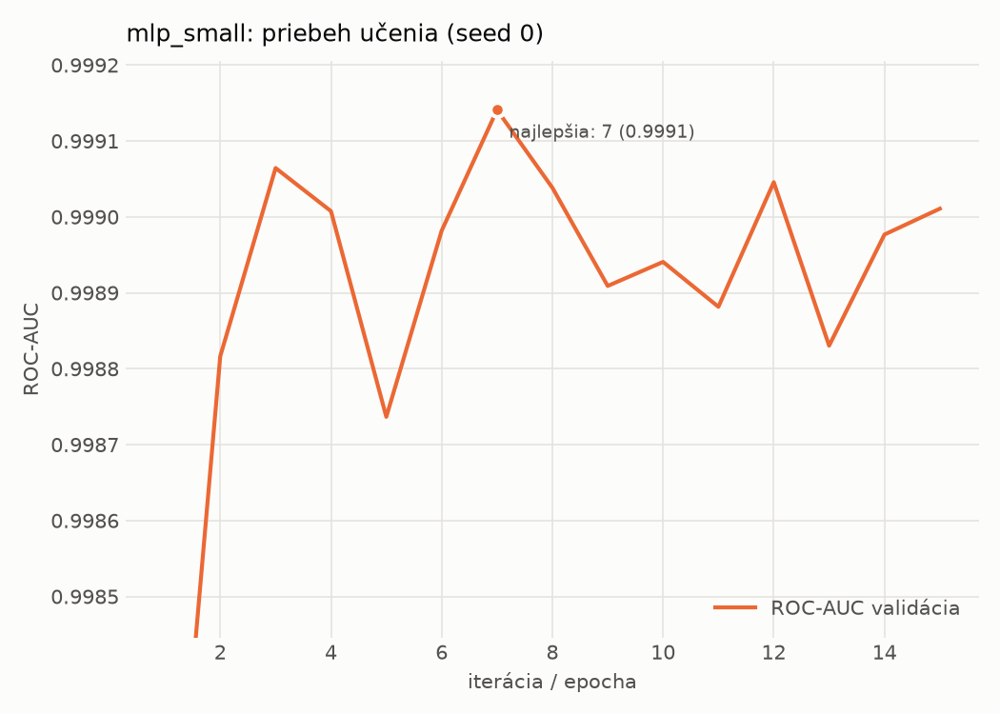

# static/mlp_small – beh `20261104-081228`

> Automaticky generované (`src/training/run_tabular.py`). Konfigurácia: `config.yaml`, protokol: `protocol.yaml`.

- **Model:** `mlp` – malá neurónová sieť (1–2 skryté vrstvy), kandidát na ľahkého študenta
- **Ladenie:** bez ladenia – hyperparametre prevzaté z `runs_final/static/mlp_small/20261101-235005`
- **Finálne modely:** seedy [0, 1, 2]; hodnoty sú priemer ± smerodajná odchýlka cez seedy
- **Najlepšie hyperparametre:** `{"width_decay": 0.5, "max_epochs": 100, "patience": 8, "hidden_layers": 2, "hidden_width": 32, "dropout": 0.15212112147976886, "lr": 0.0005958389350068958, "weight_decay": 5.34293726127978e-05, "batch_size": 512}`

## Detekčná kvalita (bez prahu)
| metrika | train (podvzorka) | validácia | test |
|---|---|---|---|
| ROC-AUC | 0.9999 ± 0.0001 | 0.9991 ± 0.0001 | 0.9975 ± 0.0004 |
| PR-AUC | 0.9999 ± 0.0000 | 0.9981 ± 0.0001 | 0.9959 ± 0.0022 |
| TPR pri FPR 1 % | 0.9977 ± 0.0013 | 0.9896 ± 0.0011 | 0.9729 ± 0.0019 |
| TPR pri FPR 0,1 % | 0.9859 ± 0.0069 | 0.9455 ± 0.0072 | 0.4771 ± 0.3978 |
| log loss | 0.0326 ± 0.0231 | 0.0432 ± 0.0219 | 0.0721 ± 0.0214 |
| Brier skóre | 0.0045 ± 0.0023 | 0.0077 ± 0.0020 | 0.0171 ± 0.0036 |

Rozdiel ROC-AUC train − validácia: **0.0008** (veľký rozdiel = preučenie).

## Pri prahu z validácie (FPR ≤ 1% na validácii)
| metrika | train (podvzorka) | validácia | test |
|---|---|---|---|
| accuracy | 0.9940 ± 0.0016 | 0.9899 ± 0.0007 | 0.9720 ± 0.0061 |
| balanced accuracy | 0.9945 ± 0.0014 | 0.9901 ± 0.0005 | 0.9737 ± 0.0056 |
| precision | 0.9978 ± 0.0005 | 0.9952 ± 0.0002 | 0.9942 ± 0.0006 |
| recall (TPR) | 0.9931 ± 0.0019 | 0.9896 ± 0.0011 | 0.9539 ± 0.0117 |
| FPR | 0.0042 ± 0.0009 | 0.0094 ± 0.0004 | 0.0066 ± 0.0007 |
| F1 | 0.9955 ± 0.0012 | 0.9924 ± 0.0005 | 0.9736 ± 0.0059 |
| MCC | 0.9868 ± 0.0034 | 0.9776 ± 0.0016 | 0.9448 ± 0.0116 |

## Pri pevnom prahu 0.5
| metrika | train (podvzorka) | validácia | test |
|---|---|---|---|
| accuracy | 0.9949 ± 0.0014 | 0.9909 ± 0.0011 | 0.9782 ± 0.0032 |
| balanced accuracy | 0.9945 ± 0.0013 | 0.9900 ± 0.0009 | 0.9792 ± 0.0030 |
| precision | 0.9965 ± 0.0011 | 0.9935 ± 0.0005 | 0.9923 ± 0.0003 |
| recall (TPR) | 0.9958 ± 0.0021 | 0.9928 ± 0.0017 | 0.9673 ± 0.0059 |
| FPR | 0.0068 ± 0.0021 | 0.0128 ± 0.0009 | 0.0089 ± 0.0004 |
| F1 | 0.9961 ± 0.0011 | 0.9931 ± 0.0009 | 0.9796 ± 0.0031 |
| MCC | 0.9887 ± 0.0031 | 0.9796 ± 0.0025 | 0.9566 ± 0.0063 |

## Výpočtové nároky (seed 0, testovacia množina)
| meranie | hodnota |
|---|---|
| tréning finálneho modelu | 7.0 s (priemer cez seedy) |
| ladenie spolu | 0 s |
| počet parametrov / uzlov | 74 881 |
| veľkosť modelu na disku | 0.36 MB |
| transformácia vstupu – latencia (1 vlákno) | 0.041 ms |
| transformácia vstupu – priepustnosť | 45 447 vzoriek/s |
| CPU latencia modelu (batch 1, 1 vlákno) | 0.097 ms (p95 0.119) |
| CPU priepustnosť (24 vlákien) | 109 182 vzoriek/s |
| GPU latencia (batch 1) | 0.382 ms (p95 0.494) |
| GPU priepustnosť | 78 351 vzoriek/s |
| GPU špičková pamäť | 855 MB |

## Grafy
| | |
|---|---|
|  |  |
|  |  |
|  |  |
|  |  |

## Súbory
`metrics.json` (všetky metriky po seedoch vrátane rodín), `timing.json`, `hpo_trials.csv`,
`predictions/<časť>_seed<N>.parquet` (sha256, family, label, score), `model/seed_<N>/`, `log.txt`.
