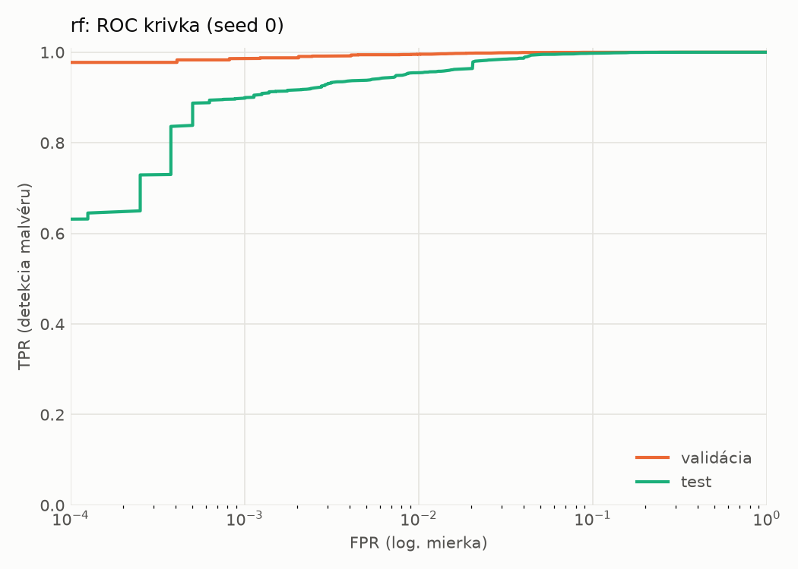
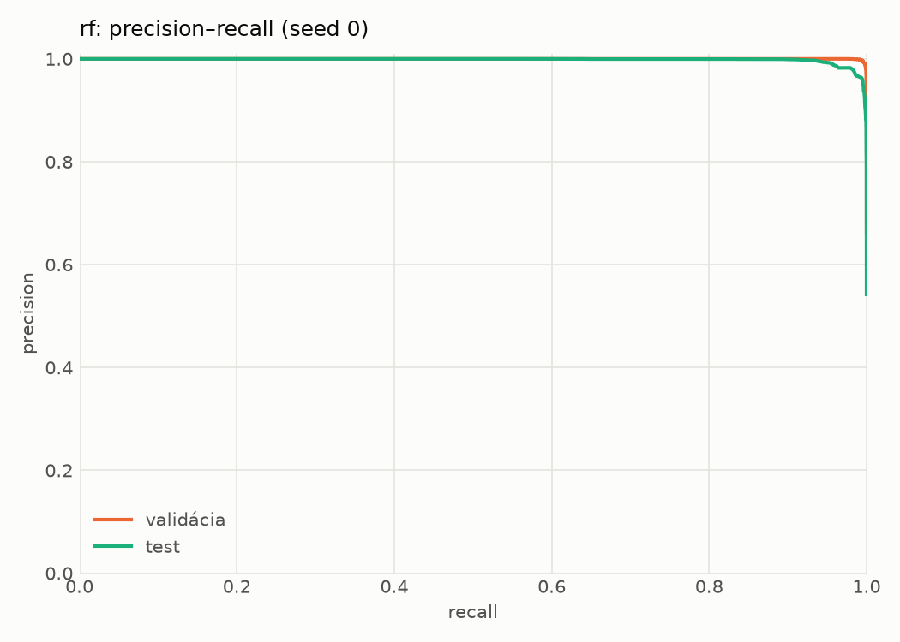
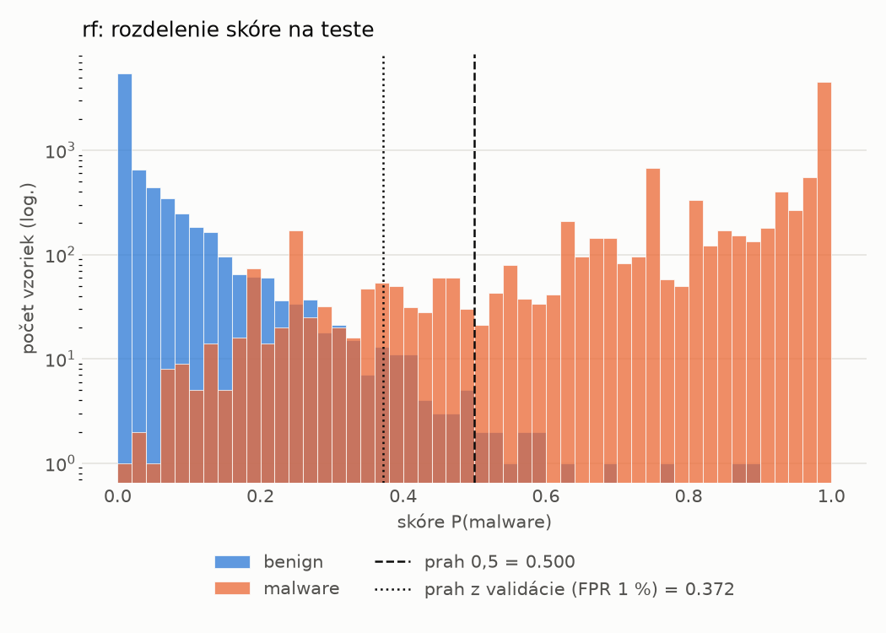
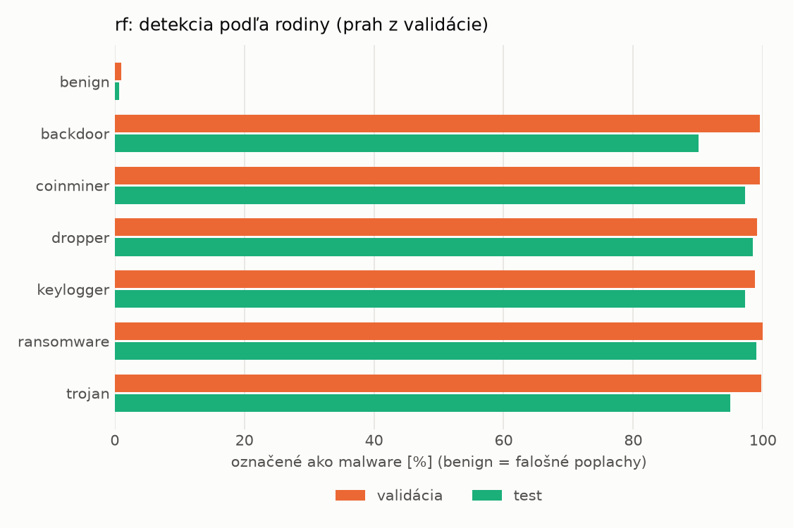
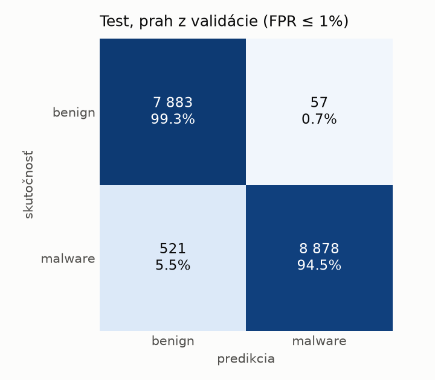
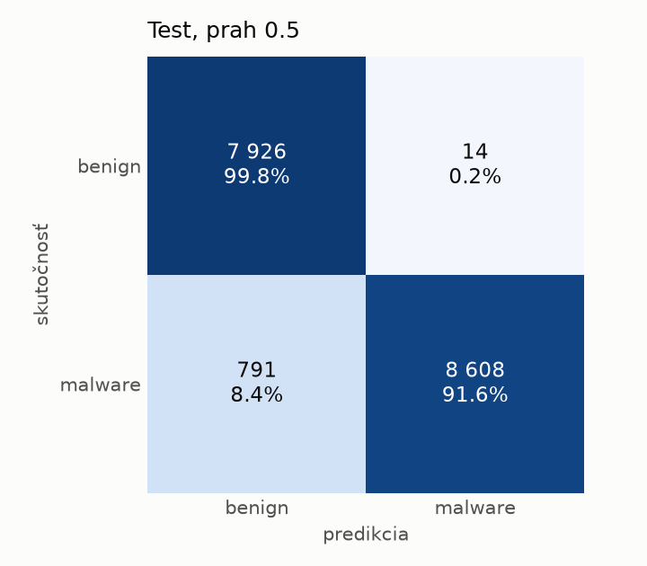

# static/rf – beh `20261104-080139`

> Automaticky generované (`src/training/run_tabular.py`). Konfigurácia: `config.yaml`, protokol: `protocol.yaml`.

- **Model:** `random_forest` – Random Forest (pôvodné hodnoty príznakov)
- **Ladenie:** bez ladenia – hyperparametre prevzaté z `runs_final/static/rf/20261101-213728`
- **Finálne modely:** seedy [0, 1, 2]; hodnoty sú priemer ± smerodajná odchýlka cez seedy
- **Najlepšie hyperparametre:** `{"n_estimators": 250, "max_depth": null, "min_samples_leaf": 1, "max_features": "sqrt"}`

## Detekčná kvalita (bez prahu)
| metrika | train (podvzorka) | validácia | test |
|---|---|---|---|
| ROC-AUC | 1.0000 ± 0.0000 | 0.9998 ± 0.0000 | 0.9980 ± 0.0000 |
| PR-AUC | 1.0000 ± 0.0000 | 0.9999 ± 0.0000 | 0.9984 ± 0.0000 |
| TPR pri FPR 1 % | 1.0000 ± 0.0000 | 0.9953 ± 0.0002 | 0.9545 ± 0.0012 |
| TPR pri FPR 0,1 % | 1.0000 ± 0.0000 | 0.9853 ± 0.0005 | 0.8968 ± 0.0028 |
| log loss | 0.0080 ± 0.0001 | 0.0250 ± 0.0002 | 0.1269 ± 0.0019 |
| Brier skóre | 0.0010 ± 0.0000 | 0.0058 ± 0.0000 | 0.0362 ± 0.0007 |

Rozdiel ROC-AUC train − validácia: **0.0002** (veľký rozdiel = preučenie).

## Pri prahu z validácie (FPR ≤ 1% na validácii)
| metrika | train (podvzorka) | validácia | test |
|---|---|---|---|
| accuracy | 1.0000 ± 0.0000 | 0.9936 ± 0.0001 | 0.9677 ± 0.0019 |
| balanced accuracy | 1.0000 ± 0.0000 | 0.9928 ± 0.0000 | 0.9696 ± 0.0017 |
| precision | 1.0000 ± 0.0000 | 0.9951 ± 0.0001 | 0.9938 ± 0.0005 |
| recall (TPR) | 1.0000 ± 0.0000 | 0.9953 ± 0.0002 | 0.9463 ± 0.0039 |
| FPR | 0.0000 ± 0.0000 | 0.0097 ± 0.0002 | 0.0070 ± 0.0006 |
| F1 | 1.0000 ± 0.0000 | 0.9952 ± 0.0001 | 0.9694 ± 0.0018 |
| MCC | 1.0000 ± 0.0000 | 0.9857 ± 0.0002 | 0.9364 ± 0.0035 |

## Pri pevnom prahu 0.5
| metrika | train (podvzorka) | validácia | test |
|---|---|---|---|
| accuracy | 1.0000 ± 0.0000 | 0.9936 ± 0.0001 | 0.9539 ± 0.0010 |
| balanced accuracy | 1.0000 ± 0.0000 | 0.9942 ± 0.0001 | 0.9573 ± 0.0009 |
| precision | 1.0000 ± 0.0000 | 0.9979 ± 0.0000 | 0.9981 ± 0.0003 |
| recall (TPR) | 1.0000 ± 0.0000 | 0.9925 ± 0.0001 | 0.9167 ± 0.0018 |
| FPR | 0.0000 ± 0.0000 | 0.0041 ± 0.0000 | 0.0021 ± 0.0003 |
| F1 | 1.0000 ± 0.0000 | 0.9952 ± 0.0001 | 0.9556 ± 0.0010 |
| MCC | 1.0000 ± 0.0000 | 0.9858 ± 0.0002 | 0.9114 ± 0.0019 |

## Výpočtové nároky (seed 0, testovacia množina)
| meranie | hodnota |
|---|---|
| tréning finálneho modelu | 24.9 s (priemer cez seedy) |
| ladenie spolu | 0 s |
| počet parametrov / uzlov | 379 078 |
| veľkosť modelu na disku | 30.69 MB |
| CPU latencia modelu (batch 1, 1 vlákno) | 7.197 ms (p95 7.522) |
| CPU priepustnosť (24 vlákien) | 125 620 vzoriek/s |

## Grafy
| | |
|---|---|
|  |  |
|  |  |
|  |  |
|  |  |

## Súbory
`metrics.json` (všetky metriky po seedoch vrátane rodín), `timing.json`, `hpo_trials.csv`,
`predictions/<časť>_seed<N>.parquet` (sha256, family, label, score), `model/seed_<N>/`, `log.txt`.
