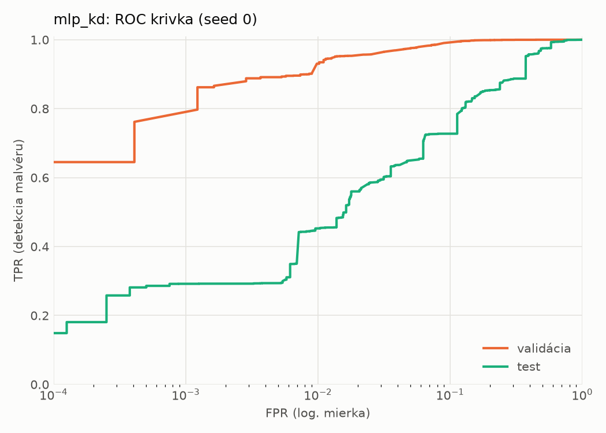
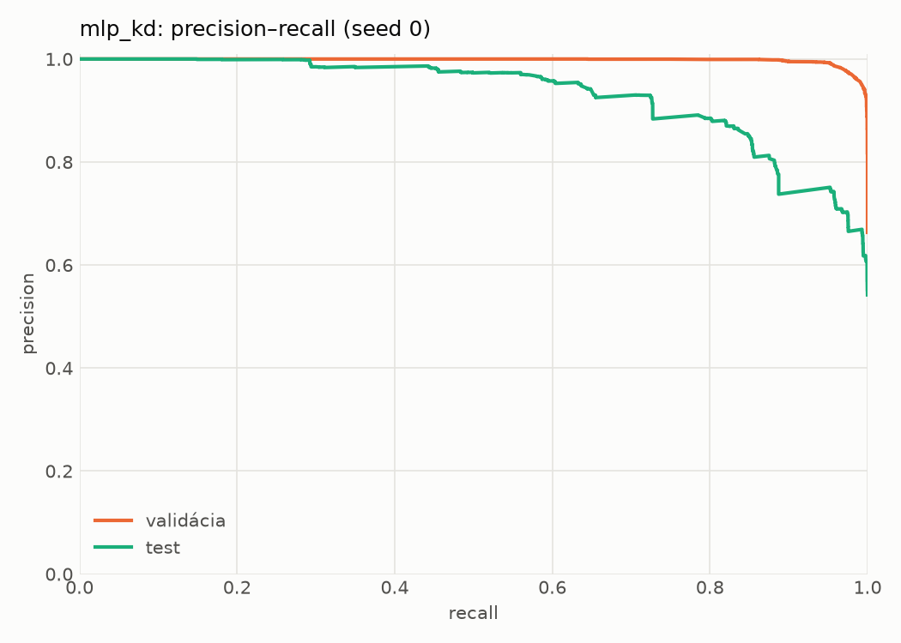
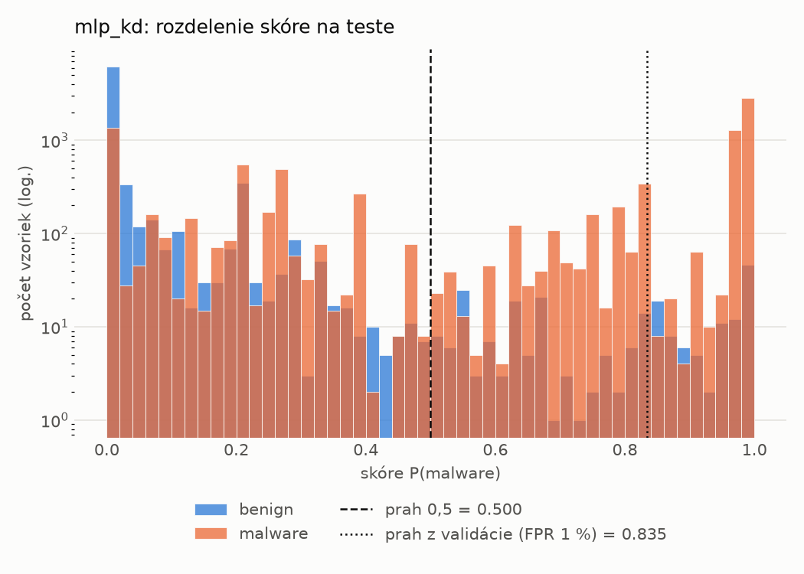
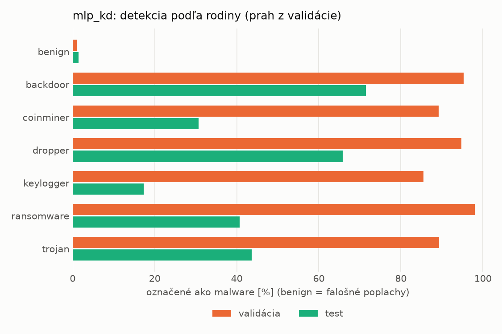
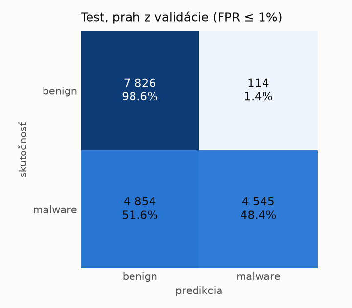
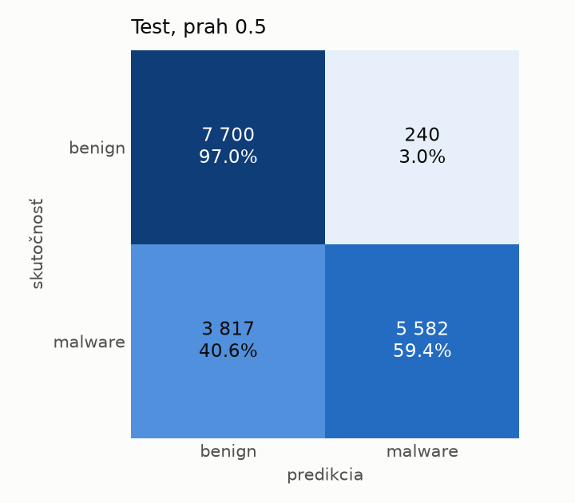
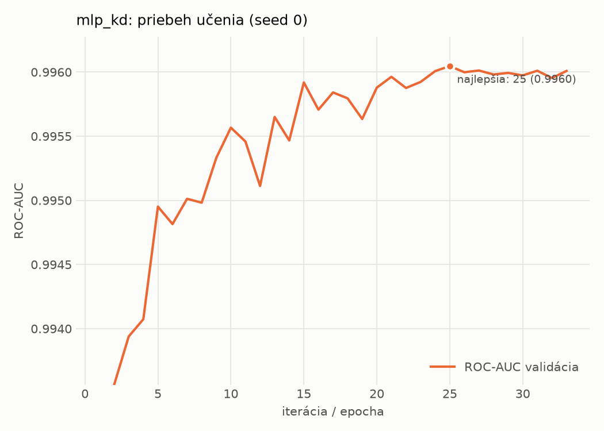

# dynamic/mlp_kd – beh `20261104-183809`

> Automaticky generované (`src/training/run_tabular.py`). Konfigurácia: `config.yaml`, protokol: `protocol.yaml`.

- **Model:** `mlp` – študent – malé MLP učené destiláciou z hybridného učiteľa
- **Ladenie:** bez ladenia – hyperparametre prevzaté z `runs_final/students_dynamic/mlp_kd/20261102-212132`
- **Finálne modely:** seedy [0, 1, 2]; hodnoty sú priemer ± smerodajná odchýlka cez seedy
- **Najlepšie hyperparametre:** `{"hidden_layers": 1, "max_epochs": 100, "patience": 8, "hidden_width": 32, "dropout": 0.14978534481914754, "lr": 0.0015794492400712224, "weight_decay": 1.2553588001973222e-06, "batch_size": 512, "kd_alpha": 0.7118939371172979, "kd_temperature": 1.298431487079528}`

## Detekčná kvalita (bez prahu)
| metrika | train (podvzorka) | validácia | test |
|---|---|---|---|
| ROC-AUC | 0.9972 ± 0.0001 | 0.9960 ± 0.0001 | 0.9040 ± 0.0115 |
| PR-AUC | 0.9985 ± 0.0000 | 0.9979 ± 0.0000 | 0.9236 ± 0.0097 |
| TPR pri FPR 1 % | 0.9419 ± 0.0008 | 0.9216 ± 0.0156 | 0.3992 ± 0.0860 |
| TPR pri FPR 0,1 % | 0.8892 ± 0.0023 | 0.7536 ± 0.0136 | 0.2821 ± 0.0149 |
| log loss | 0.0660 ± 0.0015 | 0.0807 ± 0.0002 | 0.7711 ± 0.0416 |
| Brier skóre | 0.0210 ± 0.0006 | 0.0240 ± 0.0003 | 0.1874 ± 0.0071 |

Rozdiel ROC-AUC train − validácia: **0.0013** (veľký rozdiel = preučenie).

## Pri prahu z validácie (FPR ≤ 1% na validácii)
| metrika | train (podvzorka) | validácia | test |
|---|---|---|---|
| accuracy | 0.9435 ± 0.0094 | 0.9447 ± 0.0103 | 0.7190 ± 0.0050 |
| balanced accuracy | 0.9555 ± 0.0070 | 0.9559 ± 0.0078 | 0.7396 ± 0.0046 |
| precision | 0.9964 ± 0.0004 | 0.9946 ± 0.0001 | 0.9749 ± 0.0036 |
| recall (TPR) | 0.9174 ± 0.0147 | 0.9216 ± 0.0156 | 0.4943 ± 0.0093 |
| FPR | 0.0064 ± 0.0008 | 0.0098 ± 0.0000 | 0.0151 ± 0.0023 |
| F1 | 0.9552 ± 0.0078 | 0.9567 ± 0.0085 | 0.6560 ± 0.0082 |
| MCC | 0.8845 ± 0.0173 | 0.8855 ± 0.0194 | 0.5348 ± 0.0074 |

## Pri pevnom prahu 0.5
| metrika | train (podvzorka) | validácia | test |
|---|---|---|---|
| accuracy | 0.9682 ± 0.0007 | 0.9636 ± 0.0007 | 0.7552 ± 0.0094 |
| balanced accuracy | 0.9720 ± 0.0005 | 0.9661 ± 0.0010 | 0.7708 ± 0.0099 |
| precision | 0.9915 ± 0.0006 | 0.9863 ± 0.0015 | 0.9407 ± 0.0266 |
| recall (TPR) | 0.9599 ± 0.0014 | 0.9585 ± 0.0017 | 0.5858 ± 0.0147 |
| FPR | 0.0159 ± 0.0012 | 0.0263 ± 0.0030 | 0.0442 ± 0.0219 |
| F1 | 0.9754 ± 0.0006 | 0.9722 ± 0.0005 | 0.7218 ± 0.0107 |
| MCC | 0.9313 ± 0.0014 | 0.9204 ± 0.0015 | 0.5708 ± 0.0238 |

## Výpočtové nároky (seed 0, testovacia množina)
| meranie | hodnota |
|---|---|
| tréning finálneho modelu | 8.2 s (priemer cez seedy) |
| ladenie spolu | 0 s |
| počet parametrov / uzlov | 64 129 |
| veľkosť modelu na disku | 0.31 MB |
| transformácia vstupu – latencia (1 vlákno) | 0.019 ms |
| transformácia vstupu – priepustnosť | 55 050 vzoriek/s |
| CPU latencia modelu (batch 1, 1 vlákno) | 0.067 ms (p95 0.074) |
| CPU priepustnosť (24 vlákien) | 96 050 vzoriek/s |
| GPU latencia (batch 1) | 0.454 ms (p95 0.486) |
| GPU priepustnosť | 101 014 vzoriek/s |
| GPU špičková pamäť | 740 MB |

## Grafy
| | |
|---|---|
|  |  |
|  |  |
|  |  |
|  |  |

## Súbory
`metrics.json` (všetky metriky po seedoch vrátane rodín), `timing.json`, `hpo_trials.csv`,
`predictions/<časť>_seed<N>.parquet` (sha256, family, label, score), `model/seed_<N>/`, `log.txt`.
