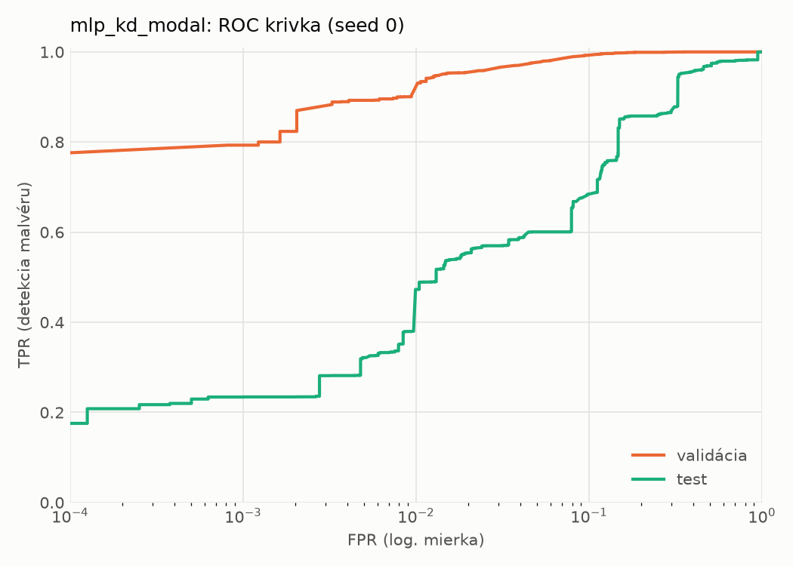
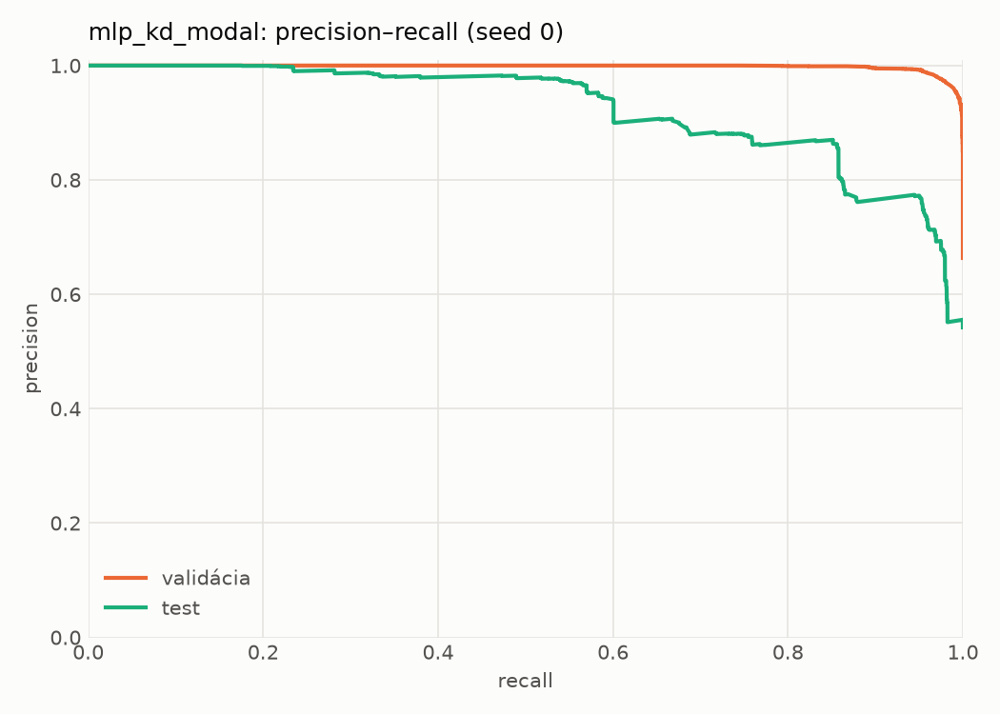
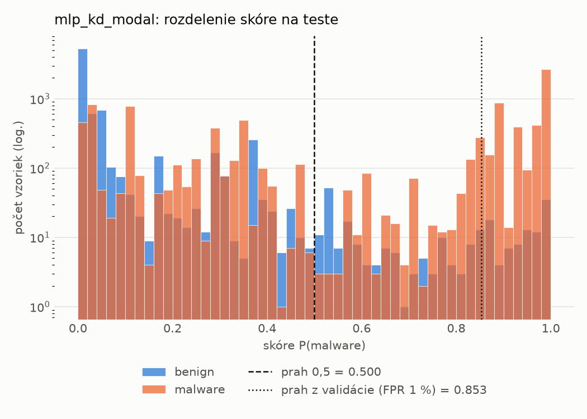
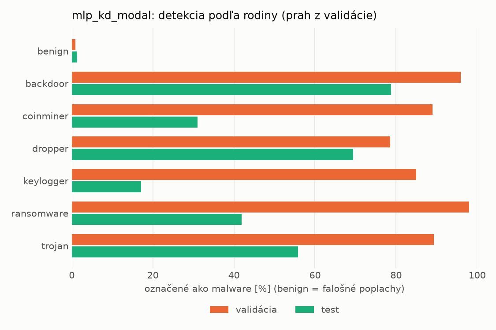
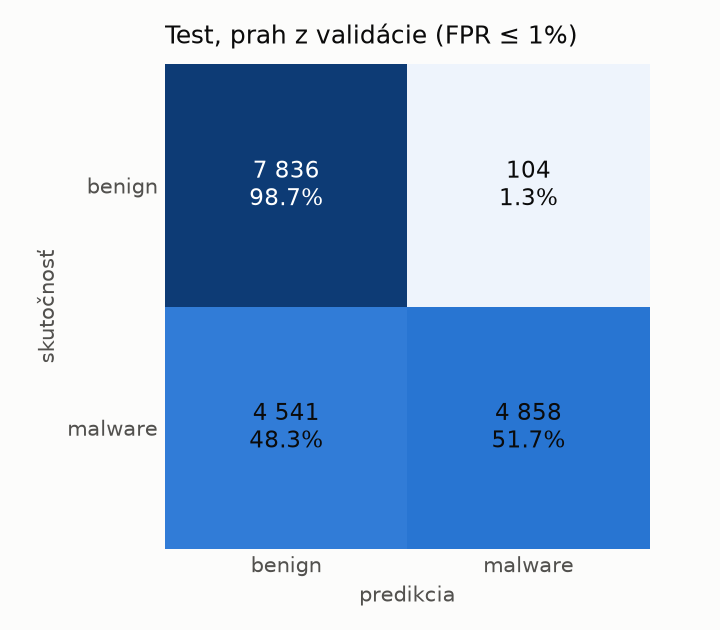
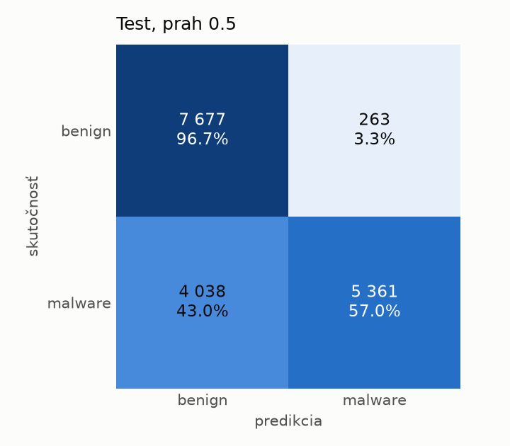
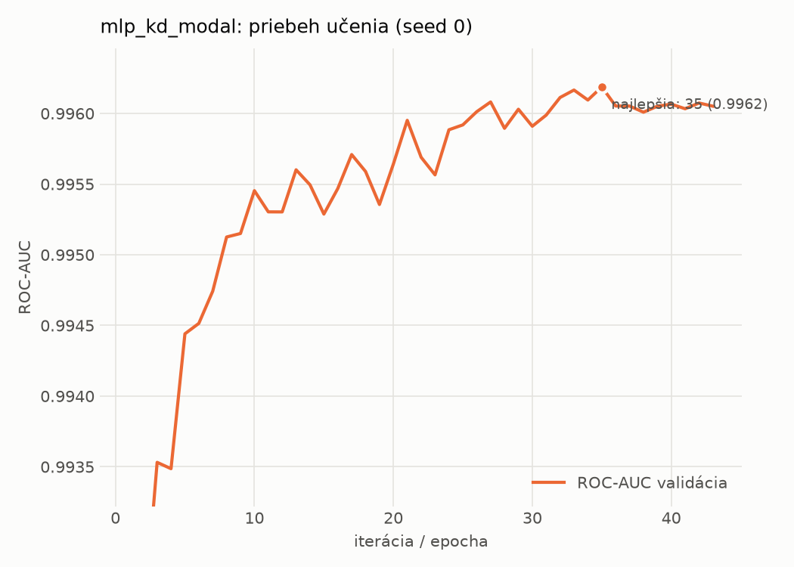

# dynamic/mlp_kd_modal – beh `20261104-183911`

> Automaticky generované (`src/training/run_tabular.py`). Konfigurácia: `config.yaml`, protokol: `protocol.yaml`.

- **Model:** `mlp` – študent – malé MLP učené destiláciou z učiteľa rovnakej modality (variant A)
- **Ladenie:** bez ladenia – hyperparametre prevzaté z `runs_final/students_dynamic/mlp_kd_modal/20261102-212954`
- **Finálne modely:** seedy [0, 1, 2]; hodnoty sú priemer ± smerodajná odchýlka cez seedy
- **Najlepšie hyperparametre:** `{"hidden_layers": 1, "max_epochs": 100, "patience": 8, "hidden_width": 32, "dropout": 0.14040860994340293, "lr": 0.00037778352941027736, "weight_decay": 1.149514965975221e-06, "batch_size": 512, "kd_alpha": 0.8818461482523741, "kd_temperature": 1.583698009756735}`

## Detekčná kvalita (bez prahu)
| metrika | train (podvzorka) | validácia | test |
|---|---|---|---|
| ROC-AUC | 0.9973 ± 0.0002 | 0.9961 ± 0.0001 | 0.9003 ± 0.0036 |
| PR-AUC | 0.9985 ± 0.0001 | 0.9980 ± 0.0000 | 0.9231 ± 0.0012 |
| TPR pri FPR 1 % | 0.9417 ± 0.0017 | 0.9140 ± 0.0176 | 0.4627 ± 0.0105 |
| TPR pri FPR 0,1 % | 0.8881 ± 0.0020 | 0.8002 ± 0.0369 | 0.2788 ± 0.0456 |
| log loss | 0.0659 ± 0.0036 | 0.0780 ± 0.0019 | 0.7230 ± 0.0144 |
| Brier skóre | 0.0207 ± 0.0012 | 0.0236 ± 0.0008 | 0.1815 ± 0.0081 |

Rozdiel ROC-AUC train − validácia: **0.0012** (veľký rozdiel = preučenie).

## Pri prahu z validácie (FPR ≤ 1% na validácii)
| metrika | train (podvzorka) | validácia | test |
|---|---|---|---|
| accuracy | 0.9385 ± 0.0111 | 0.9397 ± 0.0116 | 0.7255 ± 0.0057 |
| balanced accuracy | 0.9518 ± 0.0082 | 0.9522 ± 0.0087 | 0.7458 ± 0.0053 |
| precision | 0.9966 ± 0.0004 | 0.9947 ± 0.0000 | 0.9793 ± 0.0005 |
| recall (TPR) | 0.9096 ± 0.0173 | 0.9140 ± 0.0176 | 0.5042 ± 0.0110 |
| FPR | 0.0060 ± 0.0008 | 0.0096 ± 0.0002 | 0.0126 ± 0.0005 |
| F1 | 0.9511 ± 0.0092 | 0.9526 ± 0.0095 | 0.6656 ± 0.0095 |
| MCC | 0.8754 ± 0.0205 | 0.8763 ± 0.0218 | 0.5461 ± 0.0080 |

## Pri pevnom prahu 0.5
| metrika | train (podvzorka) | validácia | test |
|---|---|---|---|
| accuracy | 0.9693 ± 0.0025 | 0.9650 ± 0.0017 | 0.7704 ± 0.0218 |
| balanced accuracy | 0.9725 ± 0.0012 | 0.9672 ± 0.0003 | 0.7859 ± 0.0202 |
| precision | 0.9907 ± 0.0020 | 0.9865 ± 0.0022 | 0.9606 ± 0.0064 |
| recall (TPR) | 0.9624 ± 0.0057 | 0.9604 ± 0.0049 | 0.6009 ± 0.0390 |
| FPR | 0.0174 ± 0.0039 | 0.0259 ± 0.0045 | 0.0291 ± 0.0039 |
| F1 | 0.9763 ± 0.0020 | 0.9733 ± 0.0014 | 0.7389 ± 0.0304 |
| MCC | 0.9335 ± 0.0049 | 0.9233 ± 0.0032 | 0.6020 ± 0.0339 |

## Výpočtové nároky (seed 0, testovacia množina)
| meranie | hodnota |
|---|---|
| tréning finálneho modelu | 8.1 s (priemer cez seedy) |
| ladenie spolu | 0 s |
| počet parametrov / uzlov | 64 129 |
| veľkosť modelu na disku | 0.31 MB |
| transformácia vstupu – latencia (1 vlákno) | 0.034 ms |
| transformácia vstupu – priepustnosť | 47 274 vzoriek/s |
| CPU latencia modelu (batch 1, 1 vlákno) | 0.067 ms (p95 0.077) |
| CPU priepustnosť (24 vlákien) | 97 188 vzoriek/s |
| GPU latencia (batch 1) | 0.450 ms (p95 0.484) |
| GPU priepustnosť | 96 869 vzoriek/s |
| GPU špičková pamäť | 740 MB |

## Grafy
| | |
|---|---|
|  |  |
|  |  |
|  |  |
|  |  |

## Súbory
`metrics.json` (všetky metriky po seedoch vrátane rodín), `timing.json`, `hpo_trials.csv`,
`predictions/<časť>_seed<N>.parquet` (sha256, family, label, score), `model/seed_<N>/`, `log.txt`.
