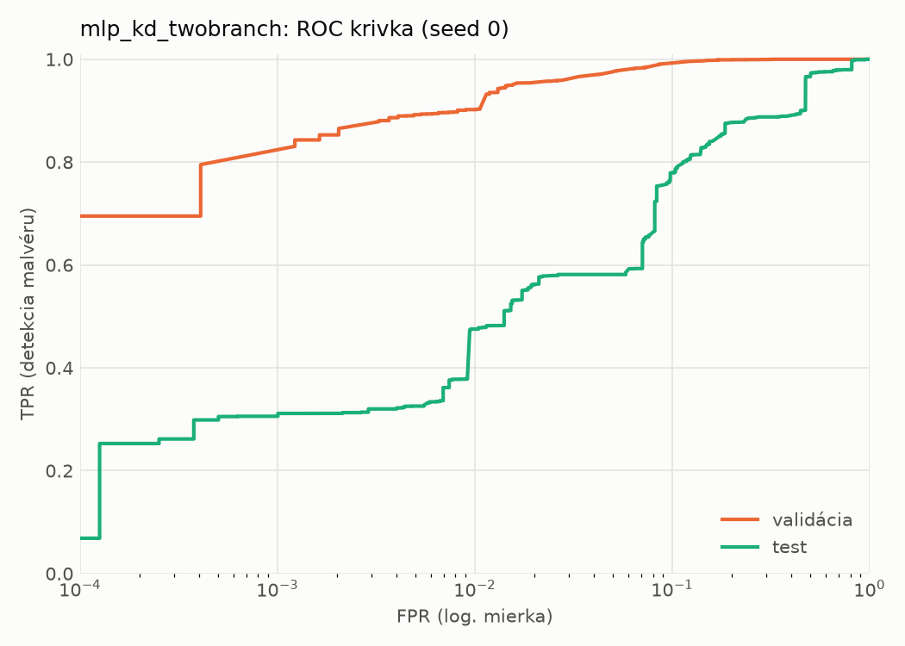
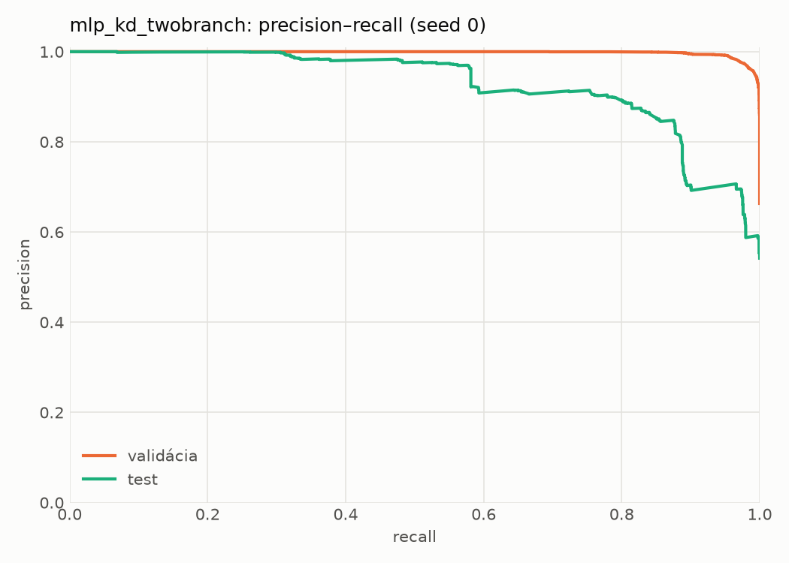
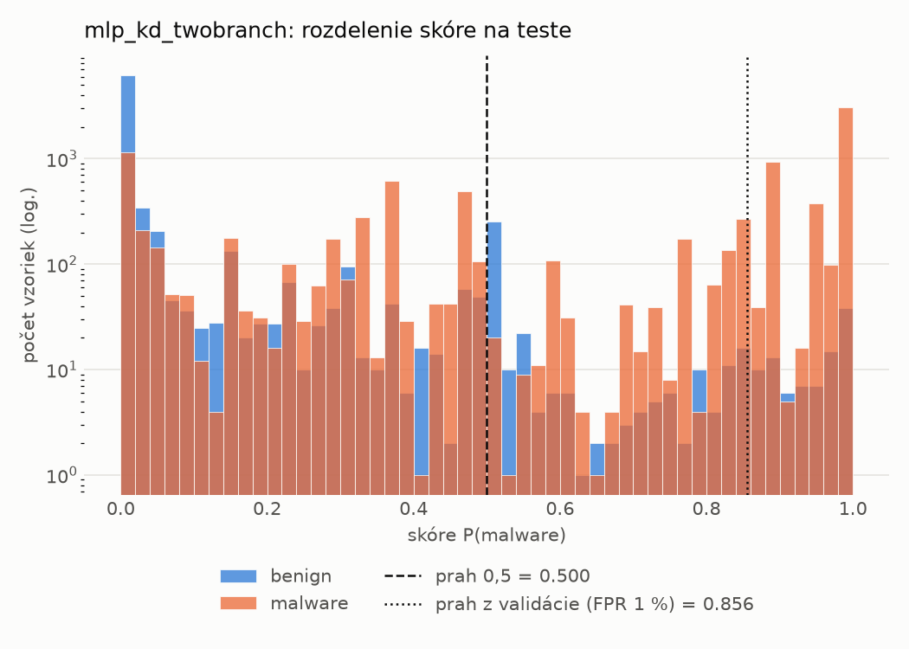
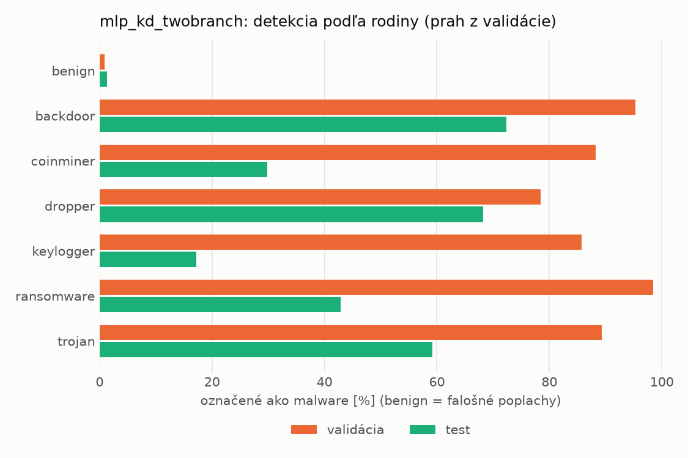
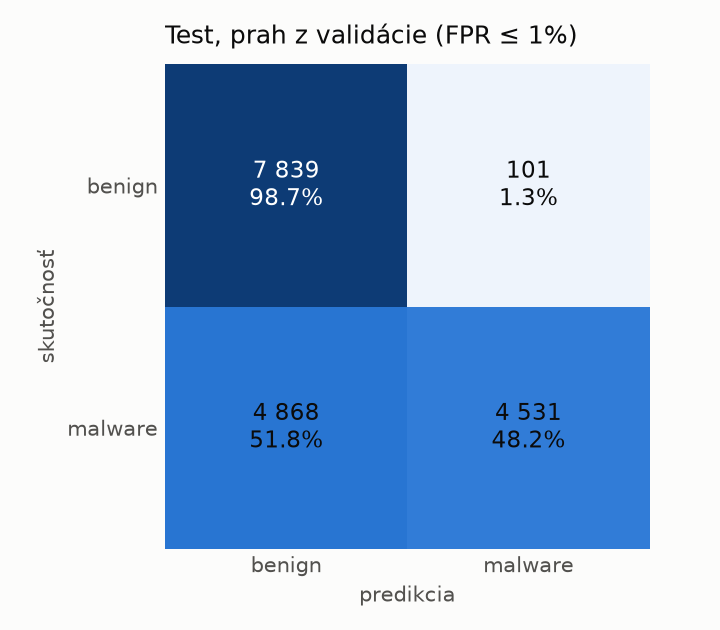
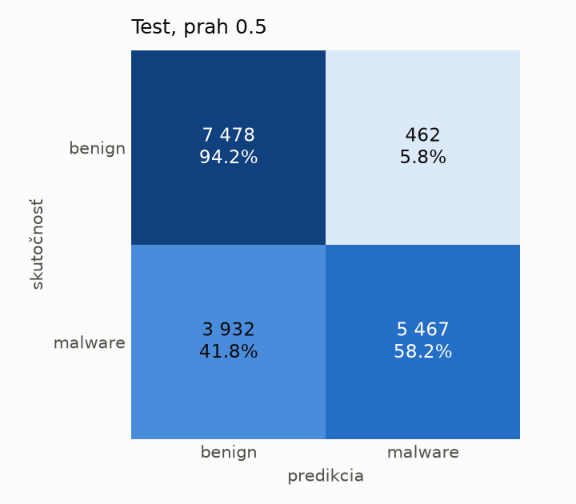
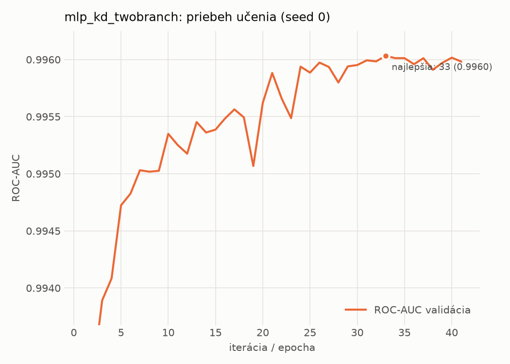

# dynamic/mlp_kd_twobranch – beh `20261104-183943`

> Automaticky generované (`src/training/run_tabular.py`). Konfigurácia: `config.yaml`, protokol: `protocol.yaml`.

- **Model:** `mlp` – študent – malé MLP učené destiláciou z dvojvetvovej siete (V2)
- **Ladenie:** bez ladenia – hyperparametre prevzaté z `runs_v2/full/students_dynamic/mlp_kd_twobranch/20261103-210509`
- **Finálne modely:** seedy [0, 1, 2]; hodnoty sú priemer ± smerodajná odchýlka cez seedy
- **Najlepšie hyperparametre:** `{"hidden_layers": 1, "max_epochs": 100, "patience": 8, "hidden_width": 32, "dropout": 0.20072105080128874, "lr": 0.0007693195243892695, "weight_decay": 5.480532660403751e-05, "batch_size": 512, "kd_alpha": 0.8408369066096718, "kd_temperature": 1.578549465607724}`

## Detekčná kvalita (bez prahu)
| metrika | train (podvzorka) | validácia | test |
|---|---|---|---|
| ROC-AUC | 0.9972 ± 0.0002 | 0.9960 ± 0.0001 | 0.9008 ± 0.0064 |
| PR-AUC | 0.9985 ± 0.0001 | 0.9979 ± 0.0000 | 0.9230 ± 0.0055 |
| TPR pri FPR 1 % | 0.9411 ± 0.0002 | 0.9034 ± 0.0014 | 0.4674 ± 0.0069 |
| TPR pri FPR 0,1 % | 0.8896 ± 0.0022 | 0.8021 ± 0.0093 | 0.2924 ± 0.0496 |
| log loss | 0.0673 ± 0.0017 | 0.0805 ± 0.0007 | 0.7525 ± 0.0094 |
| Brier skóre | 0.0214 ± 0.0003 | 0.0243 ± 0.0001 | 0.1817 ± 0.0127 |

Rozdiel ROC-AUC train − validácia: **0.0012** (veľký rozdiel = preučenie).

## Pri prahu z validácie (FPR ≤ 1% na validácii)
| metrika | train (podvzorka) | validácia | test |
|---|---|---|---|
| accuracy | 0.9332 ± 0.0013 | 0.9328 ± 0.0008 | 0.7088 ± 0.0122 |
| balanced accuracy | 0.9481 ± 0.0008 | 0.9471 ± 0.0005 | 0.7296 ± 0.0127 |
| precision | 0.9973 ± 0.0010 | 0.9948 ± 0.0003 | 0.9613 ± 0.0301 |
| recall (TPR) | 0.9009 ± 0.0027 | 0.9034 ± 0.0014 | 0.4824 ± 0.0077 |
| FPR | 0.0047 ± 0.0018 | 0.0093 ± 0.0005 | 0.0232 ± 0.0185 |
| F1 | 0.9466 ± 0.0012 | 0.9469 ± 0.0006 | 0.6424 ± 0.0130 |
| MCC | 0.8658 ± 0.0021 | 0.8633 ± 0.0013 | 0.5142 ± 0.0310 |

## Pri pevnom prahu 0.5
| metrika | train (podvzorka) | validácia | test |
|---|---|---|---|
| accuracy | 0.9686 ± 0.0019 | 0.9641 ± 0.0017 | 0.7512 ± 0.0076 |
| balanced accuracy | 0.9716 ± 0.0007 | 0.9660 ± 0.0011 | 0.7664 ± 0.0081 |
| precision | 0.9899 ± 0.0023 | 0.9854 ± 0.0018 | 0.9298 ± 0.0178 |
| recall (TPR) | 0.9622 ± 0.0051 | 0.9601 ± 0.0038 | 0.5853 ± 0.0033 |
| FPR | 0.0189 ± 0.0045 | 0.0281 ± 0.0036 | 0.0524 ± 0.0140 |
| F1 | 0.9758 ± 0.0016 | 0.9726 ± 0.0014 | 0.7184 ± 0.0072 |
| MCC | 0.9320 ± 0.0037 | 0.9212 ± 0.0034 | 0.5600 ± 0.0191 |

## Výpočtové nároky (seed 0, testovacia množina)
| meranie | hodnota |
|---|---|
| tréning finálneho modelu | 8.2 s (priemer cez seedy) |
| ladenie spolu | 0 s |
| počet parametrov / uzlov | 64 129 |
| veľkosť modelu na disku | 0.31 MB |
| transformácia vstupu – latencia (1 vlákno) | 0.034 ms |
| transformácia vstupu – priepustnosť | 47 843 vzoriek/s |
| CPU latencia modelu (batch 1, 1 vlákno) | 0.069 ms (p95 0.079) |
| CPU priepustnosť (24 vlákien) | 94 988 vzoriek/s |
| GPU latencia (batch 1) | 0.476 ms (p95 0.510) |
| GPU priepustnosť | 104 006 vzoriek/s |
| GPU špičková pamäť | 1320 MB |

## Grafy
| | |
|---|---|
|  |  |
|  |  |
|  |  |
|  |  |

## Súbory
`metrics.json` (všetky metriky po seedoch vrátane rodín), `timing.json`, `hpo_trials.csv`,
`predictions/<časť>_seed<N>.parquet` (sha256, family, label, score), `model/seed_<N>/`, `log.txt`.
