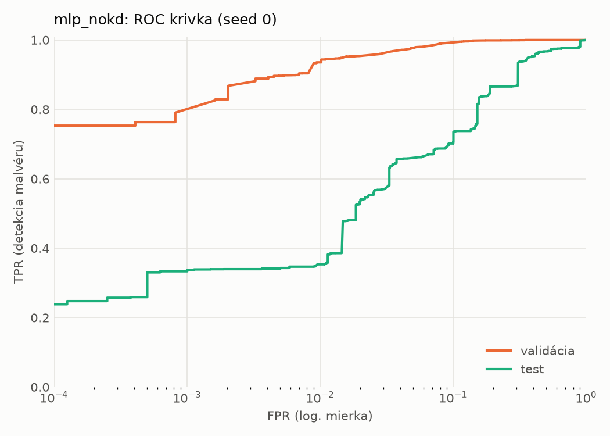
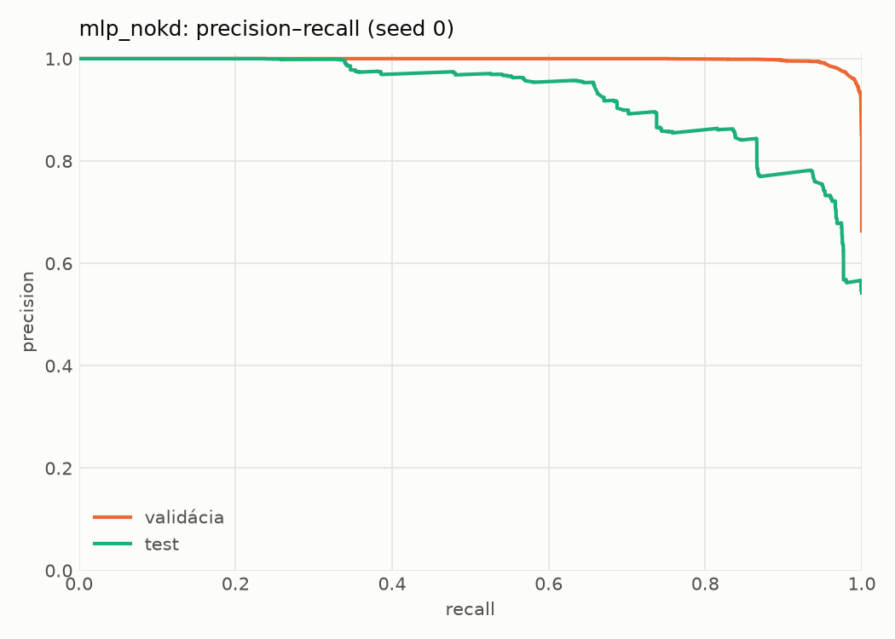
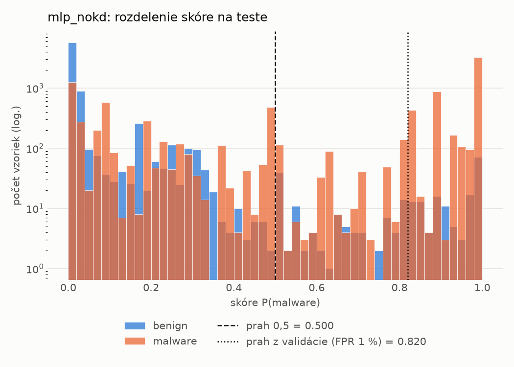
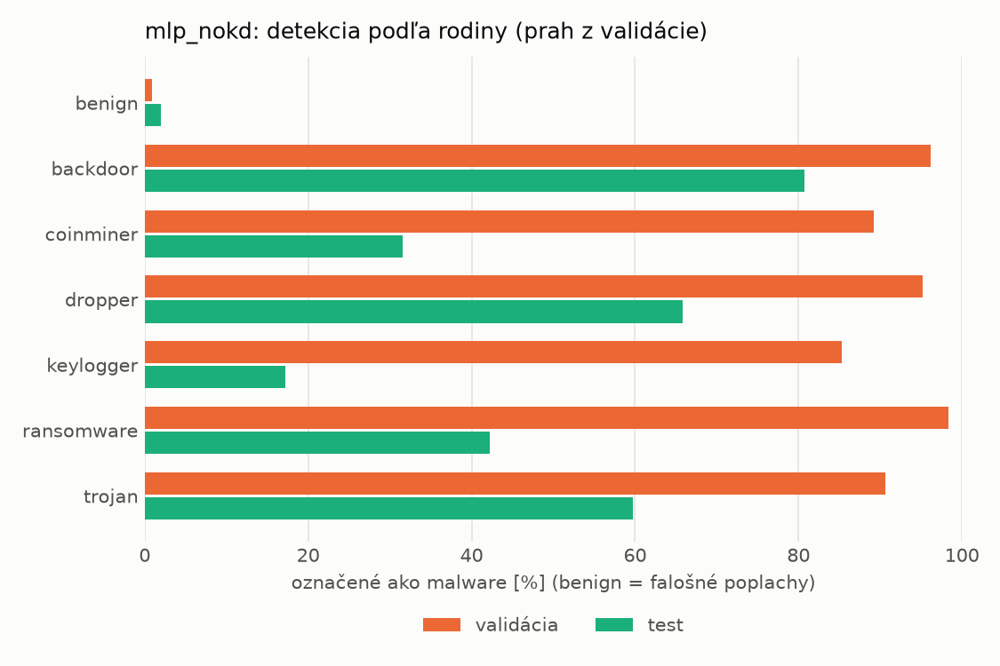
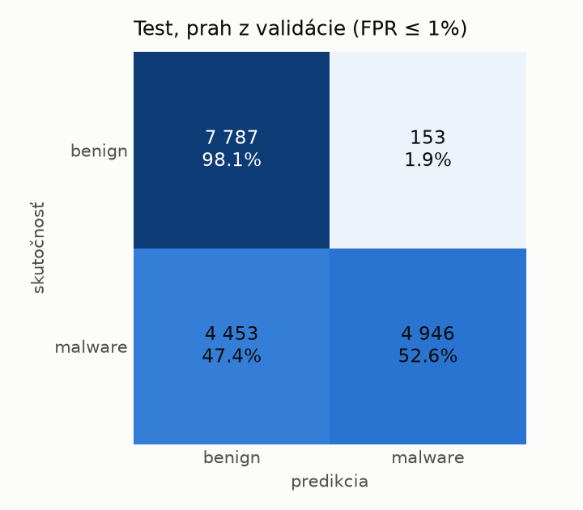
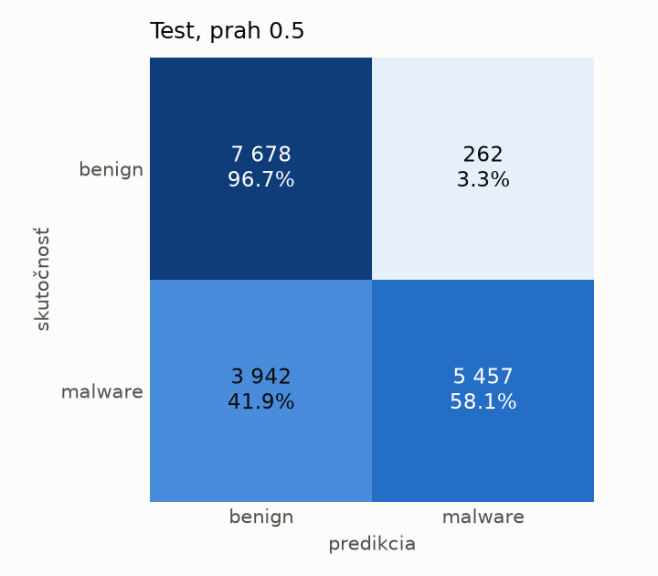
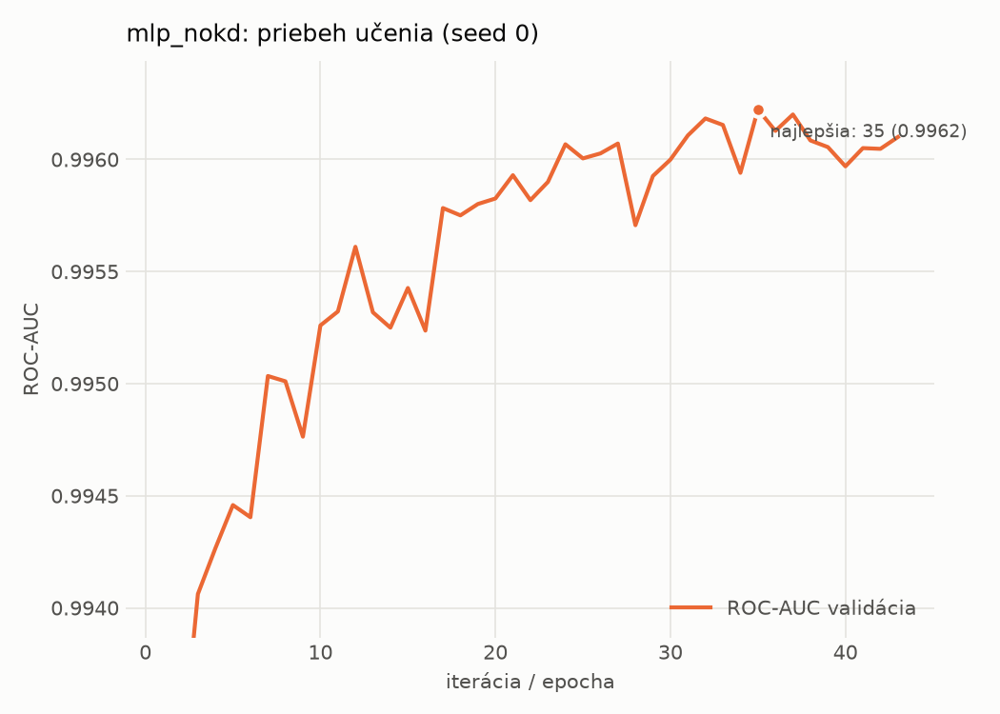

# dynamic/mlp_nokd – beh `20261104-183842`

> Automaticky generované (`src/training/run_tabular.py`). Konfigurácia: `config.yaml`, protokol: `protocol.yaml`.

- **Model:** `mlp` – kontrola – rovnaké malé MLP bez destilácie (iba skutočné označenia)
- **Ladenie:** bez ladenia – hyperparametre prevzaté z `runs_final/students_dynamic/mlp_nokd/20261102-212647`
- **Finálne modely:** seedy [0, 1, 2]; hodnoty sú priemer ± smerodajná odchýlka cez seedy
- **Najlepšie hyperparametre:** `{"hidden_layers": 1, "max_epochs": 100, "patience": 8, "hidden_width": 32, "dropout": 0.27854460554056926, "lr": 0.002048574130711367, "weight_decay": 5.911733622585913e-06, "batch_size": 512}`

## Detekčná kvalita (bez prahu)
| metrika | train (podvzorka) | validácia | test |
|---|---|---|---|
| ROC-AUC | 0.9973 ± 0.0002 | 0.9961 ± 0.0001 | 0.9058 ± 0.0008 |
| PR-AUC | 0.9985 ± 0.0001 | 0.9979 ± 0.0001 | 0.9254 ± 0.0029 |
| TPR pri FPR 1 % | 0.9420 ± 0.0026 | 0.9355 ± 0.0007 | 0.4283 ± 0.0649 |
| TPR pri FPR 0,1 % | 0.8925 ± 0.0009 | 0.7789 ± 0.0147 | 0.3166 ± 0.0262 |
| log loss | 0.0660 ± 0.0025 | 0.0803 ± 0.0013 | 0.8316 ± 0.1282 |
| Brier skóre | 0.0211 ± 0.0007 | 0.0237 ± 0.0007 | 0.1896 ± 0.0097 |

Rozdiel ROC-AUC train − validácia: **0.0012** (veľký rozdiel = preučenie).

## Pri prahu z validácie (FPR ≤ 1% na validácii)
| metrika | train (podvzorka) | validácia | test |
|---|---|---|---|
| accuracy | 0.9522 ± 0.0006 | 0.9540 ± 0.0004 | 0.7263 ± 0.0135 |
| balanced accuracy | 0.9618 ± 0.0004 | 0.9630 ± 0.0003 | 0.7454 ± 0.0138 |
| precision | 0.9957 ± 0.0002 | 0.9948 ± 0.0001 | 0.9570 ± 0.0273 |
| recall (TPR) | 0.9314 ± 0.0011 | 0.9355 ± 0.0007 | 0.5185 ± 0.0101 |
| FPR | 0.0078 ± 0.0003 | 0.0096 ± 0.0002 | 0.0277 ± 0.0179 |
| F1 | 0.9624 ± 0.0005 | 0.9643 ± 0.0003 | 0.6726 ± 0.0151 |
| MCC | 0.9006 ± 0.0012 | 0.9033 ± 0.0008 | 0.5369 ± 0.0317 |

## Pri pevnom prahu 0.5
| metrika | train (podvzorka) | validácia | test |
|---|---|---|---|
| accuracy | 0.9698 ± 0.0012 | 0.9646 ± 0.0011 | 0.7577 ± 0.0023 |
| balanced accuracy | 0.9724 ± 0.0007 | 0.9660 ± 0.0004 | 0.7732 ± 0.0007 |
| precision | 0.9897 ± 0.0034 | 0.9847 ± 0.0022 | 0.9444 ± 0.0249 |
| recall (TPR) | 0.9642 ± 0.0051 | 0.9616 ± 0.0038 | 0.5883 ± 0.0223 |
| FPR | 0.0194 ± 0.0065 | 0.0295 ± 0.0044 | 0.0418 ± 0.0217 |
| F1 | 0.9767 ± 0.0010 | 0.9730 ± 0.0009 | 0.7245 ± 0.0093 |
| MCC | 0.9344 ± 0.0019 | 0.9222 ± 0.0019 | 0.5761 ± 0.0082 |

## Výpočtové nároky (seed 0, testovacia množina)
| meranie | hodnota |
|---|---|
| tréning finálneho modelu | 6.9 s (priemer cez seedy) |
| ladenie spolu | 0 s |
| počet parametrov / uzlov | 64 129 |
| veľkosť modelu na disku | 0.31 MB |
| transformácia vstupu – latencia (1 vlákno) | 0.034 ms |
| transformácia vstupu – priepustnosť | 46 817 vzoriek/s |
| CPU latencia modelu (batch 1, 1 vlákno) | 0.068 ms (p95 0.075) |
| CPU priepustnosť (24 vlákien) | 137 526 vzoriek/s |
| GPU latencia (batch 1) | 0.289 ms (p95 0.468) |
| GPU priepustnosť | 95 014 vzoriek/s |
| GPU špičková pamäť | 1320 MB |

## Grafy
| | |
|---|---|
|  |  |
|  |  |
|  |  |
|  |  |

## Súbory
`metrics.json` (všetky metriky po seedoch vrátane rodín), `timing.json`, `hpo_trials.csv`,
`predictions/<časť>_seed<N>.parquet` (sha256, family, label, score), `model/seed_<N>/`, `log.txt`.
