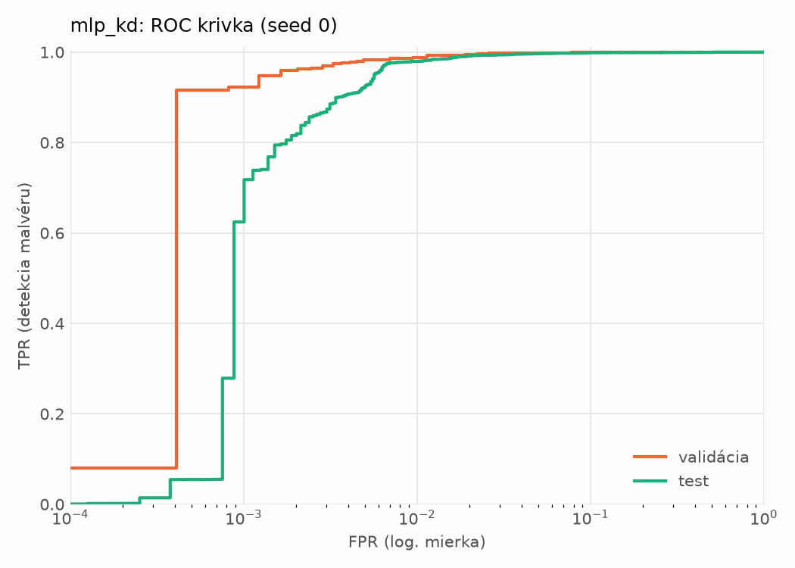
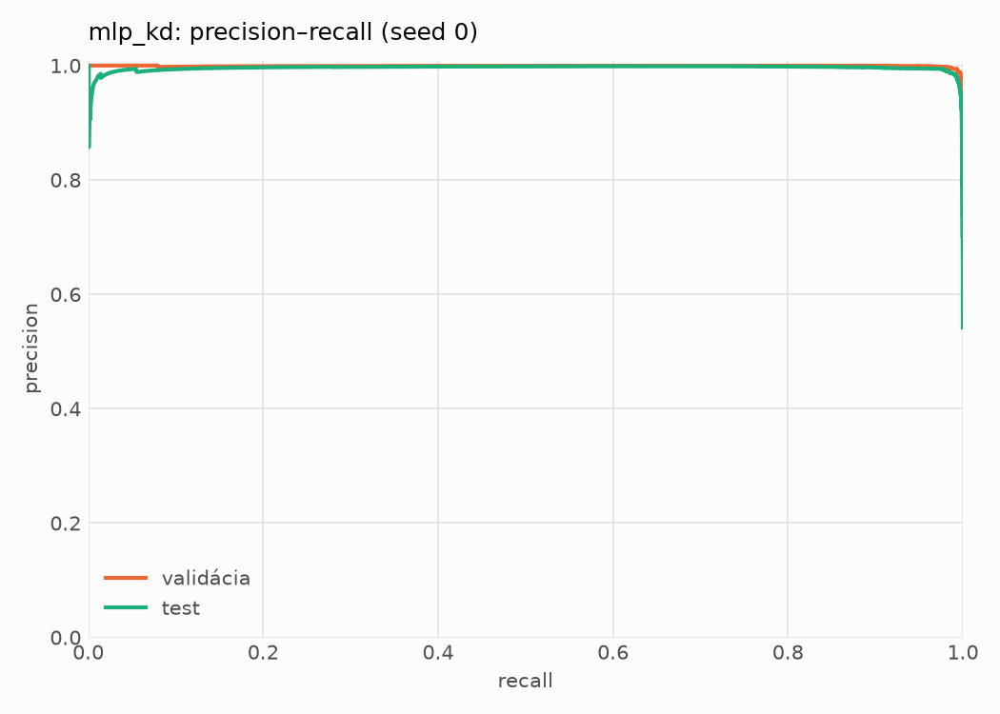
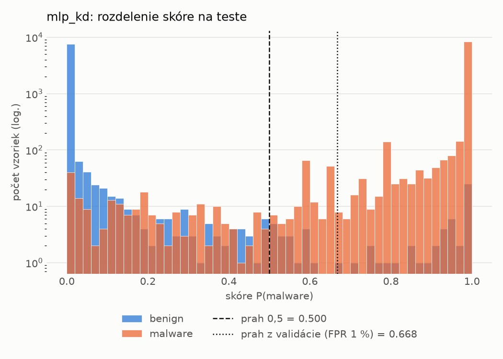
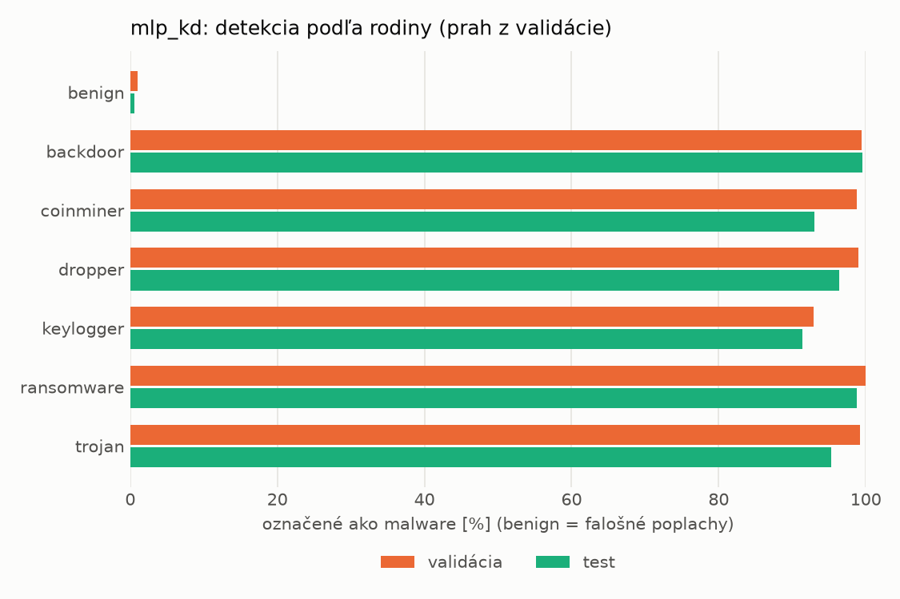
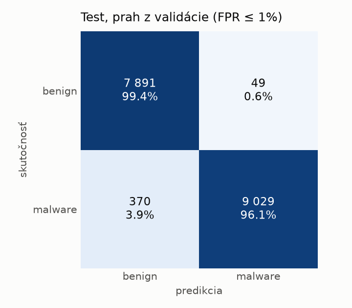
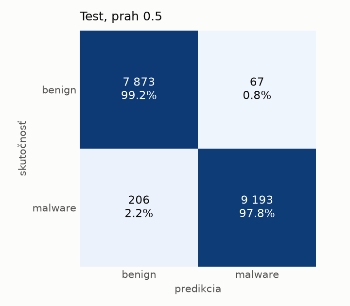
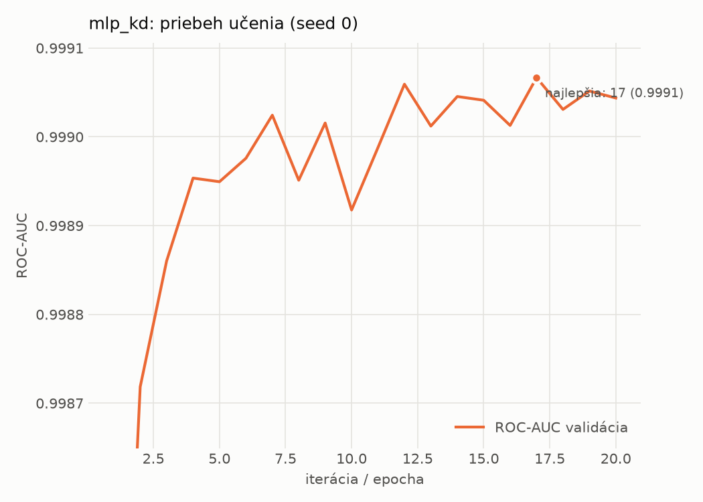

# static/mlp_kd – beh `20261104-183610`

> Automaticky generované (`src/training/run_tabular.py`). Konfigurácia: `config.yaml`, protokol: `protocol.yaml`.

- **Model:** `mlp` – študent – malé MLP učené destiláciou z hybridného učiteľa
- **Ladenie:** bez ladenia – hyperparametre prevzaté z `runs_final/students_static/mlp_kd/20261102-211333`
- **Finálne modely:** seedy [0, 1, 2]; hodnoty sú priemer ± smerodajná odchýlka cez seedy
- **Najlepšie hyperparametre:** `{"hidden_layers": 1, "max_epochs": 100, "patience": 8, "hidden_width": 32, "dropout": 0.0997633477545663, "lr": 0.0015427581570995174, "weight_decay": 0.00017559733451057006, "batch_size": 256, "kd_alpha": 0.604033962068706, "kd_temperature": 6.472658522077935}`

## Detekčná kvalita (bez prahu)
| metrika | train (podvzorka) | validácia | test |
|---|---|---|---|
| ROC-AUC | 0.9998 ± 0.0000 | 0.9991 ± 0.0002 | 0.9975 ± 0.0001 |
| PR-AUC | 0.9999 ± 0.0000 | 0.9990 ± 0.0008 | 0.9959 ± 0.0003 |
| TPR pri FPR 1 % | 0.9969 ± 0.0002 | 0.9877 ± 0.0009 | 0.9765 ± 0.0031 |
| TPR pri FPR 0,1 % | 0.9810 ± 0.0041 | 0.9285 ± 0.0069 | 0.4378 ± 0.1646 |
| log loss | 0.0169 ± 0.0014 | 0.0321 ± 0.0006 | 0.0608 ± 0.0051 |
| Brier skóre | 0.0044 ± 0.0003 | 0.0079 ± 0.0001 | 0.0143 ± 0.0015 |

Rozdiel ROC-AUC train − validácia: **0.0007** (veľký rozdiel = preučenie).

## Pri prahu z validácie (FPR ≤ 1% na validácii)
| metrika | train (podvzorka) | validácia | test |
|---|---|---|---|
| accuracy | 0.9926 ± 0.0010 | 0.9887 ± 0.0004 | 0.9733 ± 0.0039 |
| balanced accuracy | 0.9936 ± 0.0007 | 0.9891 ± 0.0002 | 0.9749 ± 0.0036 |
| precision | 0.9983 ± 0.0003 | 0.9951 ± 0.0002 | 0.9946 ± 0.0002 |
| recall (TPR) | 0.9904 ± 0.0017 | 0.9877 ± 0.0009 | 0.9558 ± 0.0075 |
| FPR | 0.0032 ± 0.0005 | 0.0096 ± 0.0005 | 0.0061 ± 0.0003 |
| F1 | 0.9943 ± 0.0008 | 0.9914 ± 0.0003 | 0.9748 ± 0.0038 |
| MCC | 0.9836 ± 0.0022 | 0.9747 ± 0.0010 | 0.9472 ± 0.0075 |

## Pri pevnom prahu 0.5
| metrika | train (podvzorka) | validácia | test |
|---|---|---|---|
| accuracy | 0.9949 ± 0.0004 | 0.9906 ± 0.0005 | 0.9839 ± 0.0015 |
| balanced accuracy | 0.9944 ± 0.0005 | 0.9893 ± 0.0005 | 0.9845 ± 0.0014 |
| precision | 0.9963 ± 0.0004 | 0.9925 ± 0.0004 | 0.9922 ± 0.0009 |
| recall (TPR) | 0.9960 ± 0.0005 | 0.9934 ± 0.0005 | 0.9780 ± 0.0035 |
| FPR | 0.0072 ± 0.0008 | 0.0147 ± 0.0007 | 0.0091 ± 0.0011 |
| F1 | 0.9961 ± 0.0003 | 0.9929 ± 0.0004 | 0.9850 ± 0.0015 |
| MCC | 0.9887 ± 0.0009 | 0.9790 ± 0.0011 | 0.9678 ± 0.0030 |

## Výpočtové nároky (seed 0, testovacia množina)
| meranie | hodnota |
|---|---|
| tréning finálneho modelu | 10.3 s (priemer cez seedy) |
| ladenie spolu | 0 s |
| počet parametrov / uzlov | 74 337 |
| veľkosť modelu na disku | 0.36 MB |
| transformácia vstupu – latencia (1 vlákno) | 0.023 ms |
| transformácia vstupu – priepustnosť | 43 953 vzoriek/s |
| CPU latencia modelu (batch 1, 1 vlákno) | 0.069 ms (p95 0.077) |
| CPU priepustnosť (24 vlákien) | 109 693 vzoriek/s |
| GPU latencia (batch 1) | 0.308 ms (p95 0.465) |
| GPU priepustnosť | 77 601 vzoriek/s |
| GPU špičková pamäť | 855 MB |

## Grafy
| | |
|---|---|
|  |  |
|  |  |
|  |  |
|  |  |

## Súbory
`metrics.json` (všetky metriky po seedoch vrátane rodín), `timing.json`, `hpo_trials.csv`,
`predictions/<časť>_seed<N>.parquet` (sha256, family, label, score), `model/seed_<N>/`, `log.txt`.
