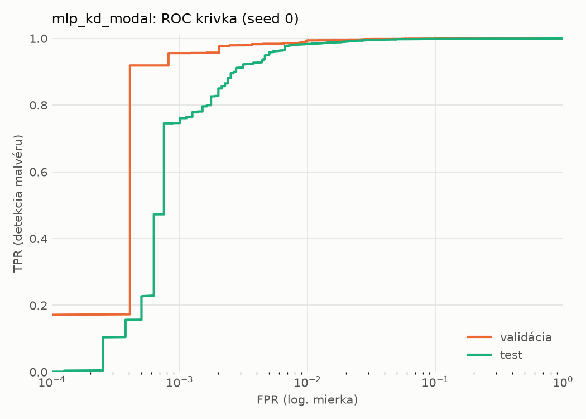
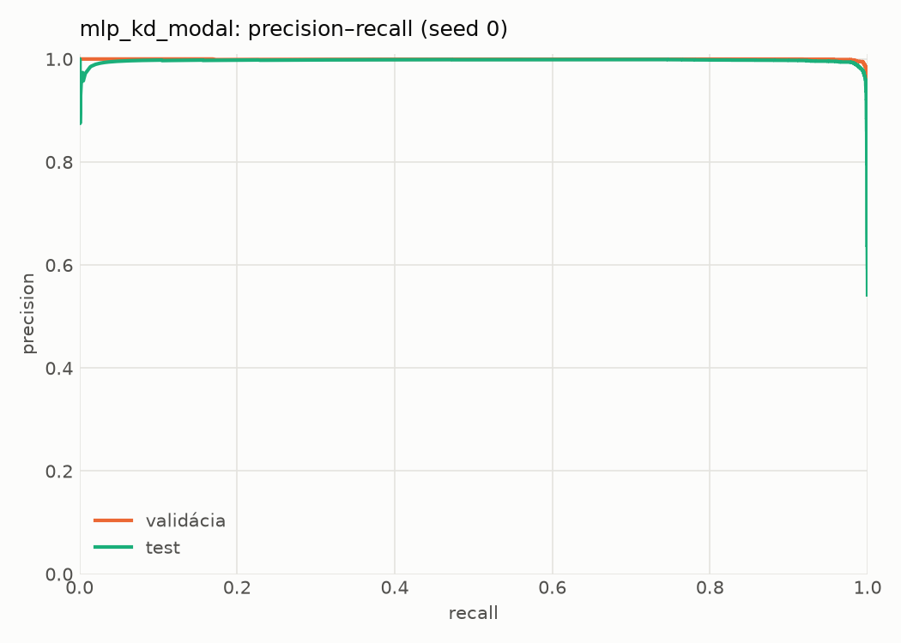
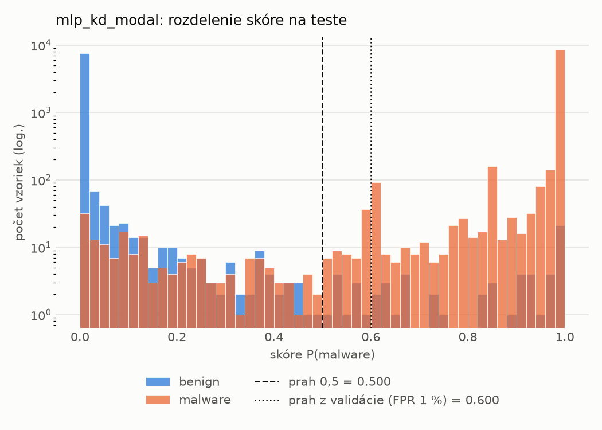
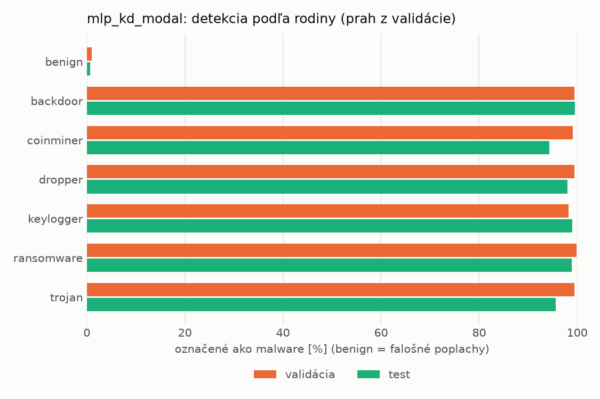
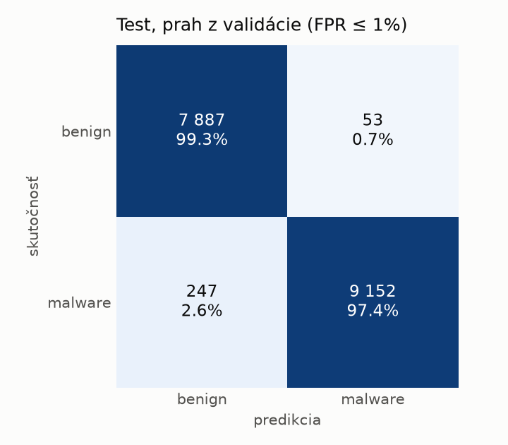
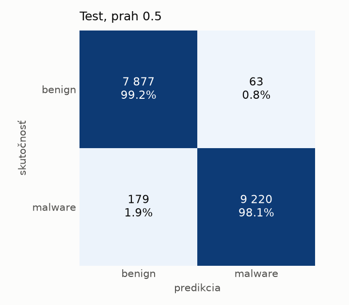
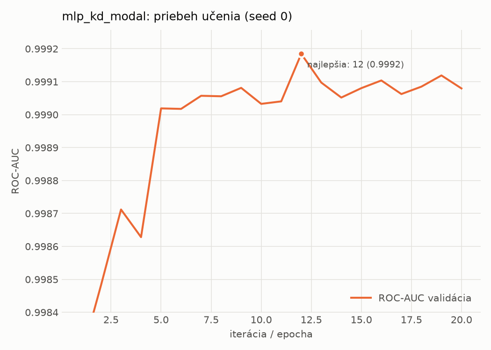

# static/mlp_kd_modal – beh `20261104-183707`

> Automaticky generované (`src/training/run_tabular.py`). Konfigurácia: `config.yaml`, protokol: `protocol.yaml`.

- **Model:** `mlp` – študent – malé MLP učené destiláciou z učiteľa rovnakej modality (variant A)
- **Ladenie:** bez ladenia – hyperparametre prevzaté z `runs_final/students_static/mlp_kd_modal/20261102-211832`
- **Finálne modely:** seedy [0, 1, 2]; hodnoty sú priemer ± smerodajná odchýlka cez seedy
- **Najlepšie hyperparametre:** `{"hidden_layers": 1, "max_epochs": 100, "patience": 8, "hidden_width": 32, "dropout": 0.15602040635334324, "lr": 0.00105640764164036, "weight_decay": 3.5856126103453987e-06, "batch_size": 256, "kd_alpha": 0.815861880342119, "kd_temperature": 5.185299851677596}`

## Detekčná kvalita (bez prahu)
| metrika | train (podvzorka) | validácia | test |
|---|---|---|---|
| ROC-AUC | 0.9998 ± 0.0001 | 0.9990 ± 0.0002 | 0.9977 ± 0.0001 |
| PR-AUC | 0.9999 ± 0.0001 | 0.9986 ± 0.0007 | 0.9962 ± 0.0006 |
| TPR pri FPR 1 % | 0.9965 ± 0.0015 | 0.9891 ± 0.0042 | 0.9805 ± 0.0024 |
| TPR pri FPR 0,1 % | 0.9771 ± 0.0051 | 0.9218 ± 0.0377 | 0.7089 ± 0.0700 |
| log loss | 0.0178 ± 0.0038 | 0.0314 ± 0.0028 | 0.0605 ± 0.0042 |
| Brier skóre | 0.0047 ± 0.0010 | 0.0077 ± 0.0007 | 0.0145 ± 0.0015 |

Rozdiel ROC-AUC train − validácia: **0.0008** (veľký rozdiel = preučenie).

## Pri prahu z validácie (FPR ≤ 1% na validácii)
| metrika | train (podvzorka) | validácia | test |
|---|---|---|---|
| accuracy | 0.9928 ± 0.0034 | 0.9894 ± 0.0028 | 0.9748 ± 0.0099 |
| balanced accuracy | 0.9935 ± 0.0027 | 0.9896 ± 0.0021 | 0.9762 ± 0.0092 |
| precision | 0.9978 ± 0.0003 | 0.9950 ± 0.0000 | 0.9941 ± 0.0004 |
| recall (TPR) | 0.9912 ± 0.0049 | 0.9891 ± 0.0042 | 0.9592 ± 0.0180 |
| FPR | 0.0042 ± 0.0006 | 0.0098 ± 0.0000 | 0.0068 ± 0.0004 |
| F1 | 0.9945 ± 0.0026 | 0.9920 ± 0.0021 | 0.9763 ± 0.0096 |
| MCC | 0.9841 ± 0.0074 | 0.9765 ± 0.0061 | 0.9502 ± 0.0191 |

## Pri pevnom prahu 0.5
| metrika | train (podvzorka) | validácia | test |
|---|---|---|---|
| accuracy | 0.9944 ± 0.0014 | 0.9910 ± 0.0013 | 0.9847 ± 0.0011 |
| balanced accuracy | 0.9936 ± 0.0016 | 0.9897 ± 0.0017 | 0.9852 ± 0.0011 |
| precision | 0.9954 ± 0.0012 | 0.9929 ± 0.0016 | 0.9924 ± 0.0009 |
| recall (TPR) | 0.9960 ± 0.0011 | 0.9934 ± 0.0008 | 0.9793 ± 0.0014 |
| FPR | 0.0088 ± 0.0023 | 0.0139 ± 0.0033 | 0.0089 ± 0.0011 |
| F1 | 0.9957 ± 0.0010 | 0.9932 ± 0.0009 | 0.9858 ± 0.0011 |
| MCC | 0.9876 ± 0.0030 | 0.9797 ± 0.0028 | 0.9694 ± 0.0023 |

## Výpočtové nároky (seed 0, testovacia množina)
| meranie | hodnota |
|---|---|
| tréning finálneho modelu | 6.8 s (priemer cez seedy) |
| ladenie spolu | 0 s |
| počet parametrov / uzlov | 74 337 |
| veľkosť modelu na disku | 0.36 MB |
| transformácia vstupu – latencia (1 vlákno) | 0.042 ms |
| transformácia vstupu – priepustnosť | 38 314 vzoriek/s |
| CPU latencia modelu (batch 1, 1 vlákno) | 0.069 ms (p95 0.077) |
| CPU priepustnosť (24 vlákien) | 60 829 vzoriek/s |
| GPU latencia (batch 1) | 0.294 ms (p95 0.323) |
| GPU priepustnosť | 79 943 vzoriek/s |
| GPU špičková pamäť | 855 MB |

## Grafy
| | |
|---|---|
|  |  |
|  |  |
|  |  |
|  |  |

## Súbory
`metrics.json` (všetky metriky po seedoch vrátane rodín), `timing.json`, `hpo_trials.csv`,
`predictions/<časť>_seed<N>.parquet` (sha256, family, label, score), `model/seed_<N>/`, `log.txt`.
