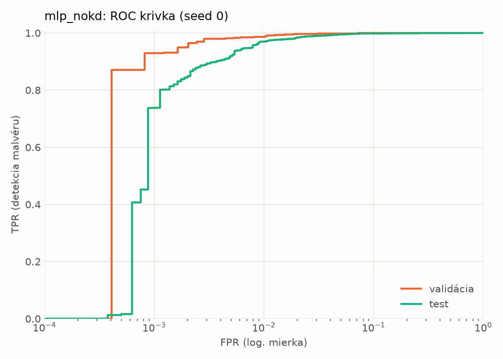
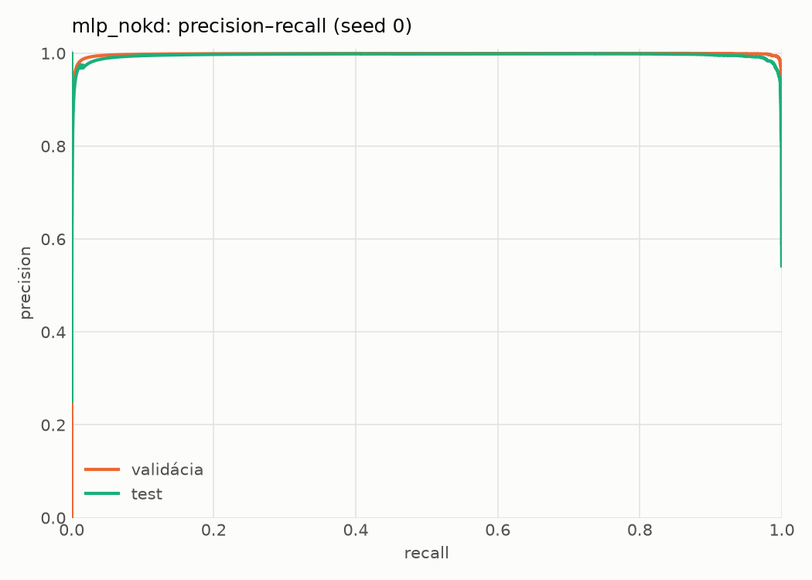
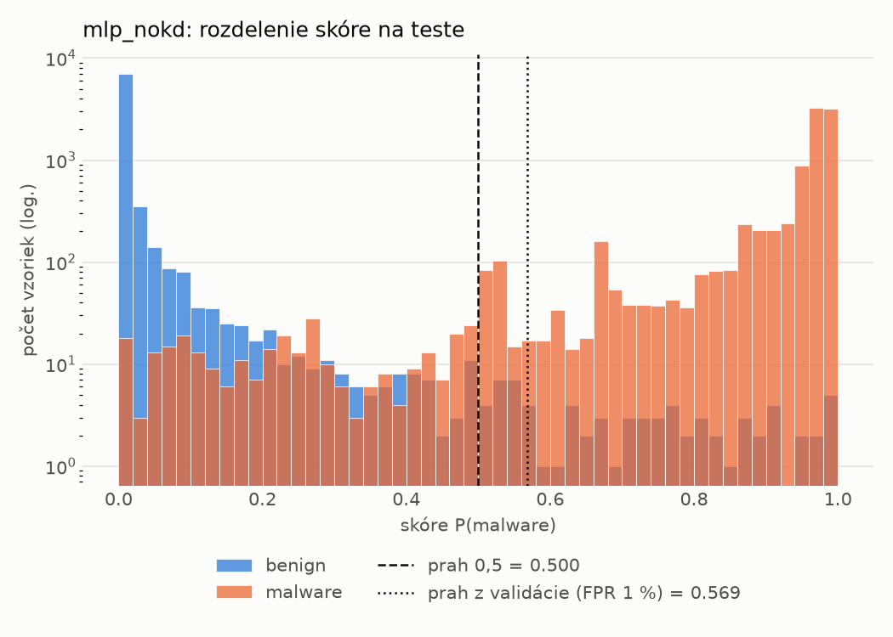
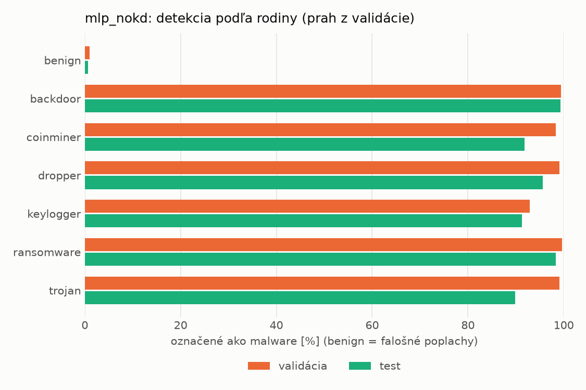
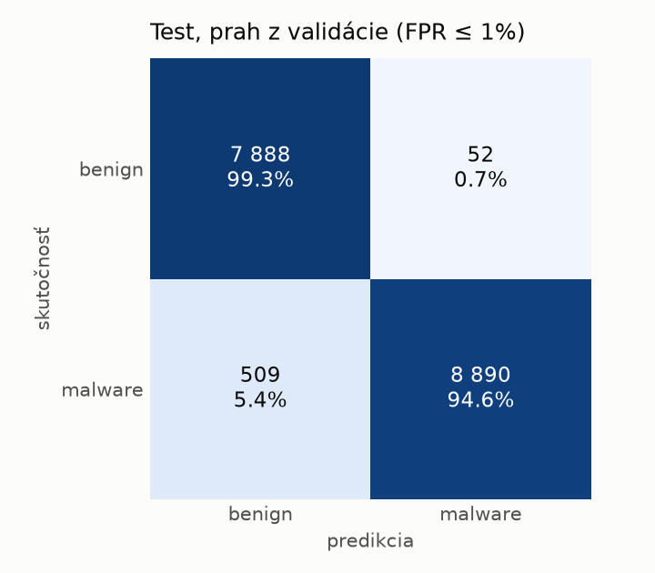
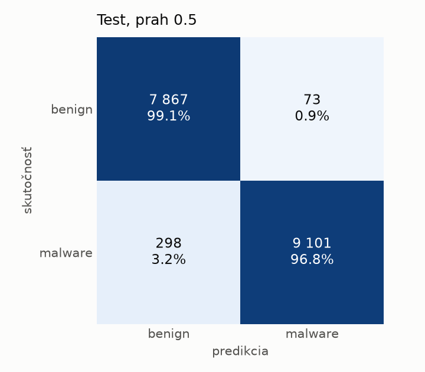
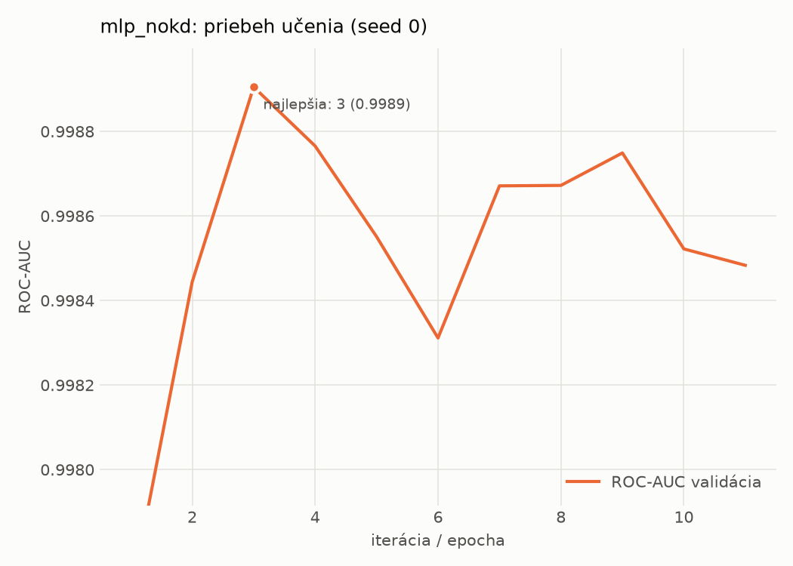

# static/mlp_nokd – beh `20261104-183650`

> Automaticky generované (`src/training/run_tabular.py`). Konfigurácia: `config.yaml`, protokol: `protocol.yaml`.

- **Model:** `mlp` – kontrola – rovnaké malé MLP bez destilácie (iba skutočné označenia)
- **Ladenie:** bez ladenia – hyperparametre prevzaté z `runs_final/students_static/mlp_nokd/20261102-211710`
- **Finálne modely:** seedy [0, 1, 2]; hodnoty sú priemer ± smerodajná odchýlka cez seedy
- **Najlepšie hyperparametre:** `{"hidden_layers": 1, "max_epochs": 100, "patience": 8, "hidden_width": 32, "dropout": 0.137657909519708, "lr": 0.0007042503153050794, "weight_decay": 1.207246112223234e-05, "batch_size": 512}`

## Detekčná kvalita (bez prahu)
| metrika | train (podvzorka) | validácia | test |
|---|---|---|---|
| ROC-AUC | 0.9997 ± 0.0002 | 0.9989 ± 0.0001 | 0.9968 ± 0.0004 |
| PR-AUC | 0.9998 ± 0.0001 | 0.9980 ± 0.0001 | 0.9942 ± 0.0018 |
| TPR pri FPR 1 % | 0.9940 ± 0.0044 | 0.9862 ± 0.0031 | 0.9626 ± 0.0121 |
| TPR pri FPR 0,1 % | 0.9612 ± 0.0272 | 0.9313 ± 0.0144 | 0.5144 ± 0.4343 |
| log loss | 0.0365 ± 0.0182 | 0.0452 ± 0.0146 | 0.0831 ± 0.0160 |
| Brier skóre | 0.0068 ± 0.0029 | 0.0089 ± 0.0020 | 0.0201 ± 0.0036 |

Rozdiel ROC-AUC train − validácia: **0.0008** (veľký rozdiel = preučenie).

## Pri prahu z validácie (FPR ≤ 1% na validácii)
| metrika | train (podvzorka) | validácia | test |
|---|---|---|---|
| accuracy | 0.9910 ± 0.0032 | 0.9875 ± 0.0020 | 0.9660 ± 0.0046 |
| balanced accuracy | 0.9922 ± 0.0026 | 0.9882 ± 0.0015 | 0.9681 ± 0.0043 |
| precision | 0.9979 ± 0.0006 | 0.9950 ± 0.0000 | 0.9938 ± 0.0005 |
| recall (TPR) | 0.9884 ± 0.0046 | 0.9862 ± 0.0031 | 0.9432 ± 0.0082 |
| FPR | 0.0041 ± 0.0011 | 0.0098 ± 0.0000 | 0.0070 ± 0.0005 |
| F1 | 0.9931 ± 0.0025 | 0.9905 ± 0.0016 | 0.9678 ± 0.0045 |
| MCC | 0.9802 ± 0.0070 | 0.9722 ± 0.0045 | 0.9333 ± 0.0088 |

## Pri pevnom prahu 0.5
| metrika | train (podvzorka) | validácia | test |
|---|---|---|---|
| accuracy | 0.9926 ± 0.0030 | 0.9893 ± 0.0029 | 0.9751 ± 0.0063 |
| balanced accuracy | 0.9921 ± 0.0026 | 0.9887 ± 0.0024 | 0.9763 ± 0.0059 |
| precision | 0.9951 ± 0.0007 | 0.9933 ± 0.0006 | 0.9913 ± 0.0008 |
| recall (TPR) | 0.9937 ± 0.0039 | 0.9906 ± 0.0038 | 0.9625 ± 0.0110 |
| FPR | 0.0095 ± 0.0014 | 0.0131 ± 0.0011 | 0.0099 ± 0.0008 |
| F1 | 0.9944 ± 0.0023 | 0.9920 ± 0.0022 | 0.9767 ± 0.0060 |
| MCC | 0.9836 ± 0.0066 | 0.9762 ± 0.0063 | 0.9506 ± 0.0122 |

## Výpočtové nároky (seed 0, testovacia množina)
| meranie | hodnota |
|---|---|
| tréning finálneho modelu | 2.5 s (priemer cez seedy) |
| ladenie spolu | 0 s |
| počet parametrov / uzlov | 74 337 |
| veľkosť modelu na disku | 0.36 MB |
| transformácia vstupu – latencia (1 vlákno) | 0.042 ms |
| transformácia vstupu – priepustnosť | 38 714 vzoriek/s |
| CPU latencia modelu (batch 1, 1 vlákno) | 0.069 ms (p95 0.078) |
| CPU priepustnosť (24 vlákien) | 109 339 vzoriek/s |
| GPU latencia (batch 1) | 0.284 ms (p95 0.333) |
| GPU priepustnosť | 79 444 vzoriek/s |
| GPU špičková pamäť | 1528 MB |

## Grafy
| | |
|---|---|
|  |  |
|  |  |
|  |  |
|  |  |

## Súbory
`metrics.json` (všetky metriky po seedoch vrátane rodín), `timing.json`, `hpo_trials.csv`,
`predictions/<časť>_seed<N>.parquet` (sha256, family, label, score), `model/seed_<N>/`, `log.txt`.
