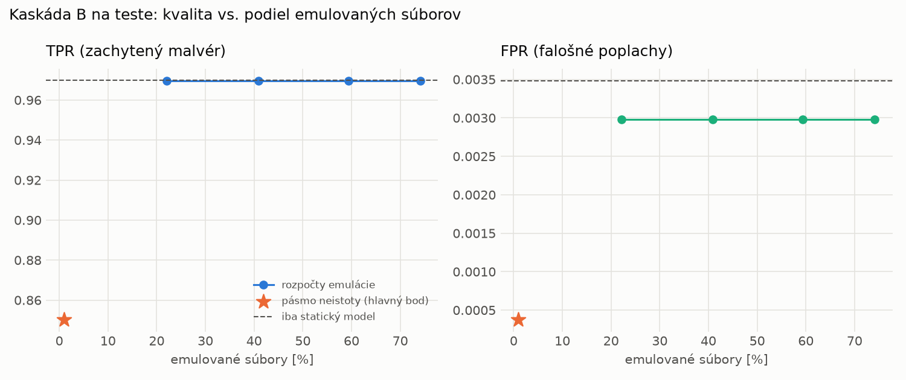

# Kaskáda B `b_baselines` – beh `20261104-204743`

> Generované `src/cascade/evaluate_b.py` (2026-11-04T20:47:43+01:00). Seedy: [0, 1, 2]; hodnoty = priemer ± sm. odchýlka.
> Všetky prahy a pásmo neistoty sú z validácie; test sa na nič nenastavuje. Postup: `docs/09_plan_v2.md`.

| rola | beh |
|---|---|
| static | `runs_v2/lofo/trojan/static/lightgbm/20261104-184220` |
| dynamic | `runs_v2/lofo/trojan/dynamic/lightgbm/20261104-190128` |
| hybrid | `runs_v2/lofo/trojan/hybrid/lightgbm/20261104-193036` |

Druhý stupeň: **dynamic**. Pásmo neistoty statického modelu: FPR ≤ 0.1% nad `hi`,
najviac 1% malvéru validácie pod `lo` (seed 0: lo = 0.9768, hi = 0.9933, seed 1: lo = 0.9542, hi = 0.9866, seed 2: lo = 0.9757, hi = 0.9926).

## Test
| prístup | accuracy | balanced_accuracy | precision | recall_tpr | fpr | f1 | mcc |
|---|---|---|---|---|---|---|---|
| kaskáda B | 0.9187 ± 0.0023 | 0.9250 ± 0.0021 | 0.9996 ± 0.0000 | 0.8503 ± 0.0043 | 0.0004 ± 0.0000 | 0.9189 ± 0.0025 | 0.8495 ± 0.0040 |
| statický | 0.9820 ± 0.0011 | 0.9831 ± 0.0010 | 0.9970 ± 0.0001 | 0.9698 ± 0.0019 | 0.0035 ± 0.0001 | 0.9832 ± 0.0010 | 0.9643 ± 0.0021 |
| dynamický | 0.8273 ± 0.0072 | 0.8389 ± 0.0066 | 0.9720 ± 0.0015 | 0.7016 ± 0.0148 | 0.0239 ± 0.0018 | 0.8149 ± 0.0095 | 0.6919 ± 0.0106 |
| hybrid (každá vzorka) | 0.9819 ± 0.0015 | 0.9830 ± 0.0013 | 0.9964 ± 0.0007 | 0.9702 ± 0.0032 | 0.0042 ± 0.0008 | 0.9831 ± 0.0014 | 0.9641 ± 0.0028 |

- **emulované súbory: 0.95%** (ostatné rozhodne iba statický model); na hybrid ide 0.27% súborov
- chyby pri istom rozhodnutí statického modelu (seed 0): 1444
- validácia: emulované 0.17%, na hybrid 0.07%

## Validácia
| prístup | accuracy | balanced_accuracy | precision | recall_tpr | fpr | f1 | mcc |
|---|---|---|---|---|---|---|---|
| kaskáda B | 0.9933 ± 0.0000 | 0.9944 ± 0.0000 | 0.9993 ± 0.0000 | 0.9900 ± 0.0000 | 0.0012 ± 0.0000 | 0.9946 ± 0.0000 | 0.9858 ± 0.0000 |
| statický | 0.9951 ± 0.0003 | 0.9945 ± 0.0003 | 0.9952 ± 0.0003 | 0.9970 ± 0.0001 | 0.0081 ± 0.0005 | 0.9961 ± 0.0002 | 0.9896 ± 0.0006 |
| dynamický | 0.9720 ± 0.0002 | 0.9758 ± 0.0002 | 0.9944 ± 0.0001 | 0.9607 ± 0.0003 | 0.0091 ± 0.0002 | 0.9773 ± 0.0002 | 0.9417 ± 0.0005 |
| hybrid (každá vzorka) | 0.9940 ± 0.0002 | 0.9934 ± 0.0003 | 0.9946 ± 0.0007 | 0.9959 ± 0.0007 | 0.0091 ± 0.0012 | 0.9952 ± 0.0002 | 0.9872 ± 0.0005 |

## Januárové vzorky vynechanej rodiny (iba malvér → TPR)
| prístup | TPR |
|---|---|
| kaskáda B | 0.7806 ± 0.0034 |
| statický | 0.9297 ± 0.0009 |
| dynamický | 0.6712 ± 0.0097 |
| hybrid (každá vzorka) | 0.9318 ± 0.0090 |

Podiel emulovaných: 10.95%

## Krivka rozpočtu emulácie (test, priemer cez seedy)
| budget_val | emulation_rate | hybrid_rate | recall_tpr | fpr | f1 |
|---|---|---|---|---|---|
| 0.1000 | 0.2210 | 0.0465 | 0.9697 | 0.0030 | 0.9834 |
| 0.2000 | 0.4088 | 0.0815 | 0.9697 | 0.0030 | 0.9834 |
| 0.3000 | 0.5939 | 0.1101 | 0.9697 | 0.0030 | 0.9834 |
| 0.4000 | 0.7411 | 0.1209 | 0.9697 | 0.0030 | 0.9834 |

## Výpočtové nároky
Emulácia (Speakeasy) sa nedá zmerať (dataset neobsahuje PE súbory). **Predpoklad** 60 s na súbor
(limit z `speakeasy-config.json`): kaskáda B ≈ 0.6 s na súbor v priemere, dynamický/hybridný model
a kaskáda A 60 s (emulujú každý súbor).

_Chýba benchmark niektorého komponentu (v zero-day behoch sa nemeria)._

