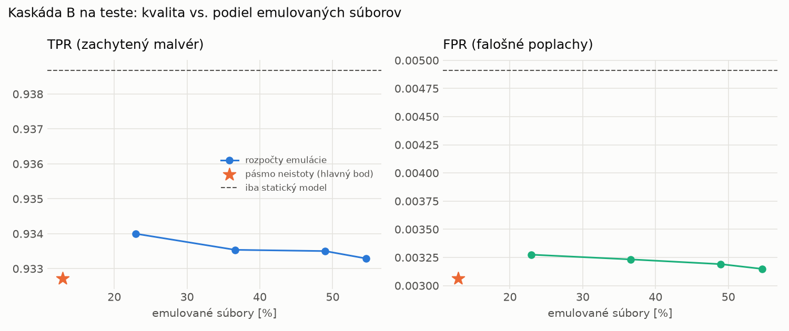

# Kaskáda B `b_heavy` – beh `20261104-204741`

> Generované `src/cascade/evaluate_b.py` (2026-11-04T20:47:41+01:00). Seedy: [0, 1, 2]; hodnoty = priemer ± sm. odchýlka.
> Všetky prahy a pásmo neistoty sú z validácie; test sa na nič nenastavuje. Postup: `docs/09_plan_v2.md`.

| rola | beh |
|---|---|
| static | `runs_v2/lofo/trojan/students_static/mlp_kd/20261104-204353` |
| dynamic | `runs_v2/lofo/trojan/students_dynamic/mlp_kd/20261104-204539` |
| hybrid | `runs_v2/lofo/trojan/hybrid/two_branch/20261104-193243` |

Druhý stupeň: **dynamic**. Pásmo neistoty statického modelu: FPR ≤ 0.1% nad `hi`,
najviac 1% malvéru validácie pod `lo` (seed 0: lo = 0.5704, hi = 0.9982, seed 1: lo = 0.5120, hi = 0.9991, seed 2: lo = 0.5977, hi = 0.9984).

## Test
| prístup | accuracy | balanced_accuracy | precision | recall_tpr | fpr | f1 | mcc |
|---|---|---|---|---|---|---|---|
| kaskáda B | 0.9621 ± 0.0040 | 0.9648 ± 0.0036 | 0.9972 ± 0.0004 | 0.9327 ± 0.0077 | 0.0031 ± 0.0005 | 0.9639 ± 0.0039 | 0.9265 ± 0.0074 |
| statický | 0.9645 ± 0.0045 | 0.9669 ± 0.0042 | 0.9956 ± 0.0001 | 0.9387 ± 0.0082 | 0.0049 ± 0.0001 | 0.9663 ± 0.0044 | 0.9307 ± 0.0084 |
| dynamický | 0.7334 ± 0.0088 | 0.7528 ± 0.0081 | 0.9741 ± 0.0034 | 0.5220 ± 0.0166 | 0.0165 ± 0.0023 | 0.6797 ± 0.0140 | 0.5549 ± 0.0126 |
| hybrid (každá vzorka) | 0.9735 ± 0.0016 | 0.9750 ± 0.0015 | 0.9939 ± 0.0015 | 0.9569 ± 0.0026 | 0.0070 ± 0.0017 | 0.9750 ± 0.0015 | 0.9475 ± 0.0031 |

- **emulované súbory: 12.88%** (ostatné rozhodne iba statický model); na hybrid ide 7.06% súborov
- chyby pri istom rozhodnutí statického modelu (seed 0): 431
- validácia: emulované 4.12%, na hybrid 1.81%

## Validácia
| prístup | accuracy | balanced_accuracy | precision | recall_tpr | fpr | f1 | mcc |
|---|---|---|---|---|---|---|---|
| kaskáda B | 0.9901 ± 0.0009 | 0.9909 ± 0.0007 | 0.9966 ± 0.0004 | 0.9876 ± 0.0015 | 0.0057 ± 0.0007 | 0.9921 ± 0.0007 | 0.9789 ± 0.0019 |
| statický | 0.9887 ± 0.0008 | 0.9892 ± 0.0005 | 0.9946 ± 0.0005 | 0.9873 ± 0.0018 | 0.0090 ± 0.0008 | 0.9910 ± 0.0007 | 0.9760 ± 0.0018 |
| dynamický | 0.9627 ± 0.0032 | 0.9682 ± 0.0026 | 0.9939 ± 0.0000 | 0.9463 ± 0.0051 | 0.0098 ± 0.0000 | 0.9695 ± 0.0027 | 0.9233 ± 0.0062 |
| hybrid (každá vzorka) | 0.9934 ± 0.0003 | 0.9928 ± 0.0004 | 0.9945 ± 0.0006 | 0.9950 ± 0.0001 | 0.0093 ± 0.0009 | 0.9947 ± 0.0003 | 0.9859 ± 0.0007 |

## Januárové vzorky vynechanej rodiny (iba malvér → TPR)
| prístup | TPR |
|---|---|
| kaskáda B | 0.8117 ± 0.0219 |
| statický | 0.8610 ± 0.0122 |
| dynamický | 0.5814 ± 0.0017 |
| hybrid (každá vzorka) | 0.8402 ± 0.0222 |

Podiel emulovaných: 36.91%

## Krivka rozpočtu emulácie (test, priemer cez seedy)
| budget_val | emulation_rate | hybrid_rate | recall_tpr | fpr | f1 |
|---|---|---|---|---|---|
| 0.1000 | 0.2294 | 0.0909 | 0.9340 | 0.0033 | 0.9645 |
| 0.2000 | 0.3660 | 0.1489 | 0.9335 | 0.0032 | 0.9643 |
| 0.3000 | 0.4896 | 0.2193 | 0.9335 | 0.0032 | 0.9643 |
| 0.4000 | 0.5462 | 0.2310 | 0.9333 | 0.0031 | 0.9642 |

## Výpočtové nároky
Emulácia (Speakeasy) sa nedá zmerať (dataset neobsahuje PE súbory). **Predpoklad** 60 s na súbor
(limit z `speakeasy-config.json`): kaskáda B ≈ 7.7 s na súbor v priemere, dynamický/hybridný model
a kaskáda A 60 s (emulujú každý súbor).

_Chýba benchmark niektorého komponentu (v zero-day behoch sa nemeria)._

