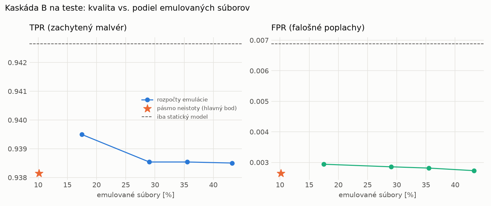

# Kaskáda B `b_nokd` – beh `20261104-204745`

> Generované `src/cascade/evaluate_b.py` (2026-11-04T20:47:45+01:00). Seedy: [0, 1, 2]; hodnoty = priemer ± sm. odchýlka.
> Všetky prahy a pásmo neistoty sú z validácie; test sa na nič nenastavuje. Postup: `docs/09_plan_v2.md`.

| rola | beh |
|---|---|
| static | `runs_v2/lofo/trojan/students_static/mlp_nokd/20261104-204423` |
| dynamic | `runs_v2/lofo/trojan/students_dynamic/mlp_nokd/20261104-204607` |
| hybrid | `runs_v2/lofo/trojan/hybrid/lightgbm/20261104-193036` |

Druhý stupeň: **dynamic**. Pásmo neistoty statického modelu: FPR ≤ 0.1% nad `hi`,
najviac 1% malvéru validácie pod `lo` (seed 0: lo = 0.5575, hi = 0.9784, seed 1: lo = 0.5917, hi = 0.9577, seed 2: lo = 0.5315, hi = 0.9846).

## Test
| prístup | accuracy | balanced_accuracy | precision | recall_tpr | fpr | f1 | mcc |
|---|---|---|---|---|---|---|---|
| kaskáda B | 0.9653 ± 0.0091 | 0.9678 ± 0.0083 | 0.9976 ± 0.0003 | 0.9381 ± 0.0170 | 0.0026 ± 0.0004 | 0.9669 ± 0.0090 | 0.9325 ± 0.0169 |
| statický | 0.9658 ± 0.0103 | 0.9679 ± 0.0094 | 0.9939 ± 0.0026 | 0.9427 ± 0.0210 | 0.0069 ± 0.0030 | 0.9675 ± 0.0102 | 0.9330 ± 0.0192 |
| dynamický | 0.7453 ± 0.0060 | 0.7628 ± 0.0069 | 0.9581 ± 0.0245 | 0.5546 ± 0.0064 | 0.0291 ± 0.0182 | 0.7024 ± 0.0043 | 0.5644 ± 0.0196 |
| hybrid (každá vzorka) | 0.9819 ± 0.0015 | 0.9830 ± 0.0013 | 0.9964 ± 0.0007 | 0.9702 ± 0.0032 | 0.0042 ± 0.0008 | 0.9831 ± 0.0014 | 0.9641 ± 0.0028 |

- **emulované súbory: 10.15%** (ostatné rozhodne iba statický model); na hybrid ide 6.04% súborov
- chyby pri istom rozhodnutí statického modelu (seed 0): 434
- validácia: emulované 4.65%, na hybrid 1.85%

## Validácia
| prístup | accuracy | balanced_accuracy | precision | recall_tpr | fpr | f1 | mcc |
|---|---|---|---|---|---|---|---|
| kaskáda B | 0.9910 ± 0.0006 | 0.9920 ± 0.0004 | 0.9974 ± 0.0003 | 0.9883 ± 0.0011 | 0.0044 ± 0.0005 | 0.9928 ± 0.0005 | 0.9810 ± 0.0012 |
| statický | 0.9901 ± 0.0013 | 0.9903 ± 0.0009 | 0.9945 ± 0.0007 | 0.9897 ± 0.0026 | 0.0091 ± 0.0012 | 0.9921 ± 0.0010 | 0.9790 ± 0.0027 |
| dynamický | 0.9648 ± 0.0021 | 0.9700 ± 0.0017 | 0.9939 ± 0.0000 | 0.9498 ± 0.0034 | 0.0098 ± 0.0000 | 0.9713 ± 0.0018 | 0.9275 ± 0.0041 |
| hybrid (každá vzorka) | 0.9940 ± 0.0002 | 0.9934 ± 0.0003 | 0.9946 ± 0.0007 | 0.9959 ± 0.0007 | 0.0091 ± 0.0012 | 0.9952 ± 0.0002 | 0.9872 ± 0.0005 |

## Januárové vzorky vynechanej rodiny (iba malvér → TPR)
| prístup | TPR |
|---|---|
| kaskáda B | 0.8815 ± 0.0217 |
| statický | 0.8865 ± 0.0273 |
| dynamický | 0.5903 ± 0.0024 |
| hybrid (každá vzorka) | 0.9318 ± 0.0090 |

Podiel emulovaných: 32.54%

## Krivka rozpočtu emulácie (test, priemer cez seedy)
| budget_val | emulation_rate | hybrid_rate | recall_tpr | fpr | f1 |
|---|---|---|---|---|---|
| 0.1000 | 0.1748 | 0.0759 | 0.9395 | 0.0029 | 0.9675 |
| 0.2000 | 0.2904 | 0.1401 | 0.9385 | 0.0029 | 0.9670 |
| 0.3000 | 0.3552 | 0.1525 | 0.9385 | 0.0028 | 0.9670 |
| 0.4000 | 0.4322 | 0.1681 | 0.9385 | 0.0027 | 0.9670 |

## Výpočtové nároky
Emulácia (Speakeasy) sa nedá zmerať (dataset neobsahuje PE súbory). **Predpoklad** 60 s na súbor
(limit z `speakeasy-config.json`): kaskáda B ≈ 6.1 s na súbor v priemere, dynamický/hybridný model
a kaskáda A 60 s (emulujú každý súbor).

_Chýba benchmark niektorého komponentu (v zero-day behoch sa nemeria)._

