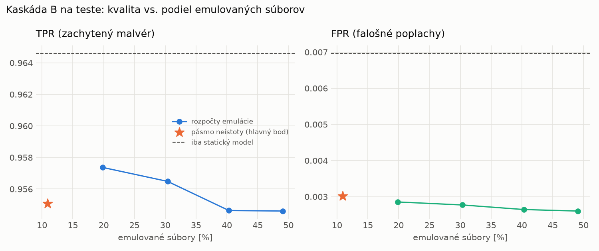

# Kaskáda B `b_twobranch` – beh `20261104-204747`

> Generované `src/cascade/evaluate_b.py` (2026-11-04T20:47:47+01:00). Seedy: [0, 1, 2]; hodnoty = priemer ± sm. odchýlka.
> Všetky prahy a pásmo neistoty sú z validácie; test sa na nič nenastavuje. Postup: `docs/09_plan_v2.md`.

| rola | beh |
|---|---|
| static | `runs_v2/lofo/trojan/students_static/mlp_kd_twobranch/20261104-204508` |
| dynamic | `runs_v2/lofo/trojan/students_dynamic/mlp_kd_twobranch/20261104-204652` |
| hybrid | `runs_v2/lofo/trojan/hybrid/lightgbm/20261104-193036` |

Druhý stupeň: **dynamic**. Pásmo neistoty statického modelu: FPR ≤ 0.1% nad `hi`,
najviac 1% malvéru validácie pod `lo` (seed 0: lo = 0.5337, hi = 0.9981, seed 1: lo = 0.5687, hi = 0.9904, seed 2: lo = 0.5834, hi = 0.9964).

## Test
| prístup | accuracy | balanced_accuracy | precision | recall_tpr | fpr | f1 | mcc |
|---|---|---|---|---|---|---|---|
| kaskáda B | 0.9743 ± 0.0002 | 0.9760 ± 0.0002 | 0.9973 ± 0.0006 | 0.9551 ± 0.0006 | 0.0030 ± 0.0007 | 0.9757 ± 0.0002 | 0.9494 ± 0.0005 |
| statický | 0.9776 ± 0.0004 | 0.9788 ± 0.0004 | 0.9939 ± 0.0003 | 0.9646 ± 0.0011 | 0.0070 ± 0.0003 | 0.9791 ± 0.0004 | 0.9555 ± 0.0008 |
| dynamický | 0.7324 ± 0.0092 | 0.7520 ± 0.0085 | 0.9761 ± 0.0014 | 0.5191 ± 0.0177 | 0.0151 ± 0.0012 | 0.6777 ± 0.0149 | 0.5544 ± 0.0129 |
| hybrid (každá vzorka) | 0.9819 ± 0.0015 | 0.9830 ± 0.0013 | 0.9964 ± 0.0007 | 0.9702 ± 0.0032 | 0.0042 ± 0.0008 | 0.9831 ± 0.0014 | 0.9641 ± 0.0028 |

- **emulované súbory: 10.91%** (ostatné rozhodne iba statický model); na hybrid ide 9.22% súborov
- chyby pri istom rozhodnutí statického modelu (seed 0): 308
- validácia: emulované 3.94%, na hybrid 1.81%

## Validácia
| prístup | accuracy | balanced_accuracy | precision | recall_tpr | fpr | f1 | mcc |
|---|---|---|---|---|---|---|---|
| kaskáda B | 0.9915 ± 0.0004 | 0.9923 ± 0.0004 | 0.9972 ± 0.0003 | 0.9892 ± 0.0004 | 0.0046 ± 0.0005 | 0.9932 ± 0.0003 | 0.9819 ± 0.0008 |
| statický | 0.9906 ± 0.0010 | 0.9906 ± 0.0007 | 0.9942 ± 0.0001 | 0.9908 ± 0.0016 | 0.0097 ± 0.0002 | 0.9925 ± 0.0008 | 0.9800 ± 0.0021 |
| dynamický | 0.9616 ± 0.0041 | 0.9674 ± 0.0032 | 0.9939 ± 0.0000 | 0.9447 ± 0.0065 | 0.0098 ± 0.0000 | 0.9686 ± 0.0034 | 0.9213 ± 0.0079 |
| hybrid (každá vzorka) | 0.9940 ± 0.0002 | 0.9934 ± 0.0003 | 0.9946 ± 0.0007 | 0.9959 ± 0.0007 | 0.0091 ± 0.0012 | 0.9952 ± 0.0002 | 0.9872 ± 0.0005 |

## Januárové vzorky vynechanej rodiny (iba malvér → TPR)
| prístup | TPR |
|---|---|
| kaskáda B | 0.9086 ± 0.0125 |
| statický | 0.9185 ± 0.0094 |
| dynamický | 0.5772 ± 0.0104 |
| hybrid (každá vzorka) | 0.9318 ± 0.0090 |

Podiel emulovaných: 26.72%

## Krivka rozpočtu emulácie (test, priemer cez seedy)
| budget_val | emulation_rate | hybrid_rate | recall_tpr | fpr | f1 |
|---|---|---|---|---|---|
| 0.1000 | 0.1982 | 0.1105 | 0.9574 | 0.0029 | 0.9770 |
| 0.2000 | 0.3038 | 0.1368 | 0.9565 | 0.0028 | 0.9766 |
| 0.3000 | 0.4033 | 0.1562 | 0.9546 | 0.0026 | 0.9757 |
| 0.4000 | 0.4910 | 0.1903 | 0.9546 | 0.0026 | 0.9757 |

## Výpočtové nároky
Emulácia (Speakeasy) sa nedá zmerať (dataset neobsahuje PE súbory). **Predpoklad** 60 s na súbor
(limit z `speakeasy-config.json`): kaskáda B ≈ 6.5 s na súbor v priemere, dynamický/hybridný model
a kaskáda A 60 s (emulujú každý súbor).

_Chýba benchmark niektorého komponentu (v zero-day behoch sa nemeria)._

