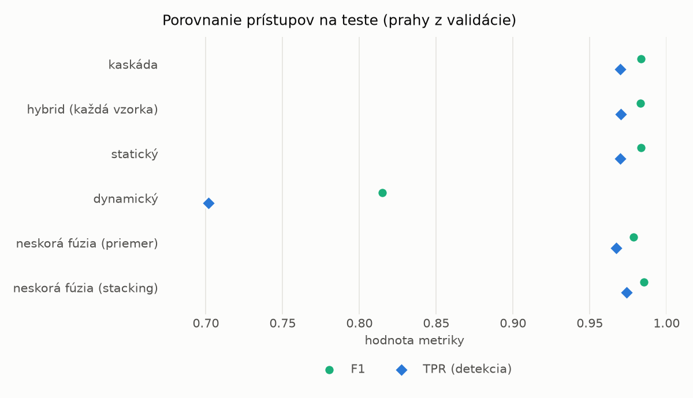
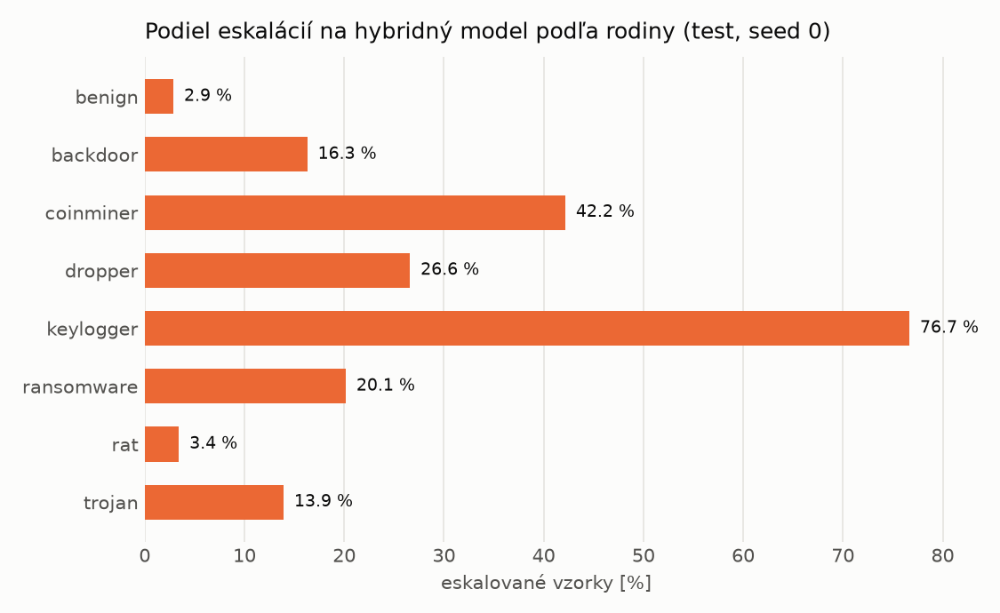

# Kaskáda `baselines` – beh `20261104-204733`

> Generované `src/cascade/evaluate.py` (2026-11-04T20:47:33+01:00). Seedy: [0, 1, 2]; hodnoty = priemer ± sm. odchýlka.
> Všetky prahy sú určené na validácii (FPR ≤ 1 %); test sa na nič nenastavuje.

| rola | beh |
|---|---|
| static | `runs_v2/lofo/trojan/static/lightgbm/20261104-184220` |
| dynamic | `runs_v2/lofo/trojan/dynamic/lightgbm/20261104-190128` |
| hybrid | `runs_v2/lofo/trojan/hybrid/lightgbm/20261104-193036` |

## Test
| prístup | accuracy | balanced_accuracy | precision | recall_tpr | fpr | f1 | mcc |
|---|---|---|---|---|---|---|---|
| kaskáda | 0.9822 ± 0.0008 | 0.9834 ± 0.0007 | 0.9974 ± 0.0003 | 0.9697 ± 0.0017 | 0.0030 ± 0.0004 | 0.9834 ± 0.0007 | 0.9647 ± 0.0015 |
| hybrid (každá vzorka) | 0.9819 ± 0.0015 | 0.9830 ± 0.0013 | 0.9964 ± 0.0007 | 0.9702 ± 0.0032 | 0.0042 ± 0.0008 | 0.9831 ± 0.0014 | 0.9641 ± 0.0028 |
| statický | 0.9820 ± 0.0011 | 0.9831 ± 0.0010 | 0.9970 ± 0.0001 | 0.9698 ± 0.0019 | 0.0035 ± 0.0001 | 0.9832 ± 0.0010 | 0.9643 ± 0.0021 |
| dynamický | 0.8273 ± 0.0072 | 0.8389 ± 0.0066 | 0.9720 ± 0.0015 | 0.7016 ± 0.0148 | 0.0239 ± 0.0018 | 0.8149 ± 0.0095 | 0.6919 ± 0.0106 |
| neskorá fúzia (priemer) | 0.9769 ± 0.0005 | 0.9778 ± 0.0004 | 0.9901 ± 0.0007 | 0.9671 ± 0.0016 | 0.0114 ± 0.0008 | 0.9785 ± 0.0005 | 0.9539 ± 0.0009 |
| neskorá fúzia (stacking) | 0.9841 ± 0.0020 | 0.9850 ± 0.0018 | 0.9964 ± 0.0002 | 0.9741 ± 0.0038 | 0.0041 ± 0.0003 | 0.9852 ± 0.0019 | 0.9683 ± 0.0038 |

## Validácia
| prístup | accuracy | balanced_accuracy | precision | recall_tpr | fpr | f1 | mcc |
|---|---|---|---|---|---|---|---|
| kaskáda | 0.9948 ± 0.0003 | 0.9944 ± 0.0005 | 0.9958 ± 0.0007 | 0.9959 ± 0.0003 | 0.0071 ± 0.0013 | 0.9959 ± 0.0002 | 0.9889 ± 0.0007 |
| hybrid (každá vzorka) | 0.9940 ± 0.0002 | 0.9934 ± 0.0003 | 0.9946 ± 0.0007 | 0.9959 ± 0.0007 | 0.0091 ± 0.0012 | 0.9952 ± 0.0002 | 0.9872 ± 0.0005 |
| statický | 0.9951 ± 0.0003 | 0.9945 ± 0.0003 | 0.9952 ± 0.0003 | 0.9970 ± 0.0001 | 0.0081 ± 0.0005 | 0.9961 ± 0.0002 | 0.9896 ± 0.0006 |
| dynamický | 0.9720 ± 0.0002 | 0.9758 ± 0.0002 | 0.9944 ± 0.0001 | 0.9607 ± 0.0003 | 0.0091 ± 0.0002 | 0.9773 ± 0.0002 | 0.9417 ± 0.0005 |
| neskorá fúzia (priemer) | 0.9941 ± 0.0001 | 0.9936 ± 0.0001 | 0.9951 ± 0.0002 | 0.9955 ± 0.0003 | 0.0082 ± 0.0004 | 0.9953 ± 0.0001 | 0.9874 ± 0.0002 |
| neskorá fúzia (stacking) | 0.9949 ± 0.0004 | 0.9940 ± 0.0005 | 0.9946 ± 0.0007 | 0.9972 ± 0.0001 | 0.0091 ± 0.0012 | 0.9959 ± 0.0003 | 0.9890 ± 0.0008 |

## Správanie kaskády (test, seed 0)
- podiel eskalácií na hybrid: **15.83%** (2744 vzoriek)
- chyby pri zhode študentov (kaskáda ich nemôže opraviť): **235**
  (1.610% zo zhôd; FP 2, FN 233)
- úspešnosť na eskalovaných vzorkách: hybrid 0.9697521865889213, statický 0.9668367346938775,
  dynamický 0.03316326530612245  → prínos hybridu pri nezhode

## Výpočtové nároky (odhad z benchmarkov komponentov)
_Chýba benchmark niektorého komponentu (`python -m src.evaluation.benchmark`)._

