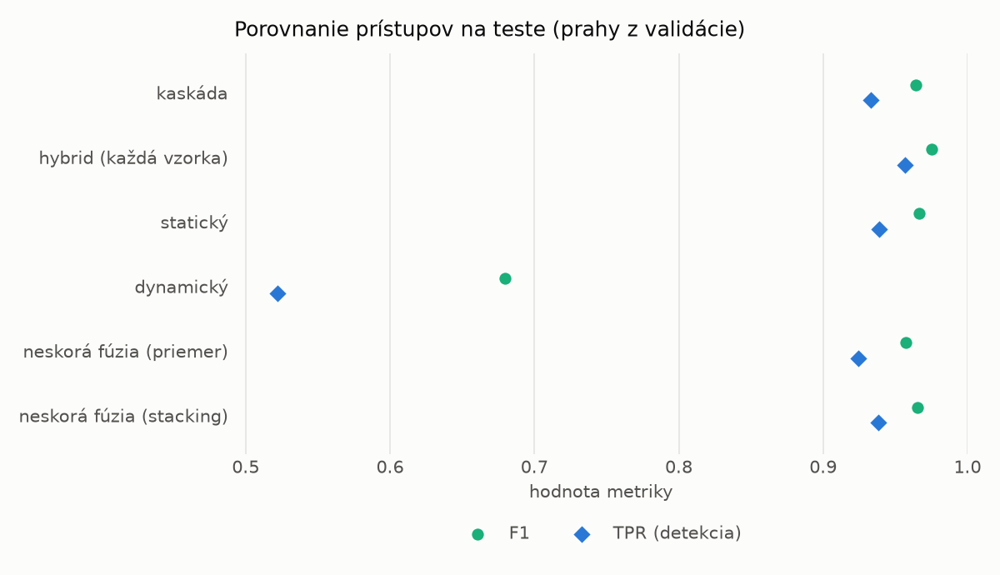
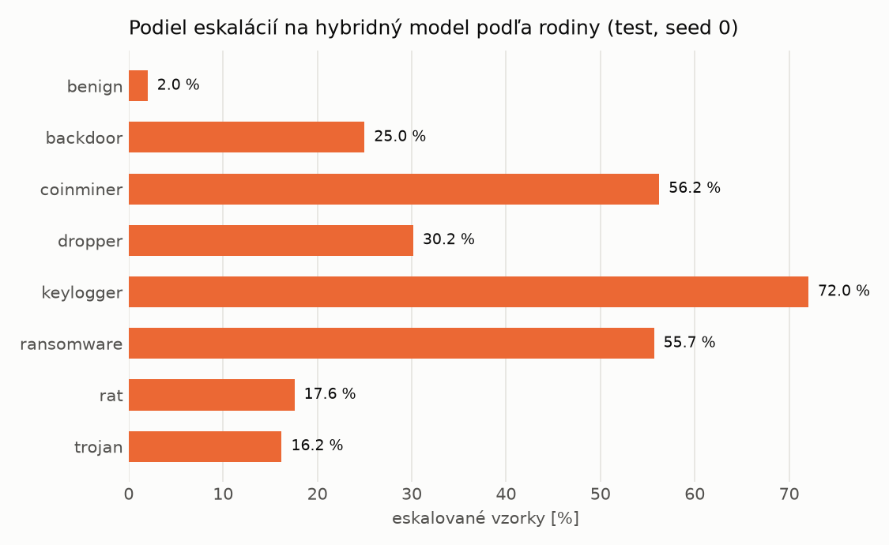

# Kaskáda `heavy` – beh `20261104-204730`

> Generované `src/cascade/evaluate.py` (2026-11-04T20:47:31+01:00). Seedy: [0, 1, 2]; hodnoty = priemer ± sm. odchýlka.
> Všetky prahy sú určené na validácii (FPR ≤ 1 %); test sa na nič nenastavuje.

| rola | beh |
|---|---|
| static | `runs_v2/lofo/trojan/students_static/mlp_kd/20261104-204353` |
| dynamic | `runs_v2/lofo/trojan/students_dynamic/mlp_kd/20261104-204539` |
| hybrid | `runs_v2/lofo/trojan/hybrid/two_branch/20261104-193243` |

## Test
| prístup | accuracy | balanced_accuracy | precision | recall_tpr | fpr | f1 | mcc |
|---|---|---|---|---|---|---|---|
| kaskáda | 0.9624 ± 0.0036 | 0.9651 ± 0.0032 | 0.9973 ± 0.0006 | 0.9332 ± 0.0071 | 0.0030 ± 0.0007 | 0.9642 ± 0.0035 | 0.9270 ± 0.0066 |
| hybrid (každá vzorka) | 0.9735 ± 0.0016 | 0.9750 ± 0.0015 | 0.9939 ± 0.0015 | 0.9569 ± 0.0026 | 0.0070 ± 0.0017 | 0.9750 ± 0.0015 | 0.9475 ± 0.0031 |
| statický | 0.9645 ± 0.0045 | 0.9669 ± 0.0042 | 0.9956 ± 0.0001 | 0.9387 ± 0.0082 | 0.0049 ± 0.0001 | 0.9663 ± 0.0044 | 0.9307 ± 0.0084 |
| dynamický | 0.7334 ± 0.0088 | 0.7528 ± 0.0081 | 0.9741 ± 0.0034 | 0.5220 ± 0.0166 | 0.0165 ± 0.0023 | 0.6797 ± 0.0140 | 0.5549 ± 0.0126 |
| neskorá fúzia (priemer) | 0.9554 ± 0.0037 | 0.9582 ± 0.0033 | 0.9929 ± 0.0019 | 0.9243 ± 0.0086 | 0.0079 ± 0.0021 | 0.9574 ± 0.0038 | 0.9133 ± 0.0066 |
| neskorá fúzia (stacking) | 0.9638 ± 0.0021 | 0.9662 ± 0.0019 | 0.9949 ± 0.0004 | 0.9380 ± 0.0035 | 0.0057 ± 0.0004 | 0.9656 ± 0.0020 | 0.9292 ± 0.0039 |

## Validácia
| prístup | accuracy | balanced_accuracy | precision | recall_tpr | fpr | f1 | mcc |
|---|---|---|---|---|---|---|---|
| kaskáda | 0.9904 ± 0.0008 | 0.9911 ± 0.0007 | 0.9965 ± 0.0005 | 0.9882 ± 0.0013 | 0.0059 ± 0.0009 | 0.9923 ± 0.0007 | 0.9796 ± 0.0017 |
| hybrid (každá vzorka) | 0.9934 ± 0.0003 | 0.9928 ± 0.0004 | 0.9945 ± 0.0006 | 0.9950 ± 0.0001 | 0.0093 ± 0.0009 | 0.9947 ± 0.0003 | 0.9859 ± 0.0007 |
| statický | 0.9887 ± 0.0008 | 0.9892 ± 0.0005 | 0.9946 ± 0.0005 | 0.9873 ± 0.0018 | 0.0090 ± 0.0008 | 0.9910 ± 0.0007 | 0.9760 ± 0.0018 |
| dynamický | 0.9627 ± 0.0032 | 0.9682 ± 0.0026 | 0.9939 ± 0.0000 | 0.9463 ± 0.0051 | 0.0098 ± 0.0000 | 0.9695 ± 0.0027 | 0.9233 ± 0.0062 |
| neskorá fúzia (priemer) | 0.9911 ± 0.0016 | 0.9911 ± 0.0013 | 0.9947 ± 0.0004 | 0.9912 ± 0.0025 | 0.0089 ± 0.0006 | 0.9929 ± 0.0013 | 0.9811 ± 0.0034 |
| neskorá fúzia (stacking) | 0.9917 ± 0.0010 | 0.9915 ± 0.0009 | 0.9943 ± 0.0001 | 0.9925 ± 0.0015 | 0.0096 ± 0.0002 | 0.9934 ± 0.0008 | 0.9823 ± 0.0022 |

## Správanie kaskády (test, seed 0)
- podiel eskalácií na hybrid: **23.10%** (4005 vzoriek)
- chyby pri zhode študentov (kaskáda ich nemôže opraviť): **502**
  (3.765% zo zhôd; FP 5, FN 497)
- úspešnosť na eskalovaných vzorkách: hybrid 0.9780274656679151, statický 0.9860174781523097,
  dynamický 0.013982521847690388  → prínos hybridu pri nezhode

## Výpočtové nároky (odhad z benchmarkov komponentov)
_Chýba benchmark niektorého komponentu (`python -m src.evaluation.benchmark`)._

