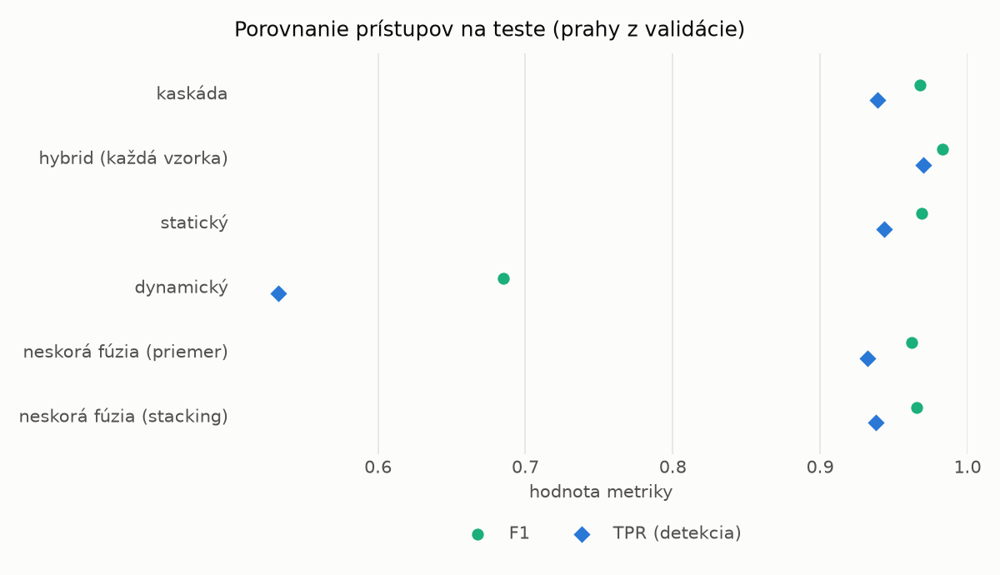
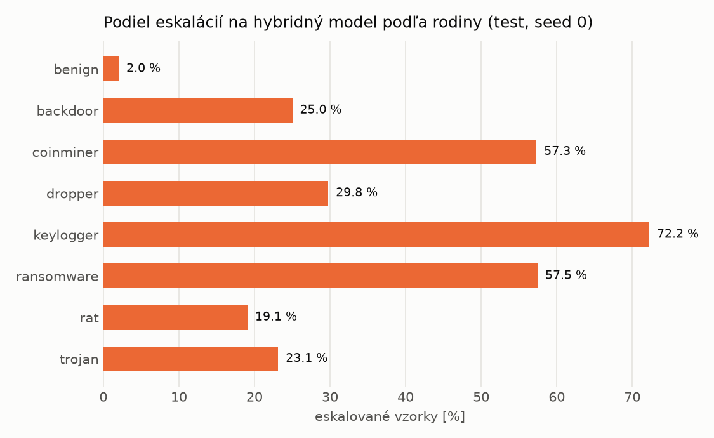

# Kaskáda `modal` – beh `20261104-204728`

> Generované `src/cascade/evaluate.py` (2026-11-04T20:47:28+01:00). Seedy: [0, 1, 2]; hodnoty = priemer ± sm. odchýlka.
> Všetky prahy sú určené na validácii (FPR ≤ 1 %); test sa na nič nenastavuje.

| rola | beh |
|---|---|
| static | `runs_v2/lofo/trojan/students_static/mlp_kd_modal/20261104-204439` |
| dynamic | `runs_v2/lofo/trojan/students_dynamic/mlp_kd_modal/20261104-204627` |
| hybrid | `runs_v2/lofo/trojan/hybrid/lightgbm/20261104-193036` |

## Test
| prístup | accuracy | balanced_accuracy | precision | recall_tpr | fpr | f1 | mcc |
|---|---|---|---|---|---|---|---|
| kaskáda | 0.9660 ± 0.0021 | 0.9684 ± 0.0019 | 0.9980 ± 0.0003 | 0.9390 ± 0.0043 | 0.0022 ± 0.0004 | 0.9676 ± 0.0021 | 0.9337 ± 0.0040 |
| hybrid (každá vzorka) | 0.9819 ± 0.0015 | 0.9830 ± 0.0013 | 0.9964 ± 0.0007 | 0.9702 ± 0.0032 | 0.0042 ± 0.0008 | 0.9831 ± 0.0014 | 0.9641 ± 0.0028 |
| statický | 0.9670 ± 0.0023 | 0.9692 ± 0.0021 | 0.9954 ± 0.0001 | 0.9435 ± 0.0042 | 0.0052 ± 0.0001 | 0.9687 ± 0.0022 | 0.9353 ± 0.0043 |
| dynamický | 0.7347 ± 0.0030 | 0.7533 ± 0.0031 | 0.9616 ± 0.0249 | 0.5324 ± 0.0162 | 0.0258 ± 0.0182 | 0.6850 ± 0.0077 | 0.5509 ± 0.0124 |
| neskorá fúzia (priemer) | 0.9600 ± 0.0018 | 0.9625 ± 0.0015 | 0.9936 ± 0.0031 | 0.9322 ± 0.0057 | 0.0071 ± 0.0035 | 0.9619 ± 0.0019 | 0.9219 ± 0.0031 |
| neskorá fúzia (stacking) | 0.9636 ± 0.0018 | 0.9660 ± 0.0016 | 0.9950 ± 0.0012 | 0.9377 ± 0.0044 | 0.0056 ± 0.0014 | 0.9655 ± 0.0018 | 0.9290 ± 0.0033 |

## Validácia
| prístup | accuracy | balanced_accuracy | precision | recall_tpr | fpr | f1 | mcc |
|---|---|---|---|---|---|---|---|
| kaskáda | 0.9915 ± 0.0002 | 0.9922 ± 0.0003 | 0.9972 ± 0.0005 | 0.9891 ± 0.0004 | 0.0046 ± 0.0009 | 0.9932 ± 0.0001 | 0.9818 ± 0.0003 |
| hybrid (každá vzorka) | 0.9940 ± 0.0002 | 0.9934 ± 0.0003 | 0.9946 ± 0.0007 | 0.9959 ± 0.0007 | 0.0091 ± 0.0012 | 0.9952 ± 0.0002 | 0.9872 ± 0.0005 |
| statický | 0.9896 ± 0.0001 | 0.9898 ± 0.0001 | 0.9945 ± 0.0001 | 0.9888 ± 0.0000 | 0.0091 ± 0.0002 | 0.9917 ± 0.0001 | 0.9778 ± 0.0002 |
| dynamický | 0.9646 ± 0.0006 | 0.9699 ± 0.0005 | 0.9940 ± 0.0001 | 0.9494 ± 0.0011 | 0.0097 ± 0.0002 | 0.9712 ± 0.0005 | 0.9272 ± 0.0012 |
| neskorá fúzia (priemer) | 0.9919 ± 0.0011 | 0.9917 ± 0.0007 | 0.9946 ± 0.0005 | 0.9925 ± 0.0023 | 0.0091 ± 0.0009 | 0.9935 ± 0.0009 | 0.9826 ± 0.0024 |
| neskorá fúzia (stacking) | 0.9920 ± 0.0009 | 0.9917 ± 0.0008 | 0.9942 ± 0.0001 | 0.9930 ± 0.0013 | 0.0097 ± 0.0002 | 0.9936 ± 0.0007 | 0.9829 ± 0.0020 |

## Správanie kaskády (test, seed 0)
- podiel eskalácií na hybrid: **23.99%** (4159 vzoriek)
- chyby pri zhode študentov (kaskáda ich nemôže opraviť): **500**
  (3.794% zo zhôd; FP 3, FN 497)
- úspešnosť na eskalovaných vzorkách: hybrid 0.9680211589324357, statický 0.9728300072132724,
  dynamický 0.02716999278672758  → prínos hybridu pri nezhode

## Výpočtové nároky (odhad z benchmarkov komponentov)
_Chýba benchmark niektorého komponentu (`python -m src.evaluation.benchmark`)._

