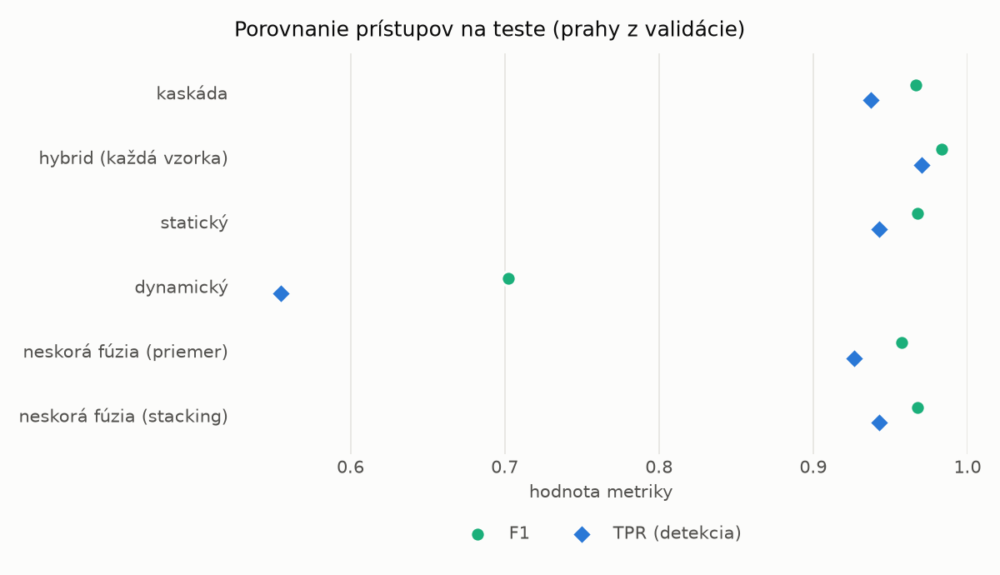
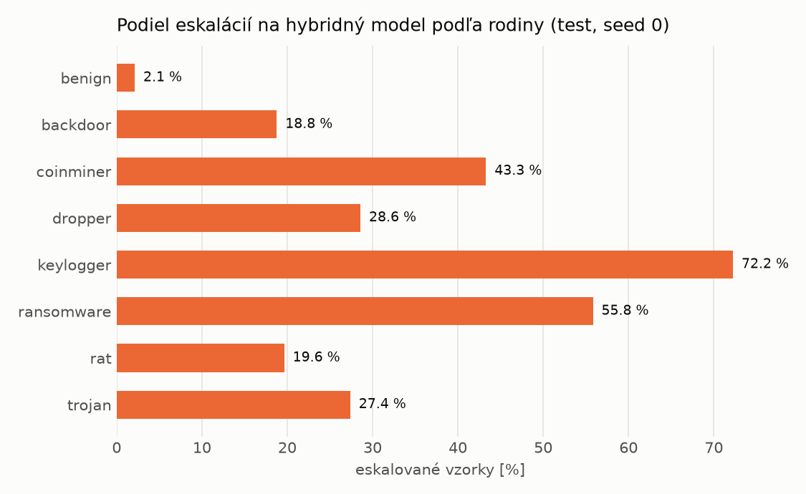

# Kaskáda `nokd` – beh `20261104-204726`

> Generované `src/cascade/evaluate.py` (2026-11-04T20:47:26+01:00). Seedy: [0, 1, 2]; hodnoty = priemer ± sm. odchýlka.
> Všetky prahy sú určené na validácii (FPR ≤ 1 %); test sa na nič nenastavuje.

| rola | beh |
|---|---|
| static | `runs_v2/lofo/trojan/students_static/mlp_nokd/20261104-204423` |
| dynamic | `runs_v2/lofo/trojan/students_dynamic/mlp_nokd/20261104-204607` |
| hybrid | `runs_v2/lofo/trojan/hybrid/lightgbm/20261104-193036` |

## Test
| prístup | accuracy | balanced_accuracy | precision | recall_tpr | fpr | f1 | mcc |
|---|---|---|---|---|---|---|---|
| kaskáda | 0.9651 ± 0.0105 | 0.9677 ± 0.0096 | 0.9982 ± 0.0004 | 0.9374 ± 0.0196 | 0.0021 ± 0.0004 | 0.9668 ± 0.0104 | 0.9323 ± 0.0194 |
| hybrid (každá vzorka) | 0.9819 ± 0.0015 | 0.9830 ± 0.0013 | 0.9964 ± 0.0007 | 0.9702 ± 0.0032 | 0.0042 ± 0.0008 | 0.9831 ± 0.0014 | 0.9641 ± 0.0028 |
| statický | 0.9658 ± 0.0103 | 0.9679 ± 0.0094 | 0.9939 ± 0.0026 | 0.9427 ± 0.0210 | 0.0069 ± 0.0030 | 0.9675 ± 0.0102 | 0.9330 ± 0.0192 |
| dynamický | 0.7453 ± 0.0060 | 0.7628 ± 0.0069 | 0.9581 ± 0.0245 | 0.5546 ± 0.0064 | 0.0291 ± 0.0182 | 0.7024 ± 0.0043 | 0.5644 ± 0.0196 |
| neskorá fúzia (priemer) | 0.9551 ± 0.0048 | 0.9577 ± 0.0046 | 0.9900 ± 0.0030 | 0.9265 ± 0.0079 | 0.0110 ± 0.0033 | 0.9572 ± 0.0047 | 0.9123 ± 0.0092 |
| neskorá fúzia (stacking) | 0.9655 ± 0.0009 | 0.9676 ± 0.0010 | 0.9933 ± 0.0020 | 0.9427 ± 0.0004 | 0.0075 ± 0.0022 | 0.9673 ± 0.0009 | 0.9322 ± 0.0020 |

## Validácia
| prístup | accuracy | balanced_accuracy | precision | recall_tpr | fpr | f1 | mcc |
|---|---|---|---|---|---|---|---|
| kaskáda | 0.9919 ± 0.0012 | 0.9925 ± 0.0008 | 0.9970 ± 0.0006 | 0.9901 ± 0.0024 | 0.0051 ± 0.0009 | 0.9935 ± 0.0010 | 0.9828 ± 0.0026 |
| hybrid (každá vzorka) | 0.9940 ± 0.0002 | 0.9934 ± 0.0003 | 0.9946 ± 0.0007 | 0.9959 ± 0.0007 | 0.0091 ± 0.0012 | 0.9952 ± 0.0002 | 0.9872 ± 0.0005 |
| statický | 0.9901 ± 0.0013 | 0.9903 ± 0.0009 | 0.9945 ± 0.0007 | 0.9897 ± 0.0026 | 0.0091 ± 0.0012 | 0.9921 ± 0.0010 | 0.9790 ± 0.0027 |
| dynamický | 0.9648 ± 0.0021 | 0.9700 ± 0.0017 | 0.9939 ± 0.0000 | 0.9498 ± 0.0034 | 0.0098 ± 0.0000 | 0.9713 ± 0.0018 | 0.9275 ± 0.0041 |
| neskorá fúzia (priemer) | 0.9925 ± 0.0008 | 0.9921 ± 0.0007 | 0.9942 ± 0.0001 | 0.9938 ± 0.0011 | 0.0097 ± 0.0002 | 0.9940 ± 0.0006 | 0.9840 ± 0.0016 |
| neskorá fúzia (stacking) | 0.9932 ± 0.0002 | 0.9927 ± 0.0003 | 0.9944 ± 0.0004 | 0.9948 ± 0.0001 | 0.0094 ± 0.0007 | 0.9946 ± 0.0001 | 0.9855 ± 0.0004 |

## Správanie kaskády (test, seed 0)
- podiel eskalácií na hybrid: **22.05%** (3823 vzoriek)
- chyby pri zhode študentov (kaskáda ich nemôže opraviť): **683**
  (5.053% zo zhôd; FP 3, FN 680)
- úspešnosť na eskalovaných vzorkách: hybrid 0.9659952916557677, statický 0.969657337169762,
  dynamický 0.030342662830238034  → prínos hybridu pri nezhode

## Výpočtové nároky (odhad z benchmarkov komponentov)
_Chýba benchmark niektorého komponentu (`python -m src.evaluation.benchmark`)._

