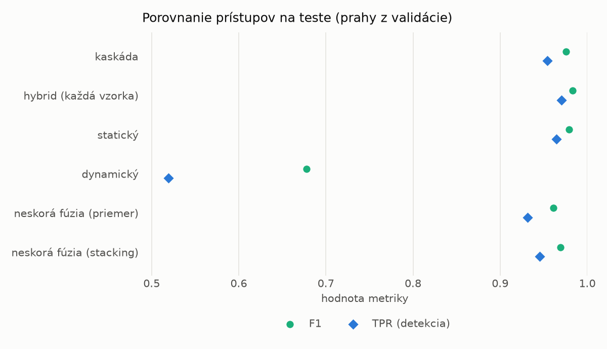
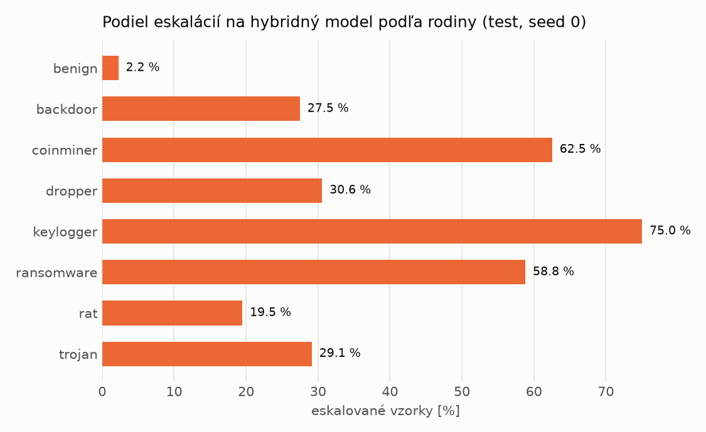

# Kaskáda `twobranch` – beh `20261104-204735`

> Generované `src/cascade/evaluate.py` (2026-11-04T20:47:35+01:00). Seedy: [0, 1, 2]; hodnoty = priemer ± sm. odchýlka.
> Všetky prahy sú určené na validácii (FPR ≤ 1 %); test sa na nič nenastavuje.

| rola | beh |
|---|---|
| static | `runs_v2/lofo/trojan/students_static/mlp_kd_twobranch/20261104-204508` |
| dynamic | `runs_v2/lofo/trojan/students_dynamic/mlp_kd_twobranch/20261104-204652` |
| hybrid | `runs_v2/lofo/trojan/hybrid/lightgbm/20261104-193036` |

## Test
| prístup | accuracy | balanced_accuracy | precision | recall_tpr | fpr | f1 | mcc |
|---|---|---|---|---|---|---|---|
| kaskáda | 0.9743 ± 0.0016 | 0.9762 ± 0.0014 | 0.9983 ± 0.0002 | 0.9543 ± 0.0030 | 0.0019 ± 0.0003 | 0.9758 ± 0.0015 | 0.9496 ± 0.0030 |
| hybrid (každá vzorka) | 0.9819 ± 0.0015 | 0.9830 ± 0.0013 | 0.9964 ± 0.0007 | 0.9702 ± 0.0032 | 0.0042 ± 0.0008 | 0.9831 ± 0.0014 | 0.9641 ± 0.0028 |
| statický | 0.9776 ± 0.0004 | 0.9788 ± 0.0004 | 0.9939 ± 0.0003 | 0.9646 ± 0.0011 | 0.0070 ± 0.0003 | 0.9791 ± 0.0004 | 0.9555 ± 0.0008 |
| dynamický | 0.7324 ± 0.0092 | 0.7520 ± 0.0085 | 0.9761 ± 0.0014 | 0.5191 ± 0.0177 | 0.0151 ± 0.0012 | 0.6777 ± 0.0149 | 0.5544 ± 0.0129 |
| neskorá fúzia (priemer) | 0.9591 ± 0.0076 | 0.9616 ± 0.0067 | 0.9926 ± 0.0034 | 0.9314 ± 0.0173 | 0.0083 ± 0.0039 | 0.9610 ± 0.0077 | 0.9202 ± 0.0137 |
| neskorá fúzia (stacking) | 0.9674 ± 0.0035 | 0.9694 ± 0.0032 | 0.9940 ± 0.0006 | 0.9455 ± 0.0064 | 0.0067 ± 0.0006 | 0.9691 ± 0.0034 | 0.9359 ± 0.0066 |

## Validácia
| prístup | accuracy | balanced_accuracy | precision | recall_tpr | fpr | f1 | mcc |
|---|---|---|---|---|---|---|---|
| kaskáda | 0.9920 ± 0.0010 | 0.9926 ± 0.0007 | 0.9969 ± 0.0003 | 0.9903 ± 0.0018 | 0.0052 ± 0.0005 | 0.9936 ± 0.0008 | 0.9830 ± 0.0021 |
| hybrid (každá vzorka) | 0.9940 ± 0.0002 | 0.9934 ± 0.0003 | 0.9946 ± 0.0007 | 0.9959 ± 0.0007 | 0.0091 ± 0.0012 | 0.9952 ± 0.0002 | 0.9872 ± 0.0005 |
| statický | 0.9906 ± 0.0010 | 0.9906 ± 0.0007 | 0.9942 ± 0.0001 | 0.9908 ± 0.0016 | 0.0097 ± 0.0002 | 0.9925 ± 0.0008 | 0.9800 ± 0.0021 |
| dynamický | 0.9616 ± 0.0041 | 0.9674 ± 0.0032 | 0.9939 ± 0.0000 | 0.9447 ± 0.0065 | 0.0098 ± 0.0000 | 0.9686 ± 0.0034 | 0.9213 ± 0.0079 |
| neskorá fúzia (priemer) | 0.9921 ± 0.0016 | 0.9920 ± 0.0013 | 0.9950 ± 0.0007 | 0.9925 ± 0.0028 | 0.0085 ± 0.0012 | 0.9937 ± 0.0013 | 0.9832 ± 0.0034 |
| neskorá fúzia (stacking) | 0.9933 ± 0.0002 | 0.9928 ± 0.0002 | 0.9945 ± 0.0004 | 0.9948 ± 0.0001 | 0.0093 ± 0.0006 | 0.9946 ± 0.0001 | 0.9856 ± 0.0003 |

## Správanie kaskády (test, seed 0)
- podiel eskalácií na hybrid: **25.61%** (4441 vzoriek)
- chyby pri zhode študentov (kaskáda ich nemôže opraviť): **313**
  (2.427% zo zhôd; FP 3, FN 310)
- úspešnosť na eskalovaných vzorkách: hybrid 0.9662238234631839, statický 0.9849133078135555,
  dynamický 0.015086692186444494  → prínos hybridu pri nezhode

## Výpočtové nároky (odhad z benchmarkov komponentov)
_Chýba benchmark niektorého komponentu (`python -m src.evaluation.benchmark`)._

