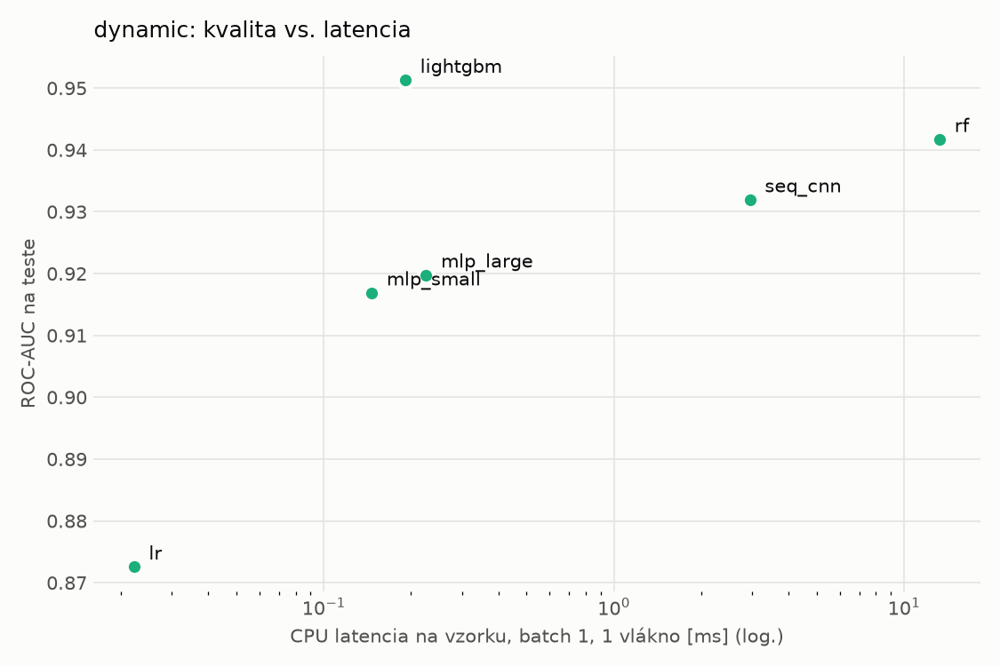
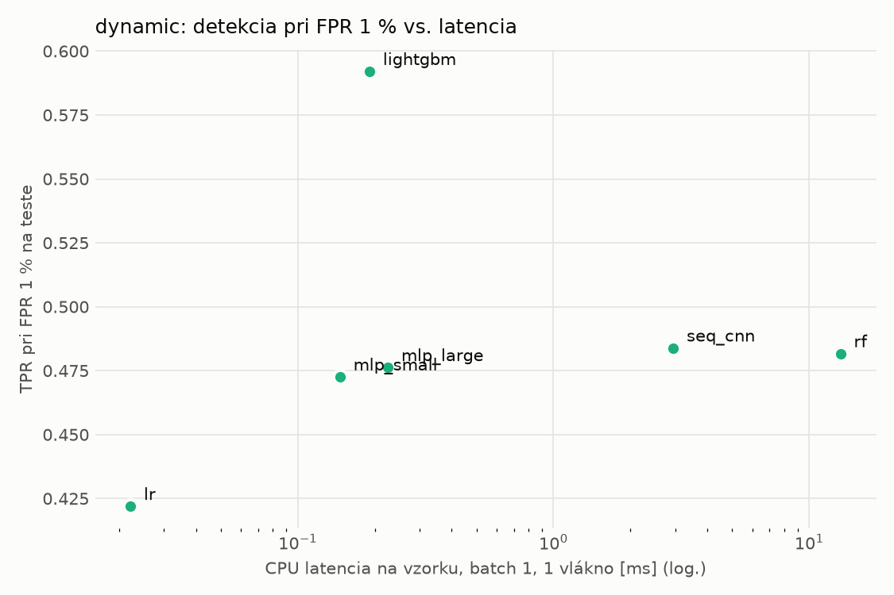
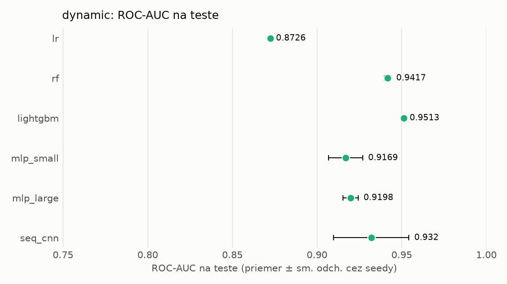
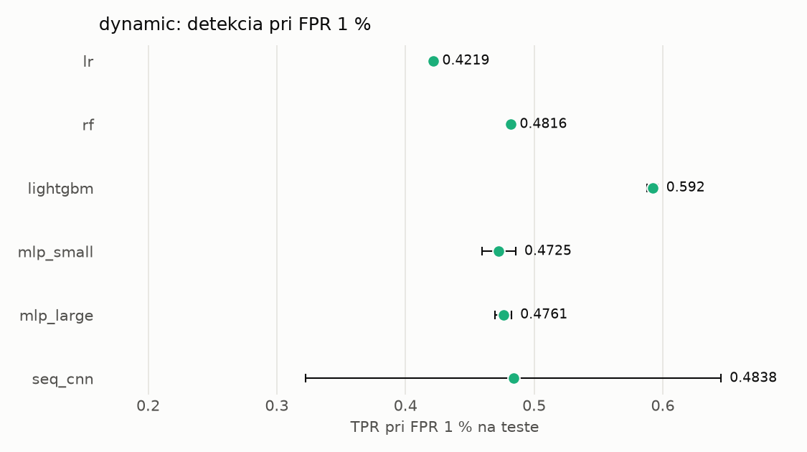

# Porovnanie modelov – dynamic

> Generované `src/evaluation/compare.py` (2026-11-04T19:24:34+01:00); použitý je posledný beh každého modelu.
> Metriky sú priemer cez seedy. \* = pri prahu určenom na validácii (FPR ≤ 1 %).
> CPU ms/vz. = medián latencie jednej vzorky na 1 vlákne vrátane transformácie vstupu (meranie hneď po tréningu,
> orientačné). Oficiálne merania spotreby sú v časti „Spotreba zdrojov pri inferencii“.

## Detekčná kvalita a orientačné časy
| model | ROC-AUC val | ROC-AUC test | TPR@FPR 1 % test | TPR@FPR 0,1 % test | F1 test* | FPR test* | gap train−val | CPU ms/vz. | CPU vz./s | GPU ms/vz. | parametre | MB | tréning s | ladenie min |
|---|---|---|---|---|---|---|---|---|---|---|---|---|---|---|
| [lr](../../dynamic/lr/20261104-185930/README.md) | 0.9948 | 0.8726 ± 0.0000 | 0.4219 | 0.2048 | 0.6507 | 0.0589 | 0.0018 | 0.022 | 340 871 | – | 2 001 | 0.06 | 3.5 | 0.0 |
| [rf](../../dynamic/rf/20261104-185948/README.md) | 0.9974 | 0.9417 ± 0.0018 | 0.4816 | 0.0000 | 0.6674 | 0.0183 | 0.0017 | 13.268 | 86 003 | – | 909 982 | 73.22 | 29.9 | 0.0 |
| [lightgbm](../../dynamic/lightgbm/20261104-190128/README.md) | 0.9976 | 0.9513 ± 0.0002 | 0.5920 | 0.3759 | 0.8149 | 0.0239 | 0.0014 | 0.191 | 73 599 | – | 539 262 | 30.59 | 20.7 | 0.0 |
| [mlp_small](../../dynamic/mlp_small/20261104-190248/README.md) | 0.9967 | 0.9169 ± 0.0101 | 0.4725 | 0.2522 | 0.6846 | 0.0141 | 0.0014 | 0.147 | 86 846 | 0.337 | 546 049 | 2.24 | 2.9 | 0.0 |
| [mlp_large](../../dynamic/mlp_large/20261104-190305/README.md) | 0.9965 | 0.9198 ± 0.0045 | 0.4761 | 0.3205 | 0.6752 | 0.0260 | 0.0012 | 0.225 | 76 316 | 0.426 | 1 190 657 | 4.83 | 9.4 | 0.0 |
| [seq_cnn](../../dynamic/seq_cnn/20261104-190342/README.md) | 0.9973 | 0.9320 ± 0.0223 | 0.4838 | 0.2945 | 0.7417 | 0.0236 | 0.0011 | 2.945 | 1 255 | 1.265 | 207 297 | 0.83 | 377.3 | 0.0 |

## Nízka prevalencia malvéru (test, prah z validácie)
| model | TPR | FPR | precision @ 1 % | falošné na 1 skutočný poplach @ 1 % | precision @ 0.1 % | falošné na 1 skutočný poplach @ 0.1 % |
|---|---|---|---|---|---|---|
| lr | 0.5062 | 0.0589 | 0.080 | 11.53 | 0.009 | 116.32 |
| rf | 0.5086 | 0.0183 | 0.220 | 3.55 | 0.027 | 35.87 |
| lightgbm | 0.7016 | 0.0239 | 0.228 | 3.38 | 0.029 | 34.07 |
| mlp_small | 0.5269 | 0.0141 | 0.275 | 2.64 | 0.036 | 26.66 |
| mlp_large | 0.5209 | 0.0260 | 0.168 | 4.94 | 0.020 | 49.84 |
| seq_cnn | 0.6039 | 0.0236 | 0.205 | 3.87 | 0.025 | 39.03 |

Prepočet: TPR a FPR nezávisia od podielu malvéru, preto sa dajú preniesť na nízku prevalenciu (v reálnej prevádzke je malvéru ~1 % alebo menej; v teste 54 %). „Falošné na 1 skutočný poplach“ = koľko neškodných súborov je označených na každý zachytený malvér.

## Spotreba zdrojov pri inferencii (benchmark, testovacia množina)
_Benchmark zatiaľ nebol spustený (`python -m src.evaluation.benchmark --approach dynamic`)._

## Grafy

