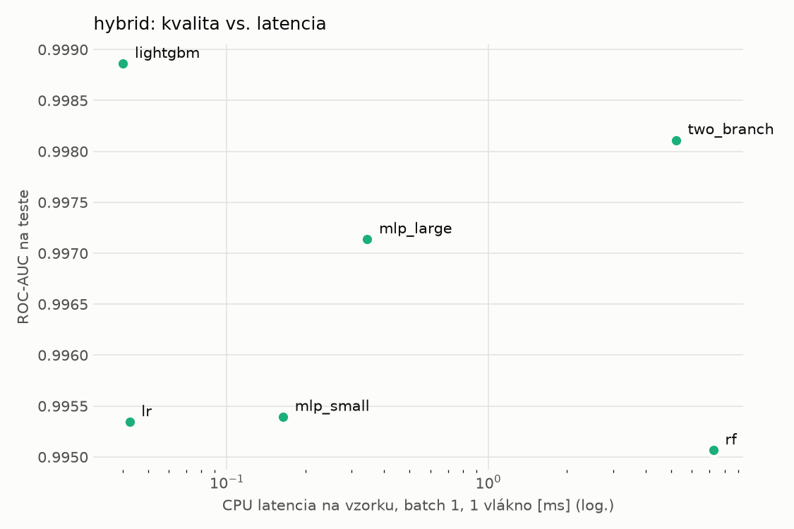
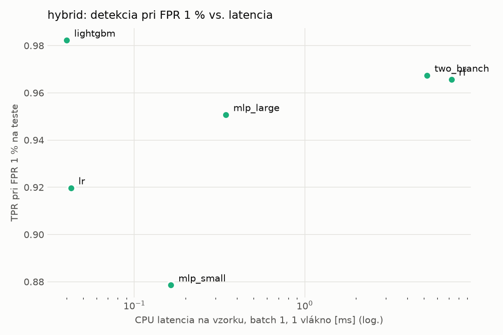
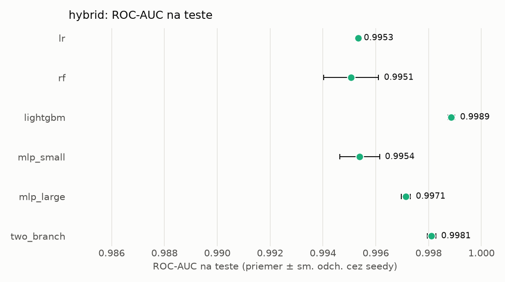
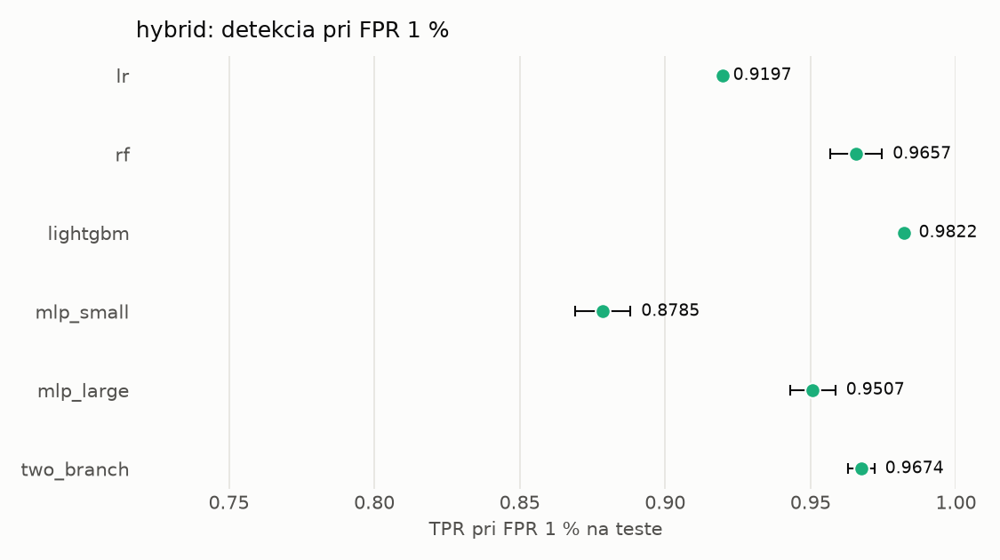

# Porovnanie modelov – hybrid

> Generované `src/evaluation/compare.py` (2026-11-04T19:54:27+01:00); použitý je posledný beh každého modelu.
> Metriky sú priemer cez seedy. \* = pri prahu určenom na validácii (FPR ≤ 1 %).
> CPU ms/vz. = medián latencie jednej vzorky na 1 vlákne vrátane transformácie vstupu (meranie hneď po tréningu,
> orientačné). Oficiálne merania spotreby sú v časti „Spotreba zdrojov pri inferencii“.

## Detekčná kvalita a orientačné časy
| model | ROC-AUC val | ROC-AUC test | TPR@FPR 1 % test | TPR@FPR 0,1 % test | F1 test* | FPR test* | gap train−val | CPU ms/vz. | CPU vz./s | GPU ms/vz. | parametre | MB | tréning s | ladenie min |
|---|---|---|---|---|---|---|---|---|---|---|---|---|---|---|
| [lr](../../hybrid/lr/20261104-192437/README.md) | 0.9989 | 0.9953 ± 0.0000 | 0.9197 | 0.6903 | 0.9426 | 0.0069 | 0.0010 | 0.042 | 155 201 | – | 4 319 | 0.13 | 4.7 | 0.0 |
| [rf](../../hybrid/rf/20261104-192506/README.md) | 0.9998 | 0.9951 ± 0.0010 | 0.9657 | 0.8077 | 0.9654 | 0.0077 | 0.0002 | 7.251 | 106 770 | – | 245 880 | 20.01 | 107.1 | 0.0 |
| [lightgbm](../../hybrid/lightgbm/20261104-193036/README.md) | 0.9997 | 0.9989 ± 0.0001 | 0.9822 | 0.9131 | 0.9831 | 0.0042 | 0.0003 | 0.040 | 237 086 | – | 25 973 | 1.48 | 15.4 | 0.0 |
| [mlp_small](../../hybrid/mlp_small/20261104-193126/README.md) | 0.9994 | 0.9954 ± 0.0007 | 0.8785 | 0.6962 | 0.9226 | 0.0075 | 0.0005 | 0.164 | 46 281 | 0.422 | 138 849 | 0.67 | 4.8 | 0.0 |
| [mlp_large](../../hybrid/mlp_large/20261104-193159/README.md) | 0.9995 | 0.9971 ± 0.0002 | 0.9507 | 0.7791 | 0.9534 | 0.0071 | 0.0005 | 0.345 | 37 548 | 0.577 | 2 385 793 | 9.67 | 8.2 | 0.0 |
| [two_branch](../../hybrid/two_branch/20261104-193243/README.md) | 0.9994 | 0.9981 ± 0.0002 | 0.9674 | 0.8148 | 0.9750 | 0.0070 | 0.0005 | 5.221 | 643 | 1.226 | 1 754 626 | 7.09 | 361.4 | 0.0 |

## Nízka prevalencia malvéru (test, prah z validácie)
| model | TPR | FPR | precision @ 1 % | falošné na 1 skutočný poplach @ 1 % | precision @ 0.1 % | falošné na 1 skutočný poplach @ 0.1 % |
|---|---|---|---|---|---|---|
| lr | 0.8966 | 0.0069 | 0.567 | 0.76 | 0.115 | 7.72 |
| rf | 0.9397 | 0.0077 | 0.551 | 0.81 | 0.109 | 8.21 |
| lightgbm | 0.9702 | 0.0042 | 0.700 | 0.43 | 0.188 | 4.32 |
| mlp_small | 0.8618 | 0.0075 | 0.538 | 0.86 | 0.103 | 8.66 |
| mlp_large | 0.9165 | 0.0071 | 0.566 | 0.77 | 0.114 | 7.73 |
| two_branch | 0.9569 | 0.0070 | 0.580 | 0.73 | 0.120 | 7.32 |

Prepočet: TPR a FPR nezávisia od podielu malvéru, preto sa dajú preniesť na nízku prevalenciu (v reálnej prevádzke je malvéru ~1 % alebo menej; v teste 54 %). „Falošné na 1 skutočný poplach“ = koľko neškodných súborov je označených na každý zachytený malvér.

## Spotreba zdrojov pri inferencii (benchmark, testovacia množina)
_Benchmark zatiaľ nebol spustený (`python -m src.evaluation.benchmark --approach hybrid`)._

## Grafy

