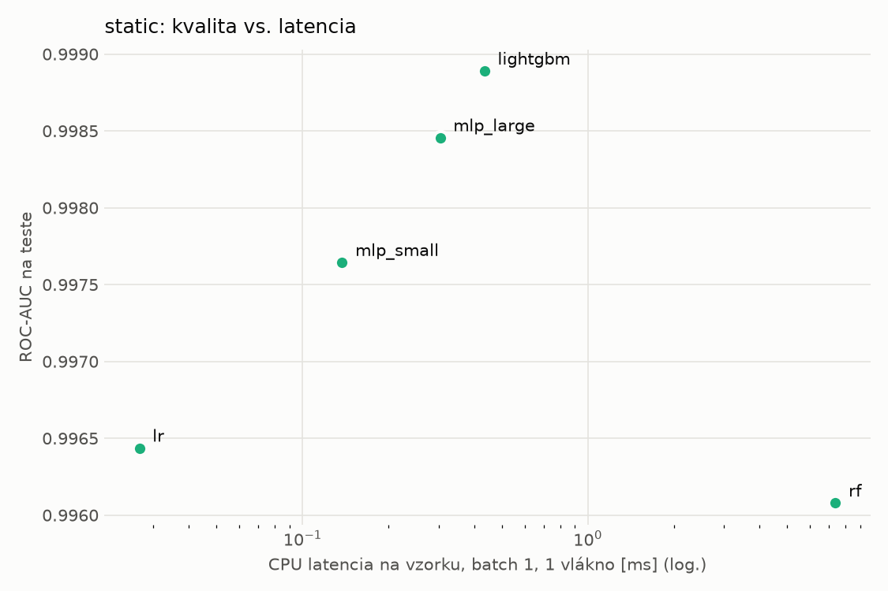
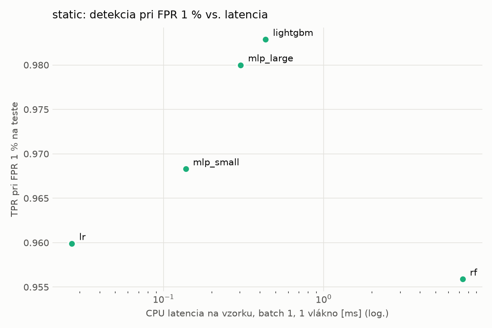
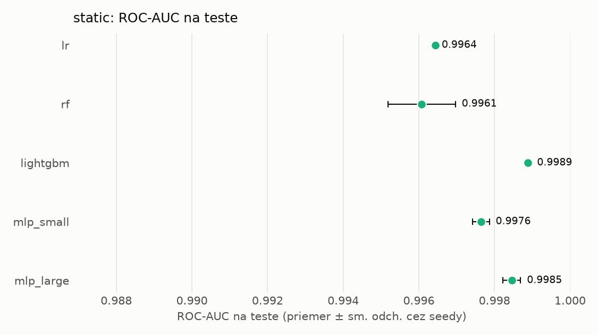
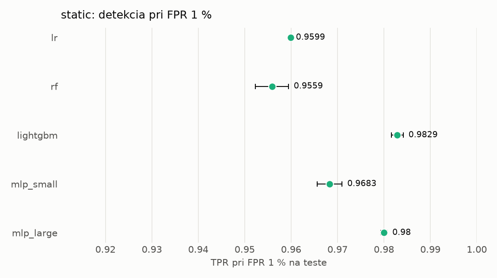

# Porovnanie modelov – static

> Generované `src/evaluation/compare.py` (2026-11-04T18:59:27+01:00); použitý je posledný beh každého modelu.
> Metriky sú priemer cez seedy. \* = pri prahu určenom na validácii (FPR ≤ 1 %).
> CPU ms/vz. = medián latencie jednej vzorky na 1 vlákne vrátane transformácie vstupu (meranie hneď po tréningu,
> orientačné). Oficiálne merania spotreby sú v časti „Spotreba zdrojov pri inferencii“.

## Detekčná kvalita a orientačné časy
| model | ROC-AUC val | ROC-AUC test | TPR@FPR 1 % test | TPR@FPR 0,1 % test | F1 test* | FPR test* | gap train−val | CPU ms/vz. | CPU vz./s | GPU ms/vz. | parametre | MB | tréning s | ladenie min |
|---|---|---|---|---|---|---|---|---|---|---|---|---|---|---|
| [lr](../../static/lr/20261104-184059/README.md) | 0.9986 | 0.9964 ± 0.0000 | 0.9599 | 0.0671 | 0.9640 | 0.0069 | 0.0012 | 0.027 | 295 891 | – | 2 319 | 0.07 | 1.8 | 0.0 |
| [rf](../../static/rf/20261104-184112/README.md) | 0.9997 | 0.9961 ± 0.0009 | 0.9559 | 0.8928 | 0.9693 | 0.0055 | 0.0003 | 7.376 | 129 882 | – | 346 690 | 28.07 | 20.2 | 0.0 |
| [lightgbm](../../static/lightgbm/20261104-184220/README.md) | 0.9998 | 0.9989 ± 0.0001 | 0.9829 | 0.9109 | 0.9832 | 0.0035 | 0.0002 | 0.434 | 27 137 | – | 688 968 | 40.47 | 318.5 | 0.0 |
| [mlp_small](../../static/mlp_small/20261104-185839/README.md) | 0.9992 | 0.9976 ± 0.0002 | 0.9683 | 0.7559 | 0.9740 | 0.0062 | 0.0007 | 0.138 | 109 632 | 0.388 | 74 849 | 0.36 | 3.2 | 0.0 |
| [mlp_large](../../static/mlp_large/20261104-185858/README.md) | 0.9996 | 0.9985 ± 0.0002 | 0.9800 | 0.8944 | 0.9807 | 0.0065 | 0.0004 | 0.304 | 83 098 | 0.620 | 1 363 905 | 5.53 | 6.1 | 0.0 |

## Nízka prevalencia malvéru (test, prah z validácie)
| model | TPR | FPR | precision @ 1 % | falošné na 1 skutočný poplach @ 1 % | precision @ 0.1 % | falošné na 1 skutočný poplach @ 0.1 % |
|---|---|---|---|---|---|---|
| lr | 0.9360 | 0.0069 | 0.577 | 0.73 | 0.119 | 7.39 |
| rf | 0.9449 | 0.0055 | 0.633 | 0.58 | 0.146 | 5.86 |
| lightgbm | 0.9698 | 0.0035 | 0.738 | 0.36 | 0.218 | 3.59 |
| mlp_small | 0.9543 | 0.0062 | 0.608 | 0.64 | 0.133 | 6.50 |
| mlp_large | 0.9674 | 0.0065 | 0.602 | 0.66 | 0.130 | 6.68 |

Prepočet: TPR a FPR nezávisia od podielu malvéru, preto sa dajú preniesť na nízku prevalenciu (v reálnej prevádzke je malvéru ~1 % alebo menej; v teste 54 %). „Falošné na 1 skutočný poplach“ = koľko neškodných súborov je označených na každý zachytený malvér.

## Spotreba zdrojov pri inferencii (benchmark, testovacia množina)
_Benchmark zatiaľ nebol spustený (`python -m src.evaluation.benchmark --approach static`)._

## Grafy

