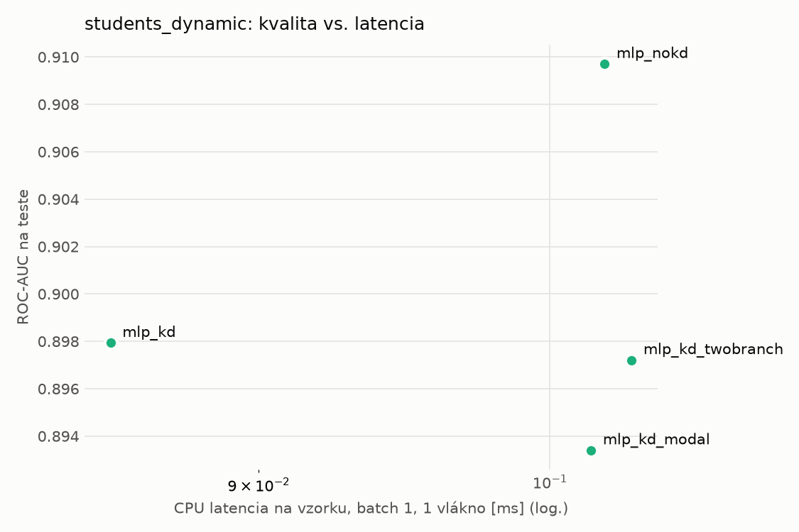
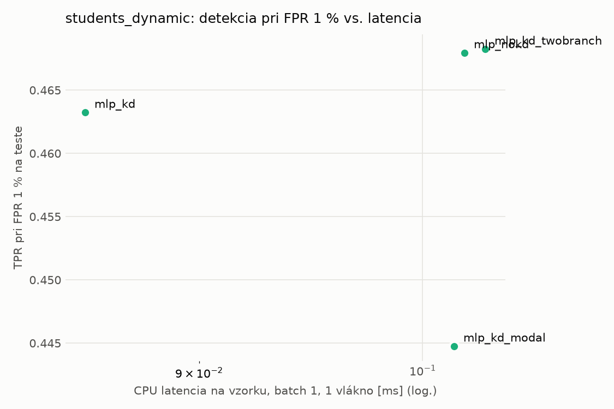
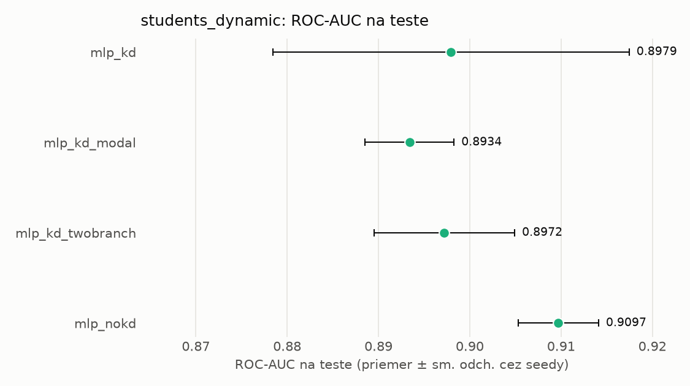
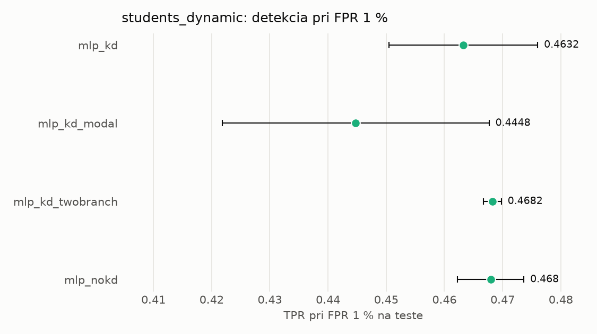

# Porovnanie modelov – students_dynamic

> Generované `src/evaluation/compare.py` (2026-11-04T20:47:21+01:00); použitý je posledný beh každého modelu.
> Metriky sú priemer cez seedy. \* = pri prahu určenom na validácii (FPR ≤ 1 %).
> CPU ms/vz. = medián latencie jednej vzorky na 1 vlákne vrátane transformácie vstupu (meranie hneď po tréningu,
> orientačné). Oficiálne merania spotreby sú v časti „Spotreba zdrojov pri inferencii“.

## Detekčná kvalita a orientačné časy
| model | ROC-AUC val | ROC-AUC test | TPR@FPR 1 % test | TPR@FPR 0,1 % test | F1 test* | FPR test* | gap train−val | CPU ms/vz. | CPU vz./s | GPU ms/vz. | parametre | MB | tréning s | ladenie min |
|---|---|---|---|---|---|---|---|---|---|---|---|---|---|---|
| [mlp_kd](../../students_dynamic/mlp_kd/20261104-204539/README.md) | 0.9966 | 0.8979 ± 0.0195 | 0.4632 | 0.2364 | 0.6797 | 0.0165 | 0.0014 | 0.085 | 138 332 | 0.461 | 64 129 | 0.31 | 6.5 | 0.0 |
| [mlp_kd_modal](../../students_dynamic/mlp_kd_modal/20261104-204627/README.md) | 0.9965 | 0.8934 ± 0.0049 | 0.4448 | 0.2497 | 0.6850 | 0.0258 | 0.0012 | 0.102 | 139 796 | 0.270 | 64 129 | 0.31 | 5.7 | 0.0 |
| [mlp_kd_twobranch](../../students_dynamic/mlp_kd_twobranch/20261104-204652/README.md) | 0.9967 | 0.8972 ± 0.0077 | 0.4682 | 0.2545 | 0.6777 | 0.0151 | 0.0013 | 0.103 | 140 041 | 0.279 | 64 129 | 0.31 | 6.7 | 0.0 |
| [mlp_nokd](../../students_dynamic/mlp_nokd/20261104-204607/README.md) | 0.9965 | 0.9097 ± 0.0044 | 0.4680 | 0.2899 | 0.7024 | 0.0291 | 0.0013 | 0.102 | 96 044 | 0.464 | 64 129 | 0.31 | 3.9 | 0.0 |

## Nízka prevalencia malvéru (test, prah z validácie)
| model | TPR | FPR | precision @ 1 % | falošné na 1 skutočný poplach @ 1 % | precision @ 0.1 % | falošné na 1 skutočný poplach @ 0.1 % |
|---|---|---|---|---|---|---|
| mlp_kd | 0.5220 | 0.0165 | 0.243 | 3.12 | 0.031 | 31.49 |
| mlp_kd_modal | 0.5324 | 0.0258 | 0.172 | 4.80 | 0.020 | 48.45 |
| mlp_kd_twobranch | 0.5191 | 0.0151 | 0.258 | 2.87 | 0.033 | 29.00 |
| mlp_nokd | 0.5546 | 0.0291 | 0.161 | 5.19 | 0.019 | 52.40 |

Prepočet: TPR a FPR nezávisia od podielu malvéru, preto sa dajú preniesť na nízku prevalenciu (v reálnej prevádzke je malvéru ~1 % alebo menej; v teste 54 %). „Falošné na 1 skutočný poplach“ = koľko neškodných súborov je označených na každý zachytený malvér.

## Spotreba zdrojov pri inferencii (benchmark, testovacia množina)
_Benchmark zatiaľ nebol spustený (`python -m src.evaluation.benchmark --approach students_dynamic`)._

## Grafy

