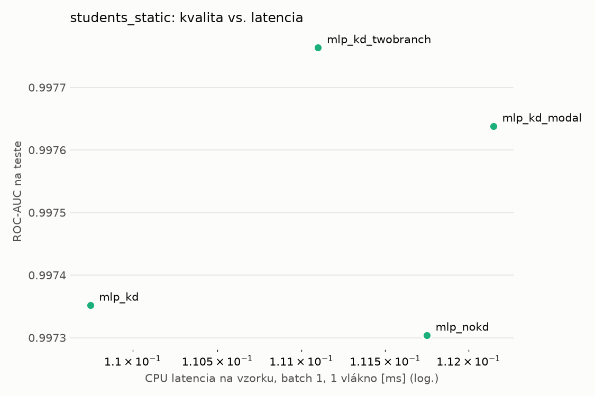
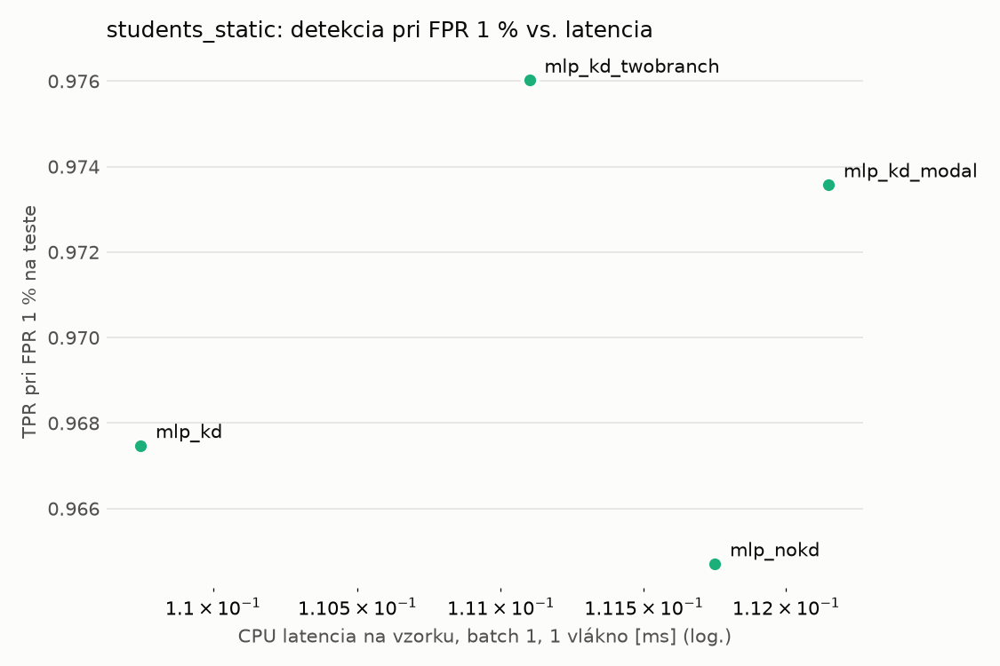
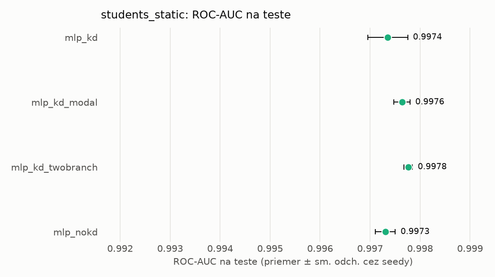
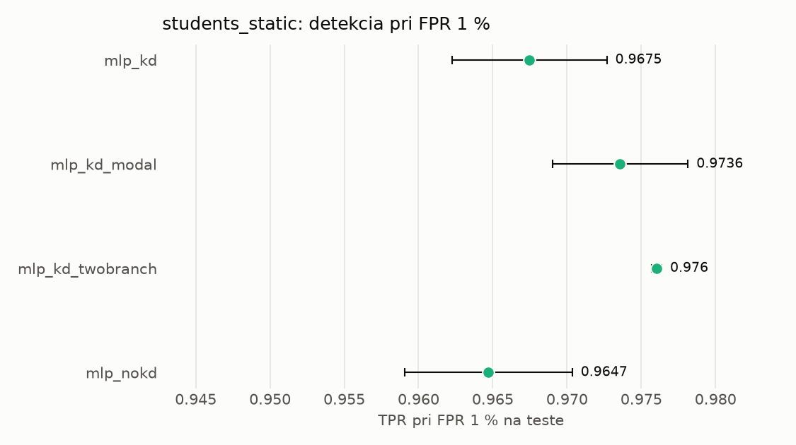

# Porovnanie modelov – students_static

> Generované `src/evaluation/compare.py` (2026-11-04T20:45:36+01:00); použitý je posledný beh každého modelu.
> Metriky sú priemer cez seedy. \* = pri prahu určenom na validácii (FPR ≤ 1 %).
> CPU ms/vz. = medián latencie jednej vzorky na 1 vlákne vrátane transformácie vstupu (meranie hneď po tréningu,
> orientačné). Oficiálne merania spotreby sú v časti „Spotreba zdrojov pri inferencii“.

## Detekčná kvalita a orientačné časy
| model | ROC-AUC val | ROC-AUC test | TPR@FPR 1 % test | TPR@FPR 0,1 % test | F1 test* | FPR test* | gap train−val | CPU ms/vz. | CPU vz./s | GPU ms/vz. | parametre | MB | tréning s | ladenie min |
|---|---|---|---|---|---|---|---|---|---|---|---|---|---|---|
| [mlp_kd](../../students_static/mlp_kd/20261104-204353/README.md) | 0.9991 | 0.9974 ± 0.0004 | 0.9675 | 0.7559 | 0.9663 | 0.0049 | 0.0008 | 0.110 | 107 981 | 0.287 | 74 305 | 0.36 | 7.2 | 0.0 |
| [mlp_kd_modal](../../students_static/mlp_kd_modal/20261104-204439/README.md) | 0.9991 | 0.9976 ± 0.0002 | 0.9736 | 0.7734 | 0.9687 | 0.0052 | 0.0008 | 0.112 | 55 416 | 0.284 | 74 305 | 0.36 | 6.6 | 0.0 |
| [mlp_kd_twobranch](../../students_static/mlp_kd_twobranch/20261104-204508/README.md) | 0.9989 | 0.9978 ± 0.0001 | 0.9760 | 0.6441 | 0.9791 | 0.0070 | 0.0010 | 0.111 | 92 656 | 0.290 | 74 305 | 0.36 | 6.2 | 0.0 |
| [mlp_nokd](../../students_static/mlp_nokd/20261104-204423/README.md) | 0.9990 | 0.9973 ± 0.0002 | 0.9647 | 0.6682 | 0.9675 | 0.0069 | 0.0009 | 0.112 | 60 901 | 0.274 | 74 305 | 0.36 | 2.2 | 0.0 |

## Nízka prevalencia malvéru (test, prah z validácie)
| model | TPR | FPR | precision @ 1 % | falošné na 1 skutočný poplach @ 1 % | precision @ 0.1 % | falošné na 1 skutočný poplach @ 0.1 % |
|---|---|---|---|---|---|---|
| mlp_kd | 0.9387 | 0.0049 | 0.659 | 0.52 | 0.161 | 5.23 |
| mlp_kd_modal | 0.9435 | 0.0052 | 0.649 | 0.54 | 0.155 | 5.47 |
| mlp_kd_twobranch | 0.9646 | 0.0070 | 0.583 | 0.72 | 0.122 | 7.22 |
| mlp_nokd | 0.9427 | 0.0069 | 0.580 | 0.72 | 0.121 | 7.30 |

Prepočet: TPR a FPR nezávisia od podielu malvéru, preto sa dajú preniesť na nízku prevalenciu (v reálnej prevádzke je malvéru ~1 % alebo menej; v teste 54 %). „Falošné na 1 skutočný poplach“ = koľko neškodných súborov je označených na každý zachytený malvér.

## Spotreba zdrojov pri inferencii (benchmark, testovacia množina)
_Benchmark zatiaľ nebol spustený (`python -m src.evaluation.benchmark --approach students_static`)._

## Grafy

