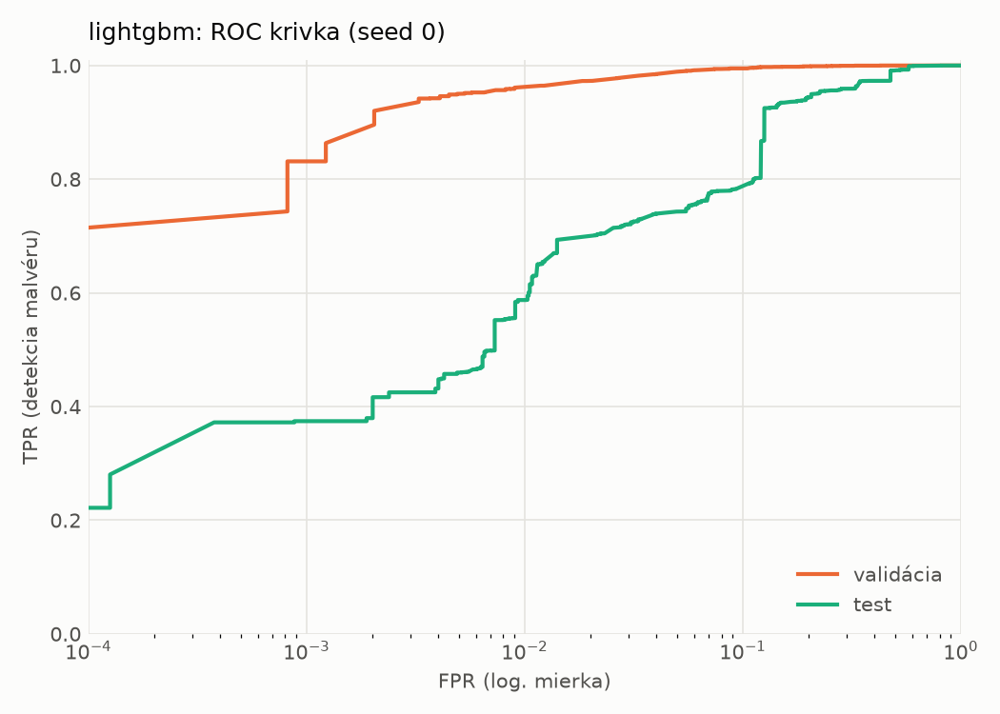
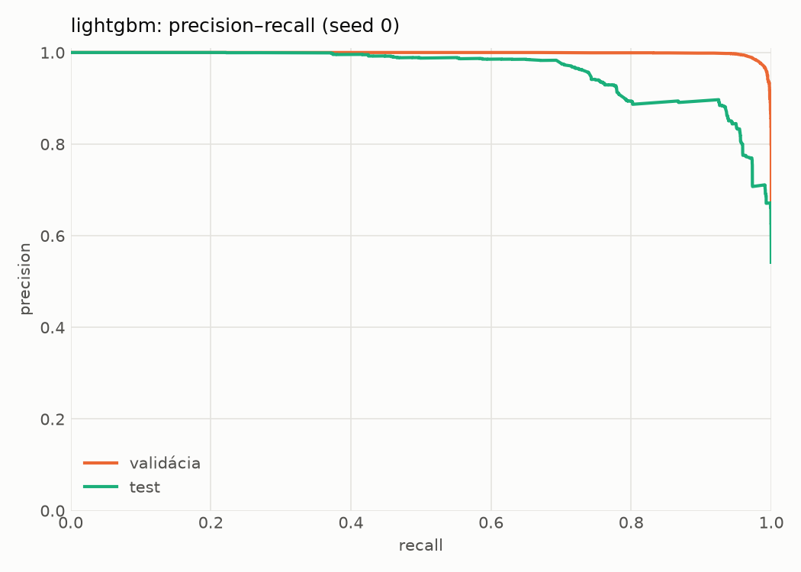
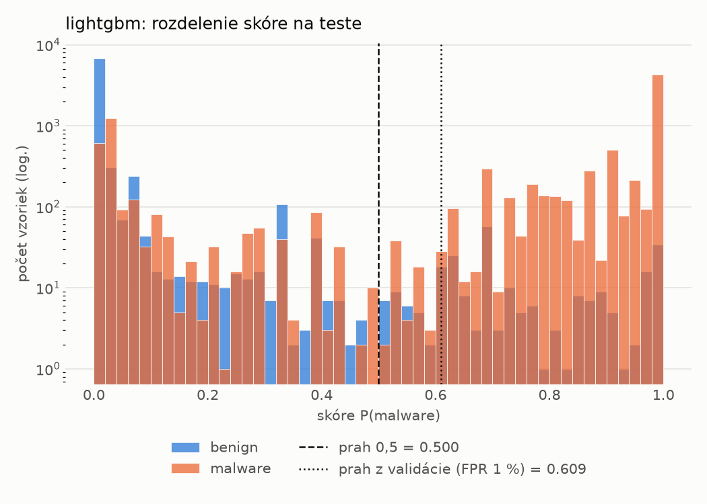
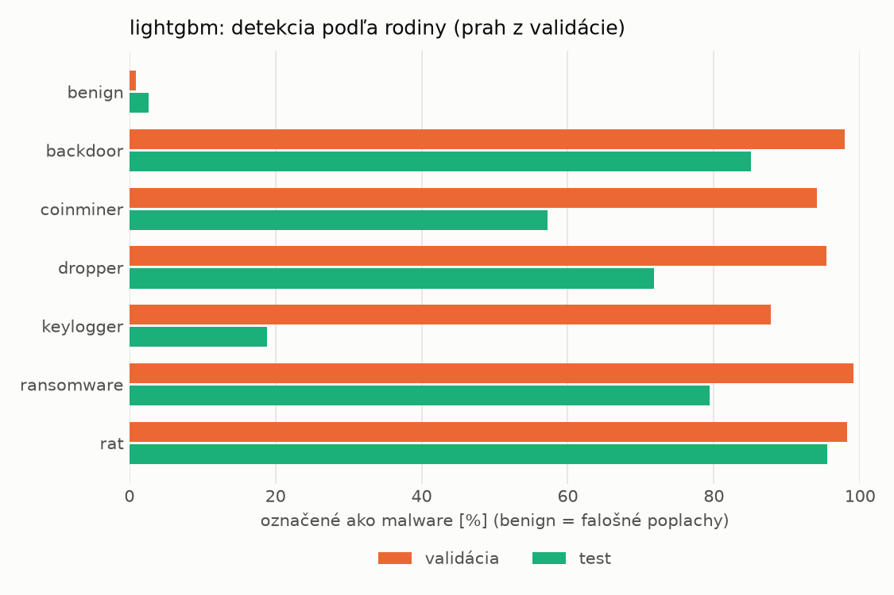
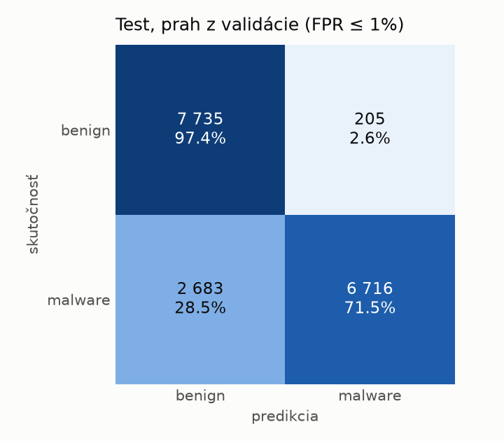
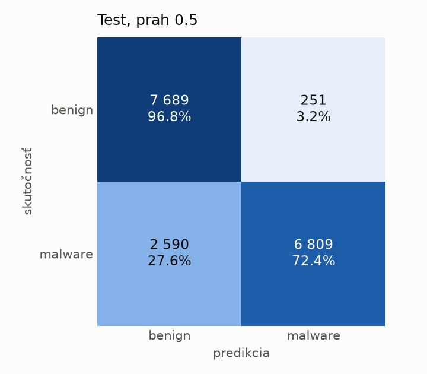
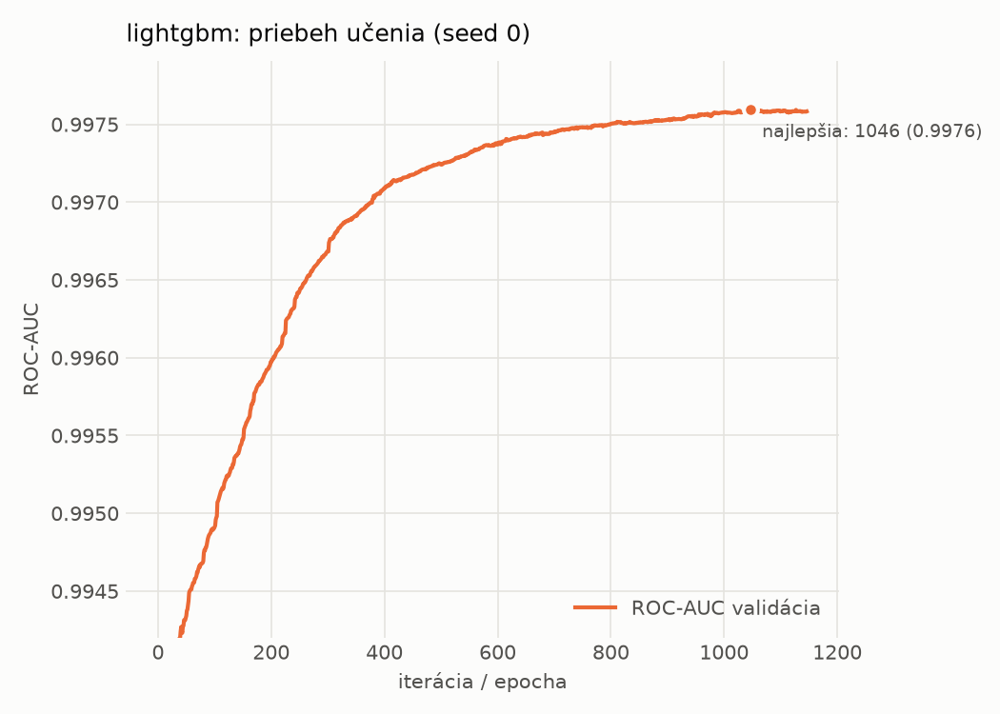

# dynamic/lightgbm – beh `20261104-190128`

> Automaticky generované (`src/training/run_tabular.py`). Konfigurácia: `config.yaml`, protokol: `protocol.yaml`.

- **Model:** `lightgbm` – LightGBM, gradient boosting stromov s early stopping na validácii (pôvodné hodnoty príznakov)
- **Ladenie:** bez ladenia – hyperparametre prevzaté z `runs_final/dynamic/lightgbm/20261102-003953`
- **Finálne modely:** seedy [0, 1, 2]; hodnoty sú priemer ± smerodajná odchýlka cez seedy
- **Najlepšie hyperparametre:** `{"num_boost_round": 5000, "early_stopping_rounds": 100, "learning_rate": 0.012600391102852807, "num_leaves": 261, "min_child_samples": 12, "feature_fraction": 0.7323605840883831, "bagging_fraction": 0.7241803281580393, "lambda_l1": 9.843384499248837e-06, "lambda_l2": 0.7301583949167907}`

## Detekčná kvalita (bez prahu)
| metrika | train (podvzorka) | validácia | test |
|---|---|---|---|
| ROC-AUC | 0.9990 ± 0.0000 | 0.9976 ± 0.0000 | 0.9513 ± 0.0002 |
| PR-AUC | 0.9993 ± 0.0000 | 0.9985 ± 0.0000 | 0.9607 ± 0.0001 |
| TPR pri FPR 1 % | 0.9650 ± 0.0000 | 0.9607 ± 0.0003 | 0.5920 ± 0.0040 |
| TPR pri FPR 0,1 % | 0.9503 ± 0.0000 | 0.8298 ± 0.0033 | 0.3759 ± 0.0019 |
| log loss | 0.0418 ± 0.0001 | 0.0604 ± 0.0001 | 0.5946 ± 0.0061 |
| Brier skóre | 0.0130 ± 0.0000 | 0.0172 ± 0.0000 | 0.1470 ± 0.0005 |

Rozdiel ROC-AUC train − validácia: **0.0014** (veľký rozdiel = preučenie).

## Pri prahu z validácie (FPR ≤ 1% na validácii)
| metrika | train (podvzorka) | validácia | test |
|---|---|---|---|
| accuracy | 0.9752 ± 0.0001 | 0.9720 ± 0.0002 | 0.8273 ± 0.0072 |
| balanced accuracy | 0.9794 ± 0.0001 | 0.9758 ± 0.0002 | 0.8389 ± 0.0066 |
| precision | 0.9982 ± 0.0000 | 0.9944 ± 0.0001 | 0.9720 ± 0.0015 |
| recall (TPR) | 0.9617 ± 0.0002 | 0.9607 ± 0.0003 | 0.7016 ± 0.0148 |
| FPR | 0.0029 ± 0.0000 | 0.0091 ± 0.0002 | 0.0239 ± 0.0018 |
| F1 | 0.9796 ± 0.0001 | 0.9773 ± 0.0002 | 0.8149 ± 0.0095 |
| MCC | 0.9490 ± 0.0002 | 0.9417 ± 0.0005 | 0.6919 ± 0.0106 |

## Pri pevnom prahu 0.5
| metrika | train (podvzorka) | validácia | test |
|---|---|---|---|
| accuracy | 0.9811 ± 0.0000 | 0.9761 ± 0.0001 | 0.8359 ± 0.0005 |
| balanced accuracy | 0.9826 ± 0.0000 | 0.9771 ± 0.0000 | 0.8462 ± 0.0004 |
| precision | 0.9931 ± 0.0000 | 0.9887 ± 0.0003 | 0.9650 ± 0.0007 |
| recall (TPR) | 0.9763 ± 0.0000 | 0.9730 ± 0.0004 | 0.7234 ± 0.0015 |
| FPR | 0.0111 ± 0.0000 | 0.0187 ± 0.0005 | 0.0311 ± 0.0007 |
| F1 | 0.9846 ± 0.0000 | 0.9808 ± 0.0001 | 0.8269 ± 0.0007 |
| MCC | 0.9603 ± 0.0000 | 0.9494 ± 0.0002 | 0.7023 ± 0.0004 |

## Výpočtové nároky (seed 0, testovacia množina)
| meranie | hodnota |
|---|---|
| tréning finálneho modelu | 20.7 s (priemer cez seedy) |
| ladenie spolu | 0 s |
| počet parametrov / uzlov | 539 262 |
| veľkosť modelu na disku | 30.59 MB |
| CPU latencia modelu (batch 1, 1 vlákno) | 0.191 ms (p95 0.238) |
| CPU priepustnosť (24 vlákien) | 73 599 vzoriek/s |

## Grafy
| | |
|---|---|
|  |  |
|  |  |
|  |  |
|  |  |

## Súbory
`metrics.json` (všetky metriky po seedoch vrátane rodín), `timing.json`, `hpo_trials.csv`,
`predictions/<časť>_seed<N>.parquet` (sha256, family, label, score), `model/seed_<N>/`, `log.txt`.
