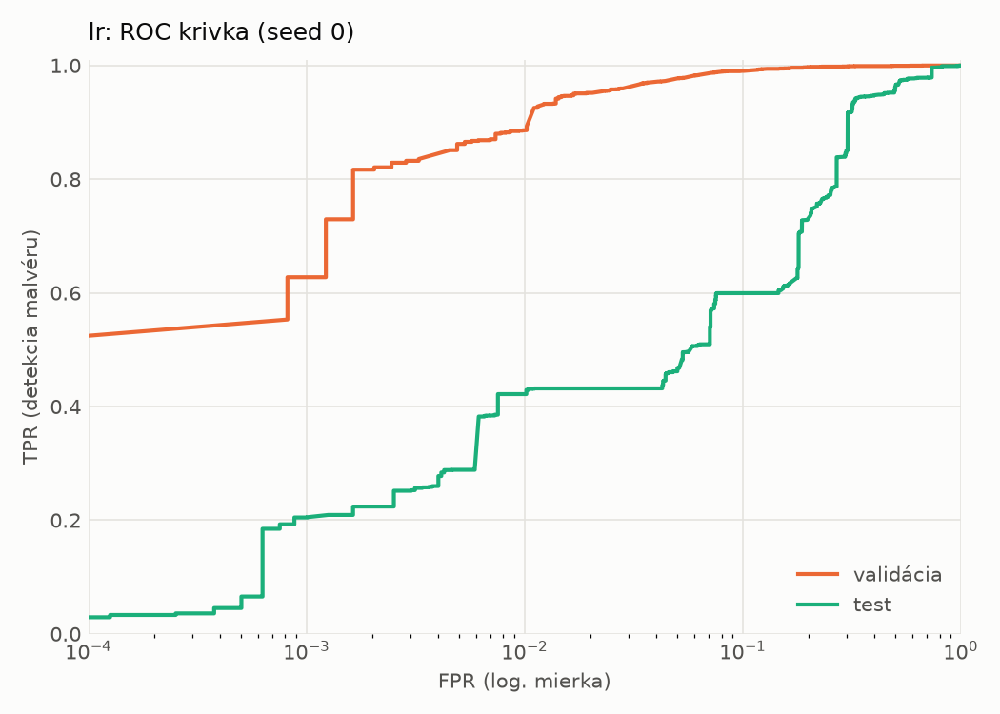
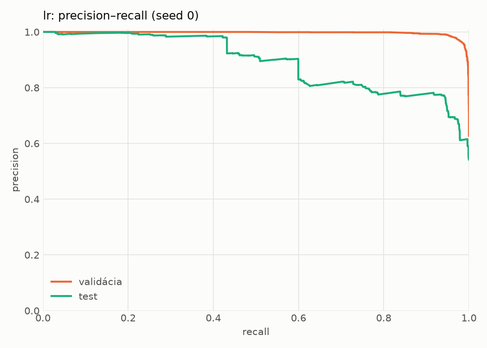
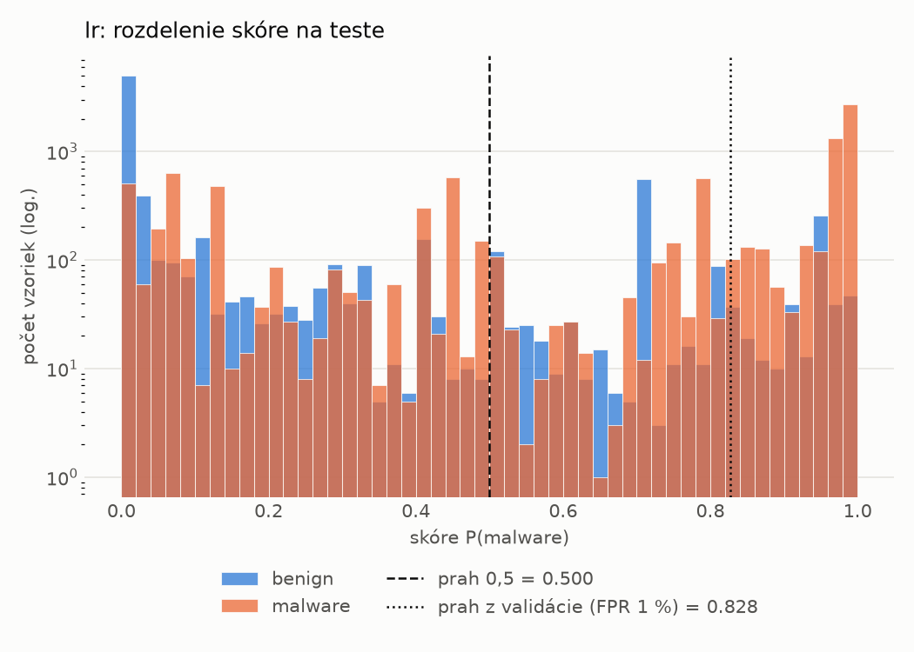
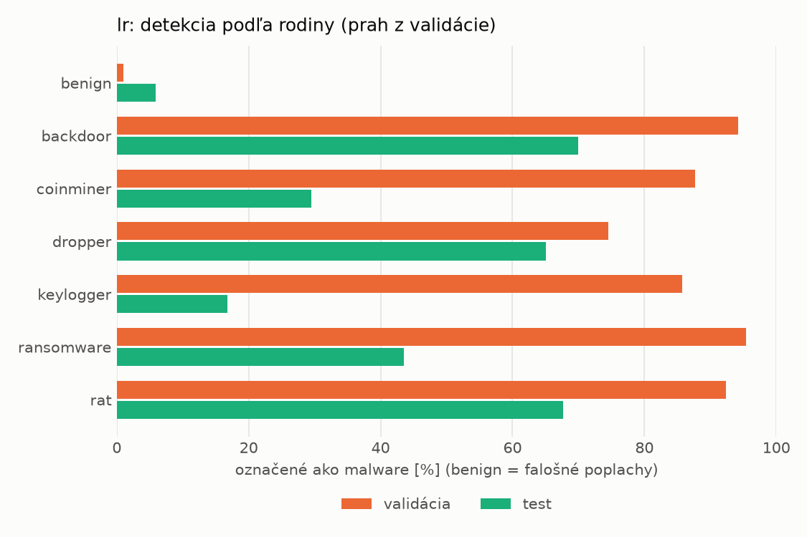
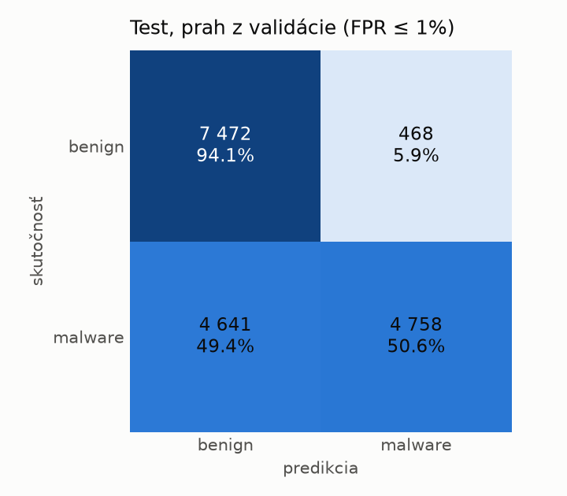
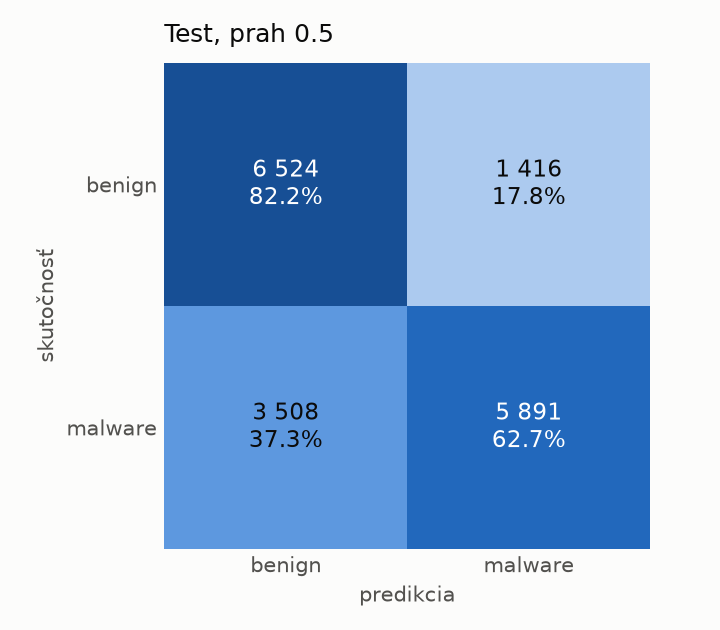

# dynamic/lr – beh `20261104-185930`

> Automaticky generované (`src/training/run_tabular.py`). Konfigurácia: `config.yaml`, protokol: `protocol.yaml`.

- **Model:** `logreg` – logistická regresia s L2 regularizáciou (vstup signed log1p + štandardizácia)
- **Ladenie:** bez ladenia – hyperparametre prevzaté z `runs_final/dynamic/lr/20261102-002602`
- **Finálne modely:** seedy [0, 1, 2]; hodnoty sú priemer ± smerodajná odchýlka cez seedy
- **Najlepšie hyperparametre:** `{"max_iter": 2000, "C": 0.04224422279858655}`

## Detekčná kvalita (bez prahu)
| metrika | train (podvzorka) | validácia | test |
|---|---|---|---|
| ROC-AUC | 0.9966 ± 0.0000 | 0.9948 ± 0.0000 | 0.8726 ± 0.0000 |
| PR-AUC | 0.9979 ± 0.0000 | 0.9968 ± 0.0000 | 0.8928 ± 0.0000 |
| TPR pri FPR 1 % | 0.9292 ± 0.0000 | 0.8861 ± 0.0000 | 0.4219 ± 0.0000 |
| TPR pri FPR 0,1 % | 0.8764 ± 0.0000 | 0.6275 ± 0.0000 | 0.2048 ± 0.0000 |
| log loss | 0.0772 ± 0.0000 | 0.0912 ± 0.0000 | 0.6989 ± 0.0000 |
| Brier skóre | 0.0230 ± 0.0000 | 0.0251 ± 0.0000 | 0.1922 ± 0.0000 |

Rozdiel ROC-AUC train − validácia: **0.0018** (veľký rozdiel = preučenie).

## Pri prahu z validácie (FPR ≤ 1% na validácii)
| metrika | train (podvzorka) | validácia | test |
|---|---|---|---|
| accuracy | 0.9260 ± 0.0000 | 0.9249 ± 0.0000 | 0.7053 ± 0.0000 |
| balanced accuracy | 0.9395 ± 0.0000 | 0.9382 ± 0.0000 | 0.7236 ± 0.0000 |
| precision | 0.9971 ± 0.0000 | 0.9935 ± 0.0000 | 0.9104 ± 0.0000 |
| recall (TPR) | 0.8833 ± 0.0000 | 0.8861 ± 0.0000 | 0.5062 ± 0.0000 |
| FPR | 0.0042 ± 0.0000 | 0.0098 ± 0.0000 | 0.0589 ± 0.0000 |
| F1 | 0.9367 ± 0.0000 | 0.9367 ± 0.0000 | 0.6507 ± 0.0000 |
| MCC | 0.8575 ± 0.0000 | 0.8535 ± 0.0000 | 0.4856 ± 0.0000 |

## Pri pevnom prahu 0.5
| metrika | train (podvzorka) | validácia | test |
|---|---|---|---|
| accuracy | 0.9687 ± 0.0000 | 0.9672 ± 0.0000 | 0.7160 ± 0.0000 |
| balanced accuracy | 0.9685 ± 0.0000 | 0.9668 ± 0.0000 | 0.7242 ± 0.0000 |
| precision | 0.9801 ± 0.0000 | 0.9791 ± 0.0000 | 0.8062 ± 0.0000 |
| recall (TPR) | 0.9692 ± 0.0000 | 0.9684 ± 0.0000 | 0.6268 ± 0.0000 |
| FPR | 0.0321 ± 0.0000 | 0.0348 ± 0.0000 | 0.1783 ± 0.0000 |
| F1 | 0.9746 ± 0.0000 | 0.9737 ± 0.0000 | 0.7053 ± 0.0000 |
| MCC | 0.9339 ± 0.0000 | 0.9302 ± 0.0000 | 0.4525 ± 0.0000 |

## Výpočtové nároky (seed 0, testovacia množina)
| meranie | hodnota |
|---|---|
| tréning finálneho modelu | 3.5 s (priemer cez seedy) |
| ladenie spolu | 0 s |
| počet parametrov / uzlov | 2 001 |
| veľkosť modelu na disku | 0.06 MB |
| transformácia vstupu – latencia (1 vlákno) | 0.017 ms |
| transformácia vstupu – priepustnosť | 56 415 vzoriek/s |
| CPU latencia modelu (batch 1, 1 vlákno) | 0.005 ms (p95 0.005) |
| CPU priepustnosť (24 vlákien) | 340 871 vzoriek/s |

## Grafy
| | |
|---|---|
|  |  |
|  |  |
|  |  |
|  |  |

## Súbory
`metrics.json` (všetky metriky po seedoch vrátane rodín), `timing.json`, `hpo_trials.csv`,
`predictions/<časť>_seed<N>.parquet` (sha256, family, label, score), `model/seed_<N>/`, `log.txt`.
