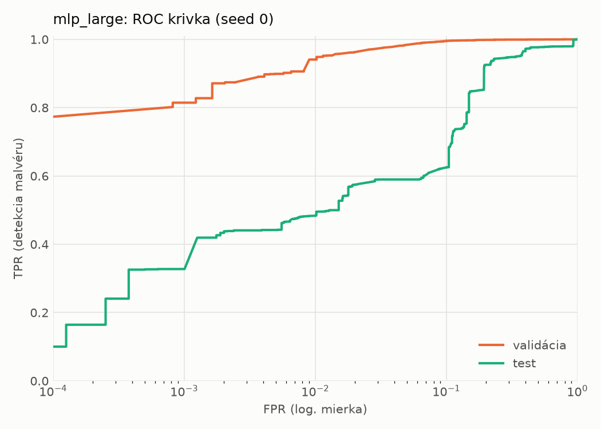
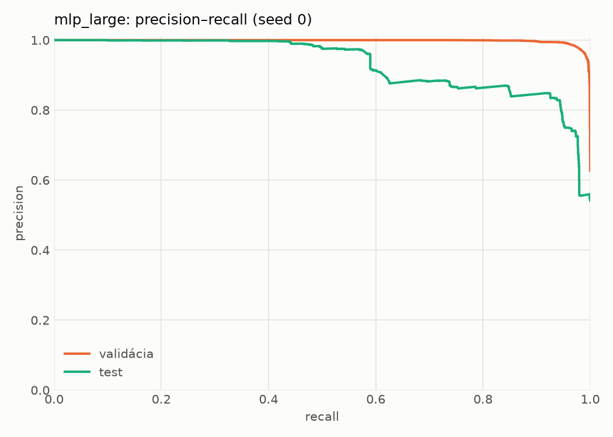
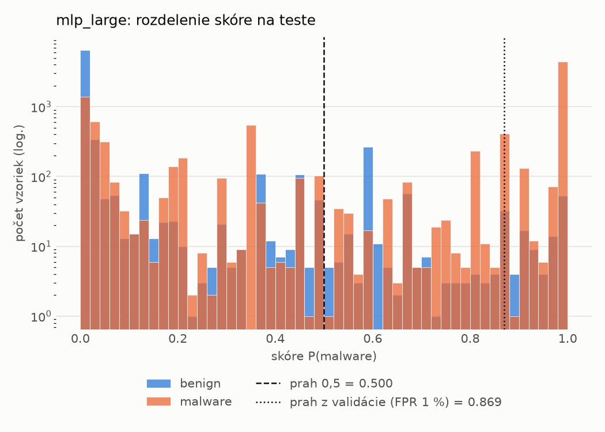
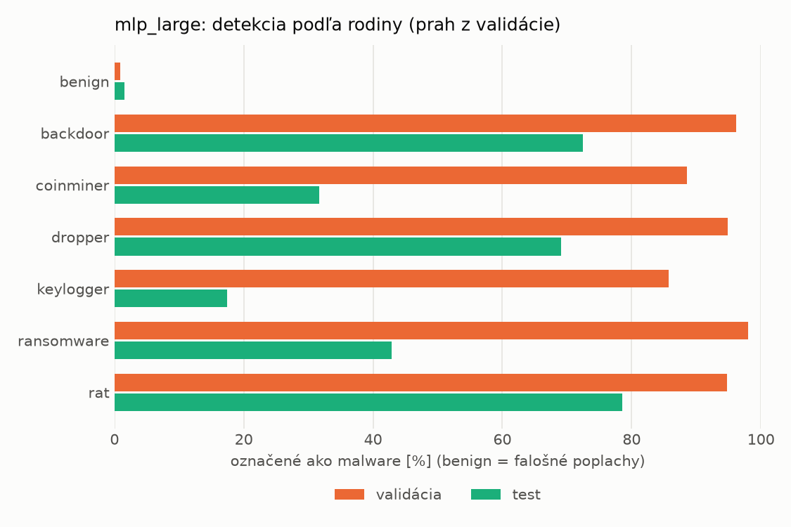
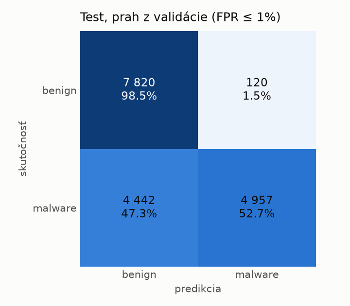
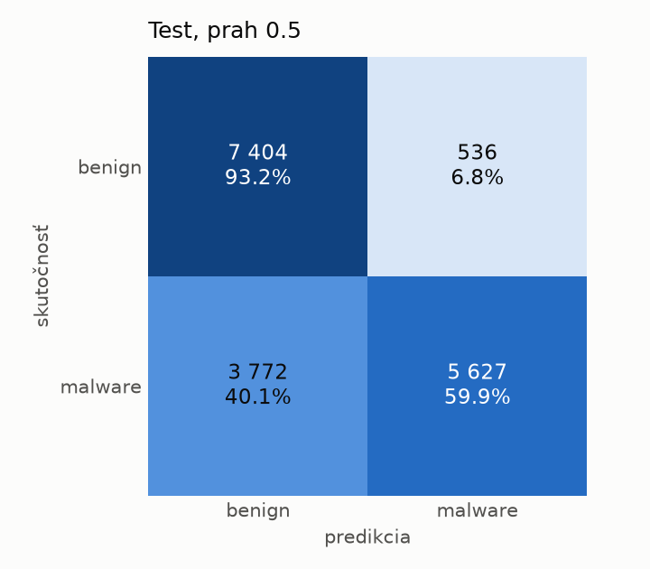
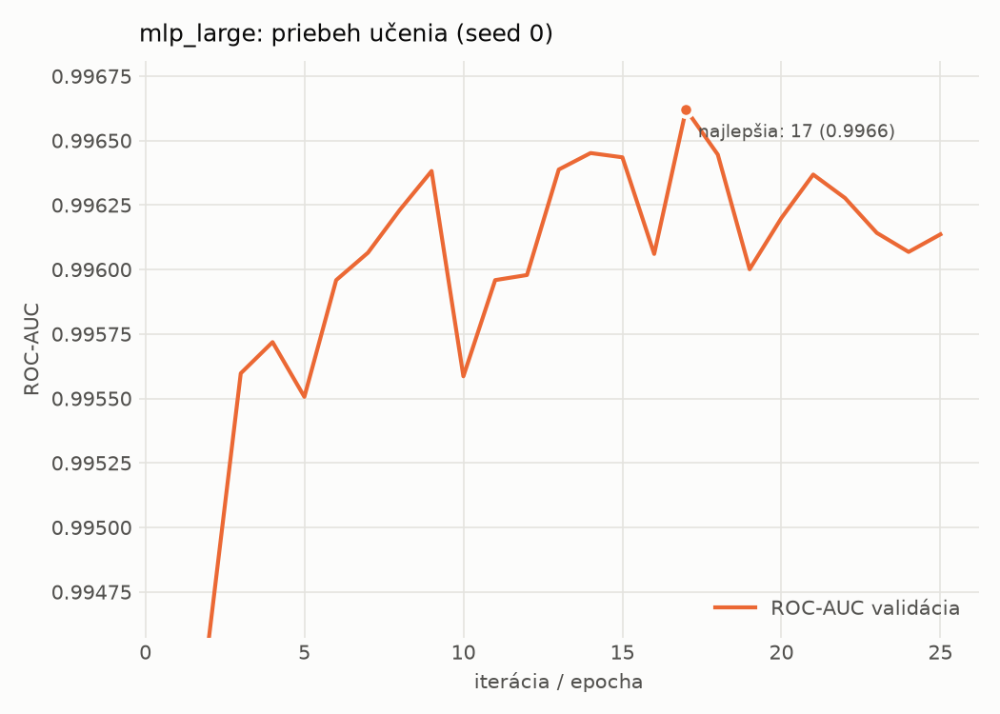

# dynamic/mlp_large – beh `20261104-190305`

> Automaticky generované (`src/training/run_tabular.py`). Konfigurácia: `config.yaml`, protokol: `protocol.yaml`.

- **Model:** `mlp` – veľká neurónová sieť (3–5 skrytých vrstiev, 512–2048 neurónov), kandidát na učiteľa
- **Ladenie:** bez ladenia – hyperparametre prevzaté z `runs_final/dynamic/mlp_large/20261102-005920`
- **Finálne modely:** seedy [0, 1, 2]; hodnoty sú priemer ± smerodajná odchýlka cez seedy
- **Najlepšie hyperparametre:** `{"max_epochs": 100, "patience": 8, "hidden_layers": 3, "hidden_width": 512, "width_decay": 0.5, "dropout": 0.3735687797102123, "lr": 0.00020669709962675654, "weight_decay": 1.4747439017290252e-05, "batch_size": 256}`

## Detekčná kvalita (bez prahu)
| metrika | train (podvzorka) | validácia | test |
|---|---|---|---|
| ROC-AUC | 0.9978 ± 0.0002 | 0.9965 ± 0.0002 | 0.9198 ± 0.0045 |
| PR-AUC | 0.9986 ± 0.0001 | 0.9979 ± 0.0001 | 0.9347 ± 0.0037 |
| TPR pri FPR 1 % | 0.9463 ± 0.0034 | 0.9406 ± 0.0011 | 0.4761 ± 0.0063 |
| TPR pri FPR 0,1 % | 0.8986 ± 0.0038 | 0.7804 ± 0.0301 | 0.3205 ± 0.0462 |
| log loss | 0.0592 ± 0.0028 | 0.0749 ± 0.0012 | 0.7298 ± 0.0761 |
| Brier skóre | 0.0188 ± 0.0010 | 0.0211 ± 0.0005 | 0.1818 ± 0.0102 |

Rozdiel ROC-AUC train − validácia: **0.0012** (veľký rozdiel = preučenie).

## Pri prahu z validácie (FPR ≤ 1% na validácii)
| metrika | train (podvzorka) | validácia | test |
|---|---|---|---|
| accuracy | 0.9564 ± 0.0014 | 0.9592 ± 0.0006 | 0.7284 ± 0.0074 |
| balanced accuracy | 0.9637 ± 0.0014 | 0.9655 ± 0.0005 | 0.7475 ± 0.0077 |
| precision | 0.9963 ± 0.0010 | 0.9940 ± 0.0001 | 0.9602 ± 0.0254 |
| recall (TPR) | 0.9331 ± 0.0017 | 0.9406 ± 0.0011 | 0.5209 ± 0.0127 |
| FPR | 0.0056 ± 0.0015 | 0.0096 ± 0.0002 | 0.0260 ± 0.0178 |
| F1 | 0.9637 ± 0.0012 | 0.9666 ± 0.0005 | 0.6752 ± 0.0094 |
| MCC | 0.9123 ± 0.0029 | 0.9166 ± 0.0012 | 0.5414 ± 0.0201 |

## Pri pevnom prahu 0.5
| metrika | train (podvzorka) | validácia | test |
|---|---|---|---|
| accuracy | 0.9700 ± 0.0043 | 0.9692 ± 0.0023 | 0.7651 ± 0.0185 |
| balanced accuracy | 0.9713 ± 0.0034 | 0.9706 ± 0.0015 | 0.7784 ± 0.0172 |
| precision | 0.9855 ± 0.0010 | 0.9855 ± 0.0013 | 0.9202 ± 0.0065 |
| recall (TPR) | 0.9658 ± 0.0071 | 0.9650 ± 0.0046 | 0.6203 ± 0.0331 |
| FPR | 0.0233 ± 0.0017 | 0.0239 ± 0.0023 | 0.0636 ± 0.0036 |
| F1 | 0.9755 ± 0.0035 | 0.9752 ± 0.0019 | 0.7408 ± 0.0251 |
| MCC | 0.9370 ± 0.0086 | 0.9349 ± 0.0045 | 0.5761 ± 0.0299 |

## Výpočtové nároky (seed 0, testovacia množina)
| meranie | hodnota |
|---|---|
| tréning finálneho modelu | 9.4 s (priemer cez seedy) |
| ladenie spolu | 0 s |
| počet parametrov / uzlov | 1 190 657 |
| veľkosť modelu na disku | 4.83 MB |
| transformácia vstupu – latencia (1 vlákno) | 0.034 ms |
| transformácia vstupu – priepustnosť | 47 896 vzoriek/s |
| CPU latencia modelu (batch 1, 1 vlákno) | 0.191 ms (p95 0.225) |
| CPU priepustnosť (24 vlákien) | 76 316 vzoriek/s |
| GPU latencia (batch 1) | 0.426 ms (p95 0.917) |
| GPU priepustnosť | 110 039 vzoriek/s |
| GPU špičková pamäť | 1247 MB |

## Grafy
| | |
|---|---|
|  |  |
|  |  |
|  |  |
|  |  |

## Súbory
`metrics.json` (všetky metriky po seedoch vrátane rodín), `timing.json`, `hpo_trials.csv`,
`predictions/<časť>_seed<N>.parquet` (sha256, family, label, score), `model/seed_<N>/`, `log.txt`.
