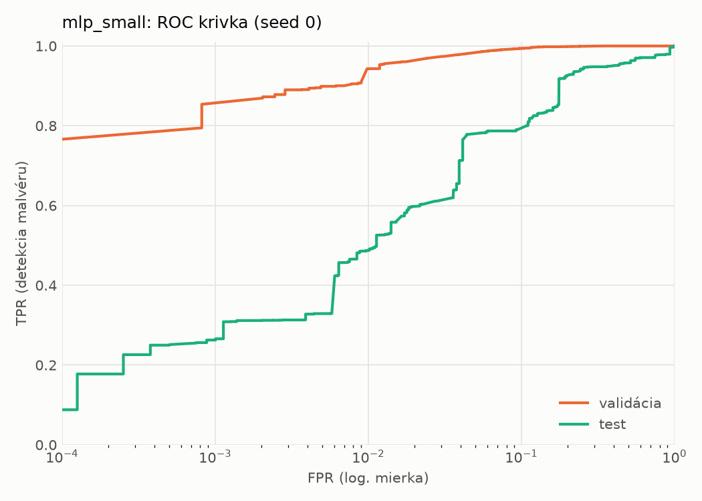
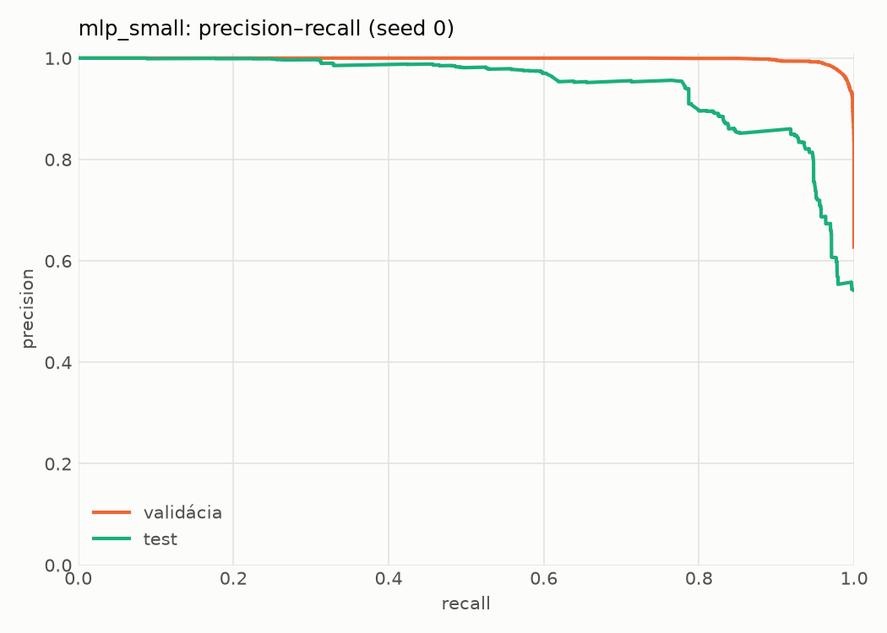
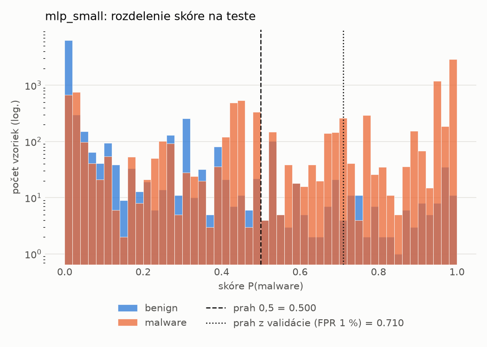
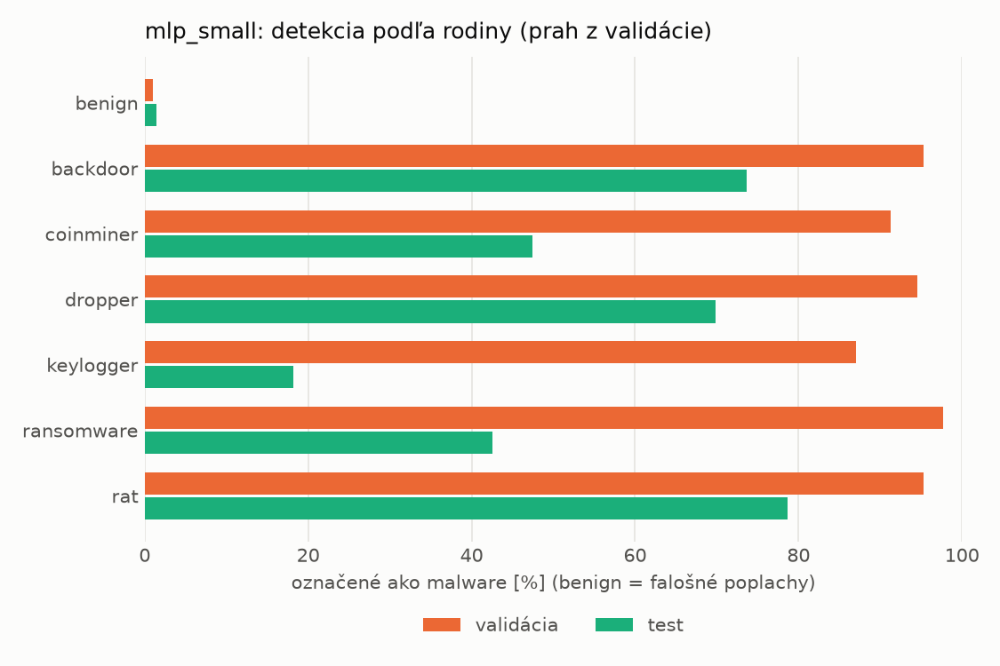
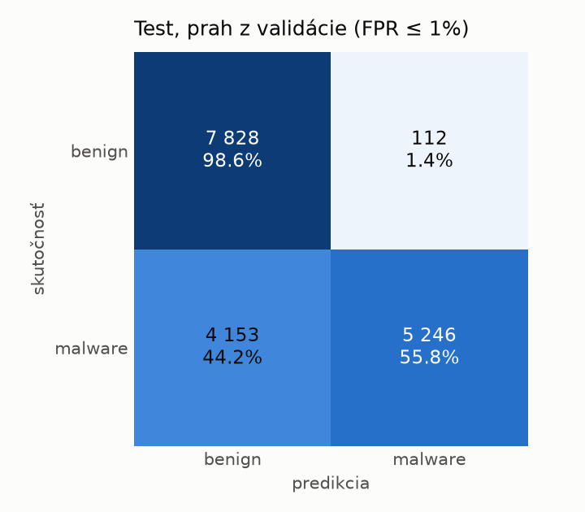
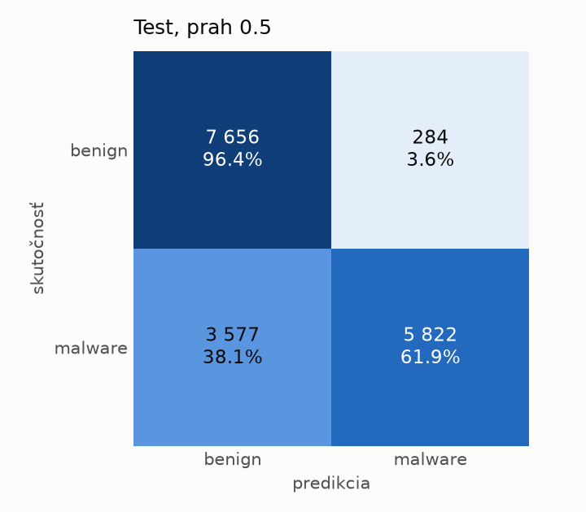
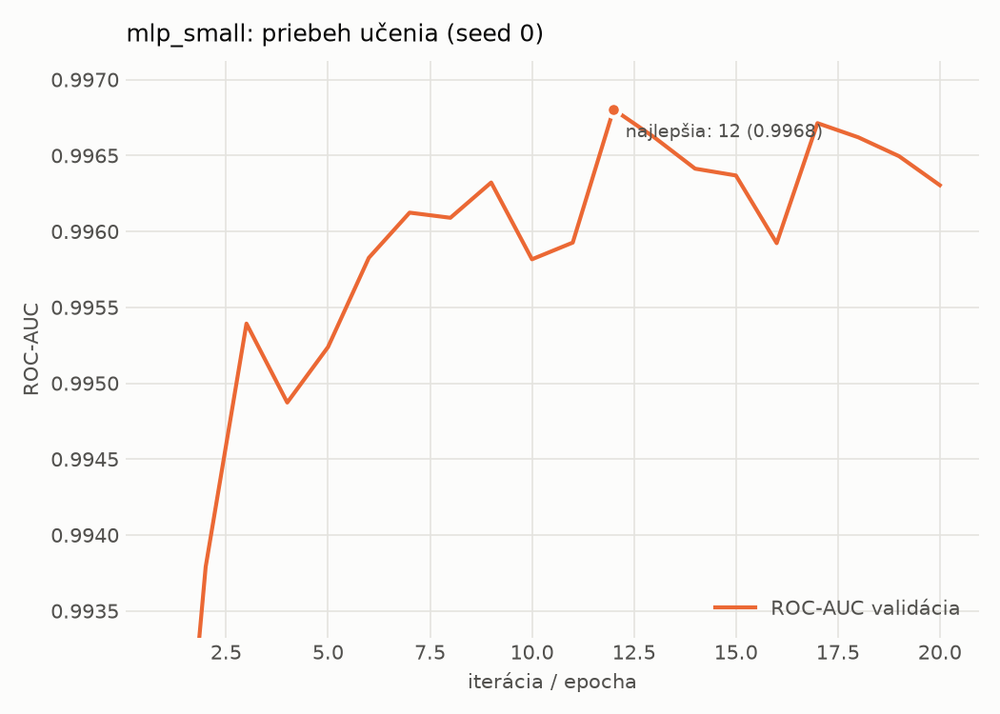

# dynamic/mlp_small – beh `20261104-190248`

> Automaticky generované (`src/training/run_tabular.py`). Konfigurácia: `config.yaml`, protokol: `protocol.yaml`.

- **Model:** `mlp` – malá neurónová sieť (1–2 skryté vrstvy), kandidát na ľahkého študenta
- **Ladenie:** bez ladenia – hyperparametre prevzaté z `runs_final/dynamic/mlp_small/20261102-005611`
- **Finálne modely:** seedy [0, 1, 2]; hodnoty sú priemer ± smerodajná odchýlka cez seedy
- **Najlepšie hyperparametre:** `{"width_decay": 0.5, "max_epochs": 100, "patience": 8, "hidden_layers": 2, "hidden_width": 256, "dropout": 0.194338644844741, "lr": 0.0002516607127550297, "weight_decay": 0.0020651425578959264, "batch_size": 1024}`

## Detekčná kvalita (bez prahu)
| metrika | train (podvzorka) | validácia | test |
|---|---|---|---|
| ROC-AUC | 0.9980 ± 0.0001 | 0.9967 ± 0.0001 | 0.9169 ± 0.0101 |
| PR-AUC | 0.9987 ± 0.0000 | 0.9980 ± 0.0000 | 0.9365 ± 0.0088 |
| TPR pri FPR 1 % | 0.9498 ± 0.0033 | 0.9453 ± 0.0035 | 0.4725 ± 0.0132 |
| TPR pri FPR 0,1 % | 0.8984 ± 0.0035 | 0.8212 ± 0.0384 | 0.2522 ± 0.0262 |
| log loss | 0.0589 ± 0.0035 | 0.0745 ± 0.0026 | 0.6852 ± 0.0718 |
| Brier skóre | 0.0182 ± 0.0010 | 0.0212 ± 0.0012 | 0.1660 ± 0.0181 |

Rozdiel ROC-AUC train − validácia: **0.0014** (veľký rozdiel = preučenie).

## Pri prahu z validácie (FPR ≤ 1% na validácii)
| metrika | train (podvzorka) | validácia | test |
|---|---|---|---|
| accuracy | 0.9608 ± 0.0016 | 0.9620 ± 0.0022 | 0.7371 ± 0.0147 |
| balanced accuracy | 0.9672 ± 0.0013 | 0.9678 ± 0.0018 | 0.7564 ± 0.0136 |
| precision | 0.9958 ± 0.0006 | 0.9939 ± 0.0000 | 0.9779 ± 0.0017 |
| recall (TPR) | 0.9407 ± 0.0027 | 0.9453 ± 0.0035 | 0.5269 ± 0.0271 |
| FPR | 0.0064 ± 0.0009 | 0.0098 ± 0.0000 | 0.0141 ± 0.0008 |
| F1 | 0.9675 ± 0.0014 | 0.9690 ± 0.0019 | 0.6846 ± 0.0230 |
| MCC | 0.9206 ± 0.0031 | 0.9221 ± 0.0043 | 0.5619 ± 0.0215 |

## Pri pevnom prahu 0.5
| metrika | train (podvzorka) | validácia | test |
|---|---|---|---|
| accuracy | 0.9755 ± 0.0004 | 0.9713 ± 0.0002 | 0.7770 ± 0.0035 |
| balanced accuracy | 0.9759 ± 0.0003 | 0.9718 ± 0.0005 | 0.7908 ± 0.0041 |
| precision | 0.9861 ± 0.0009 | 0.9842 ± 0.0012 | 0.9434 ± 0.0144 |
| recall (TPR) | 0.9742 ± 0.0012 | 0.9698 ± 0.0011 | 0.6262 ± 0.0062 |
| FPR | 0.0225 ± 0.0015 | 0.0262 ± 0.0021 | 0.0446 ± 0.0125 |
| F1 | 0.9801 ± 0.0003 | 0.9770 ± 0.0001 | 0.7527 ± 0.0028 |
| MCC | 0.9482 ± 0.0008 | 0.9391 ± 0.0004 | 0.6038 ± 0.0111 |

## Výpočtové nároky (seed 0, testovacia množina)
| meranie | hodnota |
|---|---|
| tréning finálneho modelu | 2.9 s (priemer cez seedy) |
| ladenie spolu | 0 s |
| počet parametrov / uzlov | 546 049 |
| veľkosť modelu na disku | 2.24 MB |
| transformácia vstupu – latencia (1 vlákno) | 0.018 ms |
| transformácia vstupu – priepustnosť | 54 693 vzoriek/s |
| CPU latencia modelu (batch 1, 1 vlákno) | 0.128 ms (p95 0.141) |
| CPU priepustnosť (24 vlákien) | 86 846 vzoriek/s |
| GPU latencia (batch 1) | 0.337 ms (p95 0.715) |
| GPU priepustnosť | 139 846 vzoriek/s |
| GPU špičková pamäť | 701 MB |

## Grafy
| | |
|---|---|
|  |  |
|  |  |
|  |  |
|  |  |

## Súbory
`metrics.json` (všetky metriky po seedoch vrátane rodín), `timing.json`, `hpo_trials.csv`,
`predictions/<časť>_seed<N>.parquet` (sha256, family, label, score), `model/seed_<N>/`, `log.txt`.
