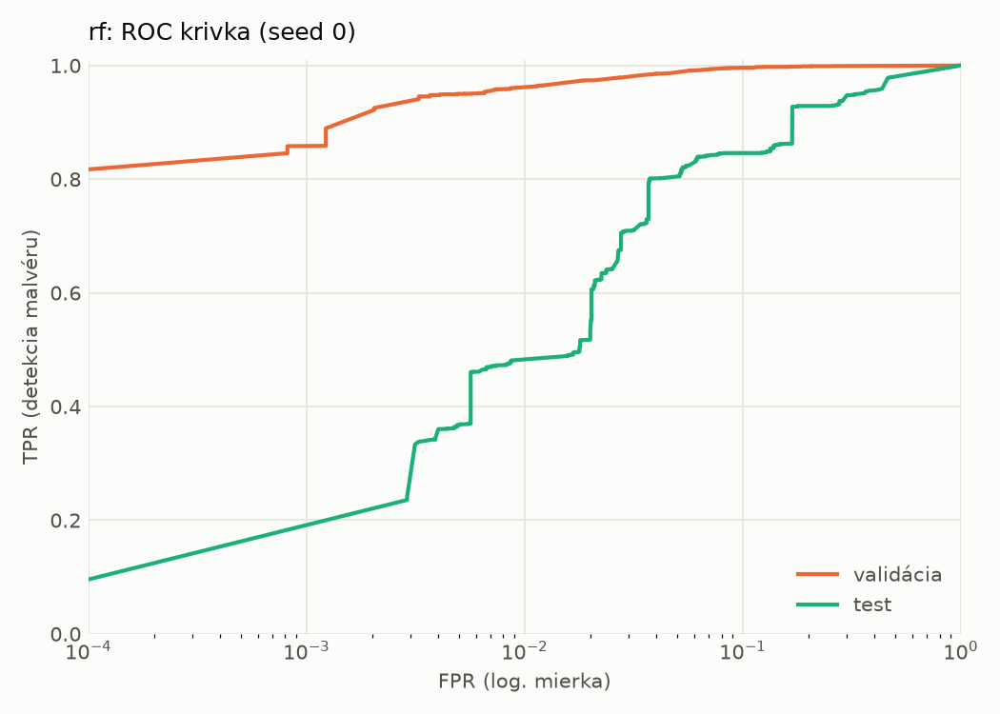
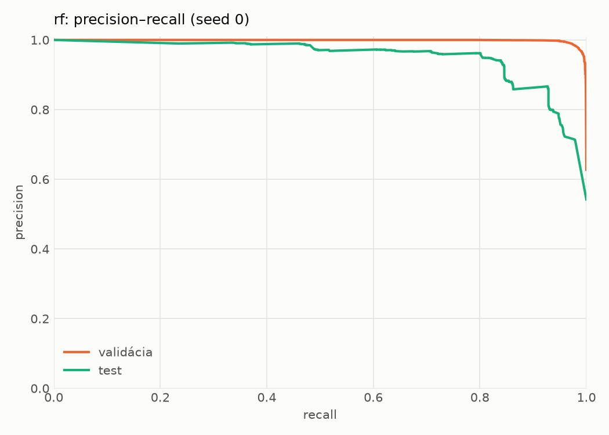
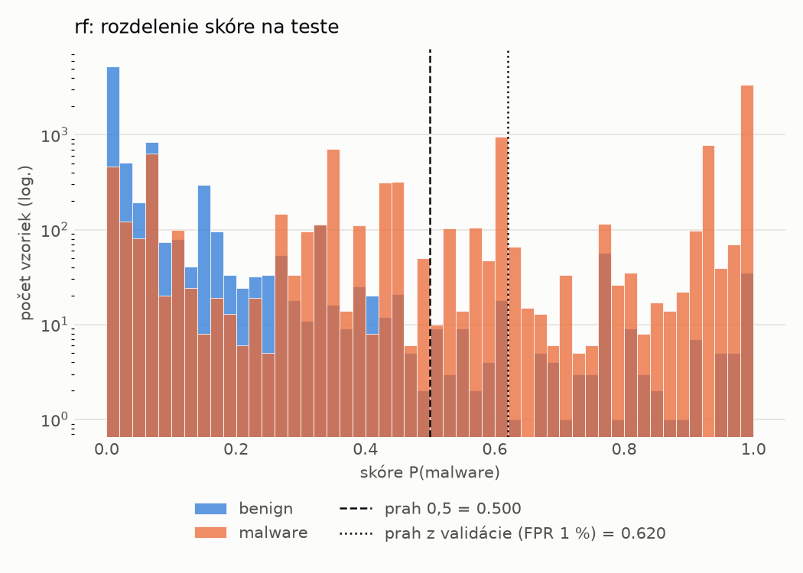
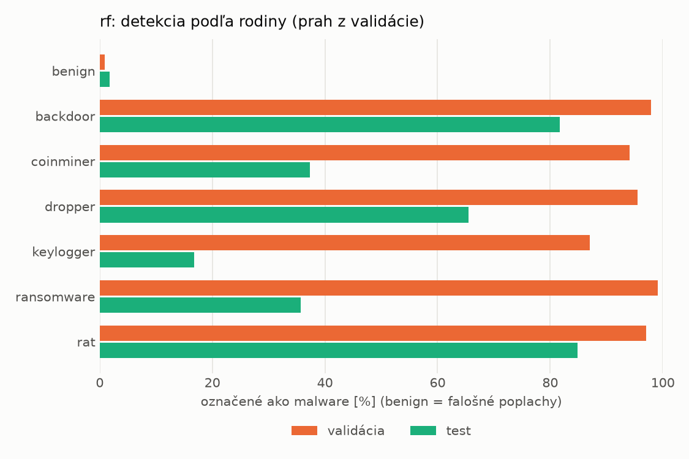
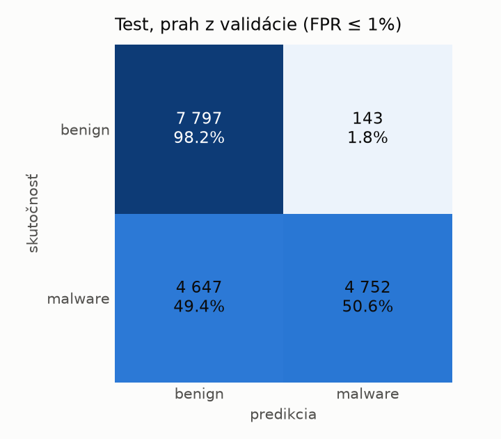
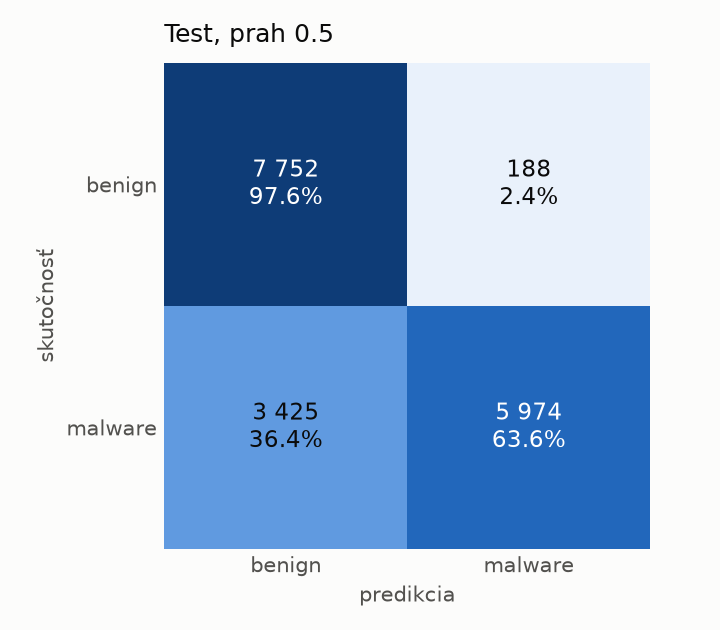

# dynamic/rf – beh `20261104-185948`

> Automaticky generované (`src/training/run_tabular.py`). Konfigurácia: `config.yaml`, protokol: `protocol.yaml`.

- **Model:** `random_forest` – Random Forest (pôvodné hodnoty príznakov)
- **Ladenie:** bez ladenia – hyperparametre prevzaté z `runs_final/dynamic/rf/20261102-003041`
- **Finálne modely:** seedy [0, 1, 2]; hodnoty sú priemer ± smerodajná odchýlka cez seedy
- **Najlepšie hyperparametre:** `{"n_estimators": 450, "max_depth": null, "min_samples_leaf": 1, "max_features": 0.05}`

## Detekčná kvalita (bez prahu)
| metrika | train (podvzorka) | validácia | test |
|---|---|---|---|
| ROC-AUC | 0.9991 ± 0.0000 | 0.9974 ± 0.0001 | 0.9417 ± 0.0018 |
| PR-AUC | 0.9994 ± 0.0000 | 0.9983 ± 0.0001 | 0.9514 ± 0.0018 |
| TPR pri FPR 1 % | 0.9663 ± 0.0001 | 0.9603 ± 0.0003 | 0.4816 ± 0.0005 |
| TPR pri FPR 0,1 % | 0.9490 ± 0.0001 | 0.8412 ± 0.0509 | 0.0000 ± 0.0000 |
| log loss | 0.0405 ± 0.0000 | 0.0649 ± 0.0010 | 0.6240 ± 0.0170 |
| Brier skóre | 0.0128 ± 0.0000 | 0.0169 ± 0.0000 | 0.1439 ± 0.0013 |

Rozdiel ROC-AUC train − validácia: **0.0017** (veľký rozdiel = preučenie).

## Pri prahu z validácie (FPR ≤ 1% na validácii)
| metrika | train (podvzorka) | validácia | test |
|---|---|---|---|
| accuracy | 0.9748 ± 0.0001 | 0.9719 ± 0.0002 | 0.7253 ± 0.0053 |
| balanced accuracy | 0.9792 ± 0.0001 | 0.9758 ± 0.0001 | 0.7452 ± 0.0049 |
| precision | 0.9982 ± 0.0000 | 0.9947 ± 0.0000 | 0.9706 ± 0.0004 |
| recall (TPR) | 0.9612 ± 0.0002 | 0.9603 ± 0.0003 | 0.5086 ± 0.0099 |
| FPR | 0.0029 ± 0.0000 | 0.0086 ± 0.0000 | 0.0183 ± 0.0003 |
| F1 | 0.9793 ± 0.0001 | 0.9772 ± 0.0001 | 0.6674 ± 0.0086 |
| MCC | 0.9483 ± 0.0002 | 0.9415 ± 0.0004 | 0.5418 ± 0.0076 |

## Pri pevnom prahu 0.5
| metrika | train (podvzorka) | validácia | test |
|---|---|---|---|
| accuracy | 0.9819 ± 0.0001 | 0.9766 ± 0.0000 | 0.7937 ± 0.0020 |
| balanced accuracy | 0.9832 ± 0.0000 | 0.9776 ± 0.0000 | 0.8079 ± 0.0018 |
| precision | 0.9931 ± 0.0000 | 0.9889 ± 0.0000 | 0.9697 ± 0.0002 |
| recall (TPR) | 0.9775 ± 0.0001 | 0.9737 ± 0.0000 | 0.6394 ± 0.0037 |
| FPR | 0.0111 ± 0.0000 | 0.0184 ± 0.0000 | 0.0237 ± 0.0001 |
| F1 | 0.9853 ± 0.0000 | 0.9812 ± 0.0000 | 0.7706 ± 0.0027 |
| MCC | 0.9619 ± 0.0001 | 0.9505 ± 0.0000 | 0.6401 ± 0.0030 |

## Výpočtové nároky (seed 0, testovacia množina)
| meranie | hodnota |
|---|---|
| tréning finálneho modelu | 29.9 s (priemer cez seedy) |
| ladenie spolu | 0 s |
| počet parametrov / uzlov | 909 982 |
| veľkosť modelu na disku | 73.22 MB |
| CPU latencia modelu (batch 1, 1 vlákno) | 13.268 ms (p95 14.505) |
| CPU priepustnosť (24 vlákien) | 86 003 vzoriek/s |

## Grafy
| | |
|---|---|
|  |  |
|  |  |
|  |  |
|  |  |

## Súbory
`metrics.json` (všetky metriky po seedoch vrátane rodín), `timing.json`, `hpo_trials.csv`,
`predictions/<časť>_seed<N>.parquet` (sha256, family, label, score), `model/seed_<N>/`, `log.txt`.
