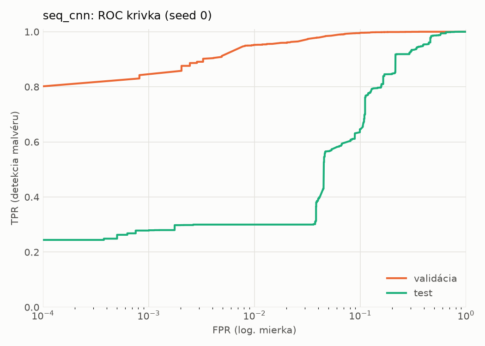
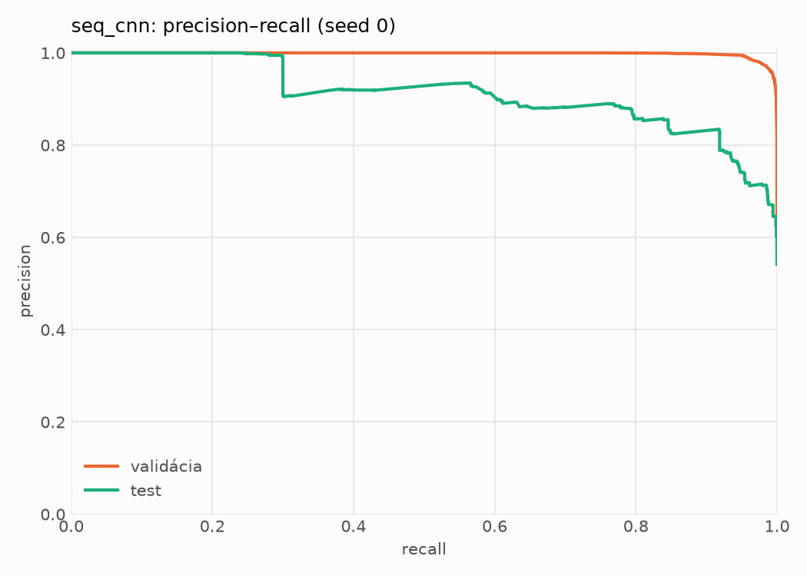
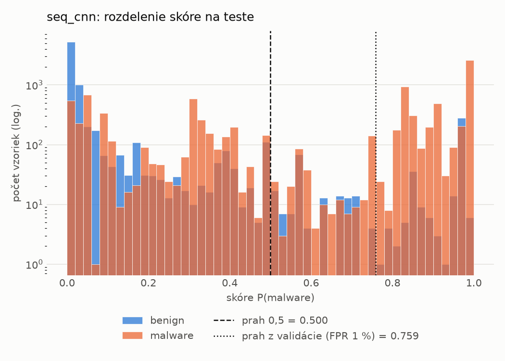
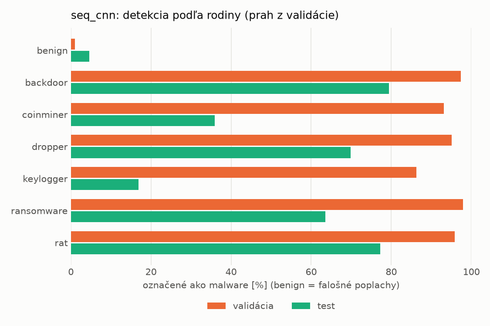
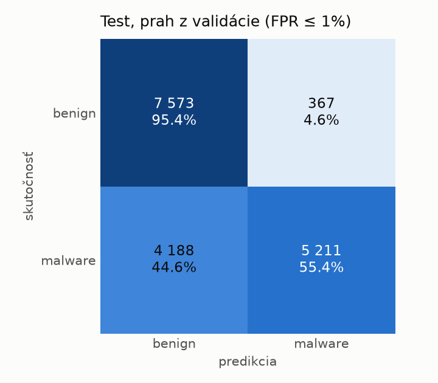
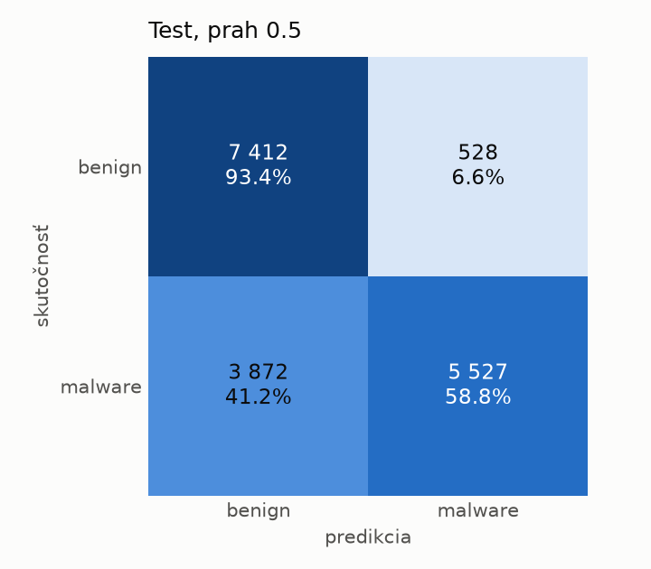
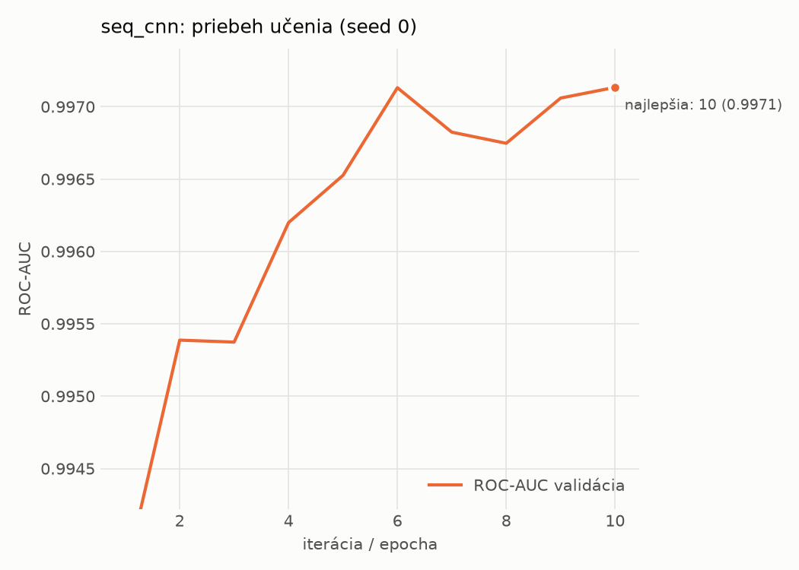

# dynamic_seq/seq_cnn – beh `20261104-190342`

> Automaticky generované (`src/training/run_tabular.py`). Konfigurácia: `config.yaml`, protokol: `protocol.yaml`.

- **Model:** `seq_cnn` – embedding API + paralelné 1D konvolúcie + maximum cez postupnosť
- **Ladenie:** bez ladenia – hyperparametre prevzaté z `runs_final/dynamic/seq_cnn/20261102-010741`
- **Finálne modely:** seedy [0, 1, 2]; hodnoty sú priemer ± smerodajná odchýlka cez seedy
- **Najlepšie hyperparametre:** `{"max_epochs": 30, "patience": 4, "emb_dim": 64, "channels": 128, "kernels": "2-4-8", "hidden": 64, "dropout": 0.19665662644598886, "lr": 0.0005755683530429188, "weight_decay": 0.0005400591881097476, "batch_size": 128}`

## Detekčná kvalita (bez prahu)
| metrika | train (podvzorka) | validácia | test |
|---|---|---|---|
| ROC-AUC | 0.9984 ± 0.0003 | 0.9973 ± 0.0002 | 0.9320 ± 0.0223 |
| PR-AUC | 0.9989 ± 0.0002 | 0.9983 ± 0.0001 | 0.9425 ± 0.0252 |
| TPR pri FPR 1 % | 0.9562 ± 0.0070 | 0.9551 ± 0.0029 | 0.4838 ± 0.1615 |
| TPR pri FPR 0,1 % | 0.9099 ± 0.0068 | 0.8129 ± 0.0696 | 0.2945 ± 0.0155 |
| log loss | 0.0520 ± 0.0056 | 0.0682 ± 0.0004 | 0.7095 ± 0.0784 |
| Brier skóre | 0.0164 ± 0.0015 | 0.0190 ± 0.0010 | 0.1557 ± 0.0272 |

Rozdiel ROC-AUC train − validácia: **0.0011** (veľký rozdiel = preučenie).

## Pri prahu z validácie (FPR ≤ 1% na validácii)
| metrika | train (podvzorka) | validácia | test |
|---|---|---|---|
| accuracy | 0.9678 ± 0.0037 | 0.9683 ± 0.0019 | 0.7745 ± 0.0504 |
| balanced accuracy | 0.9726 ± 0.0030 | 0.9728 ± 0.0016 | 0.7902 ± 0.0475 |
| precision | 0.9952 ± 0.0003 | 0.9941 ± 0.0002 | 0.9672 ± 0.0286 |
| recall (TPR) | 0.9527 ± 0.0061 | 0.9551 ± 0.0029 | 0.6039 ± 0.0840 |
| FPR | 0.0075 ± 0.0005 | 0.0096 ± 0.0002 | 0.0236 ± 0.0196 |
| F1 | 0.9735 ± 0.0031 | 0.9742 ± 0.0016 | 0.7417 ± 0.0672 |
| MCC | 0.9340 ± 0.0072 | 0.9343 ± 0.0038 | 0.6115 ± 0.0833 |

## Pri pevnom prahu 0.5
| metrika | train (podvzorka) | validácia | test |
|---|---|---|---|
| accuracy | 0.9736 ± 0.0039 | 0.9714 ± 0.0031 | 0.8044 ± 0.0520 |
| balanced accuracy | 0.9757 ± 0.0031 | 0.9732 ± 0.0025 | 0.8167 ± 0.0497 |
| precision | 0.9902 ± 0.0029 | 0.9880 ± 0.0018 | 0.9534 ± 0.0357 |
| recall (TPR) | 0.9671 ± 0.0074 | 0.9661 ± 0.0055 | 0.6709 ± 0.0774 |
| FPR | 0.0157 ± 0.0047 | 0.0198 ± 0.0030 | 0.0375 ± 0.0259 |
| F1 | 0.9785 ± 0.0033 | 0.9769 ± 0.0026 | 0.7866 ± 0.0641 |
| MCC | 0.9449 ± 0.0079 | 0.9396 ± 0.0064 | 0.6500 ± 0.0925 |

## Výpočtové nároky (seed 0, testovacia množina)
| meranie | hodnota |
|---|---|
| tréning finálneho modelu | 377.3 s (priemer cez seedy) |
| ladenie spolu | 0 s |
| počet parametrov / uzlov | 207 297 |
| veľkosť modelu na disku | 0.83 MB |
| CPU latencia modelu (batch 1, 1 vlákno) | 2.945 ms (p95 3.193) |
| CPU priepustnosť (24 vlákien) | 1 255 vzoriek/s |
| GPU latencia (batch 1) | 1.265 ms (p95 1.829) |
| GPU priepustnosť | 9 731 vzoriek/s |
| GPU špičková pamäť | 1883 MB |

## Grafy
| | |
|---|---|
|  |  |
|  |  |
|  |  |
|  |  |

## Súbory
`metrics.json` (všetky metriky po seedoch vrátane rodín), `timing.json`, `hpo_trials.csv`,
`predictions/<časť>_seed<N>.parquet` (sha256, family, label, score), `model/seed_<N>/`, `log.txt`.
