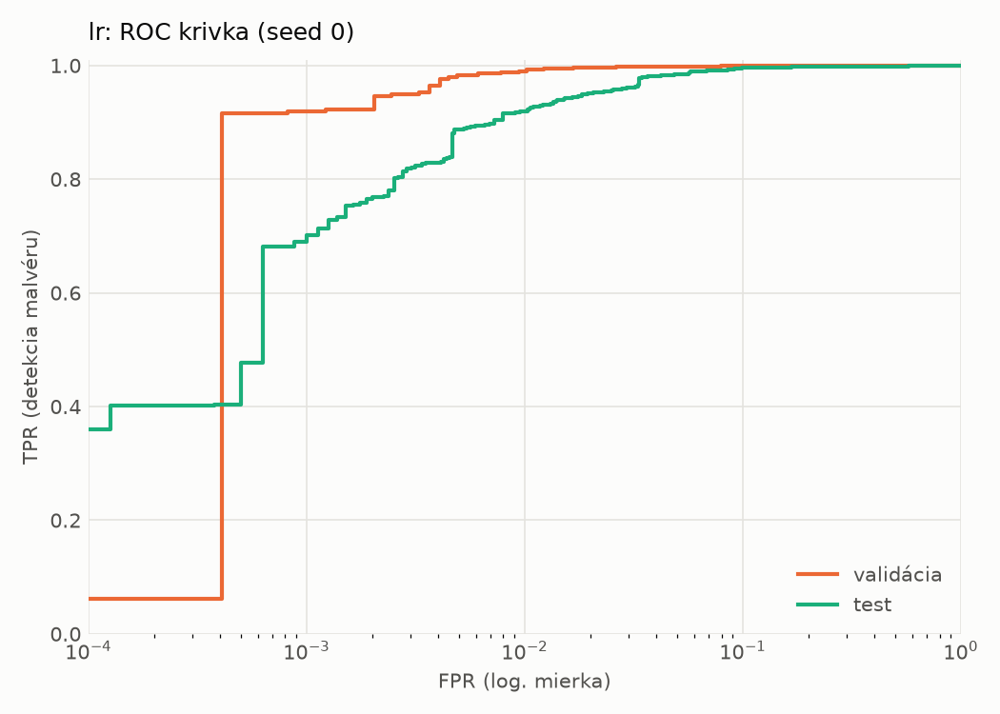
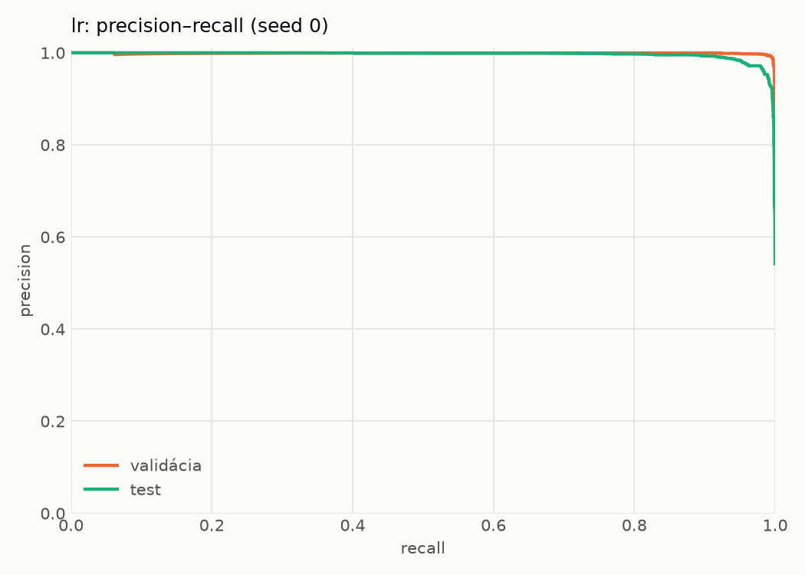
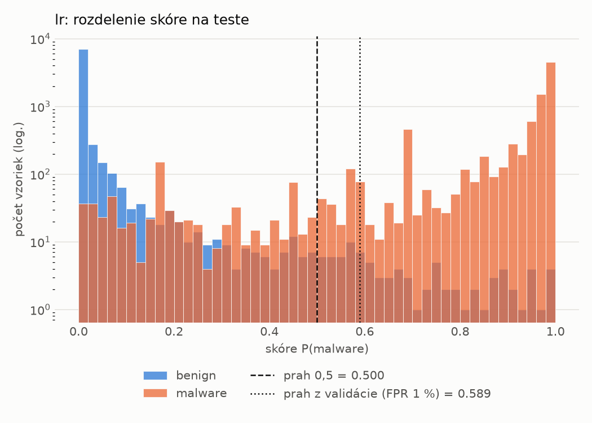
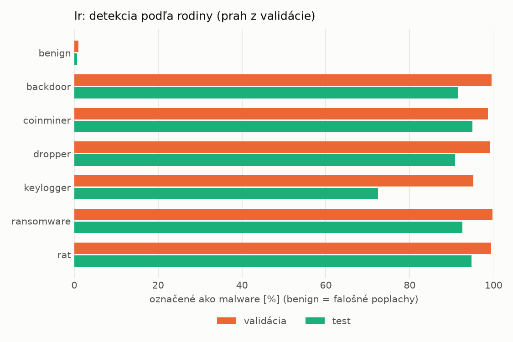
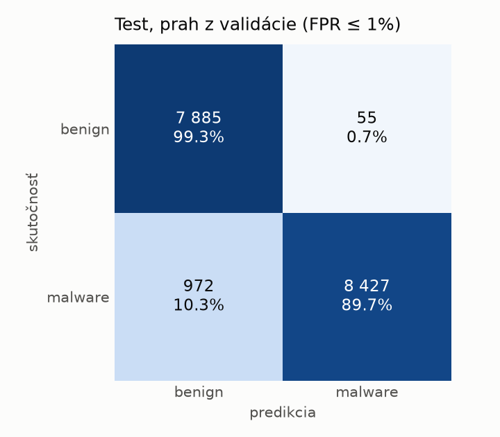
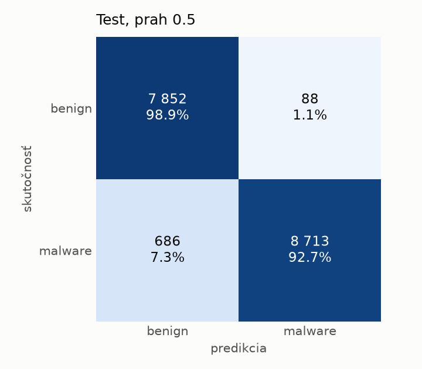

# hybrid/lr – beh `20261104-192437`

> Automaticky generované (`src/training/run_tabular.py`). Konfigurácia: `config.yaml`, protokol: `protocol.yaml`.

- **Model:** `logreg` – logistická regresia s L2 regularizáciou (vstup signed log1p + štandardizácia)
- **Ladenie:** bez ladenia – hyperparametre prevzaté z `runs_final/hybrid/lr/20261102-044357`
- **Finálne modely:** seedy [0, 1, 2]; hodnoty sú priemer ± smerodajná odchýlka cez seedy
- **Najlepšie hyperparametre:** `{"max_iter": 2000, "C": 0.0028355883180749405}`

## Detekčná kvalita (bez prahu)
| metrika | train (podvzorka) | validácia | test |
|---|---|---|---|
| ROC-AUC | 0.9998 ± 0.0000 | 0.9989 ± 0.0000 | 0.9953 ± 0.0000 |
| PR-AUC | 0.9999 ± 0.0000 | 0.9989 ± 0.0000 | 0.9961 ± 0.0000 |
| TPR pri FPR 1 % | 0.9982 ± 0.0000 | 0.9895 ± 0.0000 | 0.9197 ± 0.0000 |
| TPR pri FPR 0,1 % | 0.9587 ± 0.0000 | 0.9197 ± 0.0000 | 0.6903 ± 0.0000 |
| log loss | 0.0219 ± 0.0000 | 0.0322 ± 0.0000 | 0.1281 ± 0.0000 |
| Brier skóre | 0.0047 ± 0.0000 | 0.0073 ± 0.0000 | 0.0367 ± 0.0000 |

Rozdiel ROC-AUC train − validácia: **0.0010** (veľký rozdiel = preučenie).

## Pri prahu z validácie (FPR ≤ 1% na validácii)
| metrika | train (podvzorka) | validácia | test |
|---|---|---|---|
| accuracy | 0.9933 ± 0.0000 | 0.9898 ± 0.0000 | 0.9408 ± 0.0000 |
| balanced accuracy | 0.9937 ± 0.0000 | 0.9899 ± 0.0000 | 0.9448 ± 0.0000 |
| precision | 0.9971 ± 0.0000 | 0.9941 ± 0.0000 | 0.9935 ± 0.0000 |
| recall (TPR) | 0.9921 ± 0.0000 | 0.9895 ± 0.0000 | 0.8966 ± 0.0000 |
| FPR | 0.0047 ± 0.0000 | 0.0098 ± 0.0000 | 0.0069 ± 0.0000 |
| F1 | 0.9946 ± 0.0000 | 0.9918 ± 0.0000 | 0.9426 ± 0.0000 |
| MCC | 0.9858 ± 0.0000 | 0.9782 ± 0.0000 | 0.8867 ± 0.0000 |

## Pri pevnom prahu 0.5
| metrika | train (podvzorka) | validácia | test |
|---|---|---|---|
| accuracy | 0.9950 ± 0.0000 | 0.9916 ± 0.0000 | 0.9554 ± 0.0000 |
| balanced accuracy | 0.9949 ± 0.0000 | 0.9910 ± 0.0000 | 0.9580 ± 0.0000 |
| precision | 0.9968 ± 0.0000 | 0.9932 ± 0.0000 | 0.9900 ± 0.0000 |
| recall (TPR) | 0.9952 ± 0.0000 | 0.9934 ± 0.0000 | 0.9270 ± 0.0000 |
| FPR | 0.0053 ± 0.0000 | 0.0115 ± 0.0000 | 0.0111 ± 0.0000 |
| F1 | 0.9960 ± 0.0000 | 0.9933 ± 0.0000 | 0.9575 ± 0.0000 |
| MCC | 0.9894 ± 0.0000 | 0.9820 ± 0.0000 | 0.9128 ± 0.0000 |

## Výpočtové nároky (seed 0, testovacia množina)
| meranie | hodnota |
|---|---|
| tréning finálneho modelu | 4.7 s (priemer cez seedy) |
| ladenie spolu | 0 s |
| počet parametrov / uzlov | 4 319 |
| veľkosť modelu na disku | 0.13 MB |
| transformácia vstupu – latencia (1 vlákno) | 0.035 ms |
| transformácia vstupu – priepustnosť | 22 986 vzoriek/s |
| CPU latencia modelu (batch 1, 1 vlákno) | 0.007 ms (p95 0.008) |
| CPU priepustnosť (24 vlákien) | 155 201 vzoriek/s |

## Grafy
| | |
|---|---|
|  |  |
|  |  |
|  |  |
|  |  |

## Súbory
`metrics.json` (všetky metriky po seedoch vrátane rodín), `timing.json`, `hpo_trials.csv`,
`predictions/<časť>_seed<N>.parquet` (sha256, family, label, score), `model/seed_<N>/`, `log.txt`.
