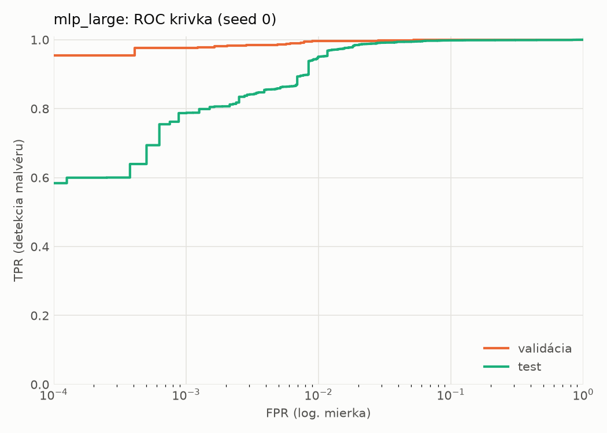
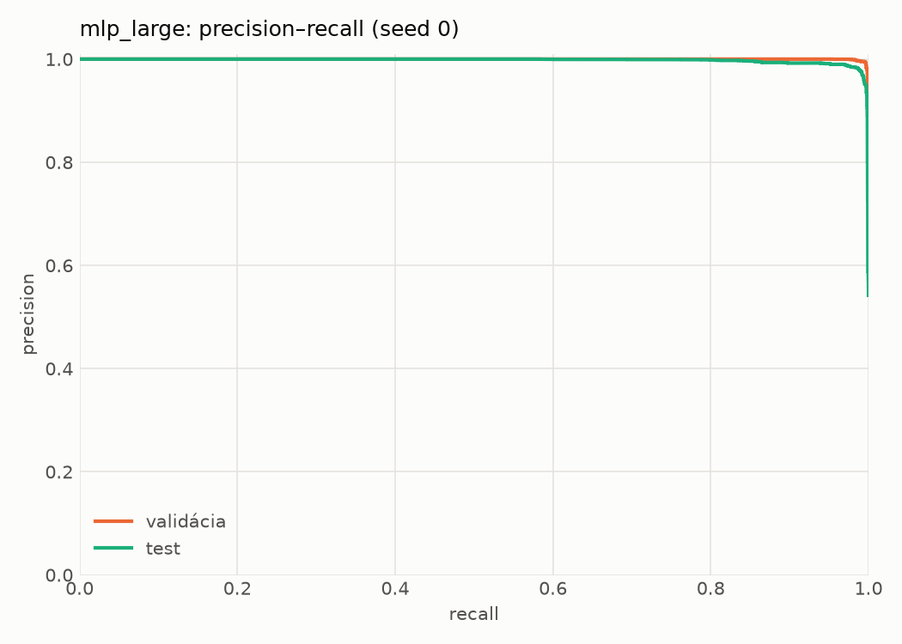
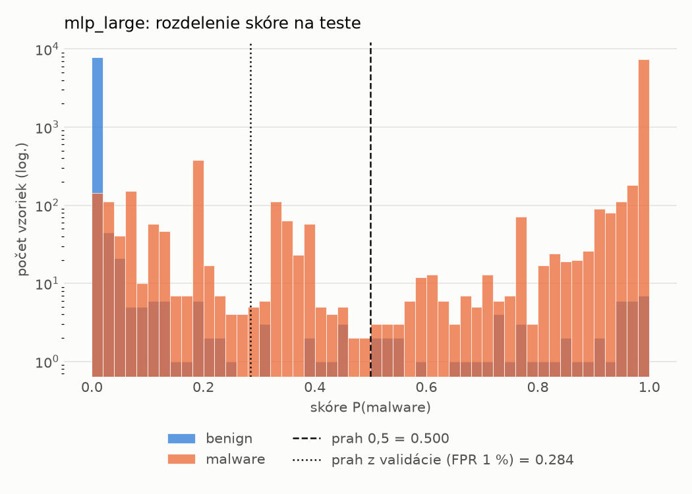
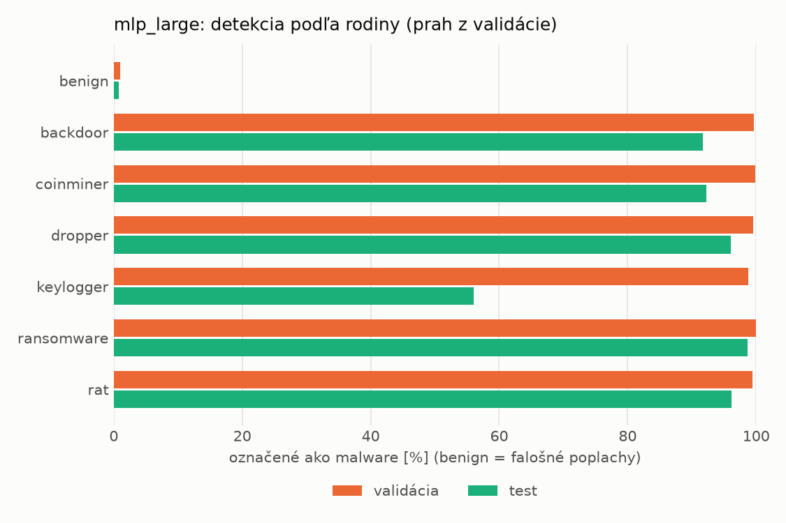
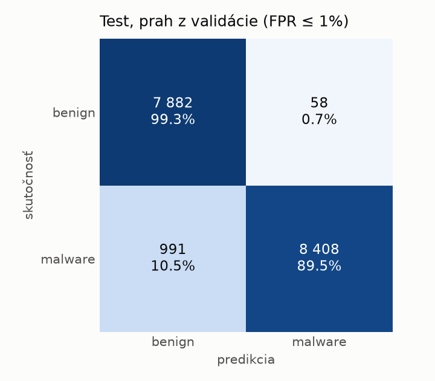
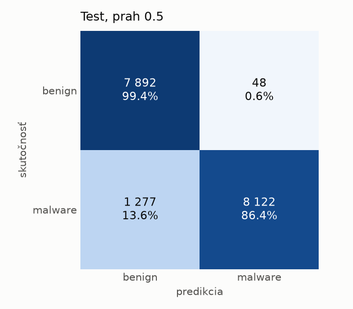
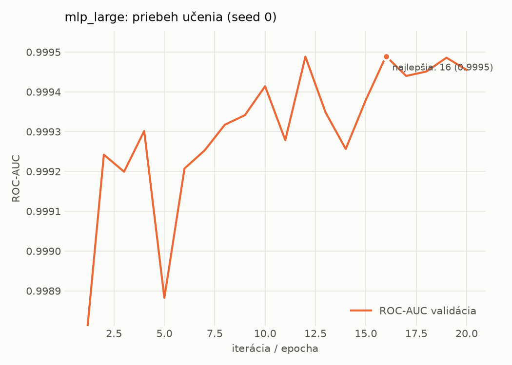

# hybrid/mlp_large – beh `20261104-193159`

> Automaticky generované (`src/training/run_tabular.py`). Konfigurácia: `config.yaml`, protokol: `protocol.yaml`.

- **Model:** `mlp` – veľká neurónová sieť (3–5 skrytých vrstiev, 512–2048 neurónov), kandidát na učiteľa
- **Ladenie:** bez ladenia – hyperparametre prevzaté z `runs_final/hybrid/mlp_large/20261102-064138`
- **Finálne modely:** seedy [0, 1, 2]; hodnoty sú priemer ± smerodajná odchýlka cez seedy
- **Najlepšie hyperparametre:** `{"max_epochs": 100, "patience": 8, "hidden_layers": 4, "hidden_width": 512, "width_decay": 0.5, "dropout": 0.1951820260605614, "lr": 0.000176468680848935, "weight_decay": 1.209699321025492e-05, "batch_size": 512}`

## Detekčná kvalita (bez prahu)
| metrika | train (podvzorka) | validácia | test |
|---|---|---|---|
| ROC-AUC | 1.0000 ± 0.0000 | 0.9995 ± 0.0001 | 0.9971 ± 0.0002 |
| PR-AUC | 1.0000 ± 0.0000 | 0.9998 ± 0.0000 | 0.9978 ± 0.0001 |
| TPR pri FPR 1 % | 0.9996 ± 0.0001 | 0.9961 ± 0.0002 | 0.9507 ± 0.0078 |
| TPR pri FPR 0,1 % | 0.9937 ± 0.0004 | 0.9672 ± 0.0078 | 0.7791 ± 0.0093 |
| log loss | 0.0105 ± 0.0020 | 0.0274 ± 0.0016 | 0.1764 ± 0.0132 |
| Brier skóre | 0.0018 ± 0.0001 | 0.0056 ± 0.0002 | 0.0487 ± 0.0079 |

Rozdiel ROC-AUC train − validácia: **0.0005** (veľký rozdiel = preučenie).

## Pri prahu z validácie (FPR ≤ 1% na validácii)
| metrika | train (podvzorka) | validácia | test |
|---|---|---|---|
| accuracy | 0.9978 ± 0.0001 | 0.9940 ± 0.0001 | 0.9515 ± 0.0115 |
| balanced accuracy | 0.9974 ± 0.0000 | 0.9933 ± 0.0001 | 0.9547 ± 0.0106 |
| precision | 0.9974 ± 0.0001 | 0.9943 ± 0.0003 | 0.9935 ± 0.0005 |
| recall (TPR) | 0.9990 ± 0.0002 | 0.9961 ± 0.0002 | 0.9165 ± 0.0213 |
| FPR | 0.0043 ± 0.0002 | 0.0096 ± 0.0005 | 0.0071 ± 0.0005 |
| F1 | 0.9982 ± 0.0000 | 0.9952 ± 0.0001 | 0.9534 ± 0.0116 |
| MCC | 0.9953 ± 0.0001 | 0.9872 ± 0.0002 | 0.9063 ± 0.0211 |

## Pri pevnom prahu 0.5
| metrika | train (podvzorka) | validácia | test |
|---|---|---|---|
| accuracy | 0.9975 ± 0.0001 | 0.9938 ± 0.0003 | 0.9343 ± 0.0144 |
| balanced accuracy | 0.9973 ± 0.0000 | 0.9934 ± 0.0005 | 0.9390 ± 0.0133 |
| precision | 0.9977 ± 0.0001 | 0.9951 ± 0.0006 | 0.9947 ± 0.0007 |
| recall (TPR) | 0.9983 ± 0.0002 | 0.9950 ± 0.0004 | 0.8835 ± 0.0269 |
| FPR | 0.0038 ± 0.0002 | 0.0082 ± 0.0011 | 0.0056 ± 0.0008 |
| F1 | 0.9980 ± 0.0000 | 0.9951 ± 0.0003 | 0.9357 ± 0.0149 |
| MCC | 0.9948 ± 0.0001 | 0.9867 ± 0.0007 | 0.8756 ± 0.0257 |

## Výpočtové nároky (seed 0, testovacia množina)
| meranie | hodnota |
|---|---|
| tréning finálneho modelu | 8.2 s (priemer cez seedy) |
| ladenie spolu | 0 s |
| počet parametrov / uzlov | 2 385 793 |
| veľkosť modelu na disku | 9.67 MB |
| transformácia vstupu – latencia (1 vlákno) | 0.062 ms |
| transformácia vstupu – priepustnosť | 22 442 vzoriek/s |
| CPU latencia modelu (batch 1, 1 vlákno) | 0.282 ms (p95 0.304) |
| CPU priepustnosť (24 vlákien) | 37 548 vzoriek/s |
| GPU latencia (batch 1) | 0.577 ms (p95 0.697) |
| GPU priepustnosť | 35 378 vzoriek/s |
| GPU špičková pamäť | 2634 MB |

## Grafy
| | |
|---|---|
|  |  |
|  |  |
|  |  |
|  |  |

## Súbory
`metrics.json` (všetky metriky po seedoch vrátane rodín), `timing.json`, `hpo_trials.csv`,
`predictions/<časť>_seed<N>.parquet` (sha256, family, label, score), `model/seed_<N>/`, `log.txt`.
