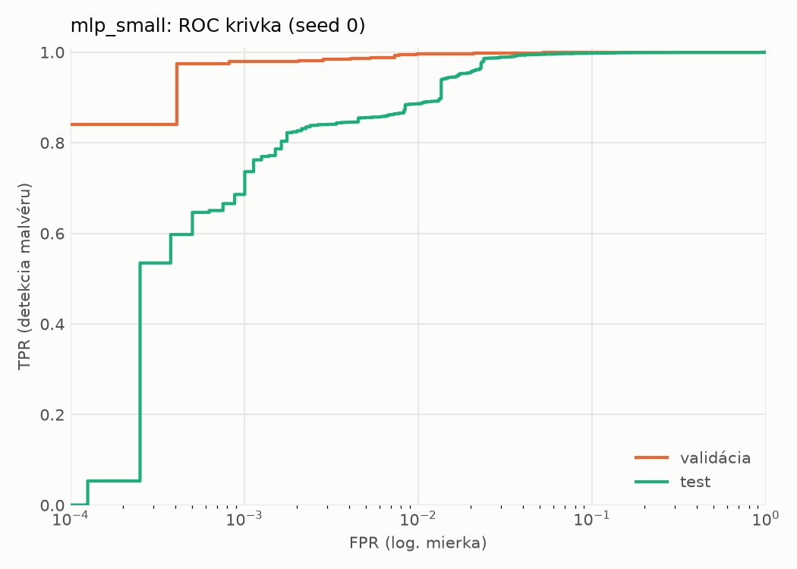
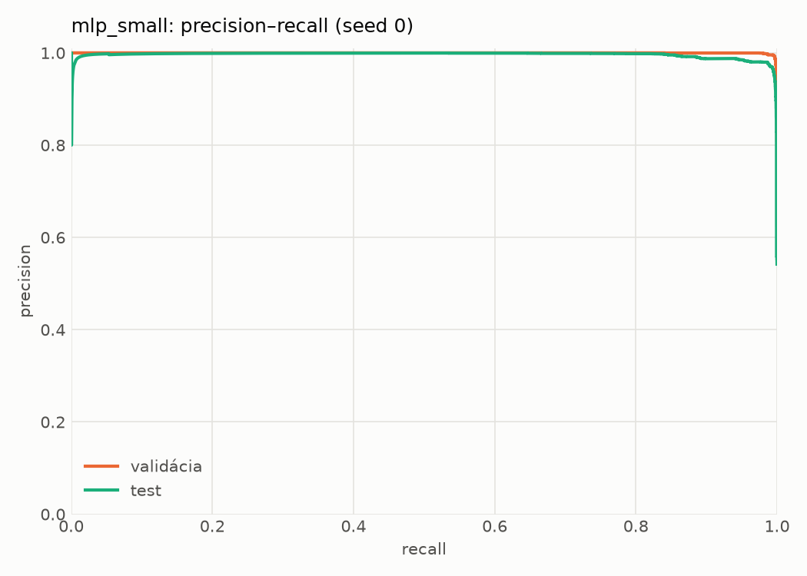
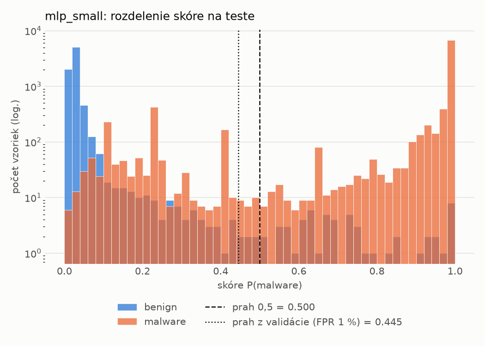
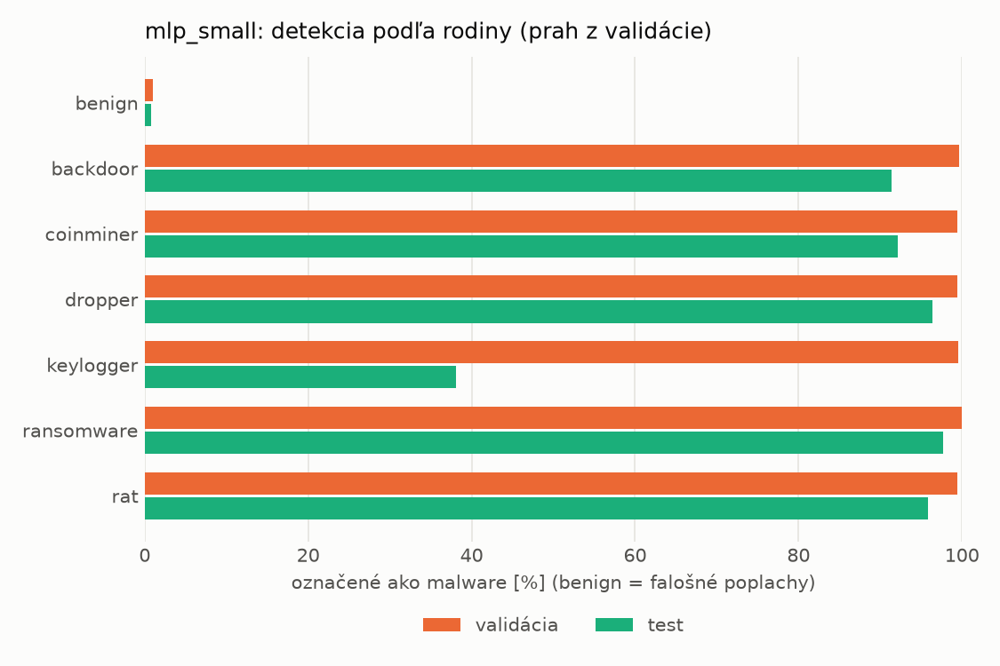
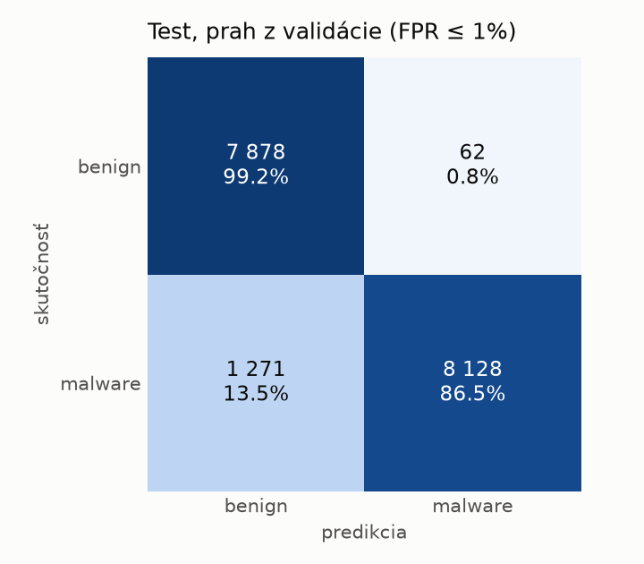
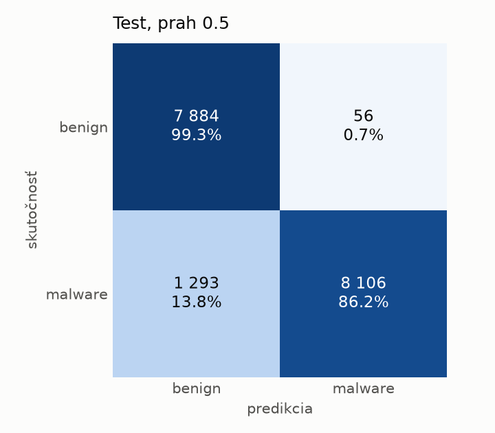
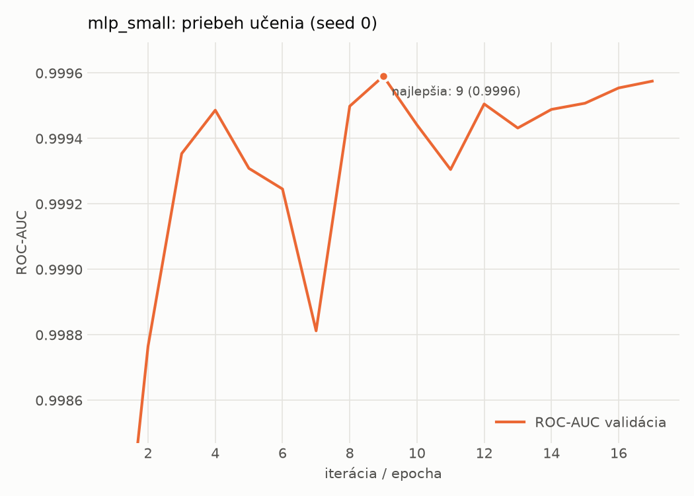

# hybrid/mlp_small – beh `20261104-193126`

> Automaticky generované (`src/training/run_tabular.py`). Konfigurácia: `config.yaml`, protokol: `protocol.yaml`.

- **Model:** `mlp` – malá neurónová sieť (1–2 skryté vrstvy), kandidát na ľahkého študenta
- **Ladenie:** bez ladenia – hyperparametre prevzaté z `runs_final/hybrid/mlp_small/20261102-063854`
- **Finálne modely:** seedy [0, 1, 2]; hodnoty sú priemer ± smerodajná odchýlka cez seedy
- **Najlepšie hyperparametre:** `{"width_decay": 0.5, "max_epochs": 100, "patience": 8, "hidden_layers": 2, "hidden_width": 32, "dropout": 0.16874195706419903, "lr": 0.0006143857735366936, "weight_decay": 0.007079811471617702, "batch_size": 512}`

## Detekčná kvalita (bez prahu)
| metrika | train (podvzorka) | validácia | test |
|---|---|---|---|
| ROC-AUC | 1.0000 ± 0.0000 | 0.9994 ± 0.0002 | 0.9954 ± 0.0007 |
| PR-AUC | 1.0000 ± 0.0000 | 0.9997 ± 0.0001 | 0.9956 ± 0.0008 |
| TPR pri FPR 1 % | 0.9992 ± 0.0002 | 0.9953 ± 0.0010 | 0.8785 ± 0.0095 |
| TPR pri FPR 0,1 % | 0.9885 ± 0.0064 | 0.9389 ± 0.0700 | 0.6962 ± 0.0103 |
| log loss | 0.0256 ± 0.0204 | 0.0367 ± 0.0177 | 0.1970 ± 0.0366 |
| Brier skóre | 0.0034 ± 0.0021 | 0.0065 ± 0.0016 | 0.0597 ± 0.0088 |

Rozdiel ROC-AUC train − validácia: **0.0005** (veľký rozdiel = preučenie).

## Pri prahu z validácie (FPR ≤ 1% na validácii)
| metrika | train (podvzorka) | validácia | test |
|---|---|---|---|
| accuracy | 0.9970 ± 0.0005 | 0.9935 ± 0.0007 | 0.9217 ± 0.0015 |
| balanced accuracy | 0.9967 ± 0.0005 | 0.9929 ± 0.0006 | 0.9272 ± 0.0013 |
| precision | 0.9973 ± 0.0006 | 0.9943 ± 0.0003 | 0.9927 ± 0.0015 |
| recall (TPR) | 0.9980 ± 0.0002 | 0.9953 ± 0.0010 | 0.8618 ± 0.0037 |
| FPR | 0.0045 ± 0.0009 | 0.0096 ± 0.0005 | 0.0075 ± 0.0015 |
| F1 | 0.9976 ± 0.0004 | 0.9948 ± 0.0006 | 0.9226 ± 0.0016 |
| MCC | 0.9937 ± 0.0010 | 0.9861 ± 0.0015 | 0.8528 ± 0.0023 |

## Pri pevnom prahu 0.5
| metrika | train (podvzorka) | validácia | test |
|---|---|---|---|
| accuracy | 0.9959 ± 0.0027 | 0.9922 ± 0.0023 | 0.9184 ± 0.0079 |
| balanced accuracy | 0.9960 ± 0.0020 | 0.9920 ± 0.0015 | 0.9242 ± 0.0071 |
| precision | 0.9979 ± 0.0006 | 0.9947 ± 0.0010 | 0.9938 ± 0.0015 |
| recall (TPR) | 0.9955 ± 0.0049 | 0.9928 ± 0.0047 | 0.8547 ± 0.0159 |
| FPR | 0.0034 ± 0.0009 | 0.0089 ± 0.0017 | 0.0063 ± 0.0016 |
| F1 | 0.9967 ± 0.0022 | 0.9937 ± 0.0019 | 0.9190 ± 0.0086 |
| MCC | 0.9913 ± 0.0056 | 0.9833 ± 0.0049 | 0.8474 ± 0.0131 |

## Výpočtové nároky (seed 0, testovacia množina)
| meranie | hodnota |
|---|---|
| tréning finálneho modelu | 4.8 s (priemer cez seedy) |
| ladenie spolu | 0 s |
| počet parametrov / uzlov | 138 849 |
| veľkosť modelu na disku | 0.67 MB |
| transformácia vstupu – latencia (1 vlákno) | 0.062 ms |
| transformácia vstupu – priepustnosť | 23 759 vzoriek/s |
| CPU latencia modelu (batch 1, 1 vlákno) | 0.102 ms (p95 0.113) |
| CPU priepustnosť (24 vlákien) | 46 281 vzoriek/s |
| GPU latencia (batch 1) | 0.422 ms (p95 0.491) |
| GPU priepustnosť | 29 301 vzoriek/s |
| GPU špičková pamäť | 1453 MB |

## Grafy
| | |
|---|---|
|  |  |
|  |  |
|  |  |
|  |  |

## Súbory
`metrics.json` (všetky metriky po seedoch vrátane rodín), `timing.json`, `hpo_trials.csv`,
`predictions/<časť>_seed<N>.parquet` (sha256, family, label, score), `model/seed_<N>/`, `log.txt`.
