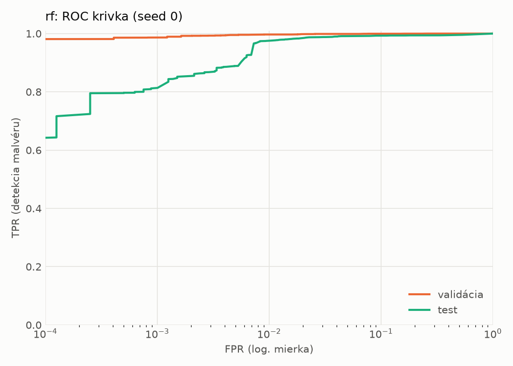
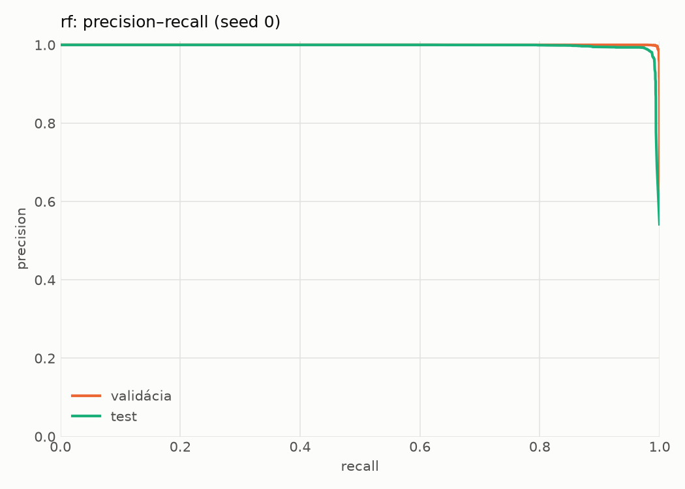
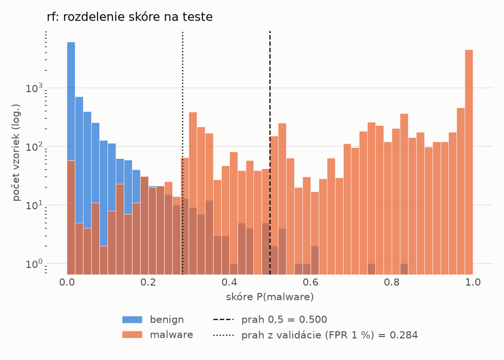
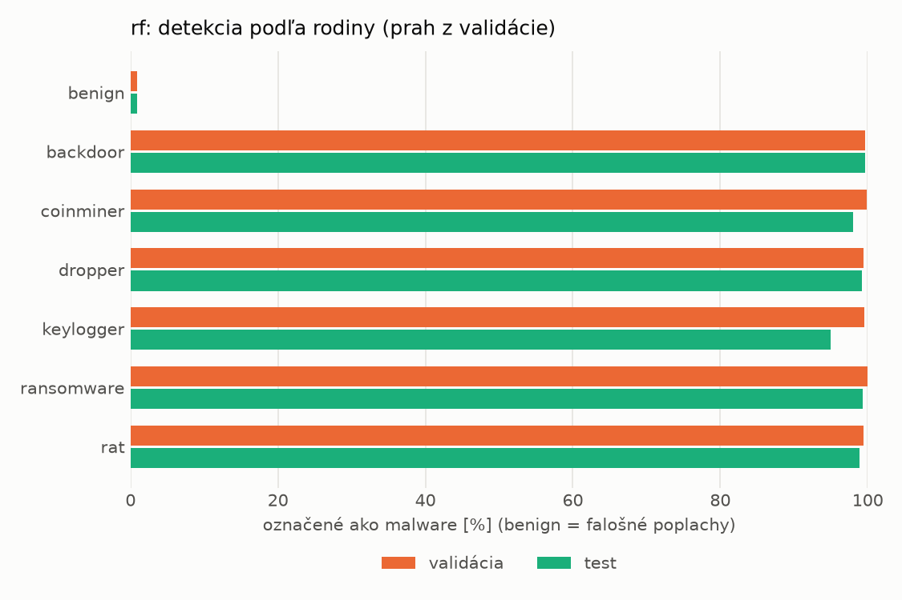
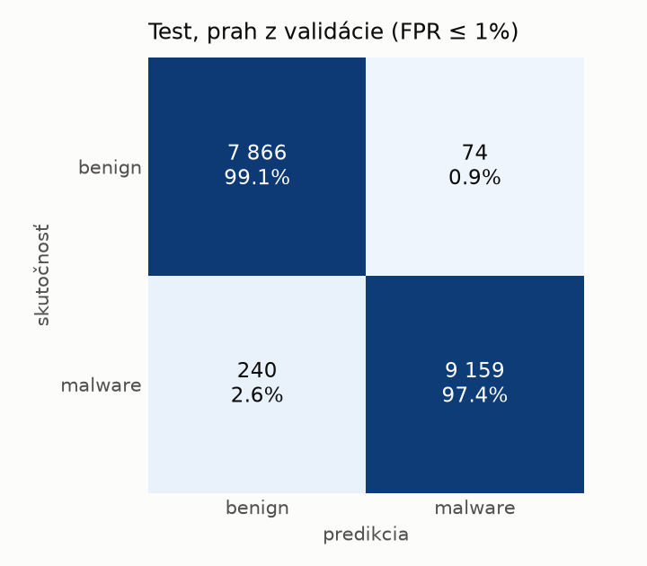
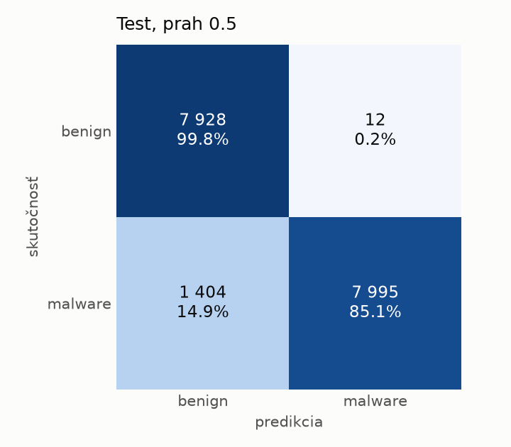

# hybrid/rf – beh `20261104-192506`

> Automaticky generované (`src/training/run_tabular.py`). Konfigurácia: `config.yaml`, protokol: `protocol.yaml`.

- **Model:** `random_forest` – Random Forest (pôvodné hodnoty príznakov)
- **Ladenie:** bez ladenia – hyperparametre prevzaté z `runs_final/hybrid/rf/20261102-044751`
- **Finálne modely:** seedy [0, 1, 2]; hodnoty sú priemer ± smerodajná odchýlka cez seedy
- **Najlepšie hyperparametre:** `{"n_estimators": 250, "max_depth": null, "min_samples_leaf": 1, "max_features": 0.05}`

## Detekčná kvalita (bez prahu)
| metrika | train (podvzorka) | validácia | test |
|---|---|---|---|
| ROC-AUC | 1.0000 ± 0.0000 | 0.9998 ± 0.0000 | 0.9951 ± 0.0010 |
| PR-AUC | 1.0000 ± 0.0000 | 0.9999 ± 0.0000 | 0.9965 ± 0.0006 |
| TPR pri FPR 1 % | 1.0000 ± 0.0000 | 0.9969 ± 0.0001 | 0.9657 ± 0.0089 |
| TPR pri FPR 0,1 % | 1.0000 ± 0.0000 | 0.9876 ± 0.0012 | 0.8077 ± 0.0044 |
| log loss | 0.0054 ± 0.0001 | 0.0198 ± 0.0001 | 0.1897 ± 0.0152 |
| Brier skóre | 0.0006 ± 0.0000 | 0.0046 ± 0.0000 | 0.0539 ± 0.0009 |

Rozdiel ROC-AUC train − validácia: **0.0002** (veľký rozdiel = preučenie).

## Pri prahu z validácie (FPR ≤ 1% na validácii)
| metrika | train (podvzorka) | validácia | test |
|---|---|---|---|
| accuracy | 1.0000 ± 0.0000 | 0.9947 ± 0.0004 | 0.9638 ± 0.0216 |
| balanced accuracy | 1.0000 ± 0.0000 | 0.9940 ± 0.0004 | 0.9660 ± 0.0198 |
| precision | 1.0000 ± 0.0000 | 0.9947 ± 0.0004 | 0.9931 ± 0.0010 |
| recall (TPR) | 1.0000 ± 0.0000 | 0.9969 ± 0.0001 | 0.9397 ± 0.0408 |
| FPR | 0.0000 ± 0.0000 | 0.0090 ± 0.0007 | 0.0077 ± 0.0014 |
| F1 | 1.0000 ± 0.0000 | 0.9958 ± 0.0003 | 0.9654 ± 0.0214 |
| MCC | 1.0000 ± 0.0000 | 0.9887 ± 0.0008 | 0.9297 ± 0.0403 |

## Pri pevnom prahu 0.5
| metrika | train (podvzorka) | validácia | test |
|---|---|---|---|
| accuracy | 1.0000 ± 0.0000 | 0.9945 ± 0.0000 | 0.9170 ± 0.0014 |
| balanced accuracy | 1.0000 ± 0.0000 | 0.9950 ± 0.0000 | 0.9234 ± 0.0013 |
| precision | 1.0000 ± 0.0000 | 0.9981 ± 0.0001 | 0.9983 ± 0.0002 |
| recall (TPR) | 1.0000 ± 0.0000 | 0.9931 ± 0.0001 | 0.8484 ± 0.0023 |
| FPR | 0.0000 ± 0.0000 | 0.0031 ± 0.0002 | 0.0017 ± 0.0002 |
| F1 | 1.0000 ± 0.0000 | 0.9956 ± 0.0000 | 0.9173 ± 0.0015 |
| MCC | 1.0000 ± 0.0000 | 0.9883 ± 0.0000 | 0.8463 ± 0.0024 |

## Výpočtové nároky (seed 0, testovacia množina)
| meranie | hodnota |
|---|---|
| tréning finálneho modelu | 107.1 s (priemer cez seedy) |
| ladenie spolu | 0 s |
| počet parametrov / uzlov | 245 880 |
| veľkosť modelu na disku | 20.01 MB |
| CPU latencia modelu (batch 1, 1 vlákno) | 7.251 ms (p95 7.806) |
| CPU priepustnosť (24 vlákien) | 106 770 vzoriek/s |

## Grafy
| | |
|---|---|
|  |  |
|  |  |
|  |  |
|  |  |

## Súbory
`metrics.json` (všetky metriky po seedoch vrátane rodín), `timing.json`, `hpo_trials.csv`,
`predictions/<časť>_seed<N>.parquet` (sha256, family, label, score), `model/seed_<N>/`, `log.txt`.
