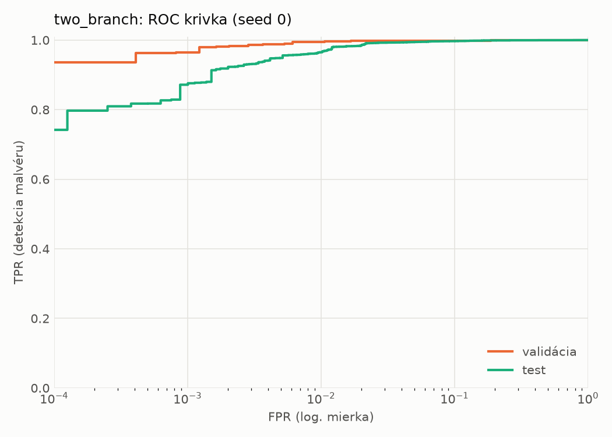
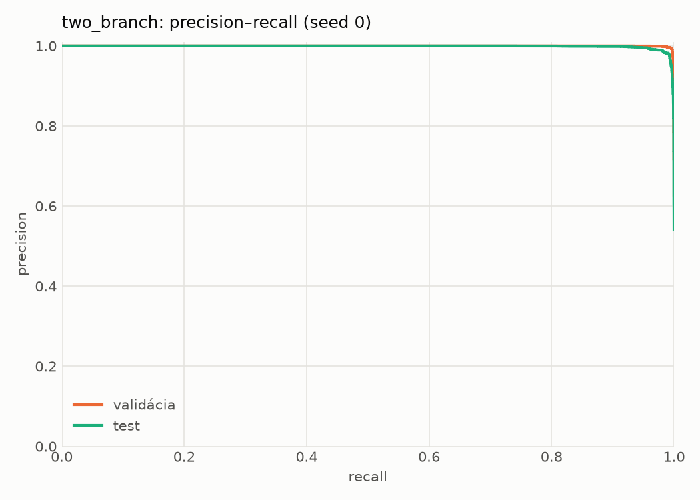
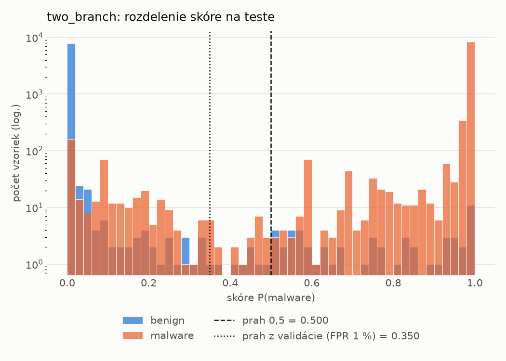
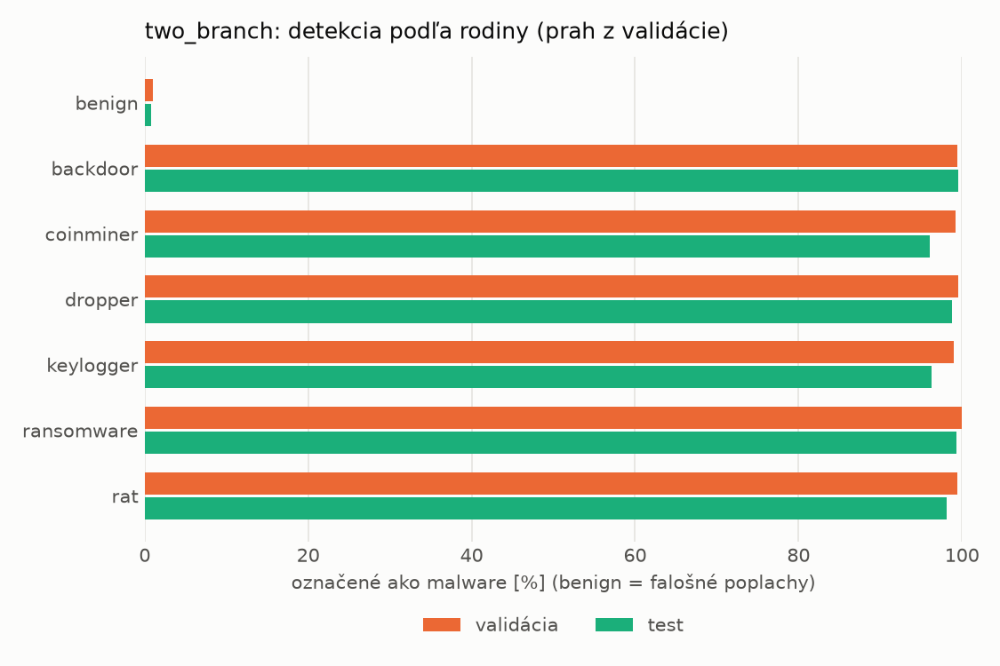
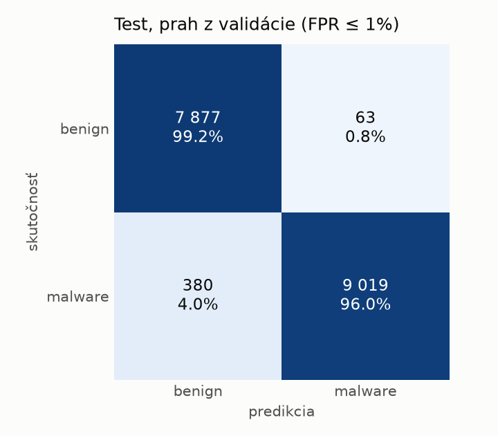
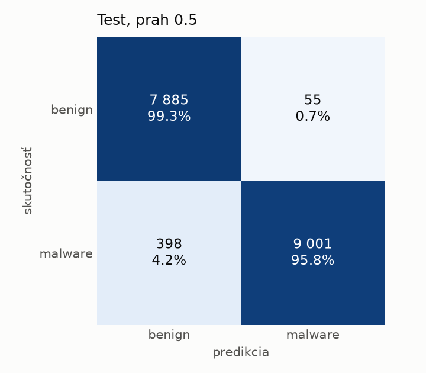
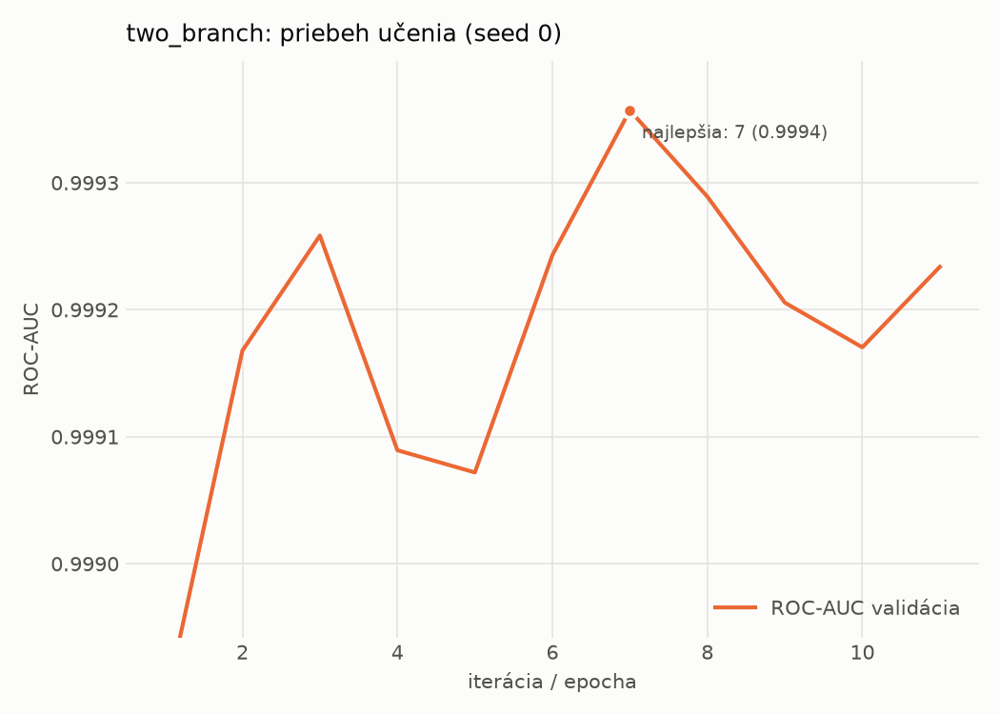

# hybrid_seq/two_branch – beh `20261104-193243`

> Automaticky generované (`src/training/run_tabular.py`). Konfigurácia: `config.yaml`, protokol: `protocol.yaml`.

- **Model:** `two_branch` – statická MLP vetva + sekvenčná CNN vetva nad API volaniami, spojené v spoločnej hlave
- **Ladenie:** bez ladenia – hyperparametre prevzaté z `runs_final/hybrid/two_branch/20261102-170657`
- **Finálne modely:** seedy [0, 1, 2]; hodnoty sú priemer ± smerodajná odchýlka cez seedy
- **Najlepšie hyperparametre:** `{"n_static": 2381, "width_decay": 0.5, "max_epochs": 30, "patience": 4, "static_layers": 3, "static_width": 256, "emb_dim": 64, "channels": 256, "kernels": "2-4-8", "hidden": 512, "dropout": 0.32477392485404594, "lr": 0.0006728393356648638, "weight_decay": 0.0003230215070317658, "batch_size": 256}`

## Detekčná kvalita (bez prahu)
| metrika | train (podvzorka) | validácia | test |
|---|---|---|---|
| ROC-AUC | 1.0000 ± 0.0000 | 0.9994 ± 0.0001 | 0.9981 ± 0.0002 |
| PR-AUC | 1.0000 ± 0.0000 | 0.9997 ± 0.0000 | 0.9984 ± 0.0003 |
| TPR pri FPR 1 % | 0.9994 ± 0.0003 | 0.9950 ± 0.0001 | 0.9674 ± 0.0046 |
| TPR pri FPR 0,1 % | 0.9897 ± 0.0053 | 0.9513 ± 0.0114 | 0.8148 ± 0.0538 |
| log loss | 0.0084 ± 0.0016 | 0.0254 ± 0.0014 | 0.0919 ± 0.0077 |
| Brier skóre | 0.0023 ± 0.0003 | 0.0057 ± 0.0001 | 0.0227 ± 0.0003 |

Rozdiel ROC-AUC train − validácia: **0.0005** (veľký rozdiel = preučenie).

## Pri prahu z validácie (FPR ≤ 1% na validácii)
| metrika | train (podvzorka) | validácia | test |
|---|---|---|---|
| accuracy | 0.9975 ± 0.0002 | 0.9934 ± 0.0003 | 0.9735 ± 0.0016 |
| balanced accuracy | 0.9972 ± 0.0002 | 0.9928 ± 0.0004 | 0.9750 ± 0.0015 |
| precision | 0.9975 ± 0.0001 | 0.9945 ± 0.0006 | 0.9939 ± 0.0015 |
| recall (TPR) | 0.9984 ± 0.0002 | 0.9950 ± 0.0001 | 0.9569 ± 0.0026 |
| FPR | 0.0040 ± 0.0002 | 0.0093 ± 0.0009 | 0.0070 ± 0.0017 |
| F1 | 0.9980 ± 0.0001 | 0.9947 ± 0.0003 | 0.9750 ± 0.0015 |
| MCC | 0.9946 ± 0.0003 | 0.9859 ± 0.0007 | 0.9475 ± 0.0031 |

## Pri pevnom prahu 0.5
| metrika | train (podvzorka) | validácia | test |
|---|---|---|---|
| accuracy | 0.9973 ± 0.0003 | 0.9933 ± 0.0004 | 0.9725 ± 0.0027 |
| balanced accuracy | 0.9970 ± 0.0002 | 0.9930 ± 0.0004 | 0.9741 ± 0.0025 |
| precision | 0.9975 ± 0.0001 | 0.9950 ± 0.0004 | 0.9945 ± 0.0010 |
| recall (TPR) | 0.9981 ± 0.0003 | 0.9942 ± 0.0004 | 0.9545 ± 0.0045 |
| FPR | 0.0040 ± 0.0002 | 0.0083 ± 0.0006 | 0.0063 ± 0.0012 |
| F1 | 0.9978 ± 0.0002 | 0.9946 ± 0.0003 | 0.9741 ± 0.0026 |
| MCC | 0.9943 ± 0.0006 | 0.9856 ± 0.0009 | 0.9457 ± 0.0052 |

## Výpočtové nároky (seed 0, testovacia množina)
| meranie | hodnota |
|---|---|
| tréning finálneho modelu | 361.4 s (priemer cez seedy) |
| ladenie spolu | 0 s |
| počet parametrov / uzlov | 1 754 626 |
| veľkosť modelu na disku | 7.09 MB |
| CPU latencia modelu (batch 1, 1 vlákno) | 5.221 ms (p95 5.584) |
| CPU priepustnosť (24 vlákien) | 643 vzoriek/s |
| GPU latencia (batch 1) | 1.226 ms (p95 2.870) |
| GPU priepustnosť | 4 407 vzoriek/s |
| GPU špičková pamäť | 3742 MB |

## Grafy
| | |
|---|---|
|  |  |
|  |  |
|  |  |
|  |  |

## Súbory
`metrics.json` (všetky metriky po seedoch vrátane rodín), `timing.json`, `hpo_trials.csv`,
`predictions/<časť>_seed<N>.parquet` (sha256, family, label, score), `model/seed_<N>/`, `log.txt`.
