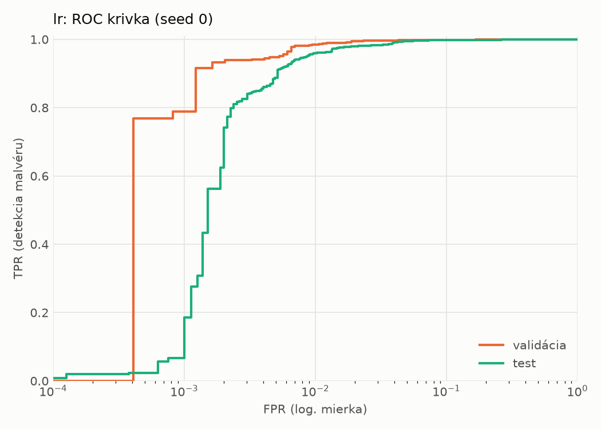
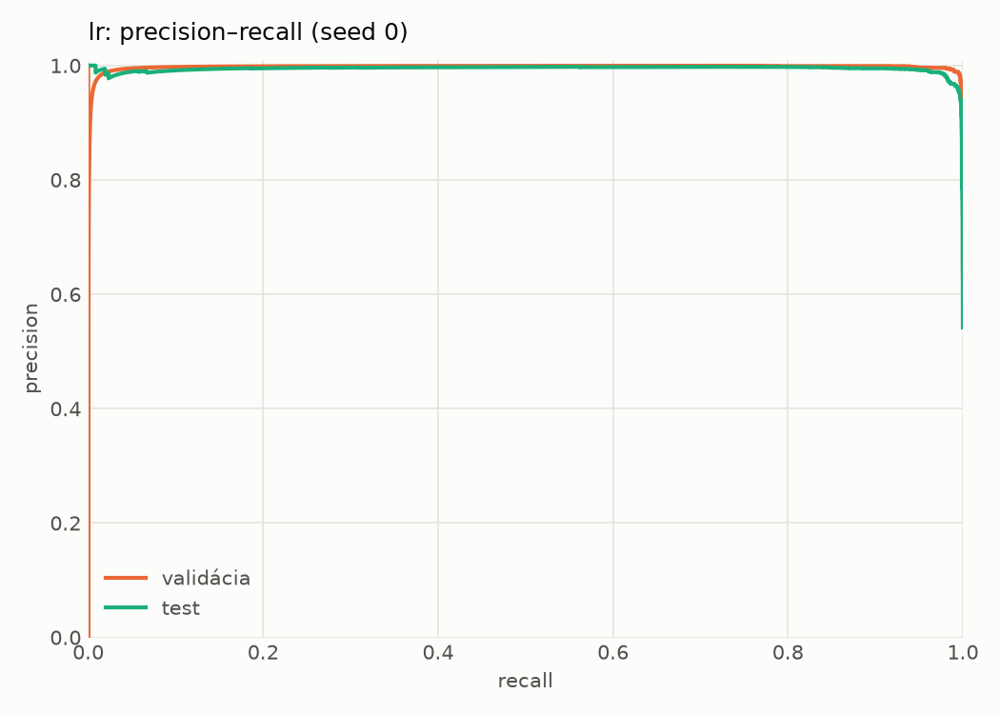
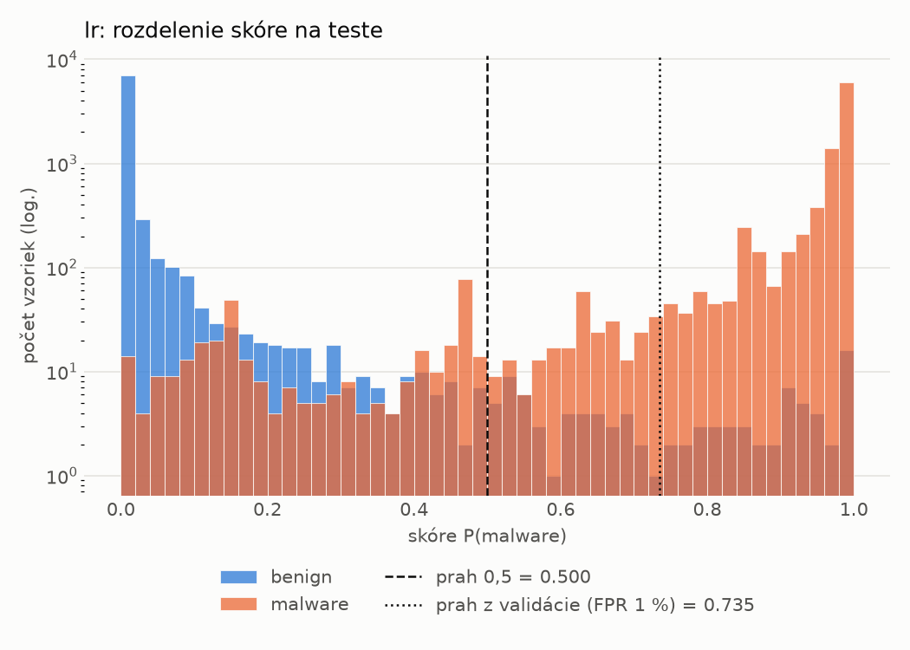
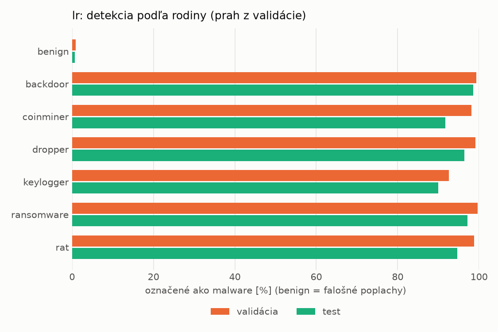
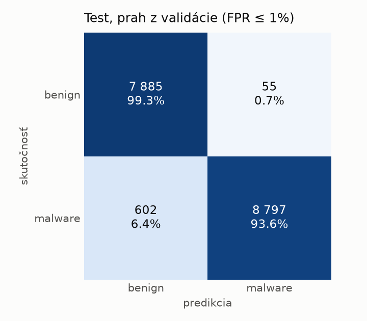
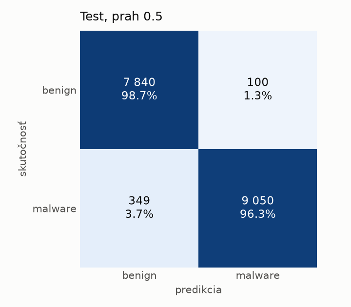

# static/lr – beh `20261104-184059`

> Automaticky generované (`src/training/run_tabular.py`). Konfigurácia: `config.yaml`, protokol: `protocol.yaml`.

- **Model:** `logreg` – logistická regresia s L2 regularizáciou (vstup signed log1p + štandardizácia)
- **Ladenie:** bez ladenia – hyperparametre prevzaté z `runs_final/static/lr/20261101-213555`
- **Finálne modely:** seedy [0, 1, 2]; hodnoty sú priemer ± smerodajná odchýlka cez seedy
- **Najlepšie hyperparametre:** `{"max_iter": 2000, "C": 0.00515917154582608}`

## Detekčná kvalita (bez prahu)
| metrika | train (podvzorka) | validácia | test |
|---|---|---|---|
| ROC-AUC | 0.9998 ± 0.0000 | 0.9986 ± 0.0000 | 0.9964 ± 0.0000 |
| PR-AUC | 0.9999 ± 0.0000 | 0.9976 ± 0.0000 | 0.9946 ± 0.0000 |
| TPR pri FPR 1 % | 0.9973 ± 0.0000 | 0.9852 ± 0.0000 | 0.9599 ± 0.0000 |
| TPR pri FPR 0,1 % | 0.9507 ± 0.0000 | 0.7878 ± 0.0000 | 0.0671 ± 0.0000 |
| log loss | 0.0257 ± 0.0000 | 0.0404 ± 0.0000 | 0.0749 ± 0.0000 |
| Brier skóre | 0.0056 ± 0.0000 | 0.0092 ± 0.0000 | 0.0192 ± 0.0000 |

Rozdiel ROC-AUC train − validácia: **0.0012** (veľký rozdiel = preučenie).

## Pri prahu z validácie (FPR ≤ 1% na validácii)
| metrika | train (podvzorka) | validácia | test |
|---|---|---|---|
| accuracy | 0.9895 ± 0.0000 | 0.9872 ± 0.0000 | 0.9621 ± 0.0000 |
| balanced accuracy | 0.9909 ± 0.0000 | 0.9879 ± 0.0000 | 0.9645 ± 0.0000 |
| precision | 0.9980 ± 0.0000 | 0.9944 ± 0.0000 | 0.9938 ± 0.0000 |
| recall (TPR) | 0.9850 ± 0.0000 | 0.9852 ± 0.0000 | 0.9360 ± 0.0000 |
| FPR | 0.0032 ± 0.0000 | 0.0094 ± 0.0000 | 0.0069 ± 0.0000 |
| F1 | 0.9915 ± 0.0000 | 0.9897 ± 0.0000 | 0.9640 ± 0.0000 |
| MCC | 0.9779 ± 0.0000 | 0.9727 ± 0.0000 | 0.9259 ± 0.0000 |

## Pri pevnom prahu 0.5
| metrika | train (podvzorka) | validácia | test |
|---|---|---|---|
| accuracy | 0.9928 ± 0.0000 | 0.9876 ± 0.0000 | 0.9741 ± 0.0000 |
| balanced accuracy | 0.9929 ± 0.0000 | 0.9866 ± 0.0000 | 0.9751 ± 0.0000 |
| precision | 0.9958 ± 0.0000 | 0.9896 ± 0.0000 | 0.9891 ± 0.0000 |
| recall (TPR) | 0.9926 ± 0.0000 | 0.9908 ± 0.0000 | 0.9629 ± 0.0000 |
| FPR | 0.0068 ± 0.0000 | 0.0176 ± 0.0000 | 0.0126 ± 0.0000 |
| F1 | 0.9942 ± 0.0000 | 0.9902 ± 0.0000 | 0.9758 ± 0.0000 |
| MCC | 0.9847 ± 0.0000 | 0.9736 ± 0.0000 | 0.9484 ± 0.0000 |

## Výpočtové nároky (seed 0, testovacia množina)
| meranie | hodnota |
|---|---|
| tréning finálneho modelu | 1.8 s (priemer cez seedy) |
| ladenie spolu | 0 s |
| počet parametrov / uzlov | 2 319 |
| veľkosť modelu na disku | 0.07 MB |
| transformácia vstupu – latencia (1 vlákno) | 0.021 ms |
| transformácia vstupu – priepustnosť | 44 806 vzoriek/s |
| CPU latencia modelu (batch 1, 1 vlákno) | 0.006 ms (p95 0.007) |
| CPU priepustnosť (24 vlákien) | 295 891 vzoriek/s |

## Grafy
| | |
|---|---|
|  |  |
|  |  |
|  |  |
|  |  |

## Súbory
`metrics.json` (všetky metriky po seedoch vrátane rodín), `timing.json`, `hpo_trials.csv`,
`predictions/<časť>_seed<N>.parquet` (sha256, family, label, score), `model/seed_<N>/`, `log.txt`.
