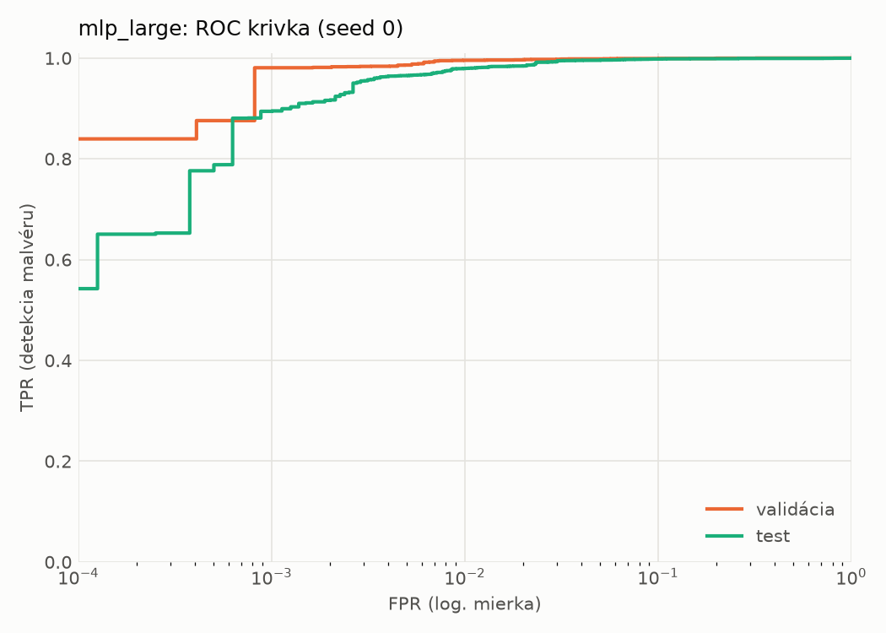
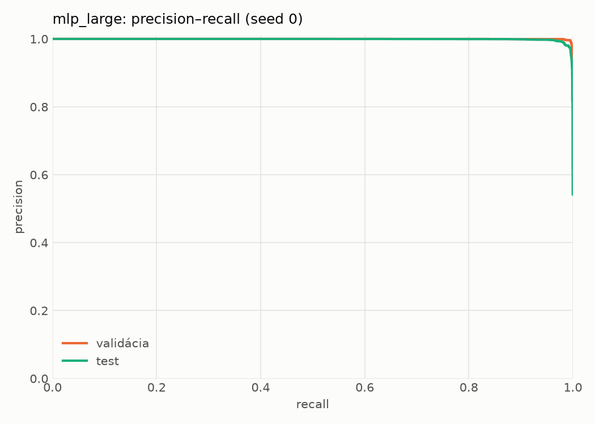
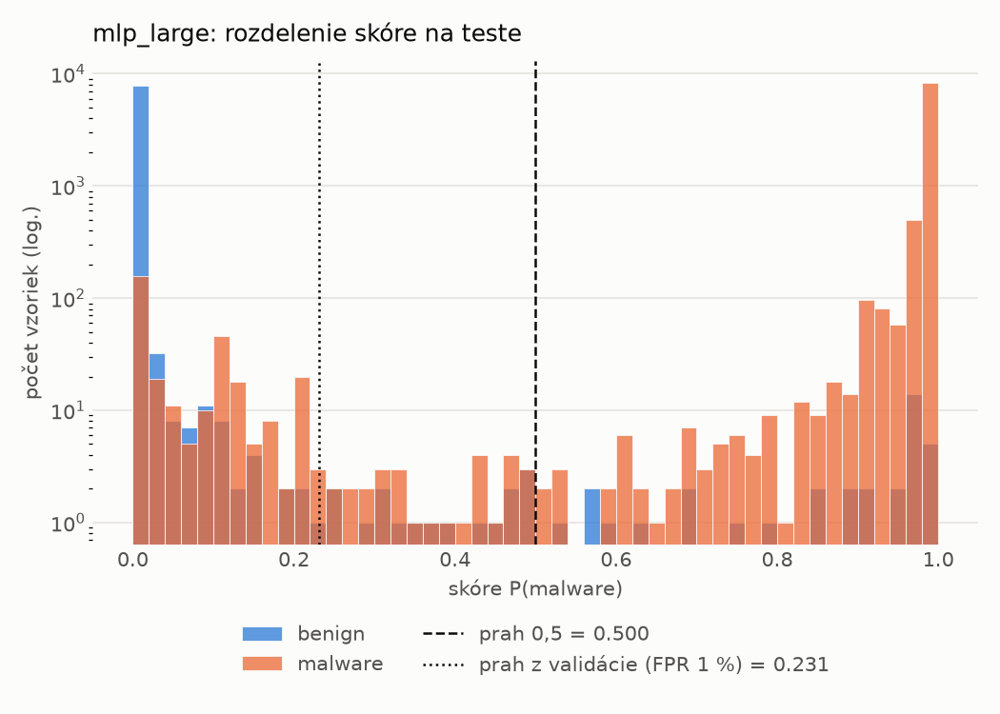
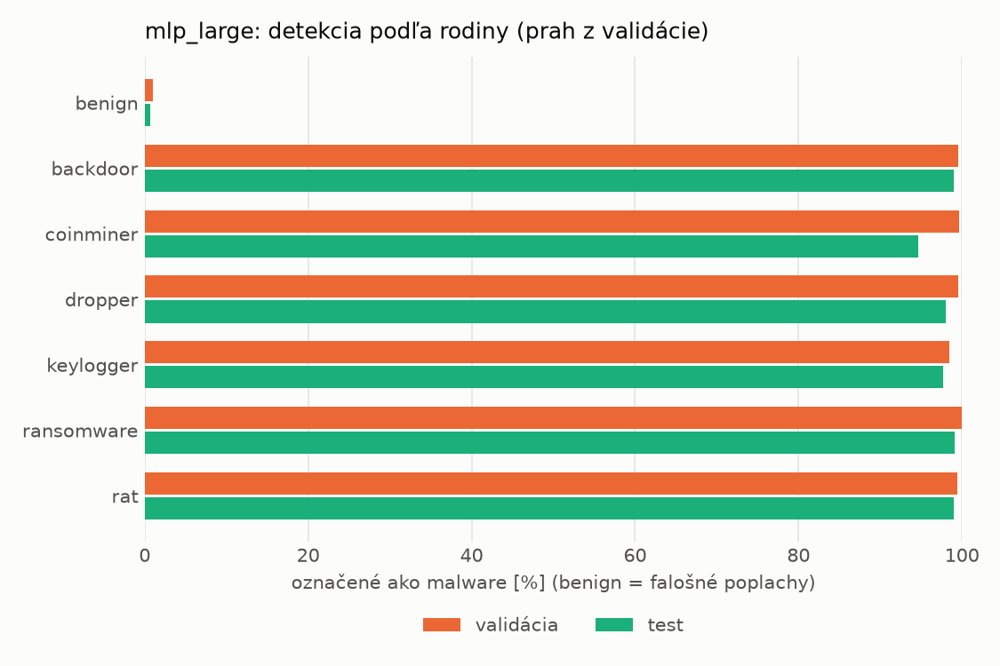
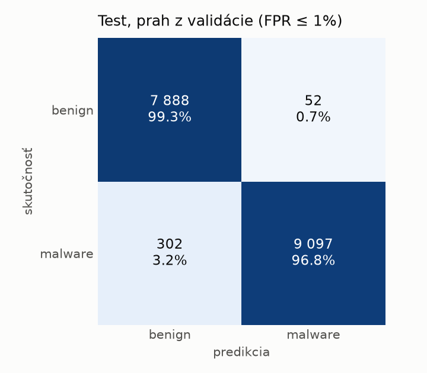
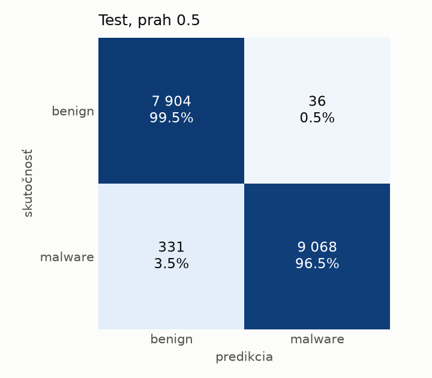
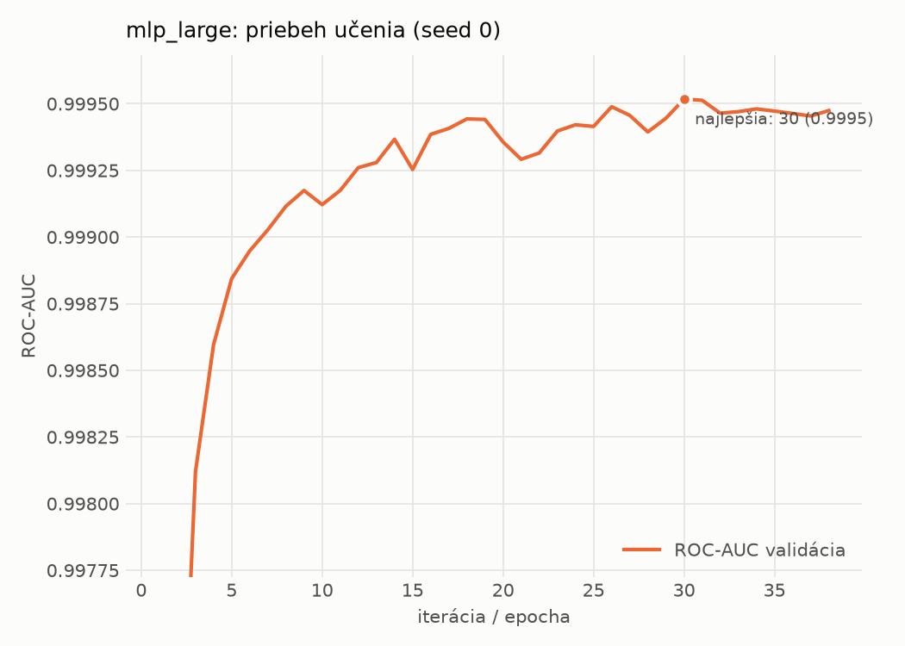

# static/mlp_large – beh `20261104-185858`

> Automaticky generované (`src/training/run_tabular.py`). Konfigurácia: `config.yaml`, protokol: `protocol.yaml`.

- **Model:** `mlp` – veľká neurónová sieť (3–5 skrytých vrstiev, 512–2048 neurónov), kandidát na učiteľa
- **Ladenie:** bez ladenia – hyperparametre prevzaté z `runs_final/static/mlp_large/20261101-235239`
- **Finálne modely:** seedy [0, 1, 2]; hodnoty sú priemer ± smerodajná odchýlka cez seedy
- **Najlepšie hyperparametre:** `{"max_epochs": 100, "patience": 8, "hidden_layers": 5, "hidden_width": 512, "width_decay": 0.5, "dropout": 0.4556986332296347, "lr": 0.00015070674125138616, "weight_decay": 0.0036646034219705954, "batch_size": 1024}`

## Detekčná kvalita (bez prahu)
| metrika | train (podvzorka) | validácia | test |
|---|---|---|---|
| ROC-AUC | 1.0000 ± 0.0000 | 0.9996 ± 0.0000 | 0.9985 ± 0.0002 |
| PR-AUC | 1.0000 ± 0.0000 | 0.9998 ± 0.0000 | 0.9988 ± 0.0001 |
| TPR pri FPR 1 % | 0.9997 ± 0.0000 | 0.9955 ± 0.0001 | 0.9800 ± 0.0007 |
| TPR pri FPR 0,1 % | 0.9973 ± 0.0004 | 0.9800 ± 0.0018 | 0.8944 ± 0.0036 |
| log loss | 0.0235 ± 0.0057 | 0.0381 ± 0.0045 | 0.0840 ± 0.0025 |
| Brier skóre | 0.0021 ± 0.0003 | 0.0058 ± 0.0001 | 0.0198 ± 0.0012 |

Rozdiel ROC-AUC train − validácia: **0.0004** (veľký rozdiel = preučenie).

## Pri prahu z validácie (FPR ≤ 1% na validácii)
| metrika | train (podvzorka) | validácia | test |
|---|---|---|---|
| accuracy | 0.9978 ± 0.0002 | 0.9937 ± 0.0001 | 0.9794 ± 0.0004 |
| balanced accuracy | 0.9974 ± 0.0003 | 0.9931 ± 0.0002 | 0.9805 ± 0.0004 |
| precision | 0.9976 ± 0.0004 | 0.9945 ± 0.0003 | 0.9944 ± 0.0007 |
| recall (TPR) | 0.9988 ± 0.0002 | 0.9955 ± 0.0001 | 0.9674 ± 0.0004 |
| FPR | 0.0040 ± 0.0007 | 0.0093 ± 0.0005 | 0.0065 ± 0.0008 |
| F1 | 0.9982 ± 0.0001 | 0.9950 ± 0.0001 | 0.9807 ± 0.0003 |
| MCC | 0.9953 ± 0.0003 | 0.9865 ± 0.0002 | 0.9589 ± 0.0007 |

## Pri pevnom prahu 0.5
| metrika | train (podvzorka) | validácia | test |
|---|---|---|---|
| accuracy | 0.9978 ± 0.0003 | 0.9938 ± 0.0001 | 0.9759 ± 0.0026 |
| balanced accuracy | 0.9976 ± 0.0003 | 0.9937 ± 0.0001 | 0.9774 ± 0.0024 |
| precision | 0.9980 ± 0.0004 | 0.9958 ± 0.0003 | 0.9958 ± 0.0004 |
| recall (TPR) | 0.9984 ± 0.0000 | 0.9944 ± 0.0002 | 0.9595 ± 0.0046 |
| FPR | 0.0032 ± 0.0007 | 0.0071 ± 0.0005 | 0.0048 ± 0.0004 |
| F1 | 0.9982 ± 0.0002 | 0.9951 ± 0.0001 | 0.9773 ± 0.0025 |
| MCC | 0.9953 ± 0.0005 | 0.9868 ± 0.0002 | 0.9523 ± 0.0050 |

## Výpočtové nároky (seed 0, testovacia množina)
| meranie | hodnota |
|---|---|
| tréning finálneho modelu | 6.1 s (priemer cez seedy) |
| ladenie spolu | 0 s |
| počet parametrov / uzlov | 1 363 905 |
| veľkosť modelu na disku | 5.53 MB |
| transformácia vstupu – latencia (1 vlákno) | 0.042 ms |
| transformácia vstupu – priepustnosť | 38 933 vzoriek/s |
| CPU latencia modelu (batch 1, 1 vlákno) | 0.262 ms (p95 0.308) |
| CPU priepustnosť (24 vlákien) | 83 098 vzoriek/s |
| GPU latencia (batch 1) | 0.620 ms (p95 0.771) |
| GPU priepustnosť | 82 198 vzoriek/s |
| GPU špičková pamäť | 1439 MB |

## Grafy
| | |
|---|---|
|  |  |
|  |  |
|  |  |
|  |  |

## Súbory
`metrics.json` (všetky metriky po seedoch vrátane rodín), `timing.json`, `hpo_trials.csv`,
`predictions/<časť>_seed<N>.parquet` (sha256, family, label, score), `model/seed_<N>/`, `log.txt`.
