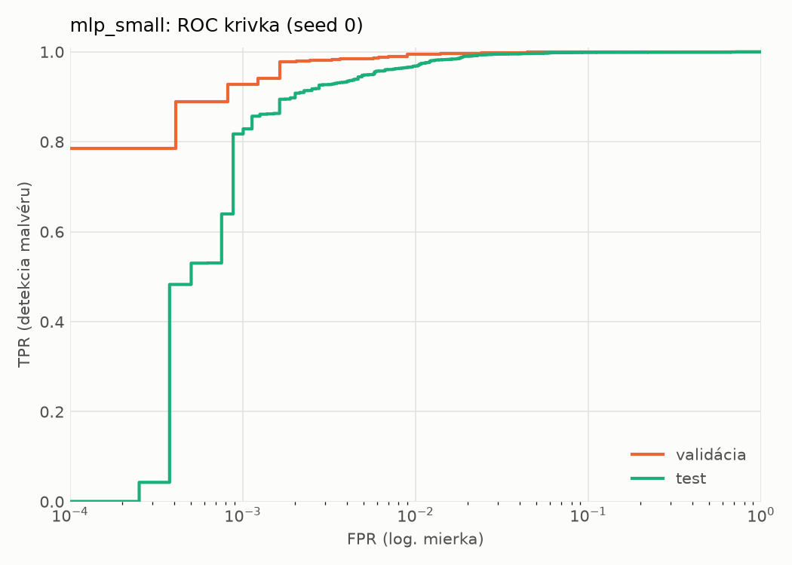
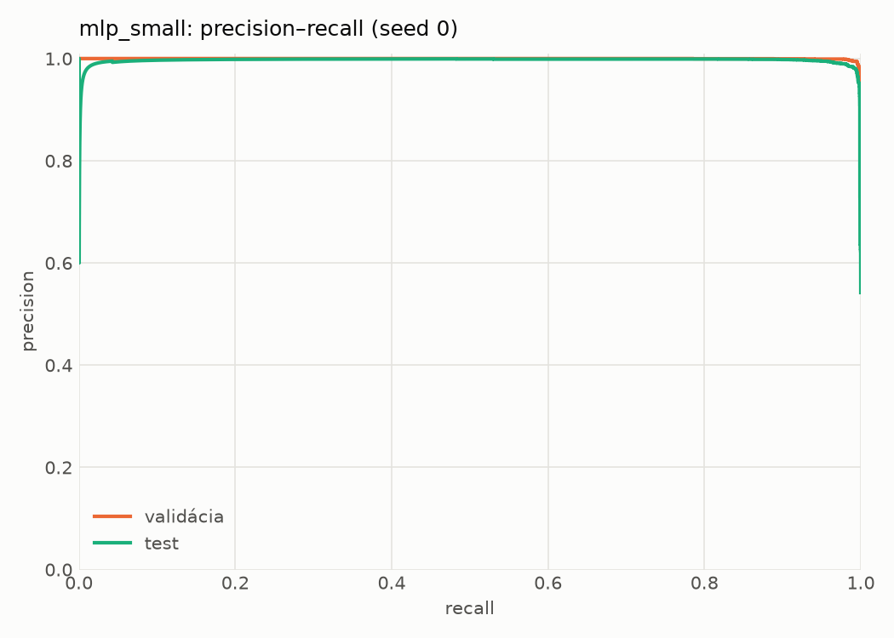
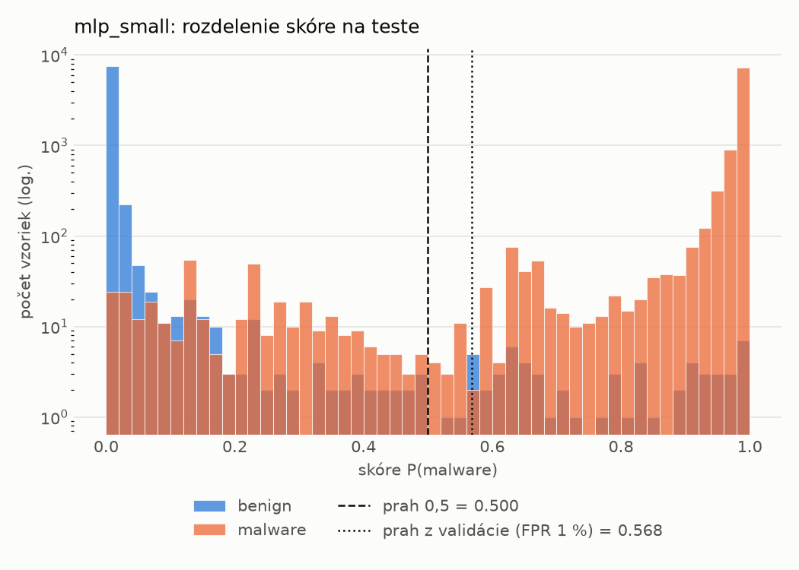
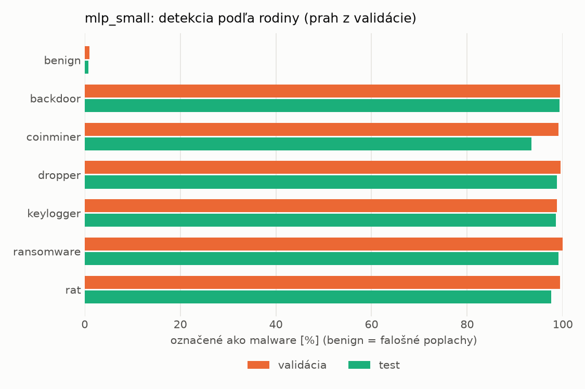
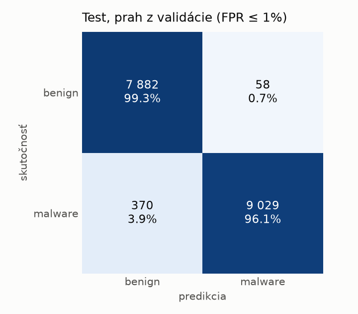
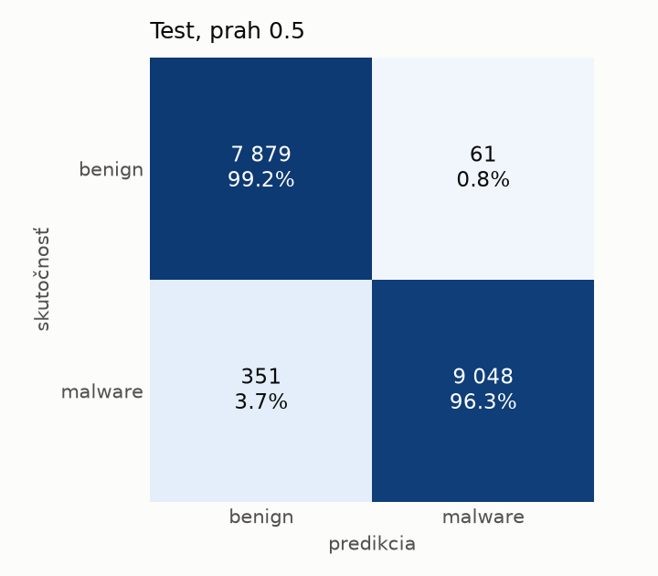
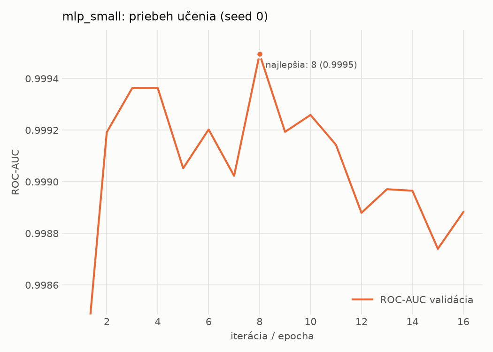

# static/mlp_small – beh `20261104-185839`

> Automaticky generované (`src/training/run_tabular.py`). Konfigurácia: `config.yaml`, protokol: `protocol.yaml`.

- **Model:** `mlp` – malá neurónová sieť (1–2 skryté vrstvy), kandidát na ľahkého študenta
- **Ladenie:** bez ladenia – hyperparametre prevzaté z `runs_final/static/mlp_small/20261101-235005`
- **Finálne modely:** seedy [0, 1, 2]; hodnoty sú priemer ± smerodajná odchýlka cez seedy
- **Najlepšie hyperparametre:** `{"width_decay": 0.5, "max_epochs": 100, "patience": 8, "hidden_layers": 2, "hidden_width": 32, "dropout": 0.15212112147976886, "lr": 0.0005958389350068958, "weight_decay": 5.34293726127978e-05, "batch_size": 512}`

## Detekčná kvalita (bez prahu)
| metrika | train (podvzorka) | validácia | test |
|---|---|---|---|
| ROC-AUC | 0.9999 ± 0.0000 | 0.9992 ± 0.0002 | 0.9976 ± 0.0002 |
| PR-AUC | 1.0000 ± 0.0000 | 0.9993 ± 0.0005 | 0.9964 ± 0.0007 |
| TPR pri FPR 1 % | 0.9992 ± 0.0007 | 0.9906 ± 0.0035 | 0.9683 ± 0.0027 |
| TPR pri FPR 0,1 % | 0.9860 ± 0.0076 | 0.9314 ± 0.0120 | 0.7559 ± 0.0644 |
| log loss | 0.0316 ± 0.0198 | 0.0441 ± 0.0184 | 0.0797 ± 0.0139 |
| Brier skóre | 0.0040 ± 0.0019 | 0.0078 ± 0.0017 | 0.0196 ± 0.0011 |

Rozdiel ROC-AUC train − validácia: **0.0007** (veľký rozdiel = preučenie).

## Pri prahu z validácie (FPR ≤ 1% na validácii)
| metrika | train (podvzorka) | validácia | test |
|---|---|---|---|
| accuracy | 0.9946 ± 0.0019 | 0.9905 ± 0.0022 | 0.9724 ± 0.0026 |
| balanced accuracy | 0.9950 ± 0.0015 | 0.9905 ± 0.0017 | 0.9741 ± 0.0023 |
| precision | 0.9979 ± 0.0007 | 0.9942 ± 0.0001 | 0.9945 ± 0.0008 |
| recall (TPR) | 0.9934 ± 0.0034 | 0.9906 ± 0.0035 | 0.9543 ± 0.0055 |
| FPR | 0.0034 ± 0.0011 | 0.0097 ± 0.0002 | 0.0062 ± 0.0010 |
| F1 | 0.9957 ± 0.0015 | 0.9924 ± 0.0018 | 0.9740 ± 0.0025 |
| MCC | 0.9887 ± 0.0040 | 0.9797 ± 0.0046 | 0.9455 ± 0.0048 |

## Pri pevnom prahu 0.5
| metrika | train (podvzorka) | validácia | test |
|---|---|---|---|
| accuracy | 0.9956 ± 0.0013 | 0.9910 ± 0.0021 | 0.9748 ± 0.0033 |
| balanced accuracy | 0.9956 ± 0.0010 | 0.9905 ± 0.0017 | 0.9762 ± 0.0030 |
| precision | 0.9973 ± 0.0014 | 0.9932 ± 0.0005 | 0.9935 ± 0.0006 |
| recall (TPR) | 0.9956 ± 0.0028 | 0.9925 ± 0.0031 | 0.9599 ± 0.0067 |
| FPR | 0.0044 ± 0.0024 | 0.0115 ± 0.0008 | 0.0075 ± 0.0007 |
| F1 | 0.9964 ± 0.0010 | 0.9929 ± 0.0017 | 0.9764 ± 0.0032 |
| MCC | 0.9907 ± 0.0027 | 0.9809 ± 0.0044 | 0.9501 ± 0.0063 |

## Výpočtové nároky (seed 0, testovacia množina)
| meranie | hodnota |
|---|---|
| tréning finálneho modelu | 3.2 s (priemer cez seedy) |
| ladenie spolu | 0 s |
| počet parametrov / uzlov | 74 849 |
| veľkosť modelu na disku | 0.36 MB |
| transformácia vstupu – latencia (1 vlákno) | 0.041 ms |
| transformácia vstupu – priepustnosť | 43 862 vzoriek/s |
| CPU latencia modelu (batch 1, 1 vlákno) | 0.096 ms (p95 0.109) |
| CPU priepustnosť (24 vlákien) | 109 632 vzoriek/s |
| GPU latencia (batch 1) | 0.388 ms (p95 0.426) |
| GPU priepustnosť | 81 009 vzoriek/s |
| GPU špičková pamäť | 789 MB |

## Grafy
| | |
|---|---|
|  |  |
|  |  |
|  |  |
|  |  |

## Súbory
`metrics.json` (všetky metriky po seedoch vrátane rodín), `timing.json`, `hpo_trials.csv`,
`predictions/<časť>_seed<N>.parquet` (sha256, family, label, score), `model/seed_<N>/`, `log.txt`.
