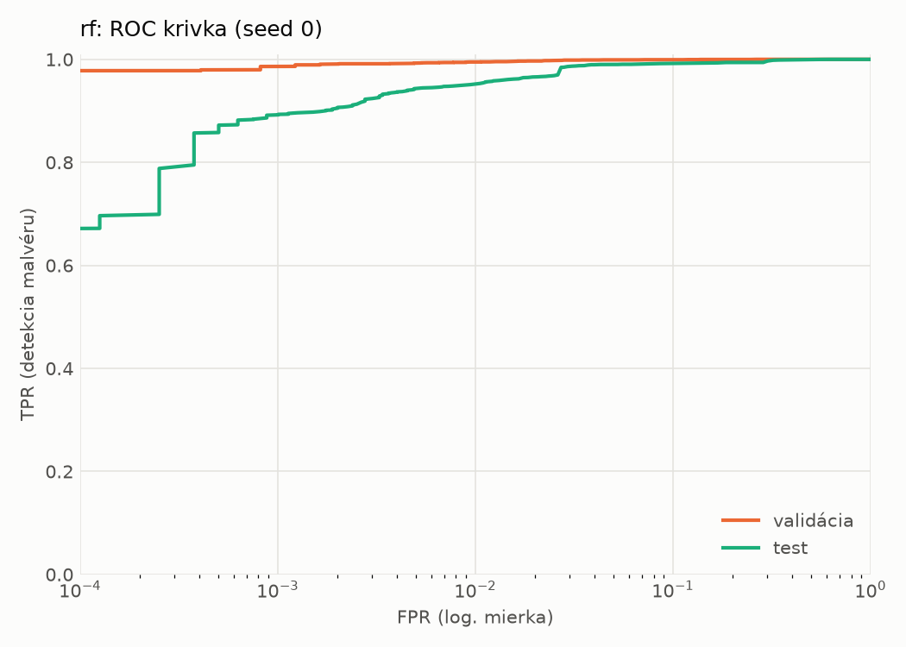
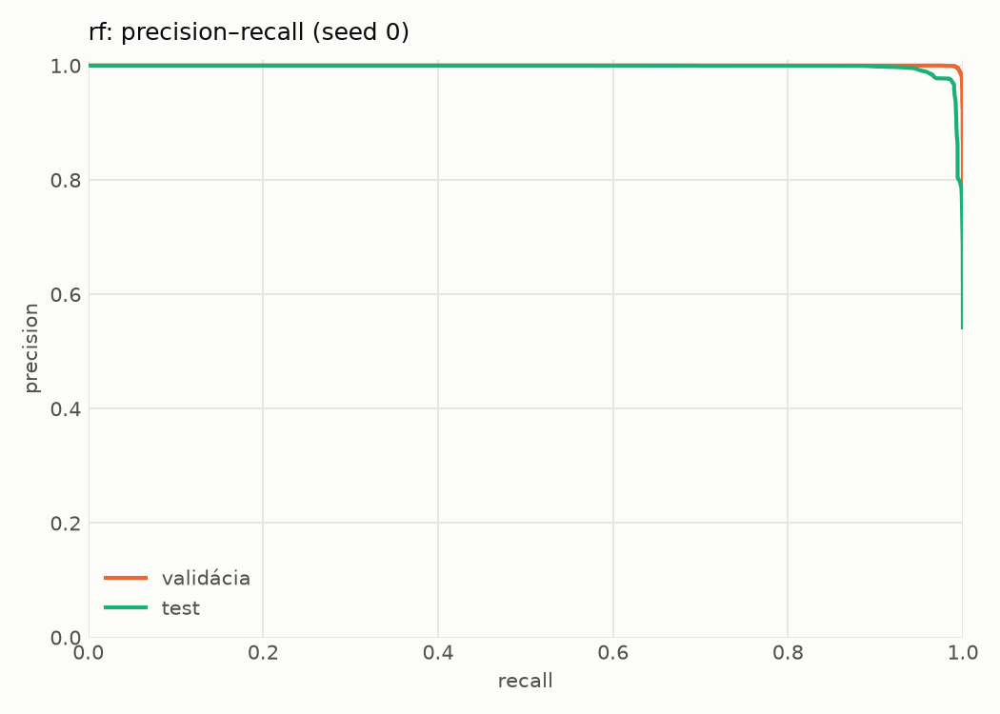
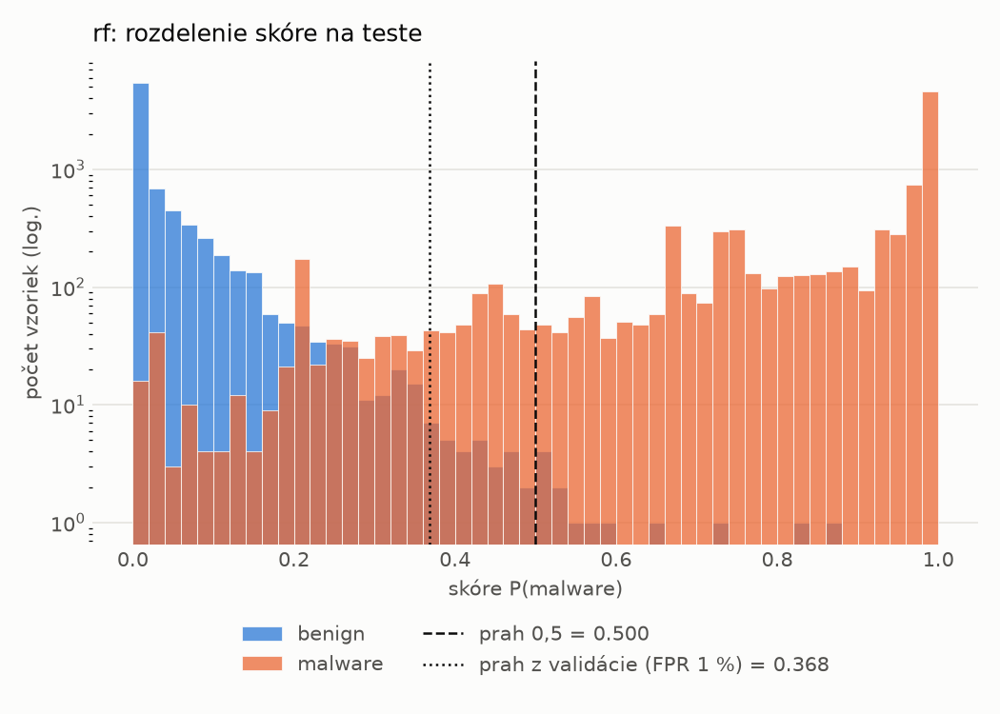
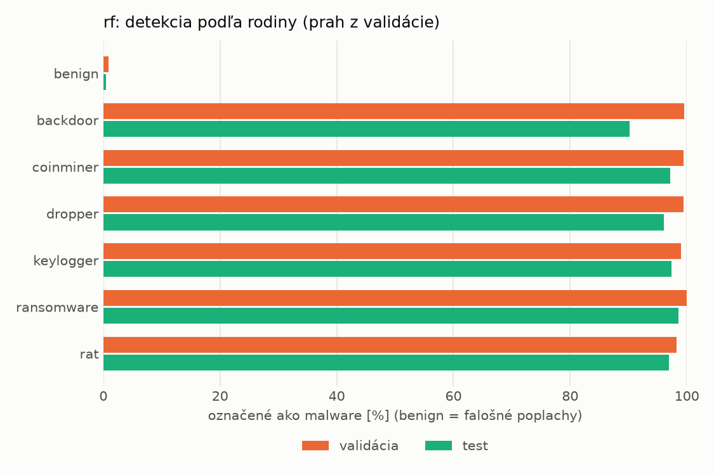
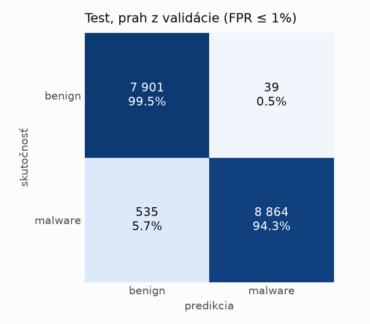
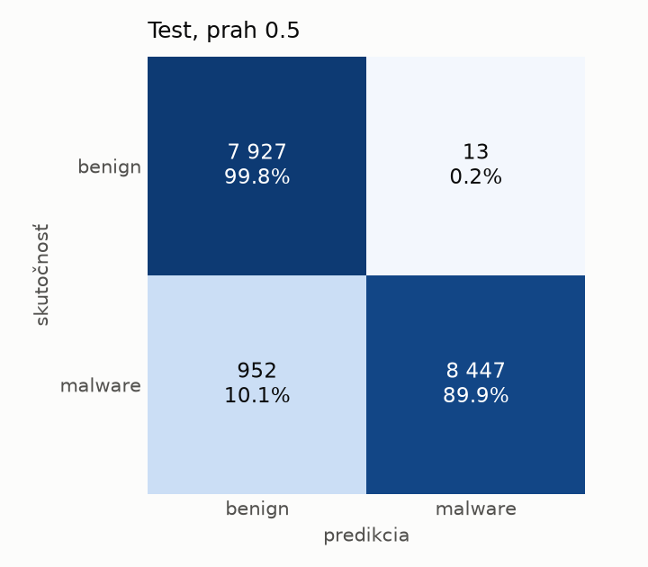

# static/rf – beh `20261104-184112`

> Automaticky generované (`src/training/run_tabular.py`). Konfigurácia: `config.yaml`, protokol: `protocol.yaml`.

- **Model:** `random_forest` – Random Forest (pôvodné hodnoty príznakov)
- **Ladenie:** bez ladenia – hyperparametre prevzaté z `runs_final/static/rf/20261101-213728`
- **Finálne modely:** seedy [0, 1, 2]; hodnoty sú priemer ± smerodajná odchýlka cez seedy
- **Najlepšie hyperparametre:** `{"n_estimators": 250, "max_depth": null, "min_samples_leaf": 1, "max_features": "sqrt"}`

## Detekčná kvalita (bez prahu)
| metrika | train (podvzorka) | validácia | test |
|---|---|---|---|
| ROC-AUC | 1.0000 ± 0.0000 | 0.9997 ± 0.0000 | 0.9961 ± 0.0009 |
| PR-AUC | 1.0000 ± 0.0000 | 0.9998 ± 0.0000 | 0.9972 ± 0.0004 |
| TPR pri FPR 1 % | 1.0000 ± 0.0000 | 0.9946 ± 0.0002 | 0.9559 ± 0.0035 |
| TPR pri FPR 0,1 % | 1.0000 ± 0.0000 | 0.9859 ± 0.0006 | 0.8928 ± 0.0012 |
| log loss | 0.0073 ± 0.0001 | 0.0260 ± 0.0001 | 0.1424 ± 0.0073 |
| Brier skóre | 0.0008 ± 0.0000 | 0.0060 ± 0.0000 | 0.0403 ± 0.0003 |

Rozdiel ROC-AUC train − validácia: **0.0003** (veľký rozdiel = preučenie).

## Pri prahu z validácie (FPR ≤ 1% na validácii)
| metrika | train (podvzorka) | validácia | test |
|---|---|---|---|
| accuracy | 1.0000 ± 0.0000 | 0.9931 ± 0.0002 | 0.9676 ± 0.0016 |
| balanced accuracy | 1.0000 ± 0.0000 | 0.9925 ± 0.0002 | 0.9697 ± 0.0014 |
| precision | 1.0000 ± 0.0000 | 0.9943 ± 0.0001 | 0.9951 ± 0.0008 |
| recall (TPR) | 1.0000 ± 0.0000 | 0.9946 ± 0.0002 | 0.9449 ± 0.0037 |
| FPR | 0.0000 ± 0.0000 | 0.0096 ± 0.0002 | 0.0055 ± 0.0010 |
| F1 | 1.0000 ± 0.0000 | 0.9945 ± 0.0002 | 0.9693 ± 0.0015 |
| MCC | 1.0000 ± 0.0000 | 0.9852 ± 0.0005 | 0.9364 ± 0.0029 |

## Pri pevnom prahu 0.5
| metrika | train (podvzorka) | validácia | test |
|---|---|---|---|
| accuracy | 1.0000 ± 0.0000 | 0.9934 ± 0.0003 | 0.9448 ± 0.0008 |
| balanced accuracy | 1.0000 ± 0.0000 | 0.9941 ± 0.0003 | 0.9490 ± 0.0008 |
| precision | 1.0000 ± 0.0000 | 0.9980 ± 0.0003 | 0.9986 ± 0.0003 |
| recall (TPR) | 1.0000 ± 0.0000 | 0.9916 ± 0.0001 | 0.8994 ± 0.0012 |
| FPR | 0.0000 ± 0.0000 | 0.0034 ± 0.0005 | 0.0015 ± 0.0003 |
| F1 | 1.0000 ± 0.0000 | 0.9948 ± 0.0002 | 0.9464 ± 0.0008 |
| MCC | 1.0000 ± 0.0000 | 0.9860 ± 0.0006 | 0.8950 ± 0.0015 |

## Výpočtové nároky (seed 0, testovacia množina)
| meranie | hodnota |
|---|---|
| tréning finálneho modelu | 20.2 s (priemer cez seedy) |
| ladenie spolu | 0 s |
| počet parametrov / uzlov | 346 690 |
| veľkosť modelu na disku | 28.07 MB |
| CPU latencia modelu (batch 1, 1 vlákno) | 7.376 ms (p95 8.000) |
| CPU priepustnosť (24 vlákien) | 129 882 vzoriek/s |

## Grafy
| | |
|---|---|
|  |  |
|  |  |
|  |  |
|  |  |

## Súbory
`metrics.json` (všetky metriky po seedoch vrátane rodín), `timing.json`, `hpo_trials.csv`,
`predictions/<časť>_seed<N>.parquet` (sha256, family, label, score), `model/seed_<N>/`, `log.txt`.
